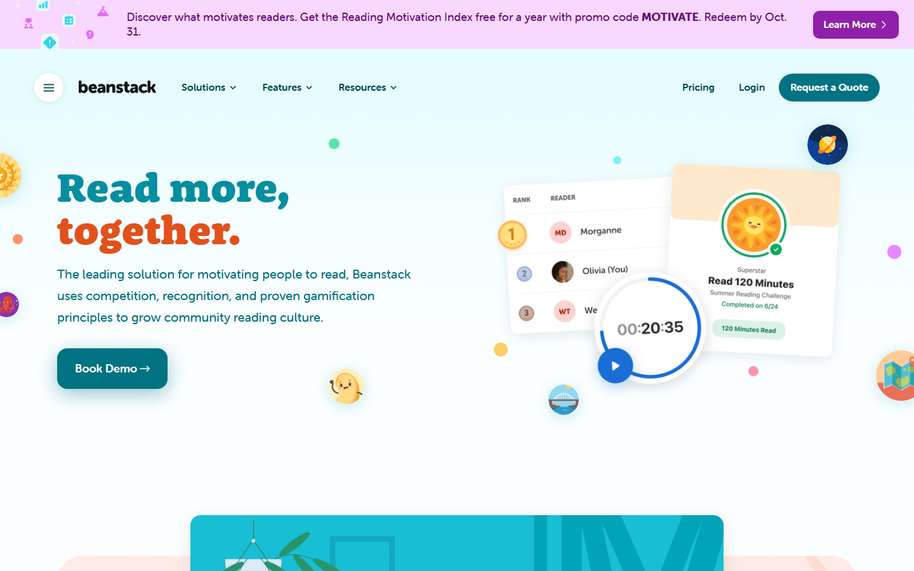
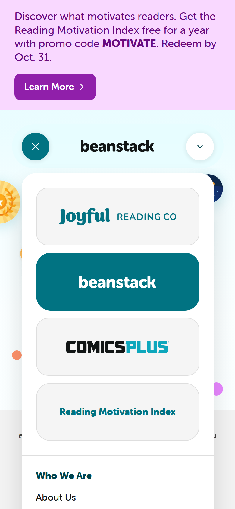
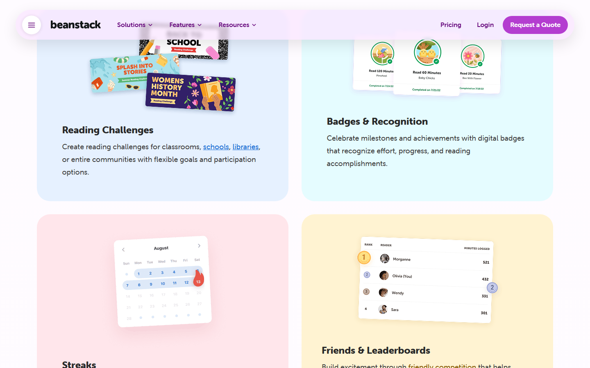
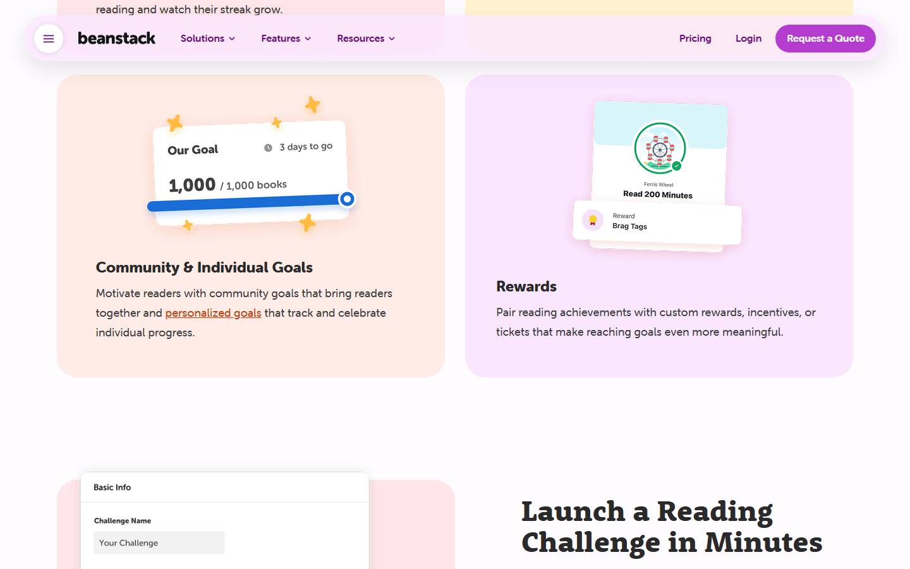
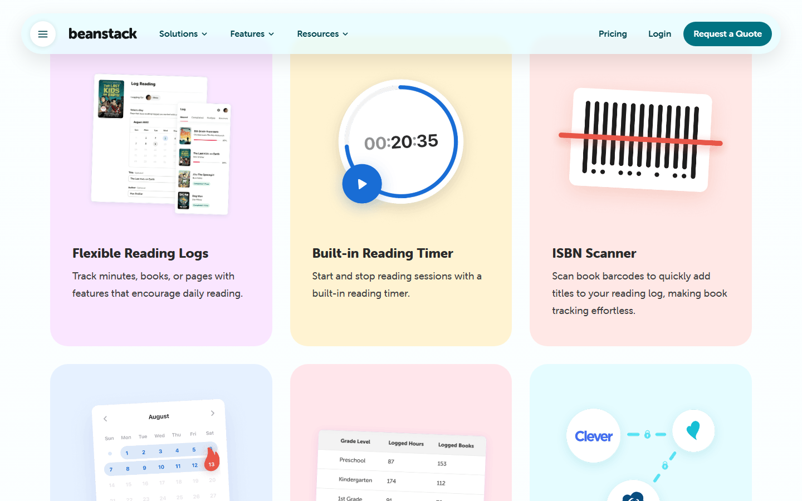
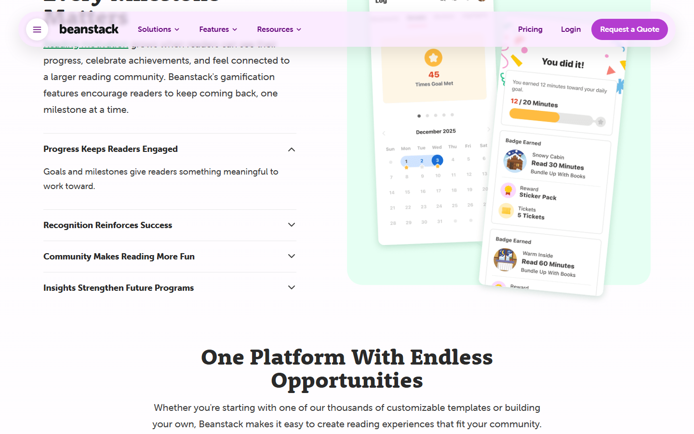
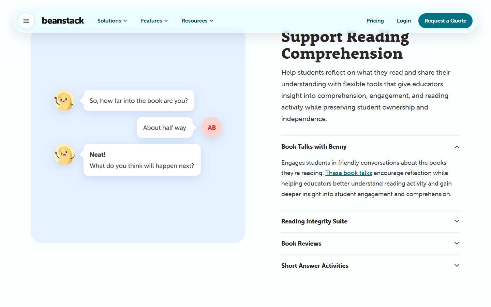
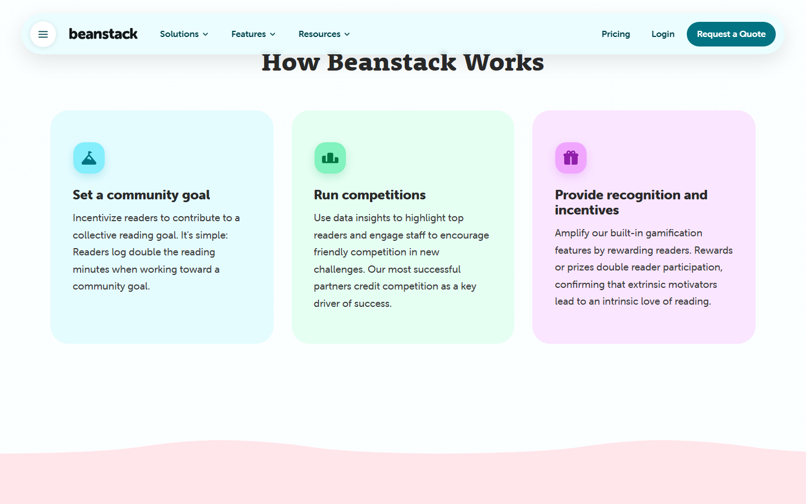
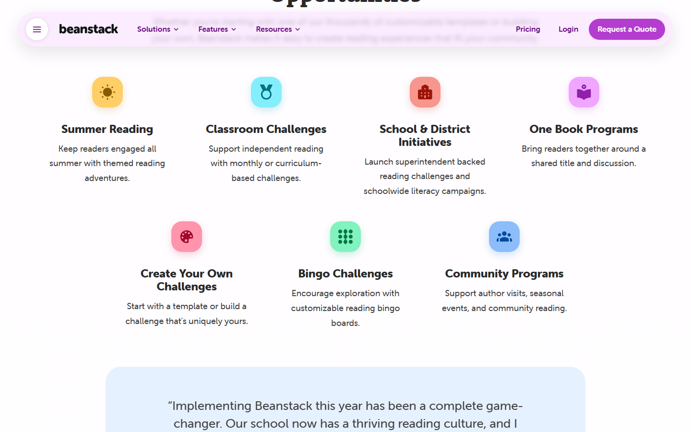

# Competitive review: Beanstack

Reviewed 2026-10-19 with Playwright (Chromium, 1440×900 desktop and 390×844 mobile). The crawl script is in [beanstack/crawl.mjs](beanstack/crawl.mjs); it visited the home page, Reading Challenges & Gamification, Reading Tracking & Accountability, Reading Data & Insights, Pricing, Solutions and the mobile menu, and extracted headings, copy, computed fonts, colours and radii.

Beanstack (Joyful Reading Co) sells reading challenges and reading logs to schools and libraries. It is a B2B product, so its marketing site is built to convince librarians and administrators. Shelfie is a household app for one reader and one grown-up. The lessons below are filtered for what transfers to Shelfie's goals in `AGENTS.md`: easy to use, a delight to use, responsive.

## What Beanstack does well

### 1. Colour is pastel-first, with saturated colour only for action and identity



Measured palette on the home page:

| Role | Values seen |
|---|---|
| Page and section backgrounds | `#e5fcff` (ice), `#e6fff3` (mint), `#fae6ff` (lilac), `#fff3d2` (cream), `#ffe8e6` (peach), `#e6f1ff` (sky) |
| Body text | `#424242`, `#2e3838` (never pure black) |
| Primary action | teal `#017382`, deep purple `#901faa` |
| Icon tiles | mint `#58e6a4`, gold `#ffce66`, sky `#84eefc`, rose `#ff95ac`, violet `#e887ff`, orange `#fe926a` |

Every card sits on a soft tinted background; the saturated hue appears only on the small icon tile inside it, the CTA and the headline. The effect is calm with points of joy. Shelfie's design system already has seven pastel cover colours (rose, sky, sun, mint, lilac, sage, peach) but uses them almost only on book covers and avatars; the rest of the shelf is white cards on grey.

### 2. Big radii everywhere, on everything

Radii measured: 10, 13, 14, 16, 20, 22, 24, 28, 32, 40 px, `100px`/`999px` pills, and blob shapes using eight-value `border-radius` for decorative backgrounds. Feature cards are 28–32 px, the top bar is a floating pill, every button is a pill, and the icon tiles are 16 px squircles. Nothing on the page has a square corner. Shelfie's cards and buttons are rounded but noticeably less so, which reads as "productivity app" next to Beanstack's "children's book".

### 3. The top bar is a floating pill that stays with you

The header is a white rounded capsule (shadowed, ~60 px tall) that sticks to the top on scroll and takes on a translucent tint of the section behind it. The hamburger is a circular button on the left, the primary CTA a dark pill on the right. On mobile, the same capsule holds a close button, the wordmark and a chevron; the menu opens as a white rounded sheet.



### 4. Features are shown as the real product, not icons





Each feature card has a cropped, slightly rotated screenshot of the actual UI floating on a tinted background with a soft shadow: the calendar streak, the leaderboard, the badge card, the goal progress bar with sparkles, the reading timer ring. The titles are two or three words ("Streaks", "Badges & Recognition", "Flexible Reading Logs") followed by one sentence. This is the single strongest pattern on the site.

### 5. Celebration is a visual language, not a toast



The "You did it!" card: confetti shapes around the title, a progress bar `12 / 20 Minutes` with the number in colour, then a stacked list of "Badge Earned" rows with a round illustrated badge, a label and the challenge name, then "Reward: Sticker Pack" and "Tickets: 5 Tickets". Progress, recognition and reward are shown together in one surface.

The badge itself is a consistent object: a circular illustration with a thin coloured ring and a small green check in the bottom-right corner when earned, a caption with the badge name and "Read 120 Minutes", and a "Completed on 7/24/22" date in green.

### 6. Streaks are a calendar, not a number

The streak is drawn as a month calendar with the consecutive days highlighted in a connected blue pill and a flame on today. A 5-day streak is visible at a glance as five joined cells; a broken day is a visible gap. This is far more legible to a child than a "🔥 5 days" chip.

### 7. The comprehension check is a conversation



"Book Talks with Benny": the mascot asks "So, how far into the book are you?", the child answers "About half way", and Benny replies "Neat! What do you think will happen next?". Questions arrive one at a time in a chat layout rather than as a form of empty textareas. This sits exactly on Shelfie's core loop (L1-004, L1-005).

### 8. Three-step "How it works" with tinted cards and icon tiles




Three equal cards, each on its own pastel, each with a 56 px coloured squircle icon, a bold title and a short paragraph. The programme grid uses the same icon tile centred over a title and a sentence. Simple, consistent, scannable.

### 9. Typography pairs a slab display face with a rounded sans

Fonts measured: `rooney-web` (a rounded slab serif) for display headings, `museo-sans-rounded` for everything else. Headlines are large (the H1 is roughly 72 px), two-tone ("Read more," in teal, "together." in orange) and never longer than four words. Body copy is 18 px with generous line height.

### 10. Mascot and decoration

Benny, a smiling bean, appears in the hero, the chat and in small floating circles. The hero has scattered pastel dots and small round illustrations at the page edges. Section boundaries are wavy, not straight. Together these make a marketing site for school administrators feel like a picture book.

## What does not transfer

- Leaderboards, competitions and community goals. Shelfie has one reader; competing with herself (streaks, badges) is already covered by L1-008 and L1-024.
- Reading timers and minutes. Shelfie's unit is the chapter.
- Mega-menus with 25 links, promo banners, "Request a Quote". Shelfie has four nav links and one CTA, which is right.
- Testimonial carousels, "As featured in", FAQs. Not needed for a family app.

## Recommendations for Shelfie

Ordered by impact for the reader's experience. Each one names the design-system pieces it would touch so the change can be made in the library first, per `AGENTS.md`.

### R1. Warm the shelf with tinted cards

Give the shelf's Keep Reading hero and the book cards a pastel surface derived from the book's cover colour (the seven cover colours already exist as tokens), instead of white on grey. Keep body text charcoal rather than black. Touches: `card`, `hero`, `book-card`, colour tokens for a `surface-tint-*` set.

### R2. Round everything further and float the top bar

Raise card radius to roughly 24–28 px and make every button a pill. Make the reader's top bar a floating capsule with a shadow that stays on scroll, keeping the streak chip and avatar in it. Touches: `--radius-*` tokens, `button`, `top-bar`.

### R3. Draw the streak as a calendar

Add a small month view, or a seven-day strip, beside the streak pill: logged days joined by a coloured band, today marked with a flame, gaps visible. Touches: `streak` (new variant), shelf page.

### R4. Turn chapter questions into a chat with a buddy

Present the comprehension questions one at a time as speech bubbles from a Shelfie mascot, with the reader's answer appearing as her bubble, and a short encouraging reply before the next question. Keep the textarea and dictation button; only the framing changes. This is the biggest "feels fun, not like homework" win. Touches: new `chat-bubble` component, log-chapter page, the `celebration` at the end.

### R5. Make the "chapter logged" celebration a stacked summary card

After logging, show one surface with: a confetti-framed "You did it!", the book's progress bar with the numbers in colour, any badge earned as a ring-illustrated row with a green check, and the streak day added. Touches: `celebration`, `badge`/`trophy`, `progress`.

### R6. Give badges a single visual form

Round illustration, coloured ring, green check when earned, name and "earned on" date underneath; the unearned state is the same shape greyed out. Use the same object on the shelf, in the celebration and in Dad's review. Touches: `trophy`/`badge`.

### R7. Marketing page: show the product floating on pastel

The marketing mock already uses a phone frame and floating chips. Beanstack's stronger move is many cropped, rotated screenshots of individual features on tinted cards with a short title and one sentence, plus a three-card "How it works" with icon tiles. Rework the "Inside the app" and "How it works" sections to that pattern, and add wavy section edges and scattered pastel dots in the hero. Touches: marketing page only (L1-028).

### R8. Headline voice

Short, two-tone display headlines with the second phrase in the accent colour ("Every chapter is a step **to a reward.**" is already close). Keep each section title to four words or fewer.

## Captures

All captures live in [beanstack/](beanstack/). Full-page captures of every page visited, plus the extracted `report.json`, are not committed; rerun the crawl script to regenerate them:

```
cd e2e && node ../docs/competitive-review/beanstack/crawl.mjs <output-dir>
```
