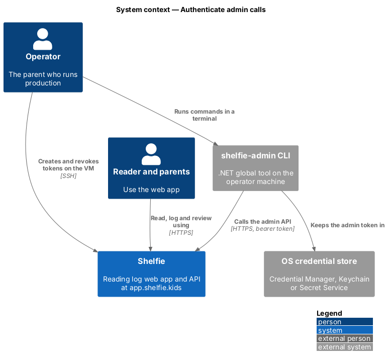
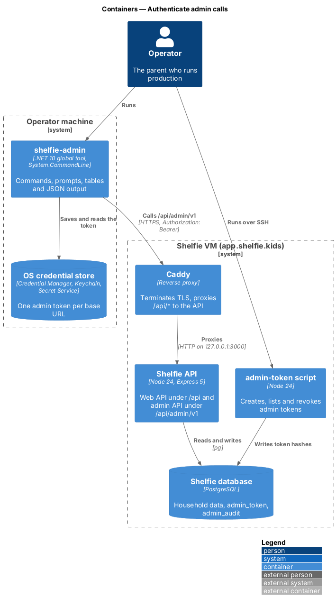
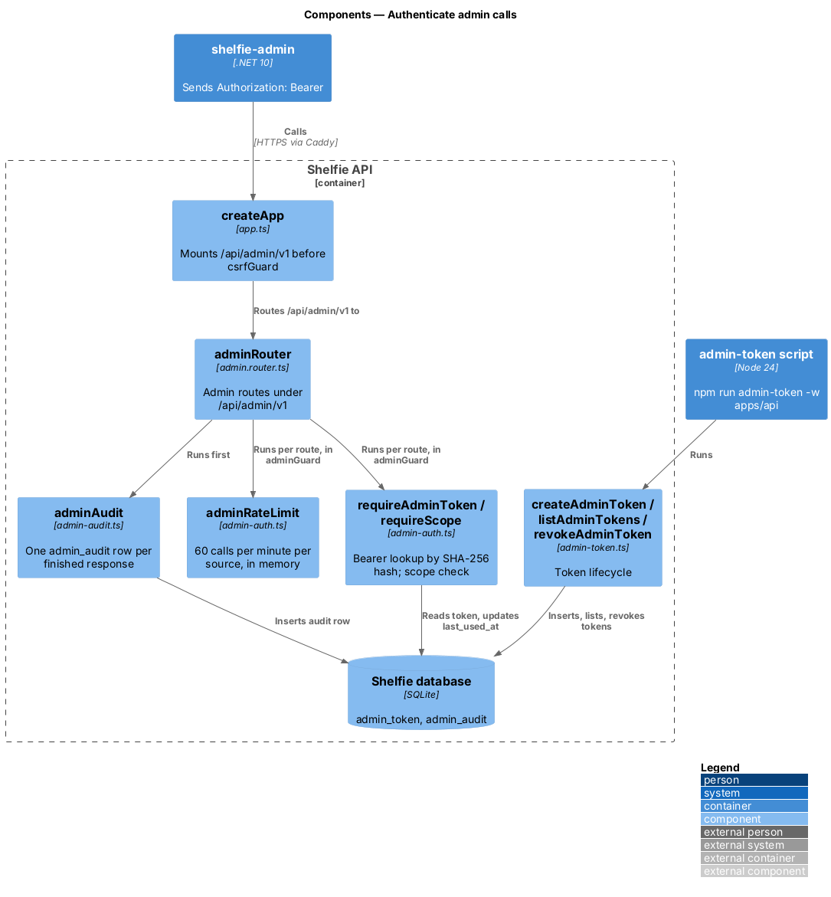
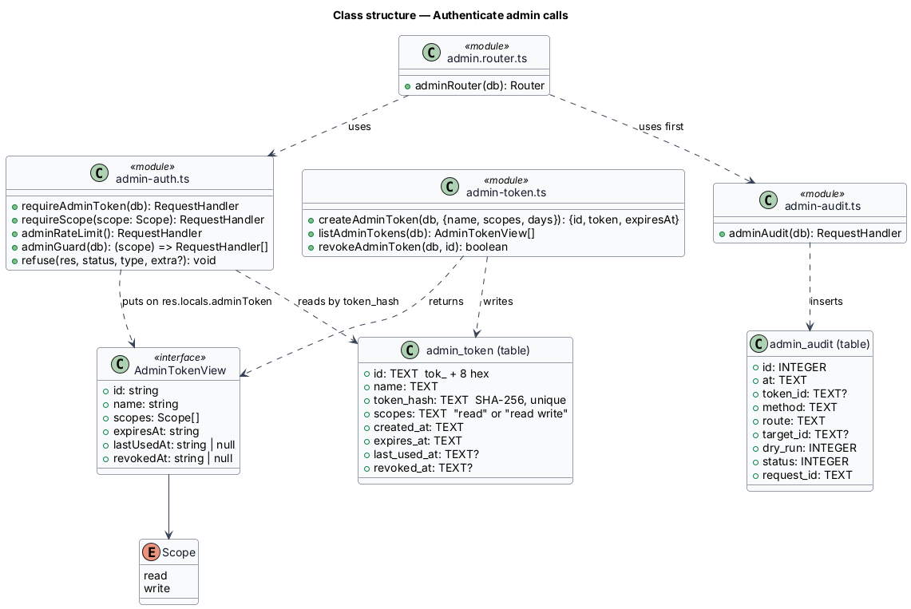
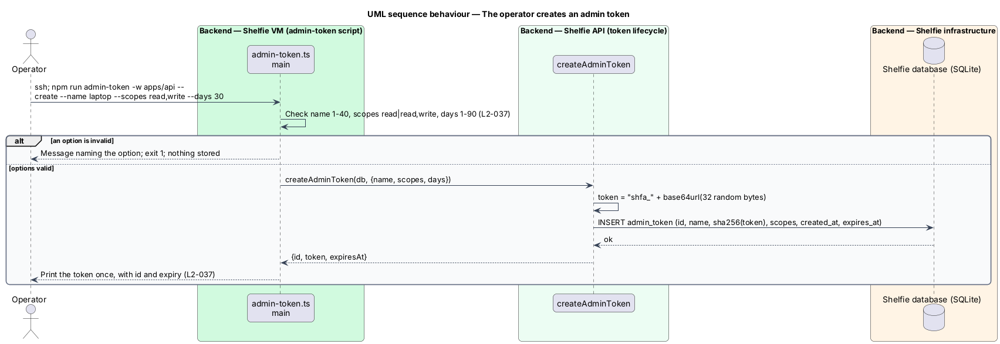
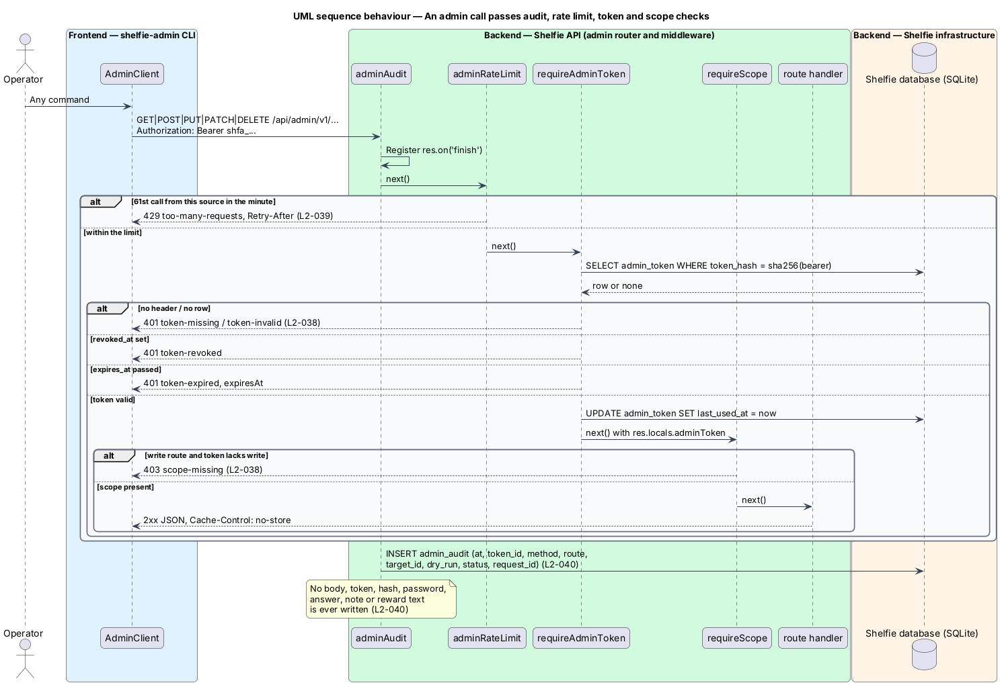

# Authenticate admin calls

## Overview

Shelfie is a web application that helps one child read books: she logs each chapter and answers short questions, and a parent in her household reviews the answers and gives rewards. One of the parents also runs the production service on a single Azure VM at `app.shelfie.kids`; that person is the **operator**. The operator queries and corrects production data with a command-line tool, `shelfie-admin`, which reaches production only through a dedicated HTTP API (L1-016).

This feature is the security boundary of that API, in the `admin-api` subsystem. It decides who may call the admin API, how often, and with what power, and it records every call. The admin endpoints themselves are the sibling feature `serve-admin-data`; the CLI side of sign-in is `admin-cli/sign-in-cli`.

Terms used below:

- **admin API** — set of HTTP endpoints under `/api/admin/v1/`, used only by `shelfie-admin`
- **admin token** — bearer secret of the form `shfa_` plus 43 base64url characters that authorizes calls to the admin API
- **scope** — permission carried by a token: `read` for queries, `write` for changes; a `write` token always also holds `read`
- **audit row** — one record in the `admin_audit` table describing one admin call and its outcome
- **source** — client address as Express reports it in `req.ip`

The admin API does not use web sessions, cookies or the CSRF header, and web sessions do not open it (ADR-0001, ADR-0005).

## Description

The slice adds two tables, three API modules, one server script and one line in `app.ts`.

- **`migrations/004-admin.sql`** — adds `admin_token` (`id`, `name`, `token_hash` unique, `scopes`, `created_at`, `expires_at`, `last_used_at`, `revoked_at`) and `admin_audit` (`id`, `at`, `token_id`, `method`, `route`, `target_id`, `dry_run`, `status`, `request_id`). The API applies the migration on start, like every other migration.
- **`admin-token.ts`** — `createAdminToken(db, { name, scopes, days })` draws 32 random bytes, forms the token `shfa_<base64url>`, stores its SHA-256 hash with an id `tok_<8 hex>` and an expiry `days` from now, and returns `{ id, token, expiresAt }`. `listAdminTokens(db)` returns id, name, scopes, expiry, last use and revocation time, never a value or hash. `revokeAdminToken(db, id)` sets `revoked_at`. When run directly (`npm run admin-token -w apps/api -- create|list|revoke`) the module parses its arguments, rejects a name outside 1-40 characters, scopes other than `read` or `read,write`, or days outside 1-90, and prints the new token once (L2-049).
- **`admin-auth.ts`** —
  - `adminRateLimit()` keeps a per-source count for the current minute in a `Map` and answers the 61st call with 429 `too-many-requests` and `Retry-After` (L2-051). Each `createApp` call gets its own limiter.
  - `requireAdminToken(db)` reads `Authorization: Bearer <token>`, hashes it, loads the matching row and refuses with 401 `token-missing`, `token-invalid`, `token-revoked` or `token-expired` (with `expiresAt`). A passing call updates `last_used_at` and puts `{ id, name, scopes, expiresAt }` on `res.locals.adminToken` (L2-050).
  - `requireScope(scope)` answers 403 `scope-missing` when the token lacks the scope.
  - `adminGuard(db)(scope)` returns the chain every admin route runs: note the route pattern and path id for the audit row, `adminRateLimit`, `requireAdminToken`, `requireScope(scope)`. The chain is applied per route rather than with `router.use`, so a refused call still records its route pattern and target id.
  - `refuse(res, status, type, extra)` sends every admin problem document with `requestId`.
- **`admin-audit.ts`** — `adminAudit(db)` is the admin router's first middleware. When the response finishes it inserts one audit row: time, `res.locals.adminToken?.id`, method, the route pattern noted by the guard (or `unmatched`), the noted path id, the `dryRun` query flag, status and `res.locals.requestId`. Nothing from the body or headers is read (L2-052, ADR-0006).
- **`admin.router.ts`** — `adminRouter(db)` applies `adminAudit`, then each route with `...guard('read')` or `...guard('write')`; `GET /whoami` returns the token from `res.locals`. Any other path answers 404 `not-found`.
- **`app.ts`** — mounts `app.use('/api/admin/v1', adminRouter(db))` after the `/api` security headers and before `csrfGuard`, so admin responses carry `Cache-Control: no-store` and the existing headers, and bearer calls are not asked for the browser-only CSRF header. No CORS middleware exists, so no `Access-Control-Allow-Origin` is sent (L2-053).
- **Request log** — the existing `requestLogging` line records the route pattern, never the URL, so target ids and tokens stay out of journald (L2-052).
- **Contract** — `apps/api/admin-api.yaml` (OpenAPI 3.1) defines the security scheme, the problem document and every endpoint.

Exposure, TLS and the decision against an IP allow-list are recorded in ADR-0005. Provisioning steps are in `docs/runbook.md`, "Admin CLI".

## Requirements

The feature realizes the following level-2 (L2) requirements. Each refines a level-1 (L1) requirement, cited by identifier.

| L2 ID | Refines (L1) | Requirement |
|-------|--------------|-------------|
| `L2-049` | `L1-017` | Admin tokens. The operator shall create, list and revoke admin tokens with a server-side script; a token shall carry a name, the scopes `read` or `read,write` and an expiry of 1-90 days (30 by default); only its SHA-256 hash shall be stored and the value shall be printed once. |
| `L2-050` | `L1-017` | Admin API authentication and least privilege. Every admin call shall carry a bearer token; missing, invalid, expired and revoked tokens shall be refused with 401 and a distinct type; a write without the `write` scope shall be refused with 403 `scope-missing`; web sessions and admin tokens shall never grant each other's access. |
| `L2-051` | `L1-017` | Admin API rate limit. The 61st admin call from one source within one minute shall be answered 429 with `Retry-After`. |
| `L2-052` | `L1-017` | Admin audit log. Every admin call, served or refused, shall write one audit row with time, token id, method, route, target id, dry-run flag, status and request id, and no secret or body. |
| `L2-053` | `L1-017` | Admin API exposure and versioning. Every endpoint shall be under `/api/admin/v1/`, described in `apps/api/admin-api.yaml`, served over HTTPS through the existing proxy, with `Cache-Control: no-store`, no CORS and no cookies; errors shall be problem documents with a request id. |

## Diagrams

### System context

The operator reaches production through the CLI over HTTPS and, once per token, over SSH to create the token; the reader and parents keep using the web app.

### Containers

The CLI calls Caddy, which proxies `/api/*` to the Node API; the `admin-token` script and the API share the PostgreSQL database that holds `admin_token` and `admin_audit`.

### Components

Inside the API, `createApp` mounts `adminRouter` ahead of `csrfGuard`; the router runs `adminAudit` first, and each route runs the `adminGuard` chain of `adminRateLimit`, `requireAdminToken` and `requireScope`.

### Class structure

The three modules read and write the two tables; `requireAdminToken` exposes the matched token to `adminAudit` and the routes through `res.locals.adminToken`.

### Behaviour — the operator creates an admin token

The script validates its options, stores only the hash and prints the token once (`L2-049`).

### Behaviour — an admin call passes audit, rate limit, token and scope checks

Each refusal ends the chain with a problem document; whatever the outcome, `adminAudit` writes one row when the response finishes (`L2-050`, `L2-051`, `L2-052`).

