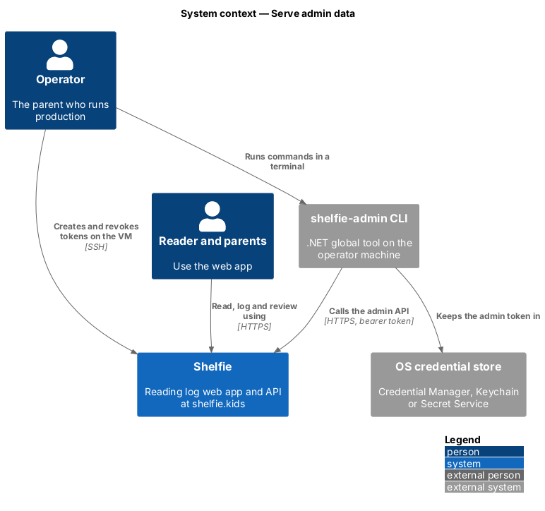
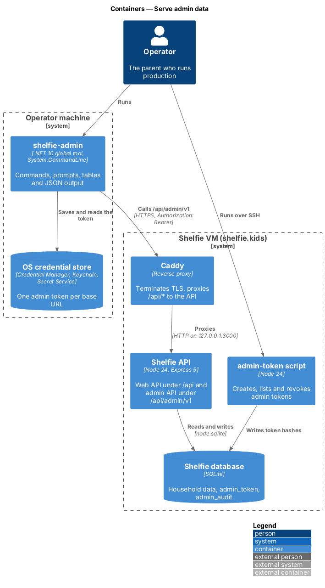
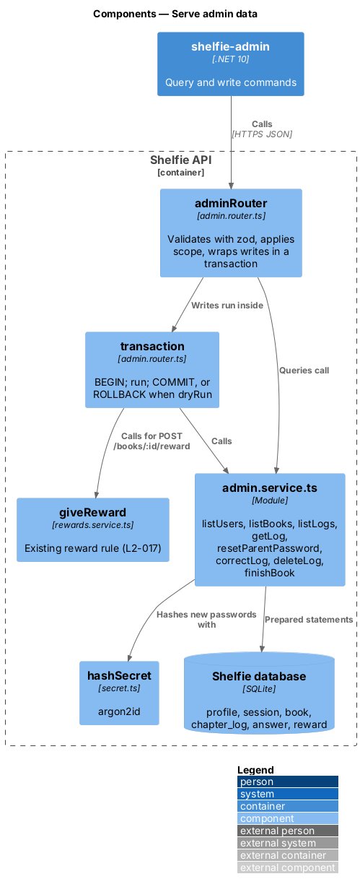
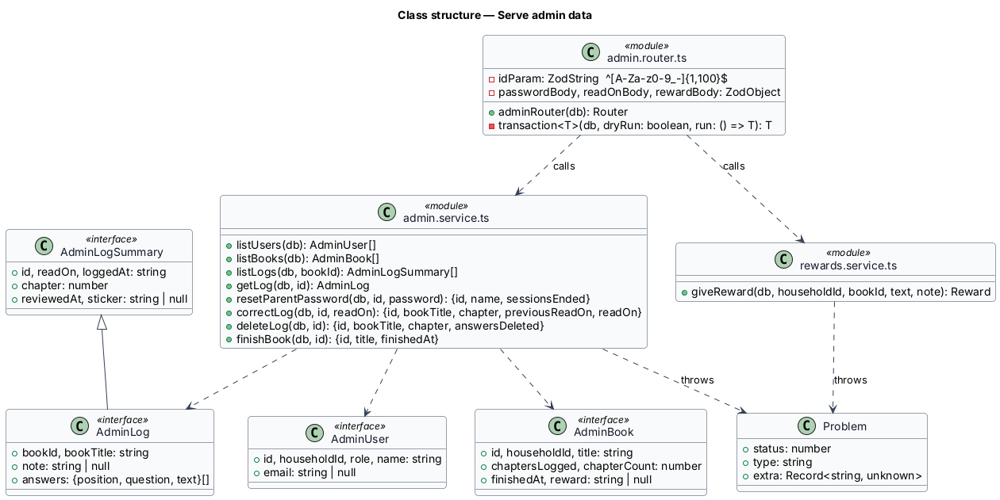
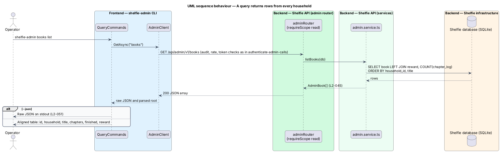
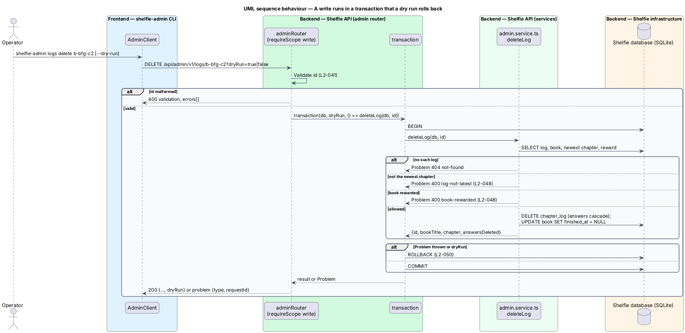

# Serve admin data

## Overview

Shelfie helps one child read books by logging chapters and answering questions, while a parent reviews the answers and gives rewards. The **operator**, the parent who runs production, sometimes needs to look at or fix production data by hand: a parent locked out of an account, a chapter logged on the wrong day, a book that should count as finished. The `shelfie-admin` CLI does this through the admin API (L1-016).

This feature is the set of admin endpoints in the `admin-api` subsystem. Every call has already passed the checks of the sibling feature `authenticate-admin-calls`. The endpoints see every household, because the operator runs the whole service.

Terms used below:

- **query endpoint** — admin `GET` endpoint that needs the `read` scope
- **write endpoint** — admin `PUT`, `PATCH`, `POST` or `DELETE` endpoint that needs the `write` scope
- **dry run** — write called with `?dryRun=true`, which validates and applies the change inside a transaction and then rolls it back
- **newest logged chapter** — chapter log with the highest chapter number in its book

## Description

- **`admin.router.ts`** — declares the routes listed below. Path ids pass the zod schema `^[A-Za-z0-9_-]{1,100}$`; bodies pass zod schemas with the same lengths as the web app. A failure returns 400 `validation` with `errors[]` (L2-053). Each write runs inside `transaction(db, dryRun, run)`, which issues `BEGIN`, calls `run`, and then `COMMIT`, or `ROLLBACK` when `dryRun` is true or `run` throws. A thrown `Problem` becomes a problem document with its status, type and the request id. Every write response carries `dryRun` (L2-062).
- **`admin.service.ts`** — one function per endpoint, each a few prepared statements:

| Route | Scope | Function | Rules |
|---|---|---|---|
| `GET /users` | read | `listUsers` | Every profile with id, household id, role, name, e-mail; no hash (L2-056) |
| `GET /books` | read | `listBooks` | Every book with chapters logged, chapter count, finished time and reward text (L2-057) |
| `GET /books/:id/logs` | read | `listLogs` | Logs in chapter order with read-on day, logged time, review time and sticker (L2-058) |
| `GET /logs/:id` | read | `getLog` | One log with book, note and every question and answer (L2-058) |
| `PUT /users/:id/password` | write | `resetParentPassword` | Parents only (`not-a-parent`); argon2id hash through `hashSecret`; deletes every session of that parent (L2-059) |
| `PATCH /logs/:id` | write | `correctLog` | `readOn` not after today in the household time zone (`future-date`) (L2-060) |
| `DELETE /logs/:id` | write | `deleteLog` | Newest logged chapter only (`log-not-latest`); refused when the book has a reward (`book-rewarded`); answers go by `ON DELETE CASCADE`; clears `book.finished_at` (L2-060) |
| `POST /books/:id/finish` | write | `finishBook` | Refused when already finished (`book-already-finished`) (L2-061) |
| `POST /books/:id/reward` | write | `giveReward` (existing, `rewards.service.ts`) | Called with the book's own household id; `book-not-finished`, `reward-exists` (L2-061) |
| `GET /profiles` | read | `listDirectoryProfiles` | Every author and volunteer with status and what they wrote; designed in `admin-cli/approve-profiles` (L2-145) |
| `POST /profiles/:id/approve` | write | `setProfileStatus` | Authors and volunteers only (`not-a-directory-profile`); status `approved`; designed in `admin-cli/approve-profiles` (L2-145) |
| `POST /profiles/:id/hide` | write | `setProfileStatus` | As approve, with status `hidden` (L2-145) |

- **Router helpers** — `idOf` and `bodyOf` validate the path id and body, `answer` turns a thrown `Problem` into a problem document, and `write` runs a change through `transaction` and adds `dryRun` to the result. `householdOfBook` finds the book's household so `giveReward` can run with the web app's own rules.
- **Reuse** — `giveReward`, its zod schema `giveRewardSchema` (exported from `review.router.ts`) and `hashSecret` are the web app's own functions, so the CLI and the web app apply the same rules. The reading streak is derived from `chapter_log.read_on` (`streak.ts`), so `correctLog` moves the streak without extra code.
- **Not found** — an unknown id answers 404 `not-found` (L2-053).
- **Authors and volunteers** — `GET /users` also lists authors and volunteers, whose household id is null (ADR-0018). `PUT /users/:id/password` stays parents only; an author or volunteer resets their own password by e-mail (L2-141).

## Requirements

The feature realizes the following level-2 (L2) requirements. Each refines a level-1 (L1) requirement, cited by identifier.

| L2 ID | Refines (L1) | Requirement |
|-------|--------------|-------------|
| `L2-053` | `L1-017` | Admin API exposure and versioning. Invalid input shall return 400 with field errors and change nothing; an unknown id shall return 404 `not-found`. |
| `L2-056` | `L1-016` | Query accounts. Every profile in every household shall be listed with id, household id, role, name and e-mail, and no password, PIN or hash. |
| `L2-057` | `L1-016` | Query books with progress and rewards. Every book shall be listed with id, household id, title, chapters logged out of chapter count, finished time and reward text. |
| `L2-058` | `L1-016` | Query chapter logs, answers and review status. A book's logs shall be listed in chapter order with review status; one log shall be shown with every question and answer. |
| `L2-059` | `L1-016` | Reset a parent's password. A parent's password shall be replaced and every session of that parent shall end; a reader's id shall be refused with `not-a-parent`. |
| `L2-060` | `L1-016` | Correct or delete a chapter log. The read-on day shall be correctable but not to a future day; only the newest logged chapter of a book without a reward shall be deletable. |
| `L2-061` | `L1-016` | Mark a book finished and give a reward. A book not yet finished shall be markable as finished; a reward shall follow the web app's rules (L2-017). |
| `L2-062` | `L1-016` | Safe writes. A dry run shall validate and apply the change in a transaction that is rolled back, change nothing, and be marked as a dry run in the audit row. |

## Diagrams

### System context

The admin endpoints are part of the Shelfie system and are called only by the operator's CLI.

### Containers

The endpoints run in the existing Node API and read and write the existing PostgreSQL database.

### Components

`adminRouter` validates input and wraps every write in `transaction`; `admin.service.ts` holds the queries and changes, and reuses `giveReward` and `hashSecret`.

### Class structure

Each service function returns a plain view type; rule failures are thrown as `Problem` and turned into problem documents by the router.

### Behaviour — a query returns rows from every household

`GET /books` returns all books with progress and reward; the CLI prints them as a table or passes the JSON through (`L2-057`, `L2-063`).

### Behaviour — a write runs in a transaction that a dry run rolls back

`DELETE /logs/:id` shows the rule checks and the transaction; with `dryRun=true` the same work is rolled back and the response says what would have changed (`L2-060`, `L2-062`).

