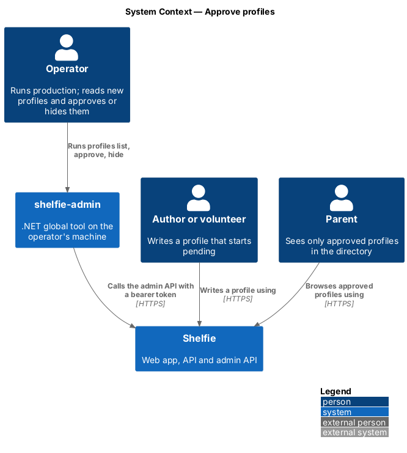
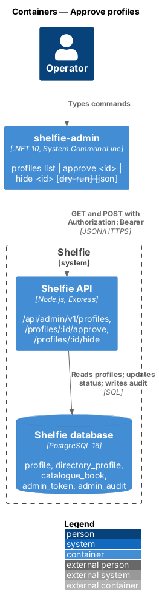
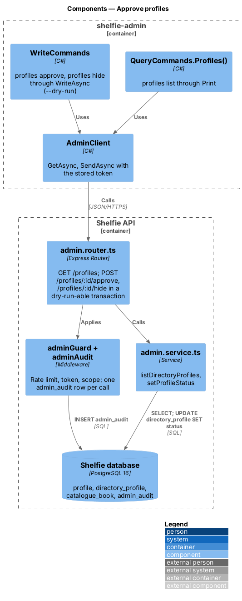
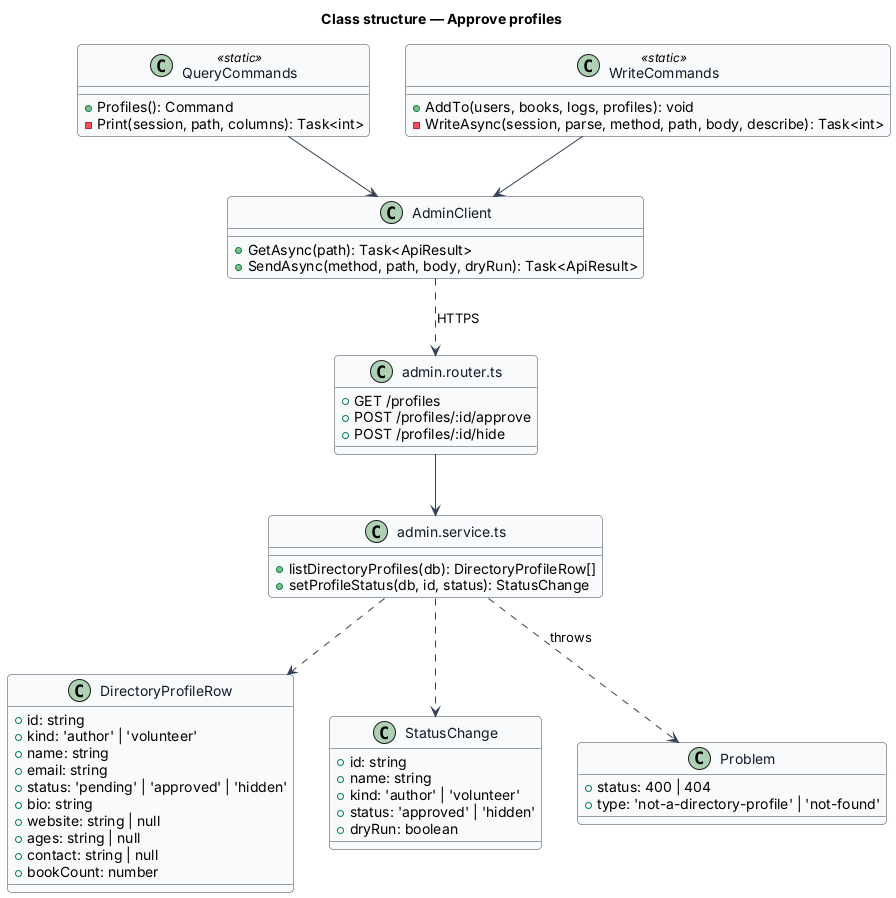
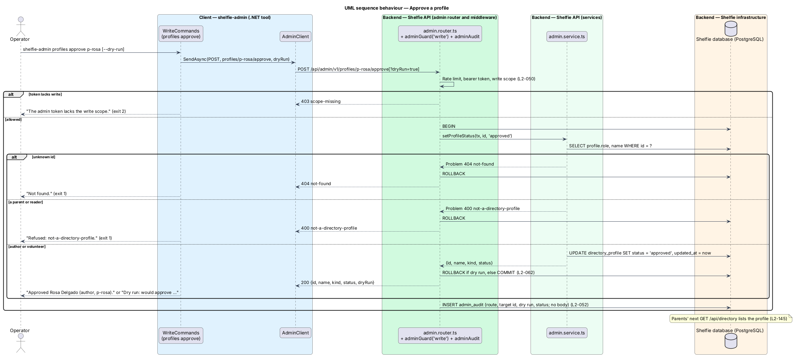

# Approve profiles

## Overview

Shelfie is a web application that helps a child read books by logging each chapter she reads and answering short questions about it, while a parent reviews her answers and gives rewards. The **operator** runs production. They query and change production data with `shelfie-admin`, a .NET global tool that calls the **admin API** under `/api/admin/v1` with a scoped, expiring admin token (`admin-cli/run-admin-commands`, `admin-api/serve-admin-data`).

Authors and volunteers are grown-up accounts outside any household (ADR-0018). Their profiles are shown to parents of children, so a new profile starts **pending** and parents do not see it until the operator **approves** it. The operator can **hide** a profile again at any time, which takes it out of the directory without deleting anything (ADR-0020). Approval and hiding are the operator's only directory actions; there is no review screen inside Shelfie.

This feature adds the admin API routes and the `profiles` command group: `profiles list` to read what each author and volunteer wrote, `profiles approve <id>` and `profiles hide <id>`.

## Description

The slice runs from the operator's terminal to the `directory_profile` table.

- **`QueryCommands.Profiles()`** — returns the `profiles` command with `list` ("List every author and volunteer with what they wrote"). It uses the shared `Print` helper on `GET profiles` with the columns ID, KIND, NAME, EMAIL, STATUS, BOOKS and ABOUT. `--json` prints the rows as the API sent them, which also carry `website`, `ages` and `contact`. `Program` adds the command to the root beside `users`, `books`, `logs` and `feedback`.
- **`WriteCommands.AddTo(...)`** — gains the `profiles` command and adds `approve <id>` ("Let parents see this profile in the directory") and `hide <id>` ("Take this profile out of the directory"), each with `--dry-run`. Both go through the existing `WriteAsync`, which sends `?dryRun=true` for a preview and prints one sentence: "Approved Rosa Delgado (author, p-…)." / "Dry run: would approve …", and "Hid …" / "Dry run: would hide …". Neither is destructive, so neither asks to confirm; the other state is always one command away.
- **Errors** — `Cli.Describe` already turns problem types into one line. `not-a-directory-profile` prints "Refused: not-a-directory-profile." and `not-found` "Not found.", each exiting 1; token problems exit with `ExitCode.Auth` as today.
- **`admin.router.ts`** — three routes on `adminRouter`, behind `adminGuard` and `adminAudit`:
  - `GET /profiles` with scope `read` → `listDirectoryProfiles(db)`.
  - `POST /profiles/:id/approve` with scope `write` → `setProfileStatus(tx, id, 'approved')` inside the router's `transaction`, rolled back when `dryRun=true`.
  - `POST /profiles/:id/hide` with scope `write` → `setProfileStatus(tx, id, 'hidden')`, the same way.
  - The id is checked with the router's `params` schema; a bad id answers 400 `validation`.
- **`admin.service.ts`**:
  - `listDirectoryProfiles(db)` → rows of `{ id, kind, name, email, status, bio, website, ages, contact, bookCount }` for every profile whose role is `author` or `volunteer`, waiting (`pending`) profiles first, then by name. `kind` is the role; `bookCount` counts `catalogue_book` rows (0 for a volunteer).
  - `setProfileStatus(db, id, status)` → reads the profile; 404 `not-found` when no profile has the id; 400 `not-a-directory-profile` when it is a parent or reader; otherwise updates `directory_profile.status` and `updated_at` and returns `{ id, name, kind, status }`. Approving an approved profile, or hiding a hidden one, succeeds and changes nothing else.
- **`admin-api.yaml`** — documents the three operations, the `DirectoryProfile` schema and the two new error types.
- **Audit** — `adminAudit` writes one `admin_audit` row per call with the time, token id, method, route pattern (`/api/admin/v1/profiles/:id/approve`), target id, dry-run flag, status and request id. It never writes a body, so a profile's text never reaches the audit trail or the request log (`L2-052`, `L2-155`).
- **Effect on parents** — the directory reads `status = 'approved'` on every request (`directory/browse-directory`), so an approval shows on a parent's next load and a hidden profile, its catalogue, photo and covers answer 404 at once. The owner's My profile shows the matching banner (`directory/author-profile`).
- **Tests** — `admin-profiles.test.ts` in `apps/api/src` calls the routes with `seededDb`, `tokenFor` and `call` from `admin-test-api.ts`, covering scopes, dry run, the two refusals and the audit row. `ProfileTests.cs` in `apps/admin-cli/tests/ShelfieAdmin.Tests` signs an author and a volunteer up through `POST /api/auth/join` on a `LocalApi`, then runs the real tool with `AdminCli.RunAsync` for `list`, `approve`, `hide`, `--dry-run`, `--json` and a parent's id.

## Requirements

| L2 ID | Refines (L1) | Requirement |
|-------|--------------|-------------|
| `L2-145` | `L1-029`, `L1-030` | Given `shelfie-admin profiles list`, then every author and volunteer is shown with id, kind, name, e-mail, status (`pending`, `approved` or `hidden`), what they wrote and, for an author, the number of catalogue books; `--json` prints the same. Given `profiles approve <id>`, then the profile becomes `approved` and parents see it on their next load. Given `profiles hide <id>`, then it becomes `hidden`, leaves the directory, and its profile, catalogue, photo and covers answer 404 to parents. A parent's or reader's id answers 400 `not-a-directory-profile` and an unknown id 404 `not-found`, changing nothing. `--dry-run` previews and rolls back. Each call writes an audit row with token, route, target id and status, never the profile's text. Approve and hide need the `write` scope (403 `scope-missing`); listing needs `read`. |

## Diagrams

### System context

The operator approves and hides author and volunteer profiles from their own machine; parents see the result in the directory.

### Containers

`shelfie-admin` calls the admin API over HTTPS with a bearer token; the API changes one column of `directory_profile` and writes an audit row.

### Components

The new commands reuse `Cli.RunAsync`, `Print` and `WriteAsync`; the new routes reuse `adminGuard`, `adminAudit` and the router's dry-run transaction.

### Class structure

`QueryCommands` and `WriteCommands` call `AdminClient`; `admin.service.ts` returns the profile rows and the `{ id, name, kind, status }` of a status change.

### Behaviour — approve a profile

A dry run previews the change and rolls it back; a real run commits it. A parent's or reader's id and an unknown id are refused without a change, and every call leaves one audit row (`L2-145`).

