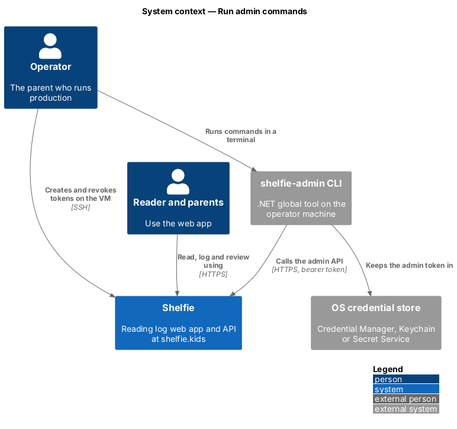
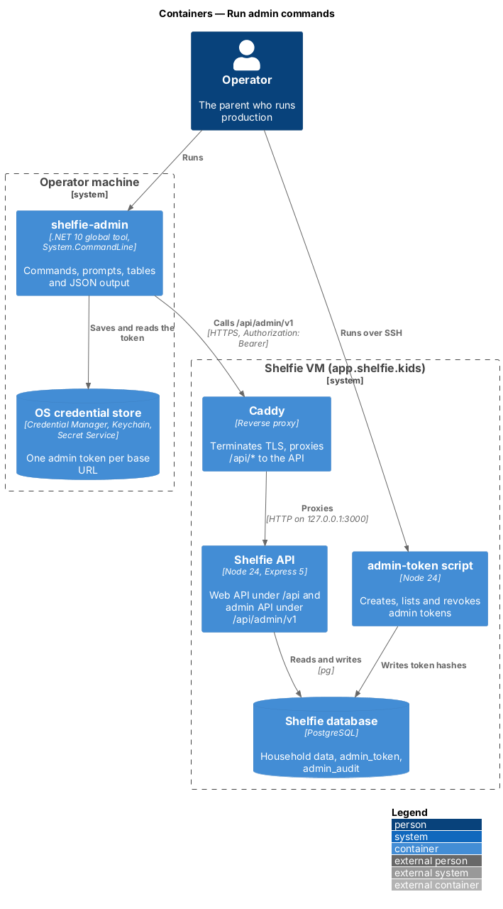
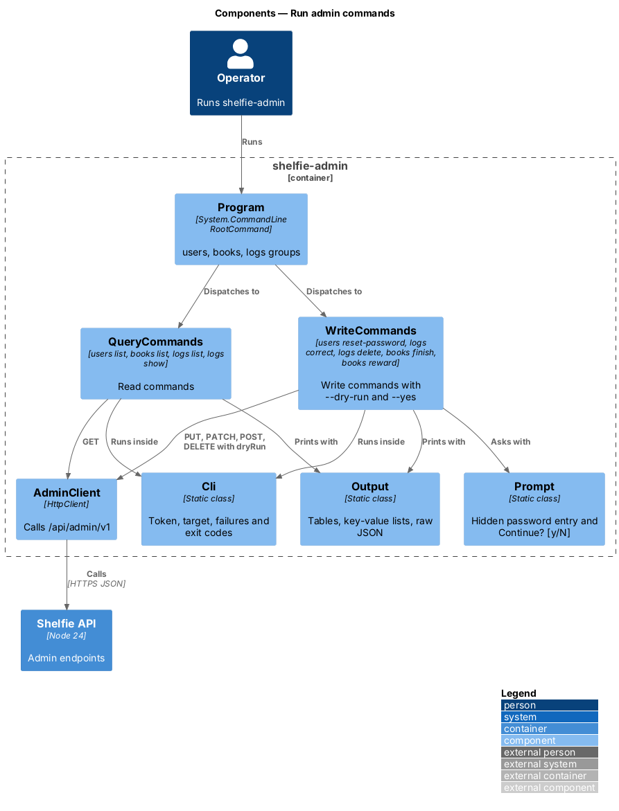
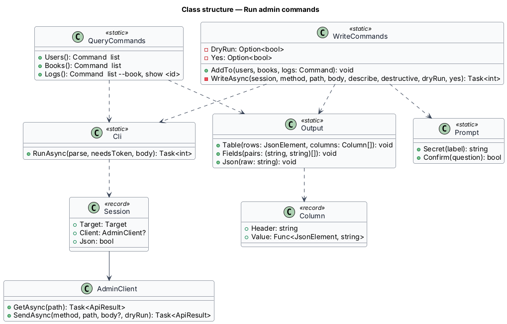
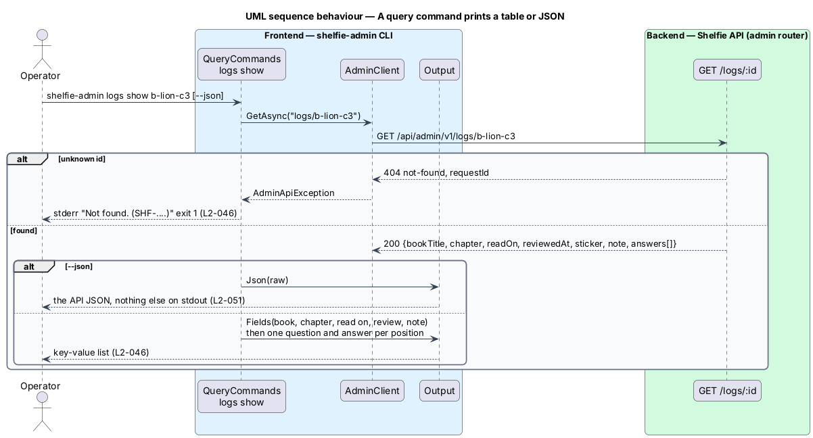
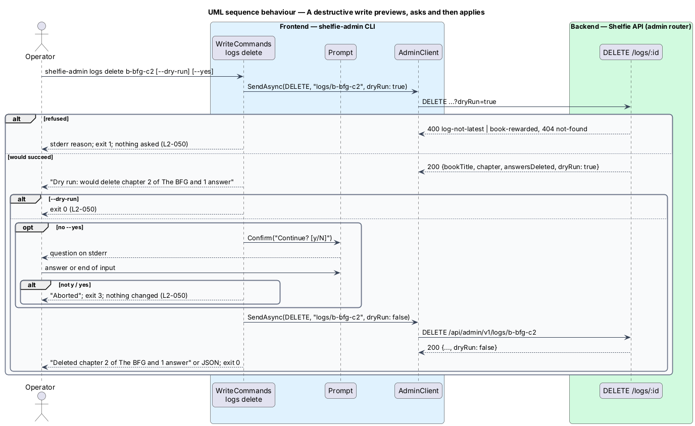

# Run admin commands

## Overview

Shelfie helps one child read books by logging chapters and answering questions, while a parent reviews the answers and gives rewards. The **operator**, the parent who runs production, uses `shelfie-admin` to see production data and to make the few corrections that the web app does not offer (L1-016).

This feature is the command set of the `admin-cli` subsystem: four query commands and five write commands. Sign-in, the target and exit-code mapping are the sibling feature `sign-in-cli`; the endpoints are `admin-api/serve-admin-data`.

Terms used below:

- **query command** — command that only reads: `users list`, `books list`, `logs list`, `logs show`, `feedback list`, `profiles list`
- **write command** — command that changes data: `users reset-password`, `logs correct`, `logs delete`, `books finish`, `books reward`, `profiles approve`, `profiles hide`
- **destructive command** — write command that removes data or access: `users reset-password` and `logs delete`
- **preview** — dry-run call made before a destructive change, whose result is shown before the question

## Description

- **`QueryCommands`** — builds the `users`, `books` and `logs` groups' read commands. Each calls `AdminClient.GetAsync` and prints either the raw JSON (`--json`) or an `Output.Table` with fixed columns:
  - `users list` — ID, HOUSEHOLD, ROLE, NAME, EMAIL (L2-056);
  - `books list` — ID, HOUSEHOLD, TITLE, CHAPTERS (`logged/count`), FINISHED, REWARD (L2-057);
  - `logs list --book <id>` — ID, CHAPTER, READ ON, LOGGED, REVIEW (`waiting`, or sticker and review time) (L2-058);
  - `logs show <id>` — `Output.Fields` for book, chapter, read on, review and note, then each question with its answer (L2-058).
  - `feedback list` — DATE, HOUSEHOLD, ROLE, KIND, SCORE, MESSAGE, newest first (L2-118, designed in `shell/send-feedback`);
  - `profiles list` — authors and volunteers with their status and what they wrote (L2-168, designed in `admin-cli/approve-profiles`);
- **`WriteCommands`** — adds the write commands to the same groups, each with `--dry-run` and `--yes`. All five share `WriteAsync`:
  1. With `--dry-run`, or for a destructive command, it first sends the request with `dryRun=true` and prints "Dry run: would …" built from the response. A refusal ends the command with exit 1 and no question (L2-062).
  2. With `--dry-run` it stops there with exit 0.
  3. For a destructive command without `--yes`, `Prompt.Confirm("Continue? [y/N]")` reads one line; anything other than `y` or `yes`, including end of input, prints "Aborted" and exits 3.
  4. It sends the request for real and prints the outcome sentence, or the API JSON with `--json`.
  Commands and their requests:
  - `users reset-password <id>` — reads the new password twice with `Prompt.Secret`; under 8 characters or a mismatch stops with exit 1 before any request; `PUT users/<id>/password` (L2-059);
  - `logs correct <id> --read-on <yyyy-mm-dd>` — `PATCH logs/<id>` (L2-060);
  - `logs delete <id>` — `DELETE logs/<id>` (L2-060);
  - `books finish <id>` — `POST books/<id>/finish` (L2-061);
  - `books reward <id> --text <text> [--note <note>]` — `POST books/<id>/reward` (L2-061);
  - `profiles approve <id>` and `profiles hide <id>` — `POST profiles/<id>/approve` and `POST profiles/<id>/hide`, through the same `WriteAsync` with `--dry-run`, not destructive (L2-168, designed in `admin-cli/approve-profiles`).
- **`Output`** — `Table` pads each column to its widest value and separates columns with two spaces; `Fields` aligns labels; `Json` writes the API body unchanged. Results go to standard output; questions, previews in `--json` mode and errors go to standard error, so standard output under `--json` holds only JSON (L2-063).
- **`Prompt`** — described in `sign-in-cli`; `Confirm` writes its question to standard error.

## Requirements

The feature realizes the following level-2 (L2) requirements. Each refines a level-1 (L1) requirement, cited by identifier.

| L2 ID | Refines (L1) | Requirement |
|-------|--------------|-------------|
| `L2-056` | `L1-016` | Query accounts. `users list` shall list every profile with id, household id, role, name and e-mail, and no secret. |
| `L2-057` | `L1-016` | Query books with progress and rewards. `books list` shall list every book with id, household id, title, progress, finished time and reward text. |
| `L2-058` | `L1-016` | Query chapter logs, answers and review status. `logs list --book` shall list logs in chapter order with review status; `logs show` shall show every question and answer; an unknown id shall say not found and exit 1. |
| `L2-059` | `L1-016` | Reset a parent's password. The new password shall be typed twice at hidden prompts, be at least 8 characters, never be echoed or printed, and the change shall end every session of that parent. |
| `L2-060` | `L1-016` | Correct or delete a chapter log. `logs correct` shall change the read-on day; `logs delete` shall delete the newest logged chapter after confirmation. |
| `L2-061` | `L1-016` | Mark a book finished and give a reward. `books finish` and `books reward` shall apply the API's rules and report refusals by type. |
| `L2-062` | `L1-016` | Safe writes. `--dry-run` shall change nothing and show what would change; destructive commands shall ask "Continue? [y/N]" unless `--yes` is given, and any other answer shall abort with exit 3. |
| `L2-063` | `L1-016` | Output formats and errors. Results shall be aligned tables or key-value lists by default and exactly the API JSON with `--json`. |

## Diagrams

### System context

The commands run on the operator's machine and call Shelfie's admin API over HTTPS.

### Containers

Each command is one HTTPS call, or two for a destructive write (preview, then change), from the CLI through Caddy to the Node API.

### Components

`QueryCommands` and `WriteCommands` run inside `Cli`, call `AdminClient` and print through `Output`; `WriteCommands` asks through `Prompt`.

### Class structure

Both command classes depend on `Cli`, `Output` and `AdminClient`; `Output.Table` is driven by a list of `Column` records.

### Behaviour — a query command prints a table or JSON

`logs show` prints the chapter's fields and each question with its answer, or the raw JSON; an unknown id ends with exit 1 (`L2-058`, `L2-063`).

### Behaviour — a destructive write previews, asks and then applies

`logs delete` previews with a dry run, asks unless `--yes` is given and then deletes; `--dry-run` stops after the preview (`L2-060`, `L2-062`).

