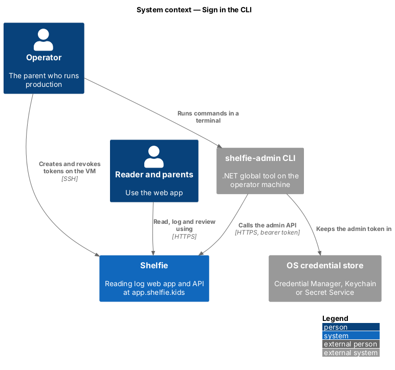
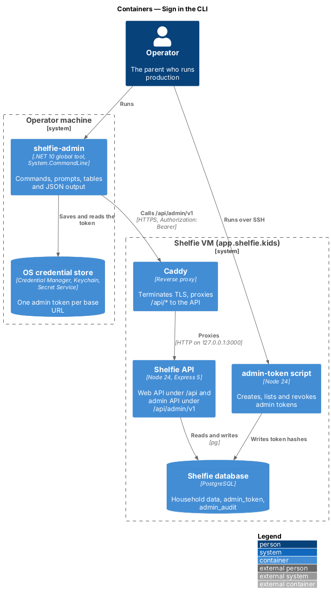
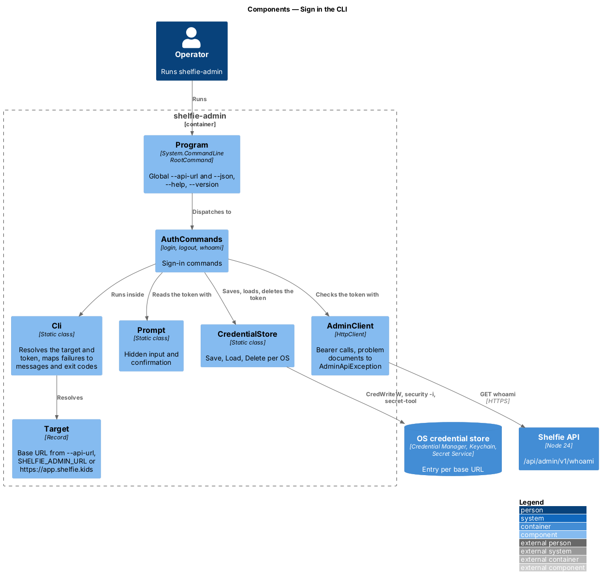
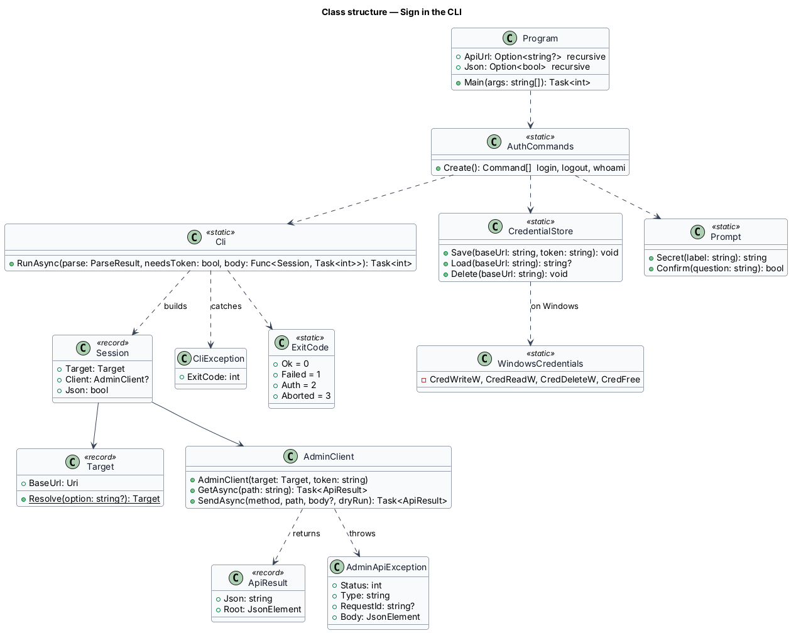
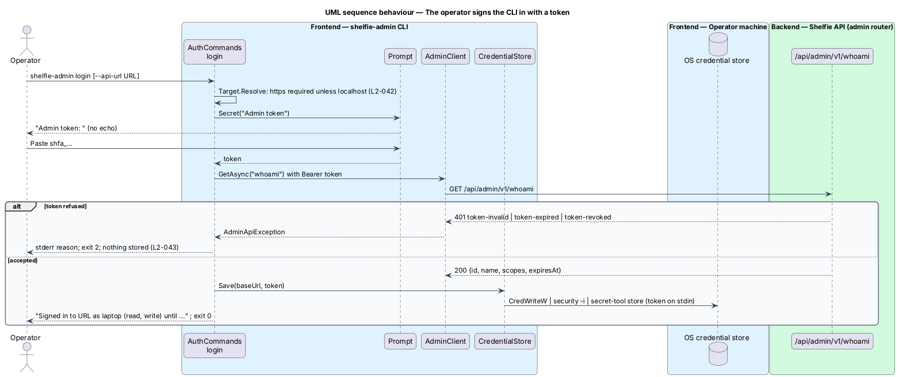
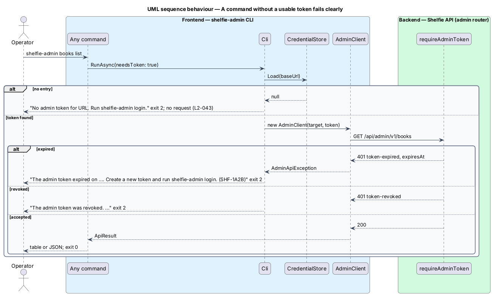

# Sign in the CLI

## Overview

Shelfie helps one child read books by logging chapters and answering questions, while a parent reviews the answers and gives rewards. The **operator**, the parent who runs production at `app.shelfie.kids`, uses the command-line tool `shelfie-admin` to query and correct production data through the admin API (L1-016).

This feature is the sign-in part of the `admin-cli` subsystem: installing the tool, choosing which Shelfie it talks to, and holding the admin token safely. The commands that use the token are the sibling feature `run-admin-commands`; the server side of the token is `admin-api/authenticate-admin-calls`.

Terms used below:

- **target** — base URL of the Shelfie instance a command talks to, production by default
- **admin token** — bearer secret `shfa_...` created on the server (L2-049)
- **OS credential store** — operating-system service that keeps secrets encrypted for the signed-in user: Windows Credential Manager, the macOS Keychain or the Linux Secret Service
- **exit code** — process result: 0 success, 1 refused or failed, 2 token problem, 3 aborted (L2-063)

## Description

The tool is one .NET 10 project, `apps/admin-cli/src/ShelfieAdmin`, packed as a global tool with command name `shelfie-admin` (ADR-0003). Commands are built with System.CommandLine 2.0 (ADR-0004).

- **`Program`** — builds the `RootCommand` with the recursive options `--api-url` and `--json`, adds the `login`, `logout` and `whoami` commands from `AuthCommands` and the groups from `run-admin-commands`, and returns the invocation's exit code. `--help` and `--version` come from System.CommandLine (L2-054).
- **`Target`** — `Target.Resolve(option)` takes `--api-url`, else the `SHELFIE_ADMIN_URL` variable, else `https://app.shelfie.kids`. A URL whose scheme is `http` and whose host is not `localhost` or `127.0.0.1` raises a `CliException` saying HTTPS is required, before any request (L2-054, ADR-0005).
- **`Cli`** — `Cli.RunAsync(parseResult, needsToken, body)` resolves the target, loads the token from `CredentialStore` when `needsToken` is set, builds the `AdminClient` and runs the command body. It turns failures into one line on standard error and an exit code:
  - no stored token: "No admin token for `<url>`. Run `shelfie-admin login`." and exit 2, with no request sent;
  - `AdminApiException` 401 or 403: the reason (`token-expired` names the expiry, `token-revoked` and `token-invalid` say to create a new token and log in, `scope-missing` names the scope) and exit 2;
  - any other `AdminApiException`: the reason and exit 1;
  - `HttpRequestException`: "Cannot reach `<url>`." and exit 1;
  - `CliException`: its message and its exit code.
  Each API message ends with the request id, for example `(SHF-1A2B)` (L2-055, L2-063).
- **`AdminClient`** — wraps one `HttpClient` with `BaseAddress = <target>/api/admin/v1/` and `Authorization: Bearer <token>`. `GetAsync` and `SendAsync` return `ApiResult(Json, Root)`; a non-success status becomes `AdminApiException(Status, Type, RequestId, Body)` read from the problem document.
- **`CredentialStore`** — `Save`, `Load` and `Delete` keyed by the target base URL (ADR-0002):
  - Windows: `WindowsCredentials` calls `CredWriteW`, `CredReadW` and `CredDeleteW` for the generic credential `shelfie-admin:<url>`;
  - macOS: `security -i` with the `add-generic-password -U`, `find-generic-password -w` or `delete-generic-password` command written to its standard input, service `shelfie-admin`, account `<url>`;
  - Linux: `secret-tool store|lookup|clear service shelfie-admin url <url>`, with the token written to standard input on `store`.
  A missing `secret-tool` or a failing store raises a `CliException` that names the cause.
- **`Prompt`** — `Prompt.Secret(label)` reads a line without echo, using `Console.ReadKey(intercept: true)` on a terminal and a plain line read when standard input is redirected. The label goes to standard error.
- **`AuthCommands`** —
  - `login` reads the token with `Prompt.Secret`, calls `GET whoami` with it, saves it only when the API accepts it, and prints "Signed in to `<url>` as `<name>` (`<scopes>`), token expires `<time>`." A refusal stores nothing and exits 2 (L2-055).
  - `whoami` prints the stored token's name, scopes and expiry, or JSON with `--json`.
  - `logout` deletes the entry for the target and prints "Signed out of `<url>`."
- **Secrets** — the token appears only in the credential store and the `Authorization` header. No message, table, JSON output or file holds it (L2-055).

## Requirements

The feature realizes the following level-2 (L2) requirements. Each refines a level-1 (L1) requirement, cited by identifier.

| L2 ID | Refines (L1) | Requirement |
|-------|--------------|-------------|
| `L2-054` | `L1-016` | Install the CLI and choose the target. The package shall install with `dotnet tool install --global` as `shelfie-admin`; the target shall default to `https://app.shelfie.kids`, be overridden by `SHELFIE_ADMIN_URL` and then by `--api-url`; plain `http` shall be refused except for `localhost` and `127.0.0.1`; help shall list every command and option. |
| `L2-055` | `L1-016` | CLI sign-in with an admin token. `login` shall check the token, store it in the OS credential store under the target and never print it; a refused token shall not be stored; a missing, expired or revoked token shall fail with a message naming the reason and exit code 2; `logout` shall remove the stored token. |
| `L2-063` | `L1-016` | Output formats and errors. Errors shall be one line on standard error naming the reason and request id; exit codes shall be 0, 1, 2 and 3 as defined; an unreachable API shall be named with exit code 1. |

## Diagrams

### System context

The CLI runs on the operator's machine, keeps its token in the OS credential store and calls Shelfie over HTTPS.

### Containers

The token lives in the operator machine's credential store; the CLI sends it through Caddy to the Node API.

### Components

`AuthCommands` runs inside `Cli`, reads the token through `Prompt`, checks it with `AdminClient` and keeps it in `CredentialStore`.

### Class structure

`Cli` builds a `Session` holding the `Target` and, when a token is needed, an `AdminClient`; `CredentialStore` delegates to `WindowsCredentials` on Windows and to `security` or `secret-tool` elsewhere.

### Behaviour — the operator signs the CLI in with a token

The token is checked against `whoami` before it is stored; a refused token is never stored (`L2-055`).

### Behaviour — a command without a usable token fails clearly

A missing entry stops the command before any request; an expired or revoked token is reported with its reason and exit code 2 (`L2-055`, `L2-063`).

