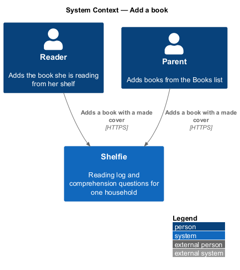
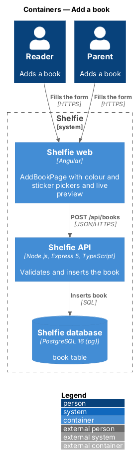
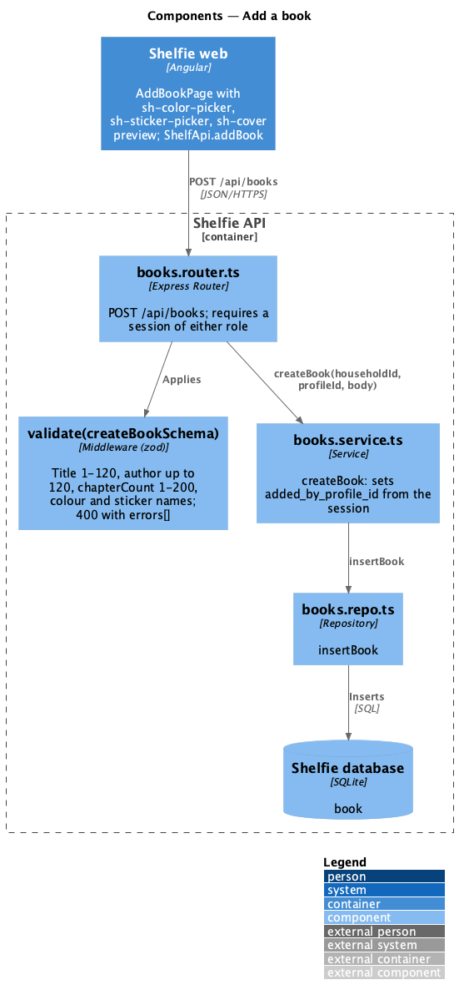
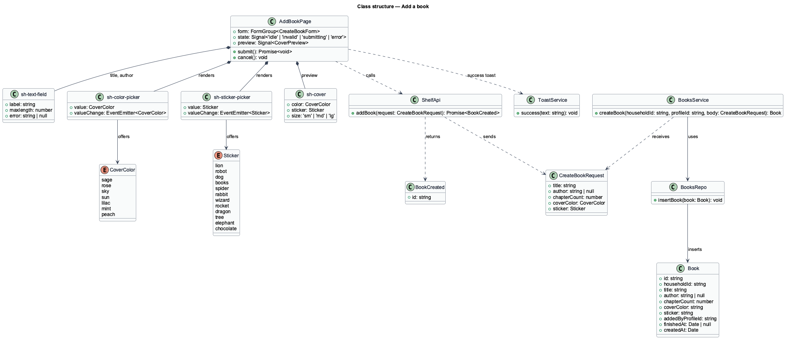
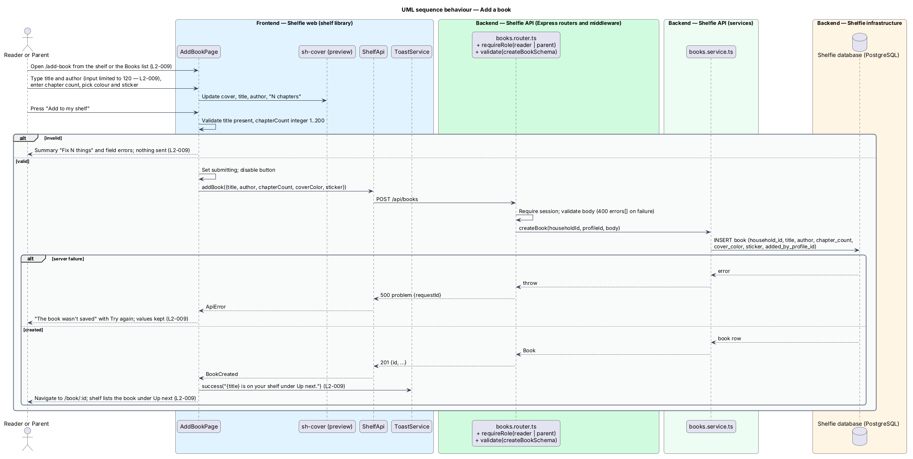

# Add a book

## Overview

Shelfie is a web application that helps one child read books by logging each chapter she reads and answering short questions about it, while a parent in the same household reviews her answers and gives rewards. A **household** is the unit of tenancy: its parents and readers share one bookshelf.

This feature puts a book on the shelf. A **book** is a title, an optional author, a **chapter count** (chapters are numbered, not titled, so the count is all the form asks about them) and a **cover**. Covers are made, not fetched: a cover is one of seven named pastel **cover colours** (Sage, Rose, Sky, Sun, Lilac, Mint, Peach) plus one of twelve named **stickers** (Lion, Robot, Dog, Books, Spider, Rabbit, Wizard, Rocket, Dragon, Tree, Elephant, Chocolate). An optional cover picture is added on this form too; see [upload-book-cover](../upload-book-cover/README.md). Typing the title looks the book up and can fill the author, chapters and picture; see [autocomplete-book](../autocomplete-book/README.md). This design covers the form as it works by hand, which the lookup leaves unchanged.

Either person in the household may add a book: the reader from the "Add a book" button on her shelf, the parent from the Books list. The same form serves both. A live **preview** shows the cover, title, author and chapter count as they are typed and picked. A new book has no logged chapters, so it appears on the shelf under "Up next".

The feature sits in the `books` subsystem beside the shelf, the book page, managing a book and managing questions. The mock's chapter field accepts 1 to 200 while `L2-009` says 1 to 500; this design follows the mock.

## Description

The slice runs from `AddBookPage` to the `book` table through one write endpoint.

- **`AddBookPage`** — page component in the `shelf` library, at route `/add-book`, reachable by both roles. It renders the title field (required, `maxlength` 120), the author field (optional, `maxlength` 120), the chapter count field (`type="number"`, `inputmode="numeric"`, 1 to 200, help "Count them in the contents page. You can change this later."), `sh-color-picker`, `sh-sticker-picker`, the preview panel and the actions "Cancel" and "Add to my shelf". It owns the `default`, `invalid`, `submitting` and `error` states in `docs/mocks/pages/add-book/`. The `invalid` state shows a summary alert ("Fix 2 things") whose items link to the fields, plus field errors "The book needs a title" and "Enter a number from 1 to 200."; nothing is sent (`L2-009`). The `submitting` state disables the submit button and ignores a second press. The `error` state shows "The book wasn't saved" with "Try again" and keeps every entered value (`L2-009`).
- **`sh-text-field`** — component in the `components` library (introduced by sign-in/sign-in-with-password); used for title and author with the 120-character limit applied on input (`L2-009`).
- **`sh-color-picker`** — component in the `components` library: a radio group of the seven cover colours, each a labelled swatch; emits the colour name.
- **`sh-sticker-picker`** — component in the `components` library: a radio group of the twelve stickers in an emoji grid, each labelled; emits the sticker name.
- **`sh-cover`** — component in the `components` library (view-shelf); the preview renders it at large size with the placeholder "Untitled book" and "Unknown author" until the fields are filled.
- **`ShelfApi.addBook(request)`** — posts to `/api/books` and returns the created book's `id` or throws `ApiError`.
- **`books.router.ts`** — Express router. `POST /api/books` requires a session of either role through `requireRole` from `authz.ts`, validates the body with `createBookSchema` through `validate()` (400 with `errors[]` on failure, `L2-009`), and calls the service.
- **`books.schemas.ts`** — `createBookSchema`: `title` trimmed string 1 to 120, `author` optional string up to 120 (empty becomes `null`), `chapterCount` integer 1 to 200, `coverColor` one of the seven colour names, `sticker` one of the twelve sticker names. The two name lists are the constants `COVER_COLORS` and `STICKERS`, also exported by the `components` library for the pickers.
- **`books.service.ts`** — `createBook(householdId, profileId, body)`: inserts the row with `added_by_profile_id` from the session and returns it.
- **`books.repo.ts`** — `insertBook(book)`, parameterised SQL over `book`.
- **`book`** table columns written: `id`, `household_id`, `title`, `author`, `chapter_count`, `cover_color`, `sticker`, `added_by_profile_id`, `created_at`.

On 201 the page navigates to `/book/:id` for the new book and calls `ToastService.success` (shell/notify) with the copy of the "added a book" toast mock ("Because of Winn-Dixie is on your shelf under Up next."). The shelf then lists the book under "Up next" with "Start with Chapter 1" (`L2-009`).

**From an author's catalogue** (`L2-167`, ADR-0024). A parent who presses "Add to shelf" on an approved author's book arrives at `/add-book?catalogueBook=:id` (`docs/mocks/pages/add-book/from-catalogue.html`). `AddBookPage` reads the query parameter and calls `ShelfApi.catalogueBook(id)` (`GET /api/directory/books/:id`, parents only), which returns `{ id, title, author, chapterCount, description, coverImage }`. It fills the title, the author's name and the chapter count, and, when there is a `coverImage`, fetches it as a `File` and sets it as the chosen picture, as a catalogue pick does. A subtitle reads "Filled in from {author}’s catalogue. Change anything before you add it."; the button and Cancel are unchanged. Everything stays editable, and saving is the unchanged `POST /api/books` followed by the cover upload, so the household gets its own copy: nothing stores which catalogue book it came from, and later edits by the author do not change it. A catalogue book of a pending, hidden or unknown author answers `404`; the form then opens empty under an `info` banner "That book isn’t available any more." A reader never sees this path; an author or volunteer session is turned away from `/add-book` (`L2-169`).

## Requirements

The feature realizes the following level-2 (L2) requirements. Each refines a level-1 (L1) requirement, cited by identifier.

| L2 ID | Refines (L1) | Requirement |
|-------|--------------|-------------|
| `L2-167` | `L1-030` | Given an approved author's profile, when a parent presses Add to shelf on a book, then Add a book opens with the title, the author's name, the chapter count and the cover picture filled in; every value stays editable, the book is saved as a new household book with its own copy of the values and picture, and later catalogue edits do not change it. |
| `L2-009` | `L1-003` | The reader or the parent supplies a title, an optional author, the chapter count, a cover colour and a sticker. Given valid input the book shall appear on the shelf as "up next" and a success toast shall be shown. An empty title, or a chapter count that is not an integer from 1 to 500, shall show inline errors and save nothing. Title and author input shall be limited to 120 characters. On a failure an error shall be shown and the entered values kept. A reader session shall see the same form from her shelf and the book she adds shall appear on her shelf. |

## Diagrams

### System context

Either person adds a book; it appears on the reader's shelf.

### Containers

The add-book page in the Angular application posts to the Express API, which inserts the book into the PostgreSQL database.

### Components

Inside the API, the books router validates the body with `createBookSchema` and delegates to `books.service.ts`, which inserts through `books.repo.ts`.

### Class structure

`AddBookPage` composes the two pickers and the preview cover and calls `ShelfApi`; the service validates a `CreateBookRequest` and creates a `Book`.

### Behaviour — add a book

The happy path creates the book, navigates to it and shows the toast; the alternate paths show client-side validation that sends nothing and a server failure that keeps the values (`L2-009`).

