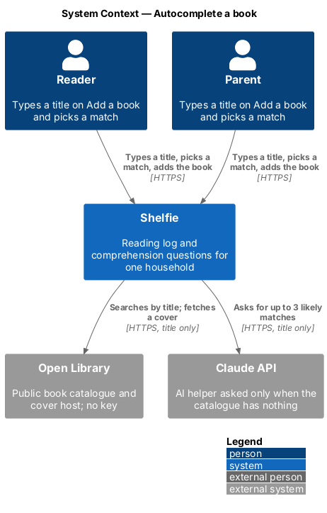
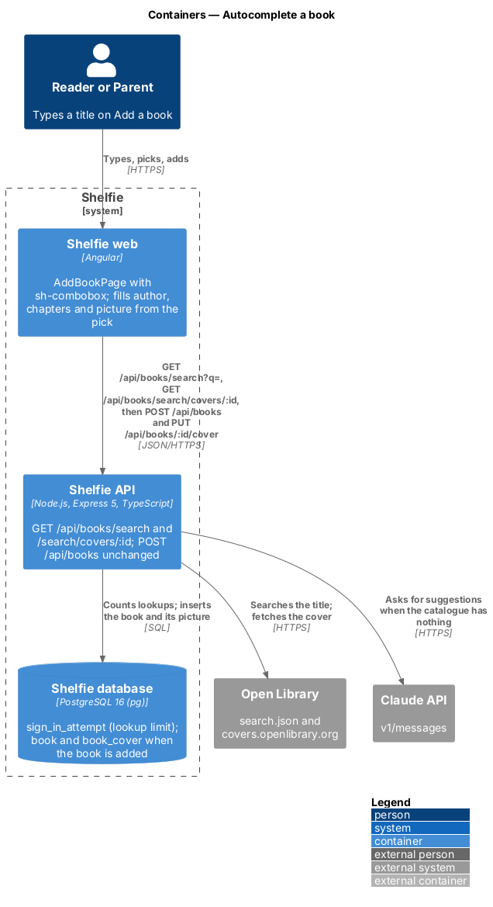
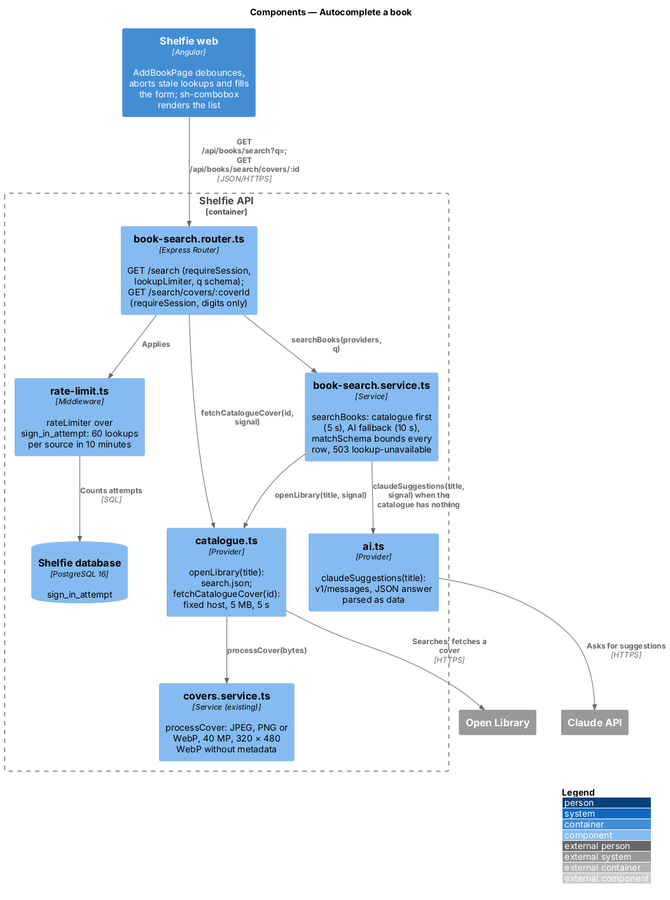
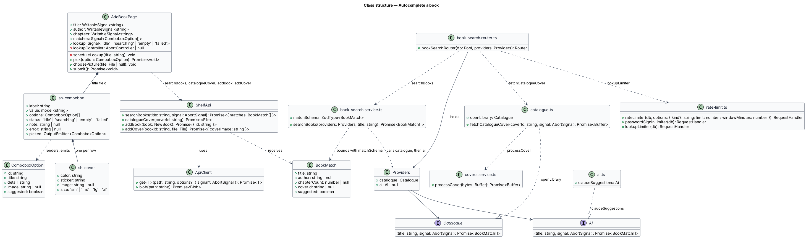
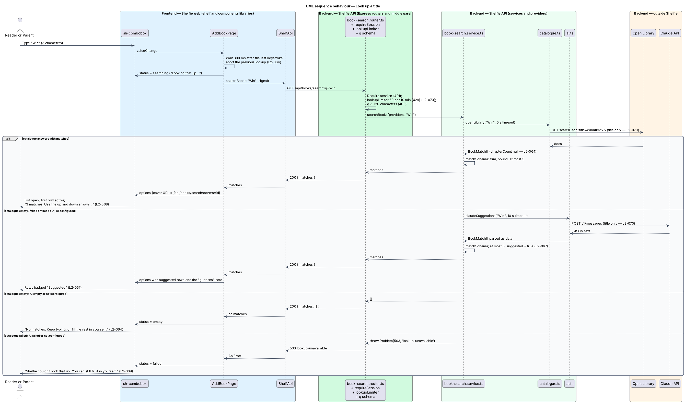
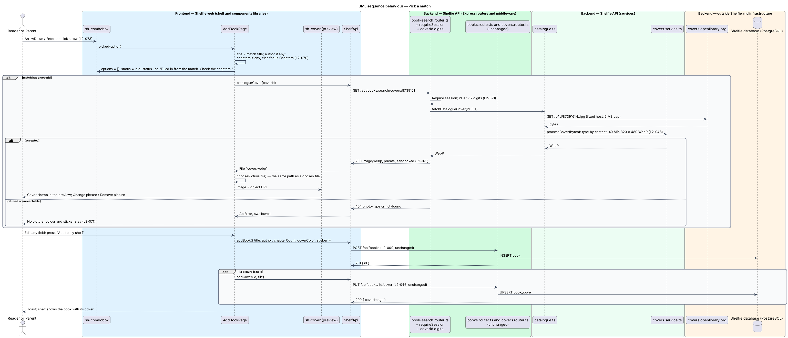

# Autocomplete a book

## Overview

Shelfie is a web application that helps a child read books by logging each chapter she reads and answering short questions about it, while a parent reviews her answers and gives rewards. A **household** is a set of parents and readers sharing one bookshelf. Either of them puts a book on the shelf through Add a book (`add-book`): a title, an optional author, a chapter count, a made cover of colour and sticker, and an optional cover picture (`upload-book-cover`).

This feature saves the typing. As the title is typed, Shelfie looks it up in a **book catalogue** (Open Library, a public, keyless catalogue) and drops a short list of **matches** under the Title field. Picking a match sets the title, fills the author, fills the chapter count when the match carries one, and gives the form the match's **cover picture**, fetched by the API through the same checks as an uploaded picture. Every filled value stays editable. When the catalogue knows nothing, an **AI helper** (Claude, called by the API) may offer up to three guesses; each is labelled "Suggested" so a guess is never shown as fact. When neither can answer, a quiet note says so and the form works by hand exactly as before.

The browser never calls the catalogue or the AI: the API exposes one search route and one cover route, and only the typed title ever leaves the server. The feature sits in the `books` subsystem beside `add-book` and `upload-book-cover`, which it extends and does not change.

## Description

The slice runs from the Title field of `AddBookPage` through two API routes to Open Library and, as a fallback, the Claude API. Nothing is stored: a match becomes a book only through the unchanged `POST /api/books`.

### Frontend

- **`sh-combobox`** (`Combobox`, `components` library) — new component specified in [`docs/specs/components/combobox.md`](../../../specs/components/combobox.md): a text field with `role="combobox"` whose `options` drop down as a `role="listbox"` of rows (an `sh-cover` sm with the cover or the 📖 placeholder, title, detail, and a "Suggested" badge when `suggested`). It renders the `status` notes (`searching`, `empty`, `failed`), handles ArrowUp, ArrowDown, Enter, Escape, Tab and clicks, keeps focus in the input, announces the row count and the pick, and emits `picked`. It does not search.
- **`ApiClient`** (`core`) — `get(path, { signal })` accepts an `AbortSignal` that unsubscribes the request, and `blob(path)` reads a binary response. Both are small additions to the existing client.
- **`ShelfApi`** (`shelf`) — `searchBooks(title, signal)` calls `GET /api/books/search?q=<title>` and returns `{ matches: BookMatch[] }`; `catalogueCover(coverId)` reads `GET /api/books/search/covers/<id>` as a `File` named `cover.webp`.
- **`AddBookPage`** (`shelf`) — the Title `sh-text-field` becomes an `sh-combobox`. A 300 ms debounce after the last keystroke starts a lookup when the trimmed title has 3 or more characters; each lookup aborts the one before it through an `AbortController`, so only the newest answer is shown (`L2-069`). The page maps matches to combobox options (the cover URL is the API's cover route) and sets `status` to `searching`, `empty` or `failed` (a 503, a 429 or an unreachable API all read as `failed`, `L2-074`). On `picked` it sets the title, the author when the match has one and the chapter count when the match has one; when it has none, focus moves to the Chapters field. When the match has a `coverId` the page fetches the cover through `ShelfApi.catalogueCover` and hands the `File` to the same `choosePicture` the cover picker uses, so the preview shows it and `submit` uploads it after the book exactly as a chosen file (`L2-070`, `L2-071`). A cover that fails to fetch leaves the picture empty and says nothing.

### API

- **`book-search.router.ts`** — mounted at `/api/books` before `booksRouter`, so `/search` is never read as a book id. Both routes sit behind `requireSession` (401) and take either role (`L2-075`).
  - `GET /search?q=` — `lookupLimiter` (60 requests per source in 10 minutes, 429 `too-many-attempts` with `Retry-After`), then `q` validated by zod as a trimmed string of 3 to 120 characters (400 `validation`), then `searchBooks`. Answers 200 `{ matches }` or 503 `lookup-unavailable`.
  - `GET /search/covers/:coverId` — `coverId` validated as 1 to 12 digits (400 `validation`), then `fetchCatalogueCover`. Answers the WebP with `Cache-Control: private, max-age=3600`, `Content-Security-Policy: default-src 'none'; sandbox` and the app's `X-Content-Type-Options: nosniff`; 404 `not-found` when the catalogue has no such cover or cannot be reached, 404 `photo-type` when the bytes are not an image the cover rules accept.
- **`book-search.service.ts`** — the orchestration and the shape of a match.
  - `BookMatch`: `title` (1–120), `author` (string up to 120 or null), `chapterCount` (integer 1–200 or null), `coverId` (digits or null), `suggested` (boolean). `matchSchema` (zod) applies these bounds to whatever a provider returns: text is trimmed and cut at 120 characters, out-of-range counts become null, rows without a title are dropped, and at most 5 rows survive (`L2-069`, `L2-075`).
  - `Catalogue` and `Ai` are both `(title: string, signal: AbortSignal) => Promise<BookMatch[]>`. `createApp` takes them as options (`catalogue`, `ai`) so the tests and the Playwright stack pass fakes; the defaults are `openLibrary` and, when `ANTHROPIC_API_KEY` is set, `claudeSuggestions`, else `null` (not configured).
  - `searchBooks({ catalogue, ai }, title)`: calls the catalogue with a 5 second `AbortSignal.timeout`; a non-empty answer is returned as it is (the AI is not called). When the catalogue answers with nothing, fails or times out, and an `ai` is configured, it calls the AI with a 10 second timeout and returns its rows marked `suggested: true`, at most 3. It throws `Problem(503, 'lookup-unavailable')` only when the catalogue failed and no AI could answer (`L2-072`, `L2-074`). An empty catalogue answer with an unconfigured or failing AI is an empty list.
- **`catalogue.ts`** — the Open Library provider and the cover fetch.
  - `openLibrary(title, signal)`: `fetch('https://openlibrary.org/search.json?title=<title>&fields=title,author_name,cover_i&limit=5', { signal })`; the only data in the request is the title. Each `doc` becomes `{ title, author: author_name[0] ?? null, chapterCount: null, coverId: cover_i ? String(cover_i) : null, suggested: false }`. **Chapter count:** Open Library's search results carry no chapter figure; the page count it does carry (`number_of_pages_median`) is not turned into one, because the ratio of pages to chapters varies too much to present as a fact. Catalogue matches therefore leave the Chapters field to the reader (`L2-069` criterion 8); see [ADR-001](adr-001-look-books-up-through-the-api.md).
  - `fetchCatalogueCover(coverId, signal)`: fetches `https://covers.openlibrary.org/b/id/<coverId>-L.jpg` with `redirect: 'error'`, a 5 second timeout and a 5 MB cap read from `Content-Length` and enforced while the body streams; the host and path are fixed in code, so no caller input can point the fetch anywhere else (SSRF). The bytes go through `processCover` from `covers.service.ts`: JPEG, PNG or WebP by content, at most 40 megapixels, re-encoded to a 320 × 480 WebP without metadata (`L2-071`).
- **`ai.ts`** — `claudeSuggestions(title, signal)`: `fetch('https://api.anthropic.com/v1/messages')` with `x-api-key` from `ANTHROPIC_API_KEY`, `anthropic-version: 2023-06-01`, model `claude-opus-5-5`, `output_config: { effort: 'low' }`, `max_tokens` 1024 and a system prompt that asks for up to 3 likely children's books for the typed title as a JSON object `{ "matches": [{ "title", "author", "chapterCount" }] }`. The user message is the title and nothing else. The reply's first text block is parsed as JSON and passed through `matchSchema`; anything else in it is ignored (`L2-072`, `L2-075`). No SDK is added: one `fetch` is enough.
- **`rate-limit.ts`** — `lookupLimiter` is one more use of the existing `rateLimiter(db, limit, keyOf)` over the `sign_in_attempt` table, beside the sign-in and assistant limits: 60 requests in the ten-minute window, keyed `lookup:<ip>` so it shares no count with them. The nightly purge already deletes rows older than the window.
- **`app.ts`** — `createApp(db, { log, mail, catalogue, ai })` mounts `bookSearchRouter(db, { catalogue, ai })` before the books routers.
- **Logging** — the request log records route, status and duration. The query string is not logged, so the typed title never appears in a log line (`L2-074`).

### Configuration

| Variable | Where | Effect |
|---|---|---|
| `ANTHROPIC_API_KEY` | `/etc/shelfie/env` (production), the shell (local) | Turns on the AI fallback. Unset, the search uses the catalogue only and never calls the AI. Documented in `docs/runbook.md`. |

The catalogue needs no key. The production VM shall allow outbound HTTPS to `openlibrary.org`, `covers.openlibrary.org` and `api.anthropic.com`.

### Error mapping

| Condition | API | Page |
|---|---|---|
| Under 3 characters | no request | closed |
| Catalogue answers 1–5 matches | 200 `{ matches }` | list open, first row active |
| Catalogue empty or failed, AI answers 1–3 | 200, rows `suggested: true` | list with badges and the "guesses" note |
| Catalogue empty, AI empty or not configured | 200 `{ matches: [] }` | "No matches. Keep typing, or fill the rest in yourself." |
| Catalogue failed, AI failed or not configured | 503 `lookup-unavailable` | "Shelfie couldn’t look that up. You can still fill it in yourself." |
| 61st lookup in 10 minutes from one source | 429 `too-many-attempts` | same note |
| API unreachable | — | same note |
| `q` missing, under 3 or over 120 characters | 400 `validation` | never sent by the page |
| Cover id not digits | 400 `validation` | never sent by the page |
| Cover missing upstream or unreachable | 404 `not-found` | row shows the placeholder; pick fills no picture |
| Cover bytes not an accepted image or over the limits | 404 `photo-type` | same |
| No session | 401 | the shell's sign-in redirect |

### Limits

| Limit | Value | Where |
|---|---|---|
| Characters before a lookup | 3 | `AddBookPage` and the `q` schema |
| Pause before a lookup | 300 ms | `AddBookPage` |
| Matches shown | 5 (3 from the AI) | `searchBooks`, `sh-combobox` |
| Catalogue timeout | 5 s | `searchBooks` |
| AI timeout | 10 s | `searchBooks` |
| Lookups per source | 60 in 10 minutes | `lookupLimiter` |
| Cover download | 5 MB, 5 s, one fixed host | `fetchCatalogueCover` |
| Served cover | 320 × 480 WebP, no metadata | `processCover` |

Caching catalogue answers in the database, autocomplete on Manage a book, a gallery of covers to choose from, barcode scanning and any catalogue other than Open Library are out of scope.

## Requirements

The feature realizes the following level-2 (L2) requirements. Each refines a level-1 (L1) requirement, cited by identifier. It leaves `L2-009` (the form and its validation), `L2-046` to `L2-048` (the cover picture) and `L2-010` (Manage a book) unchanged and applies `L2-005`, `L2-006`, `L2-025` to `L2-029` to the lookup without restating them.

| L2 ID | Refines (L1) | Requirement |
|-------|--------------|-------------|
| `L2-069` | `L1-019` | After 3 characters and a 300 ms pause, one request shall fetch at most 5 matches with title, author and cover; stale answers shall be ignored; a lookup in flight shall show "Looking that up…"; no match shall show "No matches…"; matches shall render as text; the API shall bound every field and shall return no chapter count for catalogue matches. |
| `L2-070` | `L1-019` | Picking shall set the title and fill the author and the chapter count the match has; a match without a chapter count shall send focus to Chapters; every field shall stay editable; an ignored list shall leave the book as one added by hand; nothing but the Title shall change before a pick. |
| `L2-071` | `L1-019` | Covers shall load only through `GET /api/books/search/covers/:coverId`, which shall fetch one fixed catalogue host with a 5 s timeout and 5 MB cap, apply the cover rules of `L2-048` and serve a sandboxed WebP; a bad cover shall not fail the search; a picked cover shall be uploaded with the book as a chosen file is. |
| `L2-072` | `L1-019` | When the catalogue has nothing or fails and a key is configured, the API shall ask the AI helper for up to 3 matches, sending only the title, and shall mark them `suggested`; the list shall badge them and show the "guesses" note; suggested matches shall have no cover; the AI's answer shall be parsed as bounded data. |
| `L2-073` | `L1-019` | The Title field shall follow the WAI-ARIA combobox pattern: roles and states, ArrowUp/ArrowDown wrapping, Enter picks without submitting, Escape and Tab close, a polite count and pick announcement, wrapping rows of at least 44 px, no sideways scroll, no serious axe violation. |
| `L2-074` | `L1-019` | When the catalogue fails and no AI can answer the API shall answer 503 `lookup-unavailable` and the field shall show "Shelfie couldn’t look that up…"; 429 and an unreachable API shall read the same; manual add shall work unchanged; timeouts shall be 5 s and 10 s; logs shall carry no title or provider response. |
| `L2-075` | `L1-019` | Only the typed title shall leave the server; the browser shall call only the API; the routes shall require a session; more than 60 lookups per source in 10 minutes shall answer 429; `q` shall be validated; provider answers shall be treated as untrusted data; the AI key shall live only in the API's environment. |

## Decisions

- **Open Library, called by the API** — keyless, public, with covers; one route keeps every third-party call, limit and key on the server. See [ADR-001](adr-001-look-books-up-through-the-api.md).
- **AI only as a fallback, and labelled** — the catalogue's facts come first; guesses come only when it has nothing, and every guess carries the badge and the note (ADR-001).
- **No chapter count from the catalogue** — Open Library has none; a page count is not turned into one (ADR-001).
- **Covers through a proxy route, not through the search answer** — rows need small covers and the pick needs the full one; one route serves both, lazily, and the search never waits for an image. The page turns the served WebP into a `File` so the existing picture path (`upload-book-cover`, ADR-001) saves it unchanged.
- **The page searches, the component renders** — the combobox takes `options` and `status` and emits `picked`; the debounce, the abort and the fill stay in `AddBookPage` (CRD D-1).
- **One attempt store for every limit** — `lookupLimiter` reuses `rateLimiter` over `sign_in_attempt` with its own key prefix, so the lookup limit costs no migration and the nightly purge already covers it.

## Diagrams

### System context

The reader or the parent types a title; Shelfie asks Open Library and, when it has nothing, Claude.

### Containers

The web app calls only the Shelfie API; the API calls the catalogue, its cover host and the AI, and the book is still saved through the existing route.

### Components

The search router applies the session guard, the lookup limit and the query schema; the service calls the catalogue, then the AI; the cover route re-encodes through the shared `processCover`.

### Class structure

`AddBookPage` composes `sh-combobox` and calls `ShelfApi`; the service orchestrates two provider functions behind one `BookMatch` shape.

### Behaviour — look up a title

Three characters and a pause start a lookup; the catalogue answers, or the AI answers with suggested rows, or neither does and the field says so (`L2-069`, `L2-072`, `L2-074`).

### Behaviour — pick a match

Picking fills the fields, fetches the cover through the API as a `File`, and the book is then added and its picture uploaded exactly as before (`L2-070`, `L2-071`).

## Open questions

- None block the build.
