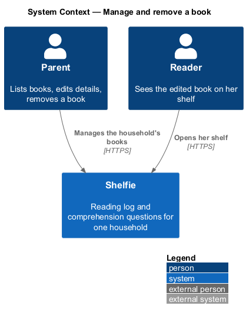
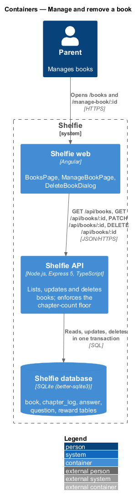
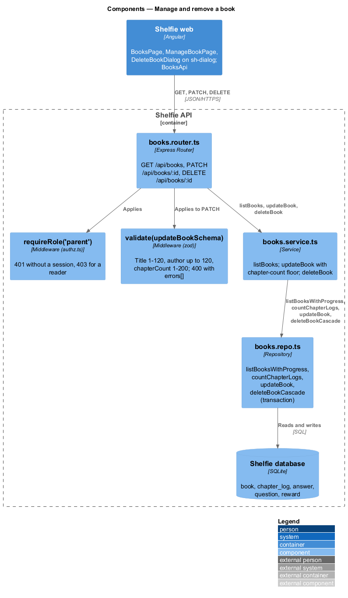
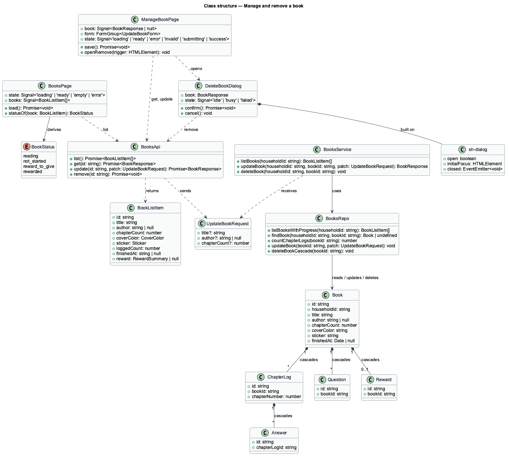
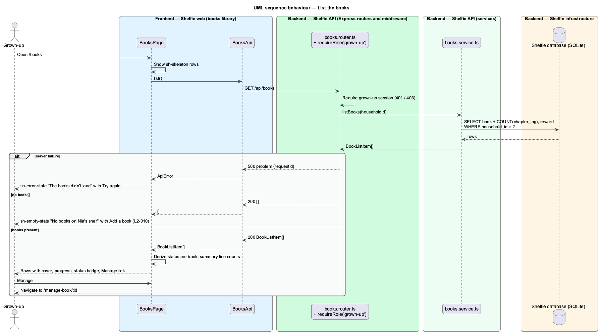
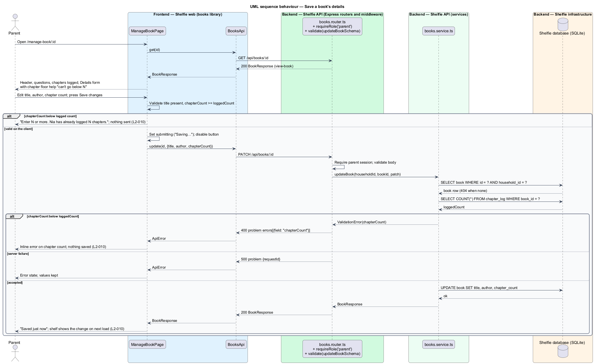
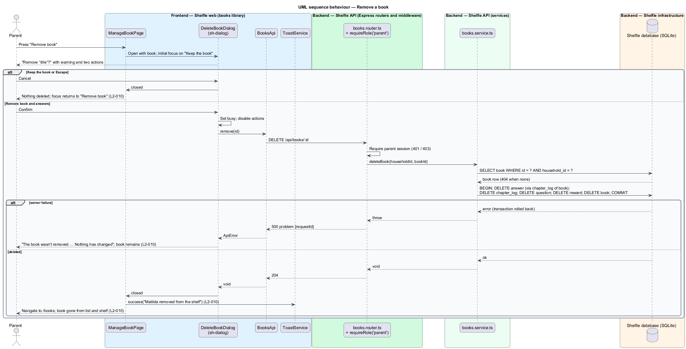

# Manage and remove a book

## Overview

Shelfie is a web application that helps one child read books by logging each chapter she reads and answering short questions about it, while a grown-up in the same household reviews her answers and gives rewards. A **household** is the unit of tenancy: exactly one reader profile and one grown-up profile, sharing one bookshelf.

This feature is the grown-up's side of the bookshelf. The **Books list** shows every book in the household with its progress and a status (Reading, Not started, Reward to give, Rewarded) and leads to the **manage page** for one book. The manage page shows the book's header, the questions the reader answers for it (manage-questions), a table of the **logged chapters** with their review status, a **details** form for the title, author and chapter count, and a "Remove this book" section. A finished and rewarded book shows its reward at the top (review/give-reward).

Chapter count has a floor: a book whose reader has logged N chapters cannot be set below N, because those logs would point at chapters that no longer exist. Removing a book is a hard delete that cascades to the book's chapter logs, answers, custom questions and reward; it is confirmed in the **Remove dialog**, whose initial focus is on "Keep the book" and which closes on Escape.

The feature sits in the `books` subsystem beside the shelf, the book page, adding a book and managing questions. Both pages are grown-up only (`grownUpGuard`, sign-in/authorize-access). The mock's details form offers title, author and chapter count only, while `L2-010` also names cover colour and sticker; this design follows the mock and leaves cover editing out.

## Description

The slice runs from `BooksPage`, `ManageBookPage` and `DeleteBookDialog` to the `book` table and its dependants through three endpoints, and reuses `GET /api/books/:id` from view-book.

- **`BooksPage`** — page component in the `books` library, at route `/books`. It calls `BooksApi.list()` and renders the header ("Books", "5 books · 2 on the go · 2 finished · 1 up next", "Add a book" linking to add-book) and one row per book: `sh-cover`, title, "author · 11 of 17 chapters" or "finished Tue 13 Oct · reward text", a status badge and a "Manage" link. It owns the `default`, `loading`, `empty` and `error` states in `docs/mocks/pages/books/`; the empty state reads "No books on Nia's shelf" and offers "Add a book" (`L2-010`). The status is derived on the client: `rewarded` when a reward exists, `reward-to-give` when `finishedAt` is set without one, `not-started` when `loggedCount` is 0, otherwise `reading`.
- **`ManageBookPage`** — page component in the `books` library, at route `/manage-book/:id`. It calls `BooksApi.get(id)` (the `BookResponse` of view-book) and renders the header (`sh-cover`, title, author, `sh-progress`), the Questions section (manage-questions), the "Chapters logged" table newest first with columns Chapter, Read, What happened (first line of answer 1), Review ("To review" or "Reviewed") and an "Open" link to the review page (review/review-chapter), the Details form and the Remove section. It owns the `default`, `loading`, `error`, `invalid`, `submitting` and `success` states in `docs/mocks/pages/manage-book/`; the `rewarded` state is owned by review/give-reward. The chapter count field carries the help "Nia has logged 11 chapters, so this can't go below 11." and `min` equal to `loggedCount`; a lower value shows "Enter 11 or more. Nia has already logged 11 chapters." and nothing is sent (`L2-010`). Saving shows "Saving…" then "Saved just now".
- **`DeleteBookDialog`** — dialog component in the `books` library built on `sh-dialog`. Title "Remove “{title}”?", the book summary with `sh-cover`, the warning that the logged chapters, answers and feedback will be deleted and that this cannot be undone, the hint to give a reward instead for a finished book, and the actions "Keep the book" (initial focus) and "Remove book and answers" (danger). It owns the `default`, `busy` and `failed` states in `docs/mocks/dialogs/delete-book/`; `failed` shows "The book wasn't removed … Nothing has changed; try again." Escape and "Keep the book" close it with nothing deleted and focus returned to the "Remove book" trigger (`L2-010`).
- **`sh-dialog`** — component in the `components` library: modal with focus trap, initial-focus target, Escape to close, focus return to the trigger, and a bottom-sheet layout under 640 px.
- **`BooksApi`** — service in the `books` library built on `ApiClient`: `list()`, `get(id)`, `update(id, patch)`, `remove(id)`, plus the question methods of manage-questions.
- **`books.router.ts`** — Express router; `GET /api/books`, `PATCH /api/books/:id` and `DELETE /api/books/:id` require `requireRole('grown-up')` from `authz.ts` (401 without a session, 403 for a reader). `PATCH` validates the body with `updateBookSchema` through `validate()`.
- **`books.schemas.ts`** — `updateBookSchema`: `title` trimmed string 1 to 120, `author` string up to 120 or `null`, `chapterCount` integer 1 to 200; each optional.
- **`books.service.ts`** — `listBooks(householdId)` returns each book with `loggedCount`, `finishedAt` and `reward`; `updateBook(householdId, bookId, patch)` loads the book (404 outside the household), counts its chapter logs and answers 400 with `errors: [{ field: "chapterCount" }]` when `chapterCount` is below the count (`L2-010`), then updates; `deleteBook(householdId, bookId)` loads the book (404 outside the household) and deletes it with its dependants in one transaction. Raising the chapter count of a finished book clears `finished_at` and keeps its reward.
- **`books.repo.ts`** — parameterised SQL: `listBooksWithProgress(householdId)`, `countChapterLogs(bookId)`, `updateBook(bookId, patch)`, `deleteBookCascade(bookId)` running, inside `db.transaction`, `DELETE FROM answer WHERE chapter_log_id IN (SELECT id FROM chapter_log WHERE book_id = ?)`, then `chapter_log`, `question`, `reward` and `book`.

After a successful delete the dialog closes, the page navigates to `/books` and `ToastService.success` (shell/notify) confirms with the copy "<title> removed from the shelf". A saved detail change is visible on the reader's shelf on its next load because the shelf reads the same `book` row (`L2-010`).

## Requirements

The feature realizes the following level-2 (L2) requirements. Each refines a level-1 (L1) requirement, cited by identifier.

| L2 ID | Refines (L1) | Requirement |
|-------|--------------|-------------|
| `L2-010` | `L1-003` | When the grown-up edits a book's title, author, cover colour or sticker and saves, the changes shall appear on the shelf. Confirming the Remove dialog shall delete the book with its chapters, answers and feedback and a toast shall confirm. Cancelling the dialog or pressing Escape shall delete nothing and return focus to the trigger. A deletion failure shall show an error in the dialog and keep the book. An empty Books list shall show an empty state offering "Add a book". Setting the chapter count below the number of logged chapters shall show an inline error and save nothing. |

## Diagrams

### System context

The grown-up manages the household's books; the reader sees the changes on her shelf.

### Containers

The Books list, manage page and Remove dialog in the Angular application call the Express API, which reads and writes the SQLite database.

### Components

Inside the API, the books router guards the three grown-up endpoints and delegates to `books.service.ts`, which enforces the chapter-count floor and the cascading delete through `books.repo.ts`.

### Class structure

`BooksPage` and `ManageBookPage` call `BooksApi`; `ManageBookPage` opens `DeleteBookDialog`; the service updates and deletes `Book` and its dependants.

### Behaviour — list the books

The Books list loads once and renders a row per book, with the empty and error states (`L2-010`).

### Behaviour — save the details

The happy path updates the row; the alternate paths show the chapter-count floor refused on the client and on the server, and a save failure (`L2-010`).

### Behaviour — remove a book

The happy path deletes the book and its dependants in one transaction and confirms with a toast; the alternate paths show cancelling and a failed delete that keeps the book (`L2-010`).

