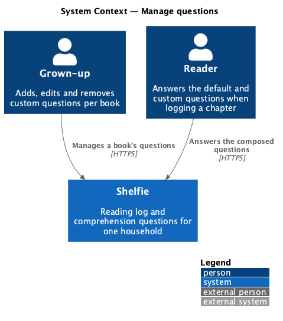
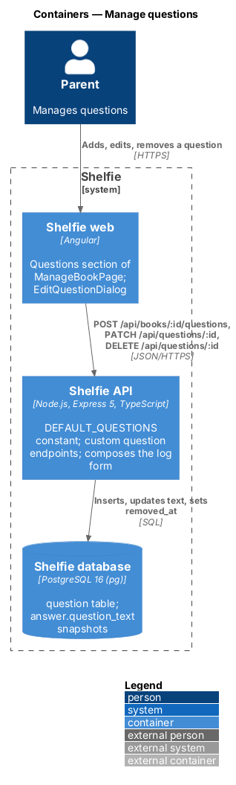
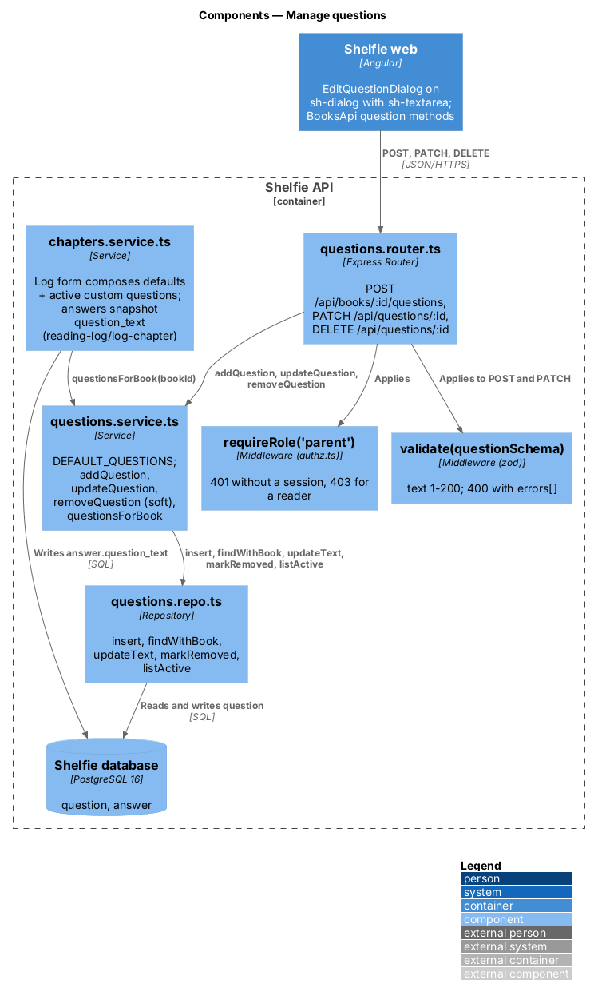
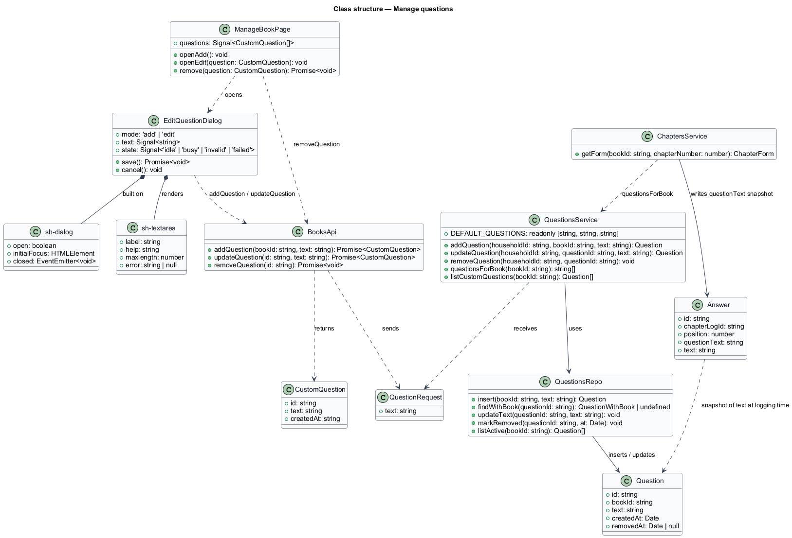
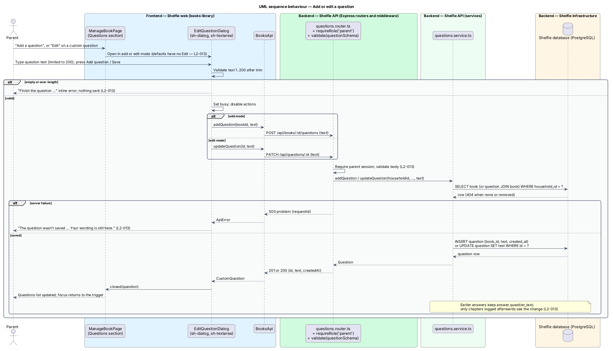
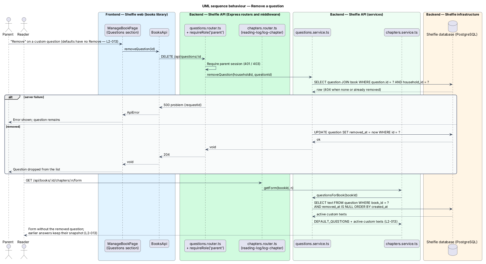

# Manage questions

## Overview

Shelfie is a web application that helps one child read books by logging each chapter she reads and answering short questions about it, while a parent in the same household reviews her answers and gives rewards. A **household** is the unit of tenancy: its parents and readers share one bookshelf.

This feature decides which questions the reader answers when she logs a chapter. Every book has the three **default questions**, in a fixed order: "What happened in this chapter?", "Who was your favourite character in this chapter, and why?" and "What do you think will happen next?". They are constants in the API, not rows, so nobody can edit or remove them. The parent may add **custom questions** to one book from the Questions section of its manage page (manage-book), and may edit or remove a custom question later.

A question change never rewrites history. When the reader logs a chapter, each answer stores a copy of the question text it answered; this **snapshot** is what the chapter page and the review page show. Editing a custom question changes what later chapters ask; removing one hides it from later chapters. Earlier answers keep the wording they were written against. Removal is a **soft delete**: the row stays with a `removed_at` timestamp so the question's identity survives for any later audit.

The feature sits in the `books` subsystem beside the shelf, the book page, adding a book and managing a book. The log form endpoint that composes the questions for a chapter belongs to reading-log/log-chapter and is described here only where it reads this feature's data. The mock's note says the default questions can be edited; `L2-013` says they cannot, and this design follows `L2-013`. The mock also offers a placement choice for a new question ("After the three default questions" or "First"); the `question` table has no column for placement, so custom questions follow the defaults in `created_at` order and the "First" option is dropped and the mock's placement choice shall go.

## Description

The slice runs from the Questions section of `ManageBookPage` and `EditQuestionDialog` to the `question` table through three endpoints.

- **Questions section of `ManageBookPage`** — in the `books` library. It lists the three defaults numbered 1 to 3 with the meta "Default question" and no actions, then each active custom question from `BookResponse.questions` (view-book) numbered onward with "Added by you · Wed 7 Oct", an "Edit" action and a "Remove" action. The heading reads "Questions Nia answers for every chapter"; "Add a question" opens the dialog in add mode. Remove calls `BooksApi.removeQuestion(id)` and drops the row from the list on 204.
- **`EditQuestionDialog`** — dialog component in the `books` library built on `sh-dialog` (manage-book), in `add` or `edit` mode; the title is "Add a question" or "Edit question" and the primary action "Add question" or "Save". It renders `sh-textarea` labelled "Question" with the help "Nia answers it for every chapter of {title}. Chapters she has already logged keep their old questions." and a 200-character limit, and the placement choice from the mock. It owns the `default`, `busy`, `invalid` and `failed` states in `docs/mocks/dialogs/edit-question/`. The `invalid` state shows "Finish the question — at least a few words, ending in a question mark helps." for an empty or over-length question and sends nothing (`L2-013`); the mock's example rejects a one-word question, so the minimum is 5 characters. The `busy` state disables the actions. The `failed` state shows "The question wasn't saved … Your wording is still here." and keeps the text (`L2-013`).
- **`sh-textarea`** — component in the `components` library: labelled multi-line field with help, error slot and a character limit.
- **`BooksApi`** — `addQuestion(bookId, text)`, `updateQuestion(id, text)`, `removeQuestion(id)` on `ApiClient`.
- **`questions.router.ts`** — Express router. `POST /api/books/:id/questions`, `PATCH /api/questions/:id` and `DELETE /api/questions/:id` require `requireRole('parent')` from `authz.ts`; the two writes with a body validate it with `questionSchema` through `validate()`.
- **`questions.schemas.ts`** — `questionSchema`: `text` trimmed string 5 to 200 (`L2-013`).
- **`questions.service.ts`** — exports `DEFAULT_QUESTIONS`, a readonly tuple of the three default texts. `addQuestion(householdId, bookId, text)` loads the book (404 outside the household) and inserts the row. `updateQuestion(householdId, questionId, text)` and `removeQuestion(householdId, questionId)` load the question joined to its book (404 outside the household, 404 when already removed), then update `text` or set `removed_at`. `questionsForBook(bookId)` returns `DEFAULT_QUESTIONS` followed by the active custom texts in `created_at` order; `listCustomQuestions(bookId)` returns the active rows for `BookResponse.questions`.
- **`questions.repo.ts`** — parameterised SQL over `question`: `insert`, `findWithBook`, `updateText`, `markRemoved`, `listActive(bookId)` (`WHERE removed_at IS NULL ORDER BY created_at`).
- **`question`** table columns: `id`, `book_id`, `text`, `created_at`, `removed_at`.

How the log form uses this data: `GET /api/books/:id/chapters/:n/form` (reading-log/log-chapter) calls `questionsForBook(bookId)` and returns the composed list, so the reader sees the defaults first and cannot edit or remove them (`L2-013`). `POST /api/books/:id/chapters/:n` (reading-log/log-chapter) writes one `answer` row per question with `position` and the `question_text` snapshot. Because the snapshot lives in `answer`, a `PATCH` or `DELETE` on a question changes only chapters logged afterwards (`L2-013`).

## Requirements

The feature realizes the following level-2 (L2) requirements. Each refines a level-1 (L1) requirement, cited by identifier.

| L2 ID | Refines (L1) | Requirement |
|-------|--------------|-------------|
| `L2-013` | `L1-005` | When a chapter of any book is logged, the three default questions shall be shown in order and shall not be editable or removable. From Manage book the parent shall add a question of 5 to 200 characters to that book. A question shorter than 5 or longer than 200 characters shall show an inline error on save. When a custom question is edited or removed, only chapters logged afterwards shall use the change and earlier answers shall keep their original question text. A save failure shall show an error in the dialog and keep the text. |

## Diagrams

### System context

The parent shapes the questions for a book; the reader answers them when she logs a chapter.

### Containers

The dialog in the Angular application calls the Express API, which stores custom questions in the PostgreSQL database; the log form reads the composed list.

### Components

Inside the API, the questions router delegates to `questions.service.ts`, which holds `DEFAULT_QUESTIONS` and reads and writes custom rows through `questions.repo.ts`; the chapters module composes the form from the same service.

### Class structure

`EditQuestionDialog` calls `BooksApi`; `QuestionsService` owns `DEFAULT_QUESTIONS` and the `Question` rows, and `Answer` snapshots `questionText`.

### Behaviour — add or edit a question

The happy path inserts or updates the row; the alternate paths show validation that sends nothing and a save failure that keeps the text (`L2-013`).

### Behaviour — remove a question

Removal sets `removed_at`; the next log form omits the question while earlier answers keep their snapshot (`L2-013`).

