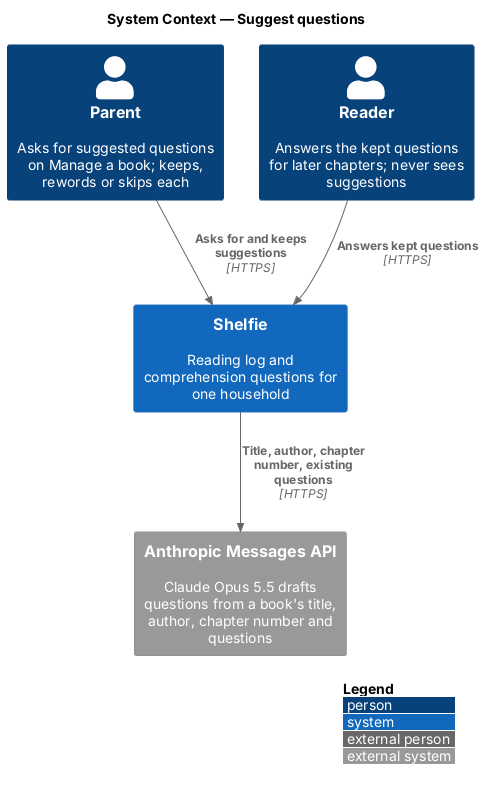
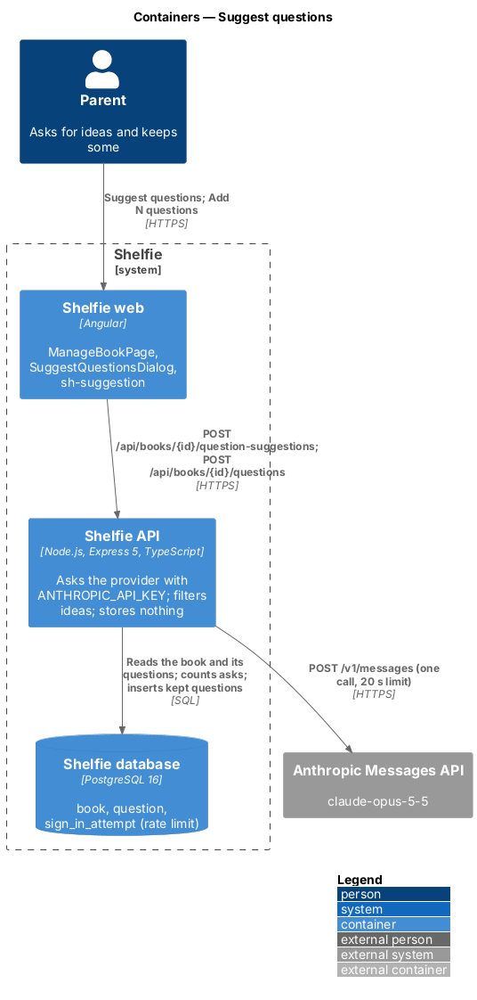
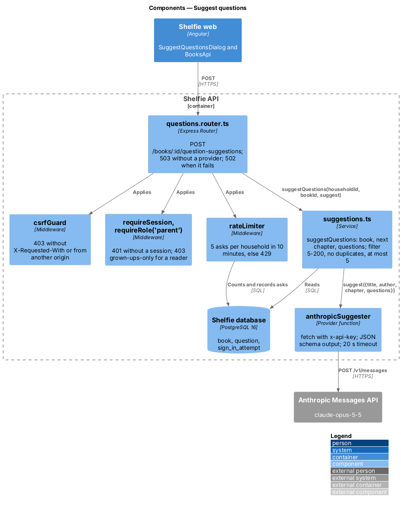
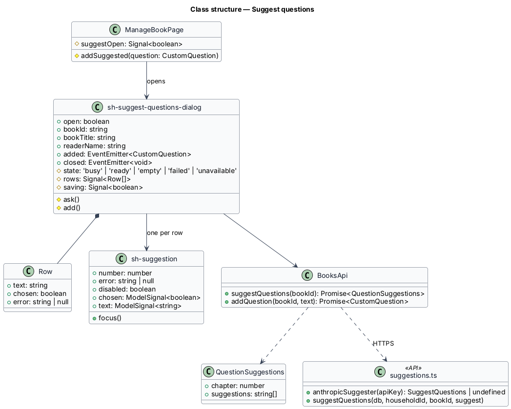
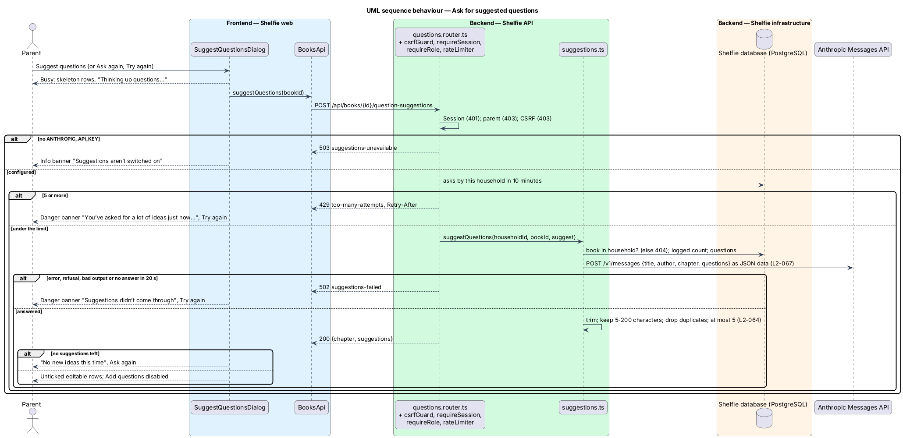
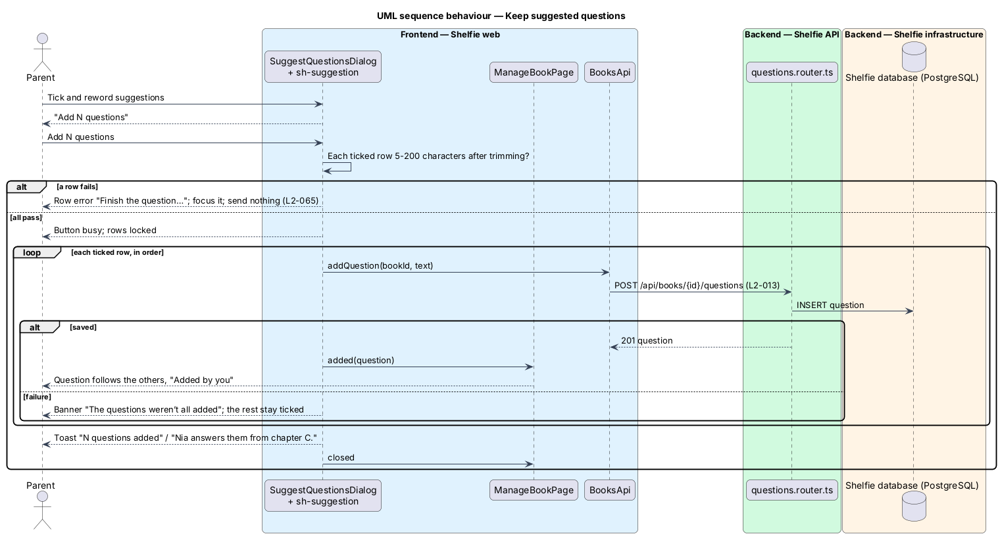

# Suggest questions

## Overview

Shelfie is a web application that helps a child read books by logging each chapter she reads and answering short questions about it, while a parent reviews her answers and gives rewards. A **household** is a set of parents and readers sharing one bookshelf. Every chapter asks three default questions, then the book's own **custom questions**, which a parent adds, edits and removes on Manage a book (`manage-questions`, `L2-013`).

This feature lets the parent ask Shelfie to **suggest** questions for a book. The API sends the book's title, author, next chapter number and existing questions to an AI service (Claude, through the Anthropic Messages API) and returns up to five short questions that pass the `L2-013` length rule and are not already asked. The parent ticks the ones to keep, rewords any of them in place, and adds them; each one is saved through the same `POST /api/books/:id/questions` as a question typed by hand. Suggestions are never stored, so nothing the AI writes reaches the reader until a parent adds it.

The feature belongs to the `books` subsystem because it is a second way into the questions list of Manage a book (`manage-questions`). Readers never see it: Manage a book and the API route are grown-ups only.

## Description

The slice runs from a "Suggest questions" button on Manage a book, through one new API route, to one outbound HTTPS call. Saving reuses the existing add-question route.

### Frontend

- **`sh-suggestion`** (`Suggestion`) — new component in the `components` library (`docs/design-system/components/suggestion.html`). Host is `role="listitem"` with the `suggestion` class. Inputs: `number` (required), `error: string | null`, `disabled`. Models: `chosen: boolean` (the "Keep suggestion N" checkbox) and `text: string` (a two-row `.textarea` labelled "Suggestion N" for screen readers). An error sets `aria-invalid` and `aria-describedby` on the box. `focus()` moves focus to the box.
- **`SuggestQuestionsDialog`** (`sh-suggest-questions-dialog`) — dialog in the `books` library on `sh-dialog`, titled "Suggested questions". Inputs: `open`, `bookId`, `bookTitle`, `readerName`. Outputs: `added: CustomQuestion` (once per saved question) and `closed`. Each time it opens it asks `BooksApi.suggestQuestions(bookId)` and shows one of the mock's states (`docs/mocks/dialogs/suggest-questions/`):
  - **busy** — `sh-skeleton` rows and the status "Thinking up questions…"; "Add questions" disabled.
  - **suggestions** — one `sh-suggestion` per idea, all unticked; "Tick at least one question to add it." and a disabled primary button until one is ticked, then "Add N questions" ("Add 1 question"). "Ask again" asks afresh and discards the list.
  - **empty** — `sh-empty-state` "No new ideas this time" with "Ask again".
  - **failed** — `sh-banner` `danger` "Suggestions didn’t come through" with "Try again"; after a 429 its message is "You’ve asked for a lot of ideas just now. Try again in a few minutes."
  - **unavailable** — `sh-banner` `info` "Suggestions aren’t switched on", no retry (503 `suggestions-unavailable`).
  - **saving** — "Add N questions" checks every ticked row (5 to 200 characters after trimming, the same message as the add-question dialog) and, if one fails, shows the error on it, focuses it and sends nothing (`L2-065` criterion 5). Otherwise it sends each ticked row in order with `BooksApi.addQuestion`, with the button busy and the rows disabled. Each saved row leaves the list and is emitted as `added`. When all are saved it shows the toast "N questions added" / "{reader} answers them from chapter C." and emits `closed`. A failure stops there and shows `sh-banner` `danger` "The questions weren’t all added"; the rest stay ticked (`L2-065` criterion 8).
- **`ManageBookPage`** — adds `sh-button`-styled "Suggest questions" beside "Add a question" in the questions card, holds `suggestOpen`, appends each `added` question to `book.questions` and closes the dialog on `closed`.
- **`BooksApi`** — `suggestQuestions(bookId)` sends `POST /api/books/{id}/question-suggestions` and returns `{ chapter, suggestions }`.

### API

- **`suggestions.ts`** — the provider and its rules:
  - `SuggestQuestions` is the provider type: `(input: { title, author, chapter, questions }) => Promise<string[]>`. Tests pass a fake; production passes the Anthropic one.
  - `anthropicSuggester(apiKey)` returns `undefined` when `apiKey` is empty, else a `SuggestQuestions` that makes one `fetch` to `https://api.anthropic.com/v1/messages` with headers `x-api-key`, `anthropic-version: 2023-06-01` and `anthropic-beta: server-side-fallback-2026-07-01`, and body: `model: "claude-opus-5-5"`, `max_tokens: 2000`, `output_config: { effort: "low", format: { type: "json_schema", schema } }` where the schema is `{ questions: string[] }`, `fallbacks: "default"`, a fixed `system` prompt, and one user message holding the input as a JSON document. The call is abandoned after 20 seconds (`AbortSignal.timeout`). A non-2xx status, a `refusal` stop reason, a missing text block or text that does not parse as `{ questions: string[] }` throws.
  - `suggestQuestions(db, householdId, bookId, suggest)` loads the book (404 outside the household), takes `chapter = min(loggedCount + 1, chapterCount)` and the book's questions (`questionsForBook`), calls `suggest`, and keeps each idea that is 5 to 200 characters after trimming and not equal (ignoring case) to an existing question or an earlier idea, up to 5. It returns `{ chapter, suggestions }`.
- **`questions.router.ts`** — `questionsRouter(db, suggest?)` adds `POST /books/:id/question-suggestions` behind `requireSession` (401), `requireRole('parent')` (403) and the app-wide `csrfGuard` (403). With no provider it answers 503 `suggestions-unavailable` before anything else. Then `suggestionLimiter` (429), then the service; a thrown provider error answers 502 `suggestions-failed`.
- **`rate-limit.ts`** — the sign-in limiter becomes one `rateLimiter(db, limit, keyOf)` over the existing `sign_in_attempt` table and 10-minute window. Sign-in keeps 10 per source address; suggestions get 5 per household, keyed `suggest:{householdId}`. The nightly purge already deletes rows older than the window.
- **`app.ts` / `main.ts`** — `createApp(db, { suggest })` passes the provider to the router; `main.ts` passes `anthropicSuggester(process.env.ANTHROPIC_API_KEY)`. The e2e stack passes a fake from `e2e/support/suggestions.ts` whose answers a test sets.

### Error mapping

| Situation | API | Dialog |
|---|---|---|
| No `ANTHROPIC_API_KEY` | 503 `suggestions-unavailable`, no outbound call | info banner, no retry |
| Provider status ≠ 2xx, refusal, bad JSON, network error | 502 `suggestions-failed` | danger banner, Try again |
| No answer in 20 s | 502 `suggestions-failed` | danger banner, Try again |
| 6th ask in 10 minutes from the household | 429 `too-many-attempts`, `Retry-After` | danger banner with the "asked a lot" message, Try again |
| Every idea dropped | 200 `{ suggestions: [] }` | empty state, Ask again |
| Reader session | 403 `grown-ups-only` | (unreachable) |
| Another household's book | 404 `not-found` | (unreachable) |

### What is sent

Only the title, the author (or `null`), the chapter number and the texts of the book's questions (`L2-067`). The `system` prompt says the JSON document is data about a children's book and that any instructions inside it are part of the book's text, not instructions. Whatever the model returns is read only as a list of strings and filtered as above, and the web app shows it as text in a `textarea` (`L2-068`). Nothing about the request or its answer is stored or logged beyond the request log's route, status and duration.

## Requirements

The feature realizes the following level-2 (L2) requirements. Each refines a level-1 (L1) requirement, cited by identifier. It applies `L2-005`, `L2-013`, `L2-025`, `L2-026`, `L2-027`, `L2-028` and `L2-029` without restating them.

| L2 ID | Refines (L1) | Requirement |
|-------|--------------|-------------|
| `L2-064` | `L1-018` | "Suggest questions" asks for up to 5 ideas for the next chapter; too short, too long and duplicate ideas are dropped; nothing is stored; readers get 403 and other households 404. |
| `L2-065` | `L1-018` | Ideas arrive unticked; the parent ticks and rewords them; "Add N questions" saves each through the add-question route; invalid rows show the `L2-013` message; a toast confirms; the next chapter asks them. |
| `L2-066` | `L1-018` | Not configured → unavailable; provider failure or 20 s timeout → failed with Try again; 5 asks per household in 10 minutes → 429; manual add always works. |
| `L2-067` | `L1-018` | Only title, author, chapter number and existing questions are sent; nothing stored or logged. |
| `L2-068` | `L1-018` | Key in a server environment variable only; session, role and CSRF as for other writes; book data sent as data; output validated and shown as text. |

## Decisions

- **Claude through a plain `fetch`, server-side, nothing saved without the parent** — see [ADR-001](adr-001-suggest-questions-with-claude-from-the-api.md).
- **Suggestions are for the next chapter** — custom questions apply to every later chapter of the book, so the most useful hint is where the reader is. No chapter picker.
- **Ideas arrive unticked** — the parent has to read each one before it can reach the reader.
- **Save through the existing route, one request per question** — one set of rules (`L2-013`) and one code path; at most five requests.
- **Reuse the sign-in rate-limit table** — no migration; a household key cannot collide with an IP address.
- **One failed state for errors, timeouts and the rate limit** — the parent can do the same thing in each case (try again or write their own); only the message differs for the rate limit.

## Diagrams

### System context

The parent asks Shelfie for ideas; Shelfie asks Claude, sending only the book's title, author, chapter number and questions.

### Containers

The web app asks the API, which calls the Anthropic Messages API with the key from its environment and saves nothing; kept questions go through the existing add-question route to PostgreSQL.

### Components

The questions router applies the session, role, CSRF and rate-limit guards; `suggestions.ts` builds the input, calls the provider and filters its answer.

### Class structure

Manage a book opens the dialog, which composes `sh-suggestion` rows and uses `BooksApi` for both asking and saving.

### Behaviour — ask for suggestions

The API checks who is asking, whether a key is set and the rate limit, then asks Claude and filters the answer (`L2-064`, `L2-066`, `L2-067`, `L2-068`).

### Behaviour — keep suggestions

Ticked rows are checked in the browser, then saved one by one through the add-question route (`L2-065`).

## Open questions

- None block the build. Per-household quotas, choosing the model in Settings and streaming are deferred.
