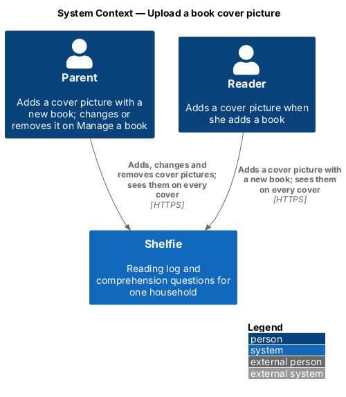
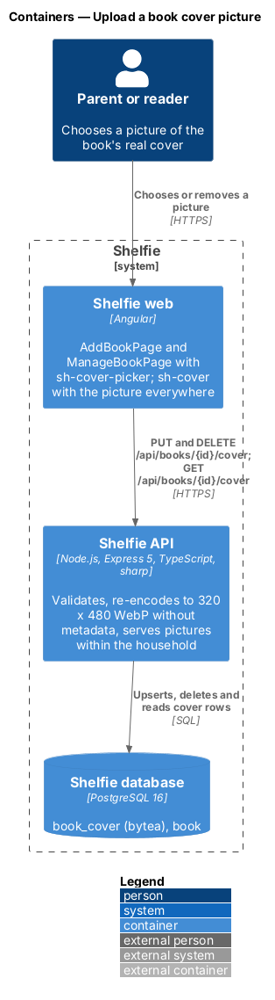
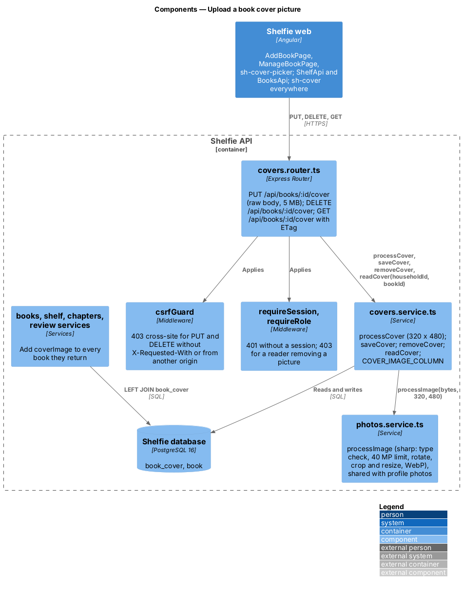
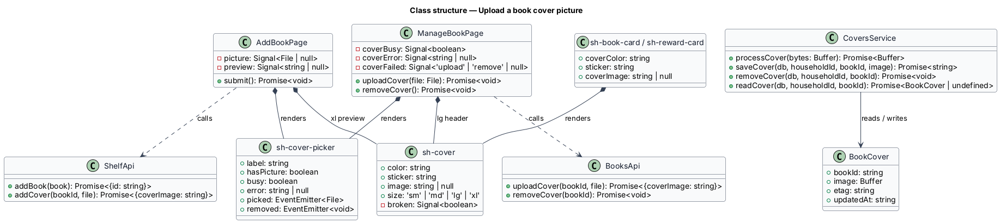
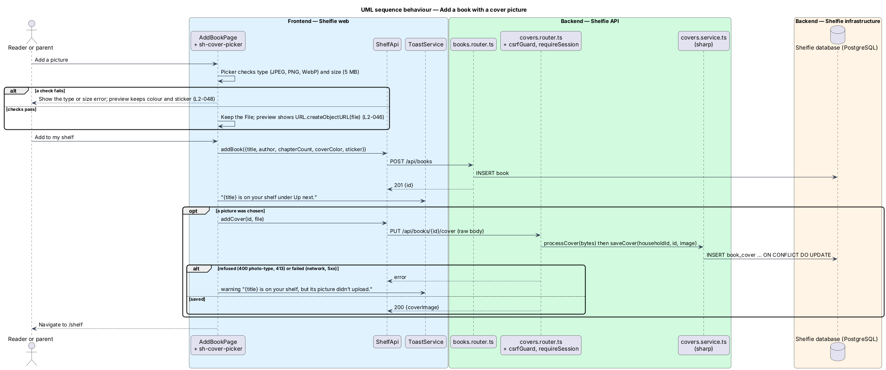
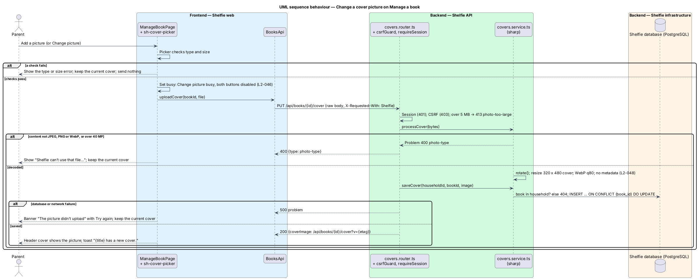
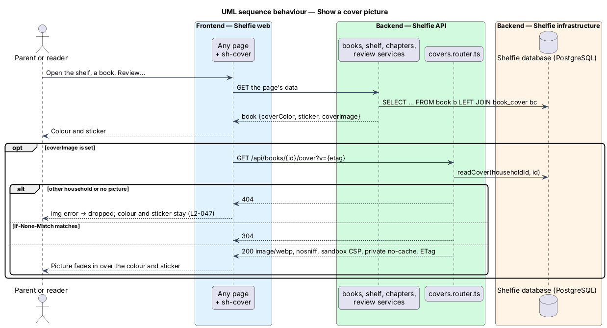
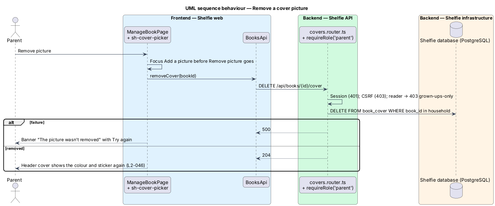

# Upload a book cover picture

## Overview

Shelfie is a web application that helps a child read books by logging each chapter she reads and answering short questions about it, while a parent reviews her answers and gives rewards. A **household** is a set of parents and readers sharing one bookshelf. Every book has a **cover**: a pastel tile in one of seven colours with a sticker, chosen when the book is added (`add-book`).

This feature lets a book also have a **cover picture**, such as a photo of the book's real cover. The picture shows over the colour and sticker wherever the cover appears: the shelf, the book page, Log a chapter and its celebration, Chapter answers, Review, Review a chapter, Give a reward, Books and Manage a book. Without a picture, while it loads, or if it fails to load, the colour and sticker show exactly as before. Colour and sticker stay required.

The reader or the parent may add a picture on Add a book; it is kept in the browser and sent right after the book is saved. The parent changes or removes it on Manage a book, where choosing a picture uploads it at once. The API decodes every upload, re-encodes it as a 320 × 480 WebP without metadata and stores only that result in PostgreSQL, as profile photos do. Pictures are served only to signed-in members of the book's household.

The feature belongs to the `books` subsystem because the picture is part of the book, next to its colour and sticker (`add-book`) and its details (`manage-book`).

## Description

The slice runs from the Add a book and Manage a book pages to the `book_cover` table, and from every `sh-cover` to `GET /api/books/:id/cover`.

### Frontend

- **`sh-cover`** (`Cover`) — gains `image: string | null` (default `null`). When set, it draws `img.cover__img` with `alt=""` inside the `aria-hidden` tile, over the sticker. An image `error` event removes the image so the colour and sticker stay (`L2-047` criterion 3); a new `image` value tries again (`linkedSignal`, as `sh-avatar` does).
- **`sh-book-card`** and **`sh-reward-card`** — gain `coverImage: string | null` and pass it to their `sh-cover`.
- **`sh-cover-picker`** (`CoverPicker`) — new component in the `components` library. Inputs: `label` (required), `hasPicture`, `busy`, `error`. Outputs: `picked: File`, `removed: void`. It is a `role="group"` named by its label, with "Add a picture" ("Change picture" when `hasPicture`) as a `label.btn` around a visually hidden `input type="file" accept="image/jpeg,image/png,image/webp"`, and "Remove picture" only when `hasPicture`. Before emitting `picked` it refuses a file whose type is not JPEG, PNG or WebP ("Shelfie can’t use that file. Pick a JPEG, PNG or WebP picture.") or that is over 5 MB ("That picture is too big. Pick one under 5 MB.") and shows that error itself (`L2-048` criteria 1 and 2). The status line reads "Uploading the picture…" while `busy`. After Remove picture, once the picture is gone and nothing is uploading, focus moves to the file input (`afterRenderEffect`), because the Remove button itself disappears. It has no preview of its own: the page's `sh-cover` is the preview.
- **`AddBookPage`** (`shelf` library) — adds `sh-cover-picker` "Cover picture (optional)" under the sticker picker. `picked` keeps the `File` and sets the preview to `URL.createObjectURL(file)`, which the xl `sh-cover` shows; `removed` clears both. The object URL is revoked when it is replaced and when the page is destroyed. On submit it calls `ShelfApi.addBook`, shows the usual success toast and then, if a picture was chosen, calls `ShelfApi.addCover(id, file)` before going to the shelf. A failed picture upload, whatever the reason, does not undo the book: the page shows a `warning` toast "{title} is on your shelf, but its picture didn’t upload." and goes on to the shelf (`L2-046` criterion 4).
- **`ManageBookPage`** (`books` library) — adds `sh-cover-picker` "Cover picture" in the book header, under the progress bar, with `hasPicture` from `book.coverImage`. `picked` sets busy and calls `BooksApi.uploadCover`; success sets `book.coverImage` and shows a `success` toast "{title} has a new cover."; a 400 `photo-type` or a 413 `photo-too-large` becomes the picker error; any other failure shows `sh-banner` `danger` "The picture didn’t upload" with "Try again", which re-sends the same file. `removed` calls `BooksApi.removeCover` and sets `coverImage` to `null`; a failure shows "The picture wasn’t removed" with "Try again".
- **`ShelfApi`** (`shelf`) — `addCover(bookId, file)` sends the file as the raw body of `PUT /api/books/{id}/cover` through `ApiClient.put` and returns `{ coverImage }`.
- **`BooksApi`** (`books`) — `uploadCover(bookId, file)` (same request) and `removeCover(bookId)` (`DELETE /api/books/{id}/cover`).
- **Every cover** — each response type that carries `coverColor` gains `coverImage: string | null`, and every `sh-cover`, `sh-book-card` and `sh-reward-card` in the `shelf`, `books`, `log-chapter` and `review` libraries passes it.

### API

- **`003-book-cover.sql`** — migration that adds `book_cover (book_id TEXT PRIMARY KEY REFERENCES book(id) ON DELETE CASCADE, image BYTEA NOT NULL, etag TEXT NOT NULL, updated_at TEXT NOT NULL)`. The cascade from `book`, which cascades from `household`, deletes a picture with its book (`L2-010`) and with an erased household (`L2-041`) in the same statement (`L2-048` criterion 8).
- **`photos.service.ts`** — the decode-and-re-encode step moves into `processImage(bytes, width, height)`: `sharp` limited to 40 megapixels, only `jpeg`, `png` or `webp` (else `Problem(400, 'photo-type')`), `rotate()`, `resize(width, height, { fit: 'cover' })`, WebP quality 80, no metadata. `processPhoto(bytes)` becomes `processImage(bytes, 256, 256)`. The raw-body reader with its 413 `photo-too-large` answer is exported as `readImage` from `photos.router.ts` for both routers. Nothing else is shared: the two tables, URLs and scopes differ.
- **`covers.service.ts`** —
  - `processCover(bytes)` is `processImage(bytes, 320, 480)`: the cover's 2:3 shape at twice the 160 px of the largest cover (`L2-048` criterion 4).
  - `saveCover(db, householdId, bookId, image)` answers `Problem(404)` for a book outside the household, else upserts the row with `etag` = the first 16 hex characters of the SHA-256 of `image` and returns the URL.
  - `removeCover(db, householdId, bookId)` deletes the row of a book in the household (404 otherwise).
  - `readCover(db, householdId, bookId)` joins `book`, so a picture of another household reads as absent.
  - `COVER_IMAGE_COLUMN` is `/api/books/{id}/cover?v={etag}` as a SQL column over `book b LEFT JOIN book_cover bc`, used by the books, shelf, chapters and review queries; `coverImageUrl(bookId, etag)` builds the same URL in code.
- **`covers.router.ts`** — mounted at `/api/books` after `csrfGuard`, every route behind `requireSession` (401):
  - `PUT /:id/cover` (`requireRole('reader')`, so any session) reads the body with `readImage`, processes, saves and answers 200 `{ coverImage }`; an empty body is 400 `photo-type`.
  - `DELETE /:id/cover` (`requireRole('parent')`, 403 `grown-ups-only` for a reader) removes and answers 204.
  - `GET /:id/cover` answers 404 when the household has no such picture; otherwise the same headers as a profile photo: `ETag`, `Content-Type: image/webp`, `Cache-Control: private, no-cache`, `Content-Security-Policy: default-src 'none'; sandbox`, and `X-Content-Type-Options: nosniff`; a matching `If-None-Match` answers 304 (`L2-048` criterion 6).
- **Views** — `getBook`, `listBooks`, the shelf's reading, up-next and finished books, the log-chapter form, a chapter log, the review queue and finished-book rows add `coverImage` from `COVER_IMAGE_COLUMN`.
- **Logging** — the request log records route, status and duration only (`L2-048` criterion 9).

### Limits

| Limit | Value | Where |
|---|---|---|
| Types accepted | JPEG, PNG, WebP (decoded content) | `sh-cover-picker` (declared type), `processImage` (content) |
| Upload size | 5 MB | `sh-cover-picker`, `readImage` |
| Decoded size | 40 megapixels | `sharp` `limitInputPixels` |
| Stored picture | 320 × 480 WebP, quality 80, no metadata (about 15–40 kB) | `processCover` |

Cropping in the browser, an in-app camera, cover lookup by title or ISBN and more than one picture per book are out of scope.

## Requirements

The feature realizes the following level-2 (L2) requirements. Each refines a level-1 (L1) requirement, cited by identifier. It applies `L2-005`, `L2-006`, `L2-010`, `L2-025`, `L2-026`, `L2-027`, `L2-029`, `L2-031`, `L2-039`, `L2-041` and the photo rules of `L2-044` and `L2-045` to cover pictures without restating them, and leaves the colour and sticker of `L2-009` unchanged.

| L2 ID | Refines (L1) | Requirement |
|-------|--------------|-------------|
| `L2-046` | `L1-003` | Reader or parent adds an optional picture on Add a book (sent after the book is saved; a failed picture still adds the book with a warning). The parent changes or removes it on Manage a book, uploading at once, busy while uploading, Try again on failure. A reader may add but never remove. |
| `L2-047` | `L1-003` | The picture fills the cover wherever the cover shows; without one, while loading or on failure the colour and sticker show; it is decorative. |
| `L2-048` | `L1-003` | Same type, size and 40 MP refusals as photos; stored as 320 × 480 WebP without metadata; 401 without a session, 404 across households; safe headers with `ETag`; CSRF-protected; deleted with its book and its household; never logged. |

## Decisions

- **Storage in PostgreSQL** — as for profile photos; see the settings design's [ADR-001](../../settings/upload-profile-photo/adr-001-store-profile-photos-in-postgresql.md). At 15–40 kB per book the same reasoning holds.
- **Add a book sends the picture second** — the book is created first and the picture follows in its own request; a failed picture does not fail the book. See [ADR-001](adr-001-send-the-add-book-picture-after-the-book.md).
- **320 × 480** — the cover is always 2:3; 320 px is twice the widest cover (`--size-cover-xl`, 160 px), so it is sharp on high-density screens at every size.
- **Same problem types as photos** — `photo-type` and `photo-too-large` describe the image, not whose it is, so the API and the pickers share them.
- **A reader adds, only a parent removes** — the reader may add books (`L2-009`), so she may give a new book its picture; changing and removing stay on Manage a book, which is grown-ups only (`L2-010`).
- **Upload on choose on Manage a book** — as for profile photos; the Details form's Save is for text only.
- **Removal without confirmation** — the colour and sticker come straight back and a picture can be chosen again (`docs/mocks/manifest.json`).

## Diagrams

### System context

The parent and the reader add cover pictures; everyone in the household sees them on the covers.

### Containers

The web app sends the file to the Express API, which re-encodes it with `sharp` and stores the result in PostgreSQL; every cover then loads the picture from the API.

### Components

The covers router applies the session, role and CSRF guards and the size limit; `covers.service.ts` re-encodes through the shared `processImage` and stores the picture; the views add its URL to every book.

### Class structure

Both pages compose `sh-cover-picker` and use their `sh-cover` as the preview; `sh-book-card` and `sh-reward-card` pass the picture to their cover.

### Behaviour — add a book with a picture

The book is saved first, then its picture; a refused or failed picture leaves the book added with a warning (`L2-046`).

### Behaviour — change a picture

On Manage a book a chosen picture uploads at once; refusals show in the picker and failures in a banner with Try again (`L2-046`, `L2-048`).

### Behaviour — show a picture

Every cover gets the picture URL with its book; the API checks the household and answers 304 to a matching `ETag`, and a picture that fails to load leaves the colour and sticker (`L2-047`, `L2-048`).

### Behaviour — remove a picture

Removing deletes the row; the colour and sticker come back at once (`L2-046`).

## Open questions

- None block the build.
