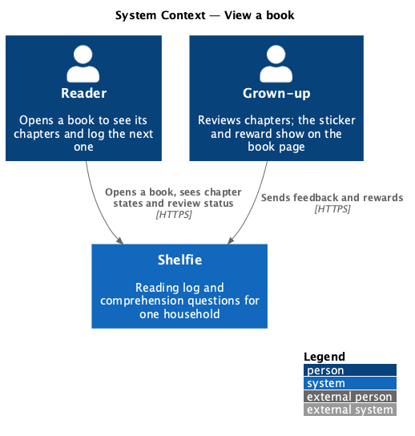
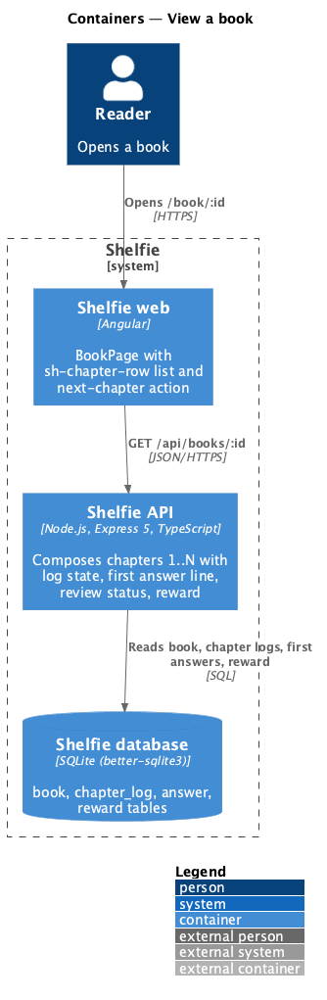
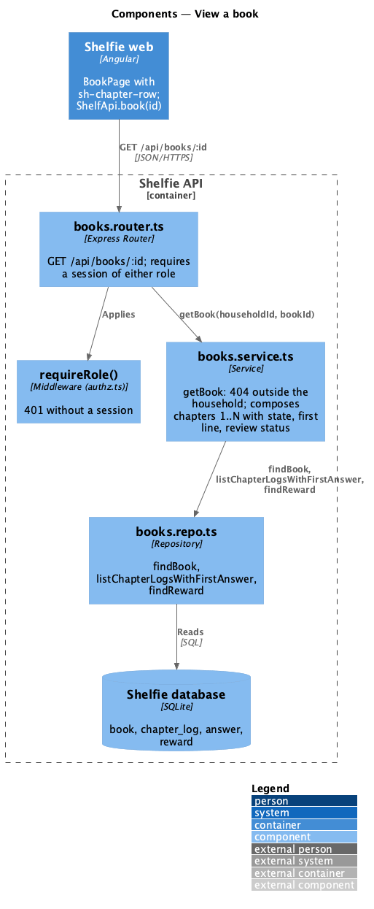
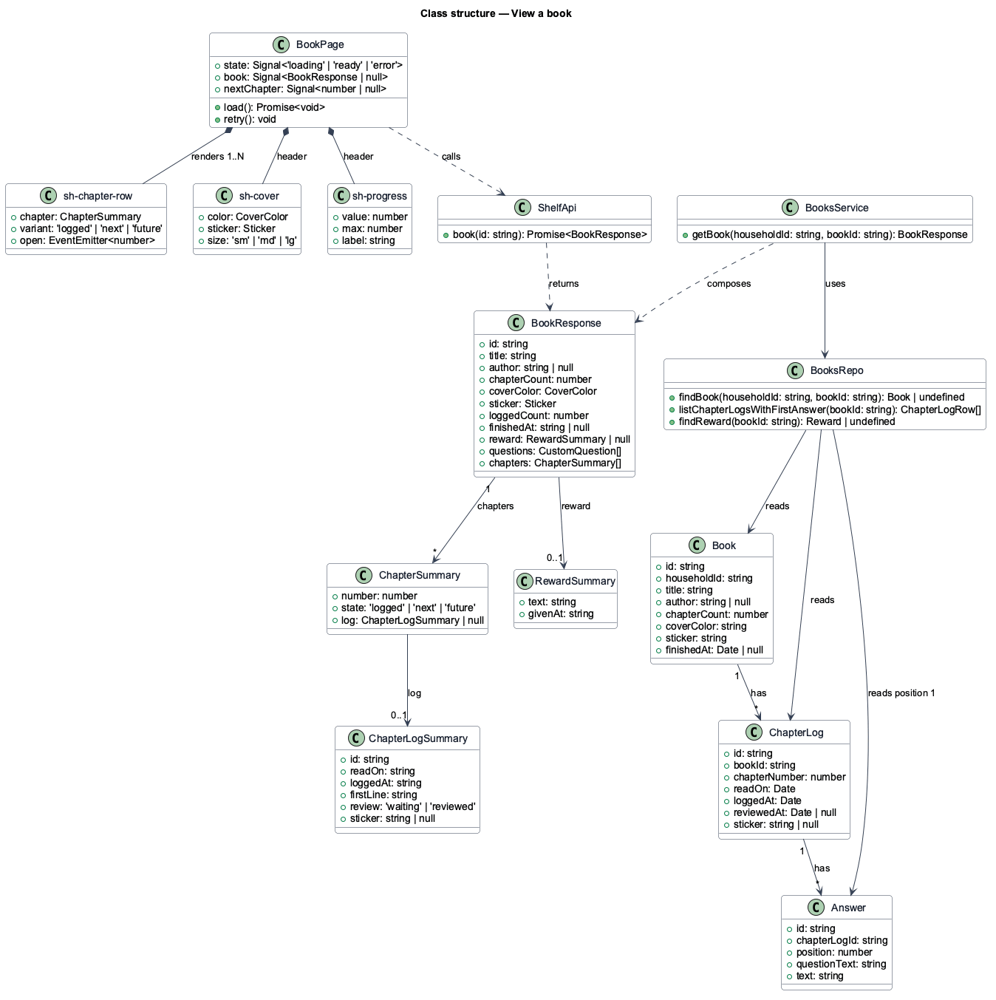
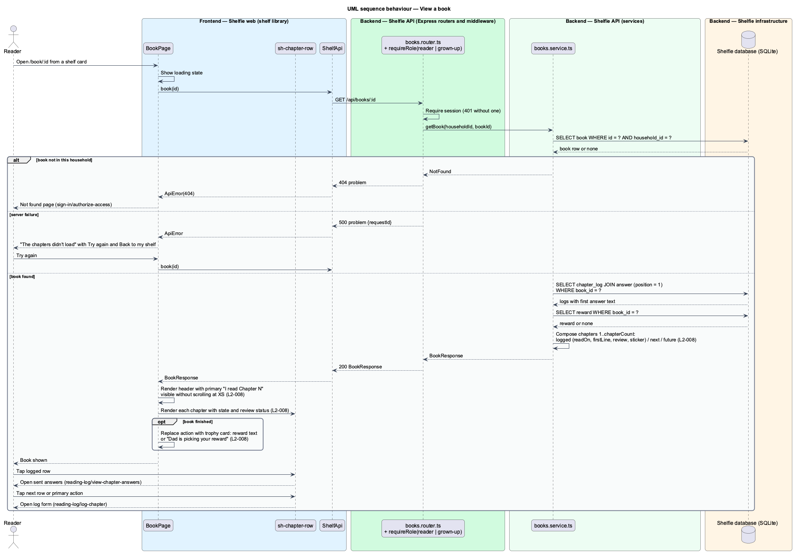

# View a book

## Overview

Shelfie is a web application that helps one child read books by logging each chapter she reads and answering short questions about it, while a grown-up in the same household reviews her answers and gives rewards. A **household** is the unit of tenancy: exactly one reader profile and one grown-up profile, sharing one bookshelf.

This feature is the **book page**: one book's cover, progress and the full list of its chapters. Chapters are numbered, not titled; a book added with 17 chapters has rows 1 to 17. A **chapter log** is the record that the reader read a chapter on a date, together with her answers. A chapter row is in one of three states: **logged** (a chapter log exists), **next** (the lowest unlogged chapter) or **future** (every later chapter). A logged row shows the date it was read, the first line of her first answer in place of a title, and its **review status**: "Waiting for Dad" until the grown-up sends feedback, then the sticker the grown-up gave. A logged row opens her sent answers (reading-log/view-chapter-answers); the next row and the page's primary action open the log form (reading-log/log-chapter); future rows are not tappable.

A **finished** book, one whose every chapter is logged, shows a trophy card instead of the primary action: the reward the grown-up gave (review/give-reward), or a line saying the reward is being picked.

The feature sits in the `books` subsystem beside the shelf, adding a book, managing a book and managing questions. The same read endpoint serves the grown-up's manage page (manage-book).

## Description

The slice runs from `BookPage` to the `book`, `chapter_log`, `answer` and `reward` tables through one read endpoint.

- **`BookPage`** — page component in the `shelf` library, at route `/book/:id`. On load it calls `ShelfApi.book(id)` and renders the breadcrumb ("My shelf"), the header (`sh-cover`, title, author, `sh-progress` with "11 of 17 chapters"), the primary action "I read Chapter N" for the next chapter, and one `sh-chapter-row` per chapter. It owns the `default`, `loading`, `error`, `finished` and `edge` states in `docs/mocks/pages/book/`. The primary action sits in the header so it is visible without scrolling at XS (`L2-008`). For a finished book the header reads "21 of 21 · finished!" and a trophy card replaces the action: the `sh-reward-card` content when a reward exists, otherwise "Dad is picking your reward. It will show up here and on your shelf." with "Back to my shelf". The `edge` state collapses future rows after the first ten rows under a disclosure "Chapters 11 to 80 (70 more)"; the chapter count above which rows collapse is `<TO SUPPLY>` (the 17- and 21-chapter mocks do not collapse, the 80-chapter mock does).
- **`sh-chapter-row`** — component in the `components` library: a number badge (check mark when logged), "Chapter N", a meta line (date · first line of answer 1, or "Up next · tap when you've read it") and a status slot ("Waiting for Dad", or the sticker with "Dad read it"). Variants `logged` (link), `next` (link, emphasised) and `future` (static, not focusable). Dates render relative: "Today, 4:12 pm", "Yesterday", then "Tue 13 Oct".
- **`ShelfApi.book(id)`** — calls `GET /api/books/:id` and returns a typed `BookResponse` or throws `ApiError`.
- **`books.router.ts`** — Express router. `GET /api/books/:id` requires a session of either role through `requireRole` from `authz.ts` and calls the service with the session's `householdId` and the path id.
- **`books.service.ts`** — `getBook(householdId, bookId)`: loads the book, answers 404 when it does not belong to the household (`L2-006`, sign-in/authorize-access), loads its chapter logs with the text of the answer at position 1, loads its reward, and composes `chapters[1..chapterCount]` with each row's state. The first line is the answer text up to its first line break; truncation to the row width is done in CSS.
- **`books.repo.ts`** — parameterised SQL: `findBook(householdId, bookId)`, `listChapterLogsWithFirstAnswer(bookId)` over `chapter_log` joined to `answer WHERE position = 1`, `findReward(bookId)`.
- **`BookResponse`** — `{ id, title, author, chapterCount, coverColor, sticker, loggedCount, finishedAt, reward, questions, chapters[] }`. A `ChapterSummary` carries `number`, `state: 'logged' | 'next' | 'future'` and `log` (`id`, `readOn`, `loggedAt`, `firstLine`, `review: 'waiting' | 'reviewed'`, `sticker`) or `null`. `questions` lists the book's active custom questions for the manage page (manage-questions) and is not rendered here.

The `error` state ("The chapters didn't load", "Try again", "Back to my shelf") covers a 500 and an unreachable server; a 404 routes to the Not found page (sign-in/authorize-access). A `next` row exists only while `loggedCount` is below `chapterCount`.

## Requirements

The feature realizes the following level-2 (L2) requirements. Each refines a level-1 (L1) requirement, cited by identifier.

| L2 ID | Refines (L1) | Requirement |
|-------|--------------|-------------|
| `L2-008` | `L1-003` | The book page shall list the chapters with logged or not-logged state and review status. A logged chapter's row shall display the first line of her first answer instead of a title. A primary "Log chapter N" action for the next unlogged chapter shall be visible without scrolling at XS. A finished book shall show its reward, if any. |

## Diagrams

### System context

The reader opens a book from her shelf to see its chapters and pick the next one; the grown-up's feedback and reward show on the same page.

### Containers

The book page in the Angular application reads one response from the Express API, which composes it from the SQLite database.

### Components

Inside the API, the books router delegates to `books.service.ts`, which reads the book, its chapter logs with first answers and its reward through `books.repo.ts`.

### Class structure

`BookPage` composes `sh-chapter-row` and calls `ShelfApi`; the service composes `ChapterSummary` rows from `Book`, `ChapterLog` and `Answer`.

### Behaviour — view a book

The happy path composes the chapter rows and the next-chapter action (`L2-008`); the alternate paths show a book outside the household and a load failure with retry.

