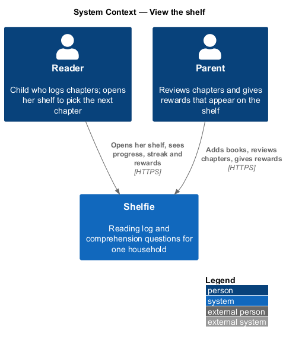
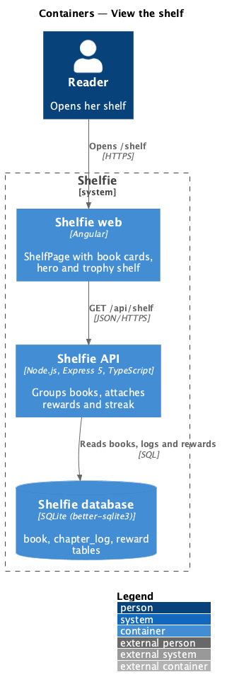
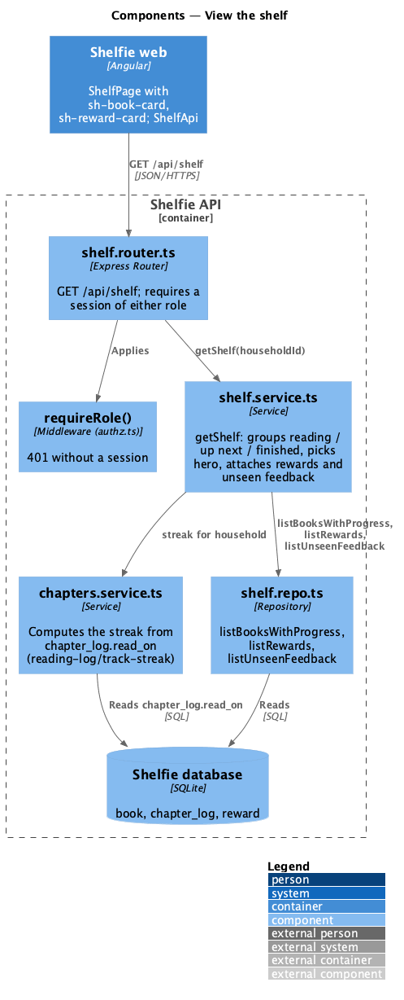
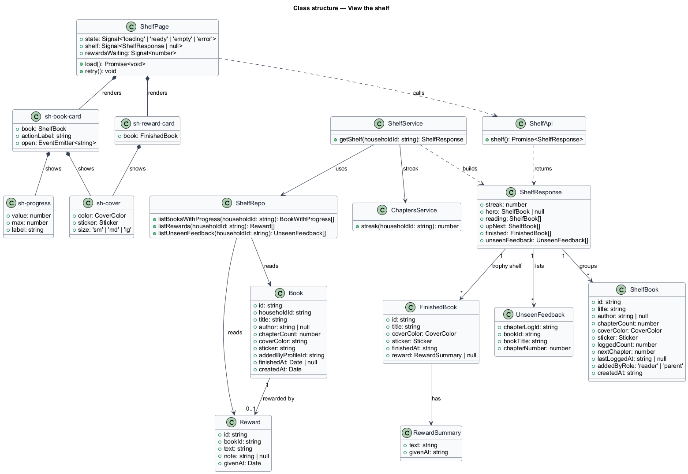
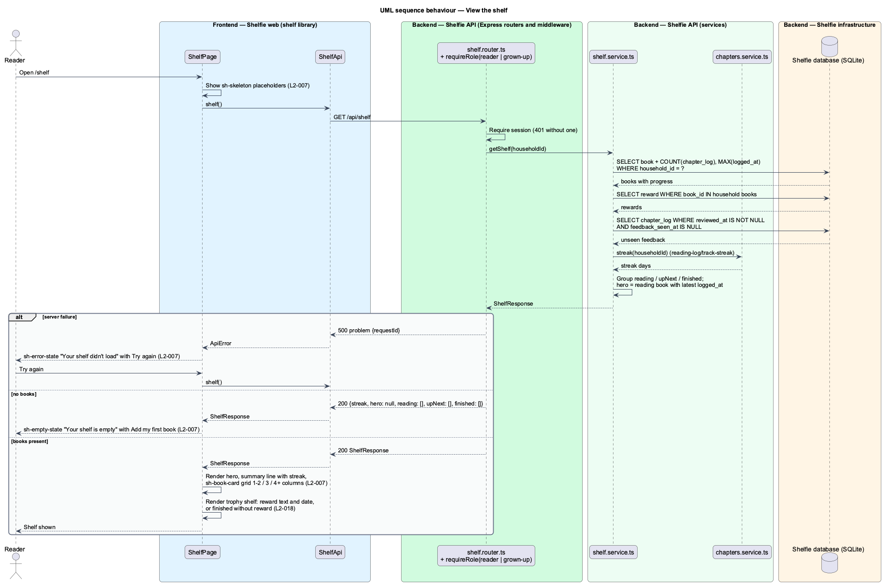

# View the shelf

## Overview

Shelfie is a web application that helps one child read books by logging each chapter she reads and answering short questions about it, while a parent in the same household reviews her answers and gives rewards. A **household** is the unit of tenancy: its parents and readers share one bookshelf.

This feature is the reader's home page. The **shelf** is the list of the household's books, grouped by where each book stands: **reading** (at least one chapter logged and not finished), **up next** (no chapter logged yet) and **finished** (every chapter logged). Each book shows its made cover, a pastel colour plus a sticker chosen when the book was added, its title and its **progress**, the count of logged chapters out of the chapter count.

Above the groups sits the **hero**, a larger card for the book the reader logged most recently, with a primary action for its next chapter. The page greeting carries the **streak**, the number of consecutive days with at least one chapter logged. The streak is derived from logged chapters and never stored; the `chapters` module computes it (reading-log/track-streak).

The finished group doubles as the **trophy shelf**: each finished book shows the **reward** the parent gave for it (review/give-reward), or a line saying the reward is still being picked. When the parent has reviewed a chapter the reader has not yet opened, the shelf response names that **unseen feedback** so the shelf can show the feedback banner; the banner itself is owned by review/review-chapter.

The feature sits in the `books` subsystem beside the book page, adding a book, managing a book and managing questions. The "Add a book" button on the shelf opens add-book; a book card opens view-book; the hero and card actions open reading-log/log-chapter.

## Description

The slice runs from `ShelfPage` to the `book`, `chapter_log` and `reward` tables through one read endpoint.

- **`ShelfPage`** — page component in the `shelf` library, at route `/shelf`. On load it calls `ShelfApi.shelf()` and renders the greeting ("Hi Nia"), the summary line (streak, books on the go, finished count, rewards waiting), the hero, the reading and up-next grids and the trophy shelf. It owns the `default`, `loading`, `empty`, `error` and `long` states in `docs/mocks/pages/shelf/`. Between Up next and Finished it also shows the "Reading toward" reward gallery, loaded on its own, with the `goal-*` states; that section is designed in review/reward-gallery. The grid of book cards uses 1 column at XS (under 576 px), 2 at SM, 3 at MD and 4 at XL, with no horizontal scroll (`L2-007`). A book with 80 chapters renders "3 of 80" without overflow.
- **`sh-book-card`** — component in the `components` library: `sh-cover`, title, author or an "added" line ("Dad added this on Thursday"), `sh-progress` with the "11 of 17" label and an action slot ("Log Chapter 12", "Start with Chapter 1"). The card body links to the book page.
- **`sh-cover`** — component in the `components` library: a rounded tile in one of the seven cover colours with the sticker centred; sizes small (list), medium (card) and large (hero).
- **`sh-progress`** — component in the `components` library: a `progressbar` with `value`, `max` and an accessible label.
- **`sh-reward-card`** — component in the `components` library: one trophy-shelf row with `sh-cover`, book title and either the reward text with its date or "Finished Tue 13 Oct · Dad is picking your reward". Given a `target` instead of a book it is a gallery reward (review/reward-gallery).
- **`sh-skeleton`**, **`sh-empty-state`**, **`sh-error-state`** — components in the `components` library for the loading placeholders, the empty shelf ("Your shelf is empty", "Add my first book") and the load failure ("Your shelf didn't load", "Try again").
- **`ShelfApi`** — service in the `shelf` library built on `ApiClient`. `shelf()` calls `GET /api/shelf` and returns a typed `ShelfResponse` or throws `ApiError`.
- **`shelf.router.ts`** — Express router. `GET /api/shelf` requires a session of either role through `requireRole` from `authz.ts` (401 without one) and calls the service with the session's `householdId`.
- **`shelf.service.ts`** — `getShelf(householdId)`: loads every book of the household with its logged count and last `logged_at`, groups books into `reading`, `upNext` and `finished`, picks the hero as the reading book with the latest `logged_at`, attaches each finished book's reward, lists unseen feedback (`chapter_log` rows with `reviewed_at` set and `feedback_seen_at` null) and asks `chapters.service.ts` for the streak.
- **`shelf.repo.ts`** — parameterised SQL: `listBooksWithProgress(householdId)` over `book` joined to `chapter_log`, `listRewards(householdId)` over `reward`, `listUnseenFeedback(householdId)` over `chapter_log`.
- **`ShelfResponse`** — `{ streak, hero, reading[], upNext[], finished[], unseenFeedback[] }`. A `ShelfBook` carries `id`, `title`, `author`, `chapterCount`, `coverColor`, `sticker`, `loggedCount`, `nextChapter`, `lastLoggedAt`, `addedByRole` and `createdAt`. A `FinishedBook` carries `id`, `title`, `coverColor`, `sticker`, `finishedAt` and `reward` (`text`, `givenAt`) or `null`.

Ordering: reading books by `lastLoggedAt` descending, up-next books by `createdAt` descending, finished books by `finishedAt` descending with no pagination (the mock notes none is needed below 50 books). A book is finished when `book.finished_at` is set; reading-log/log-chapter sets it when the last chapter is logged. The summary line's "reward waiting" count is the number of finished books without a reward. The feedback banner (review/review-chapter) reads `unseenFeedback` from the same response. Caching of the response for offline reading is owned by shell/work-offline.

## Requirements

The feature realizes the following level-2 (L2) requirements. Each refines a level-1 (L1) requirement, cited by identifier.

| L2 ID | Refines (L1) | Requirement |
|-------|--------------|-------------|
| `L2-007` | `L1-003` | The reader's shelf shall show reading, up-next and finished books with cover colour, sticker, title and progress. With no books it shall show an empty state telling her to ask a parent to add a book. While loading it shall show skeleton placeholders; on a load failure it shall show an error state with retry. At XS, MD and XL viewports the grid shall use 1-2, 3 and 4 or more columns with no horizontal scroll. A book card with 80 or more chapters shall render progress without overflow. |
| `L2-018` | `L1-007` | The shelf shall show each reward given with its book and date. A finished book without a reward shall appear as finished without a reward. |

## Diagrams

### System context

The reader opens her shelf; the parent's reviews and rewards appear on it.

### Containers

The shelf page in the Angular application reads one response from the Express API, which assembles it from the PostgreSQL database.

### Components

Inside the API, the shelf router delegates to `shelf.service.ts`, which reads books, logs and rewards through `shelf.repo.ts` and takes the streak from `chapters.service.ts`.

### Class structure

`ShelfPage` composes `sh-book-card` and `sh-reward-card` and calls `ShelfApi`; the service groups `Book` rows into a `ShelfResponse`.

### Behaviour — view the shelf

The happy path groups the books and renders the hero, grids and trophy shelf (`L2-007`, `L2-018`); the alternate paths show the empty shelf and a load failure with retry.

