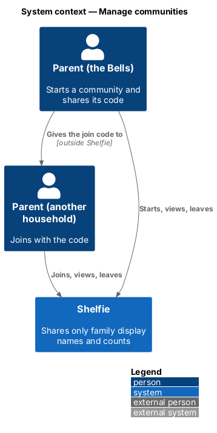
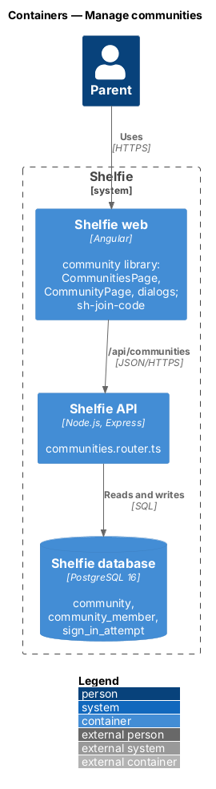
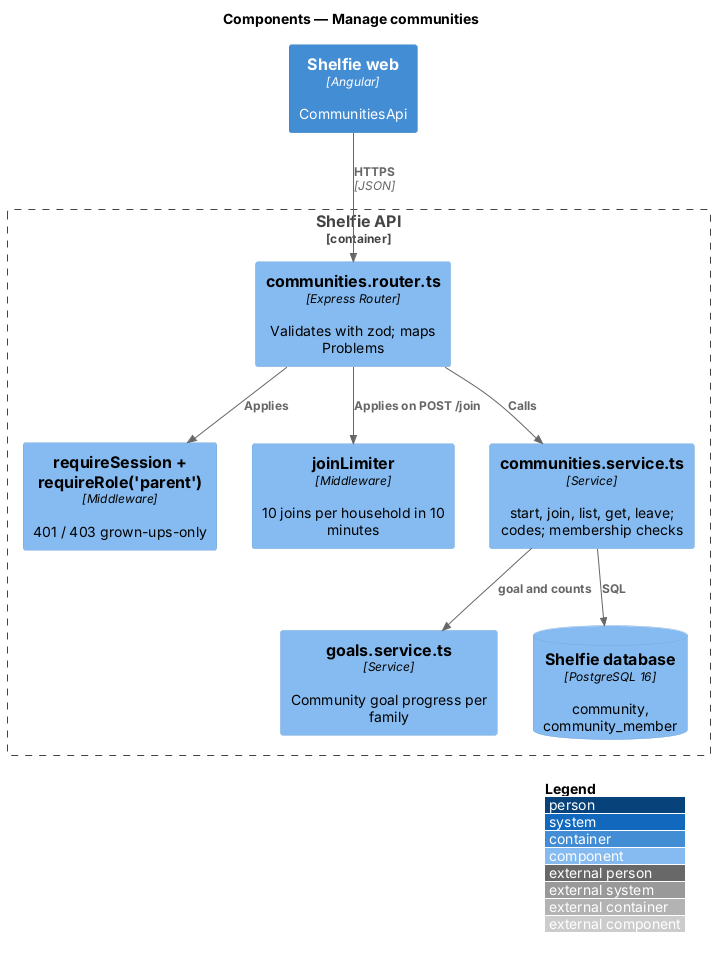
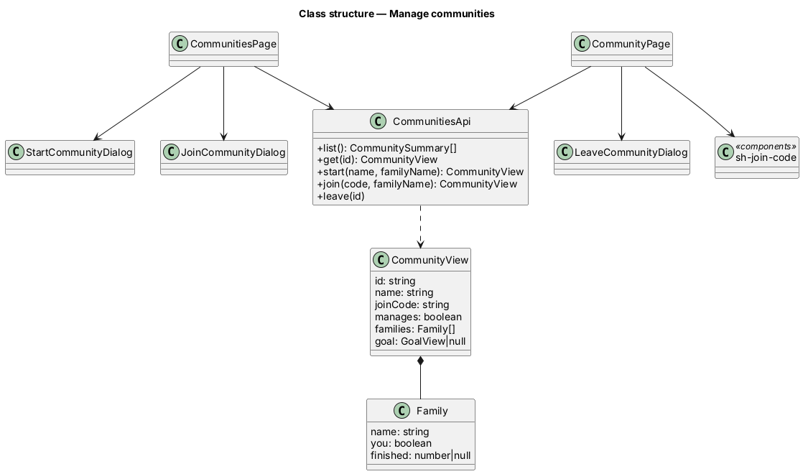
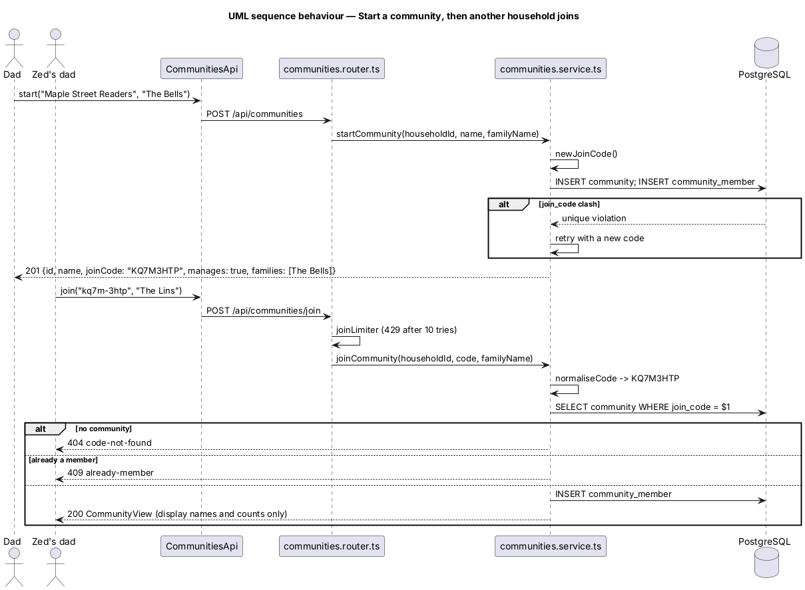
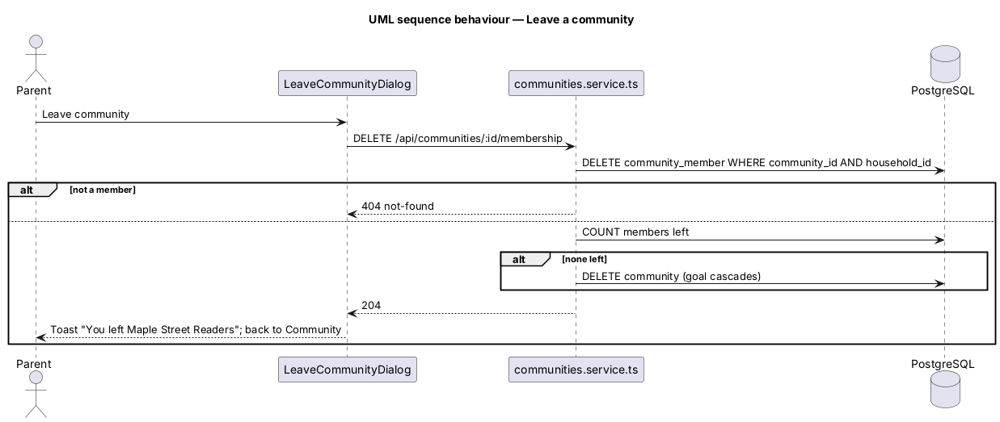

# Manage communities

## Overview

Shelfie is a web application that helps a child read books by logging each chapter she reads and answering short questions about it, while a parent reviews her answers and gives rewards. A **community** lets several households read together: a parent **starts** one, which gives it a name and a **join code**; a parent of another household **joins** it by typing that code; any member household can **leave**. A household can belong to several communities and sees the households in each.

The readers are children, so a community shares almost nothing: each member household shows only a **family display name** it chooses when it starts or joins ("The Bells") and its **count** toward the community's reading goal (`community/reading-goals`). Reader names, photos, usernames, book titles, answers, notes and rewards never cross households (`L1-030`). Only parents use communities; readers cannot reach them.

## Description

### Data

Migration `012-communities.sql`:

- **`community(id, name, join_code UNIQUE, created_at)`** — `name` 1 to 40 characters.
- **`community_member(community_id, household_id, display_name, joined_at)`** — primary key `(community_id, household_id)`; both foreign keys `ON DELETE CASCADE`; index on `household_id`.
- The **managing household** is the member with the earliest `joined_at` (then `household_id`): the starter joins first, and when it leaves or is erased the next one takes over. Nothing is stored for it (ADR-0020).

### API

`communities.router.ts`, mounted at `/api/communities`, behind `requireSession` and `requireRole('parent')` (a reader gets 403 `grown-ups-only`, `L2-152`):

| Route | Body | Answers |
|---|---|---|
| `GET /` | — | `{ communities: CommunitySummary[] }` |
| `POST /` | `{ name, familyName }` | 201 `CommunityView` |
| `POST /join` | `{ code, familyName }` | 200 `CommunityView`; 404 `code-not-found`; 409 `already-member`; 429 `too-many-attempts` |
| `GET /:id` | — | `CommunityView`; 404 `not-found` for a non-member |
| `DELETE /:id/membership` | — | 204; 404 for a non-member |
| `PUT /:id/goal`, `DELETE /:id/goal` | see `community/reading-goals` | |

- **`communities.service.ts`** — `startCommunity`, `joinCommunity`, `listCommunities`, `getCommunity`, `leaveCommunity`, `membership(db, communityId, householdId)` (404 for a non-member), `manages(...)`.
- **Join code** — `newJoinCode()` draws 8 characters from `ABCDEFGHJKMNPQRSTUVWXYZ23456789` with `crypto.randomInt`; a unique-violation retries. `normaliseCode(input)` upper-cases and strips spaces and hyphens before matching. Shown as `ABCD-EFGH`. No regeneration.
- **Rate limit** — `joinLimiter` in `rate-limit.ts`: 10 tries per household in 10 minutes, keyed `join:{householdId}` in `sign_in_attempt` (`L2-150`).
- **Leave** — in one transaction: delete the membership; if no member is left, delete the community (its goal cascades).
- **Privacy** — `CommunityView` is `{ id, name, joinCode, manages, families: { name, you, finished }[], goal }`. Families come from `community_member.display_name` only; the service never joins `profile` and never selects `book.title` (`L2-153`). Request logs carry the route pattern only (`L2-085`).
- **Erasure** — the household's memberships cascade; `docs/runbook.md` adds `DELETE FROM community c WHERE NOT EXISTS (SELECT 1 FROM community_member m WHERE m.community_id = c.id)` after the household `DELETE`.

### Frontend

A new feature library **`community`** (`apps/web/projects/community`), routed at `/communities` and `/communities/:id` behind `authGuard` and `grownUpGuard`; the shell adds a fourth parent tab "Community".

- **`CommunitiesPage`** — the household's reading goal (`community/reading-goals`) and the list of communities; Start a community and Join with a code; `sh-empty-state` with both actions when there are none; `sh-skeleton`; `sh-error-state`.
- **`CommunityPage`** — name, `sh-join-code`, the community's reading goal, the families with "You" and counts, Leave; "We can’t find that community" on 404.
- **`StartCommunityDialog`**, **`JoinCommunityDialog`**, **`LeaveCommunityDialog`** — `sh-dialog` with `sh-text-field`, `sh-button` and `sh-banner`, in the states of `docs/mocks/dialogs/{start,join,leave}-community/`.
- **`CommunitiesApi`** — `list`, `get`, `start`, `join`, `leave`, `setGoal`, `removeGoal`.
- **`sh-join-code`** (`components`) — the code and a Copy code button using `navigator.clipboard.writeText`, then "Copied!" for two seconds.
- Toasts through `ToastService`: "Joined {name}", "You left {name}" (`L2-162`).

## Requirements

| L2 ID | Refines (L1) | Requirement |
|-------|--------------|-------------|
| `L2-145` | `L1-030` | Start a community with a name of 1 to 40 characters. |
| `L2-146` | `L1-030` | A family display name per membership, 1 to 40 characters. |
| `L2-147` | `L1-030` | An 8-character join code, shown and copied. |
| `L2-148` | `L1-030` | Join with a code in any case; unknown code and already-a-member answers. |
| `L2-149` | `L1-030` | See communities and their families. |
| `L2-150` | `L1-030` | Joining is rate-limited per household. |
| `L2-151` | `L1-030` | Leave; management passes on; the last to leave deletes it. |
| `L2-152` | `L1-030`, `L1-031`, `L1-002` | Only parents; readers get 403 and the Grown-ups only page. |
| `L2-153` | `L1-030` | Non-members get 404; only display names and counts cross households; nothing in logs; erasure. |

Cross-references: `L2-006` (household isolation), `L2-084` (gallery isolation pattern), `L2-085` (no names in logs), `L2-027` (rate limits).

## Decisions

- ADR-0020 — join by an 8-character code, a family display name per membership, the first household to join manages the goal, Community as a fourth parent tab.

Deferred: regenerating a code; removing another household; transferring management by hand; deleting a community with members; chat, feeds, leaderboards; notifications about community activity.

## Diagrams

### System context

### Containers

### Components

### Class structure

### Behaviour — start and join

### Behaviour — leave

