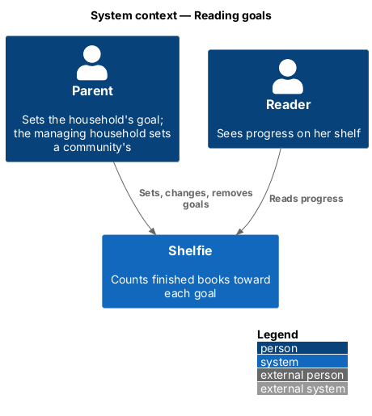
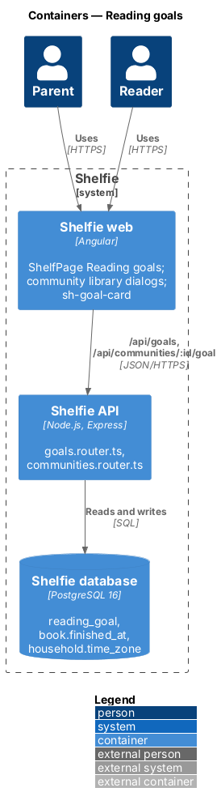
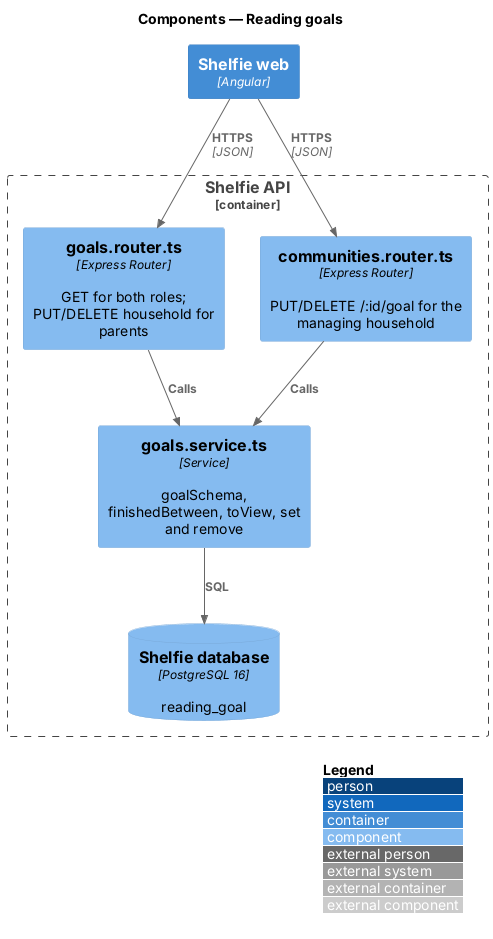
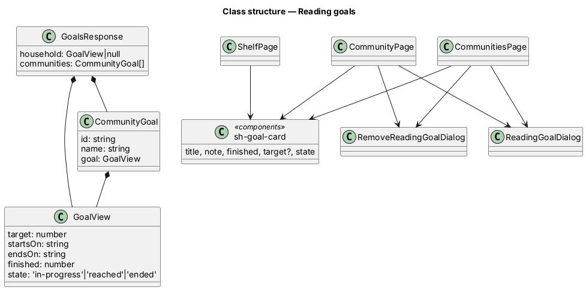
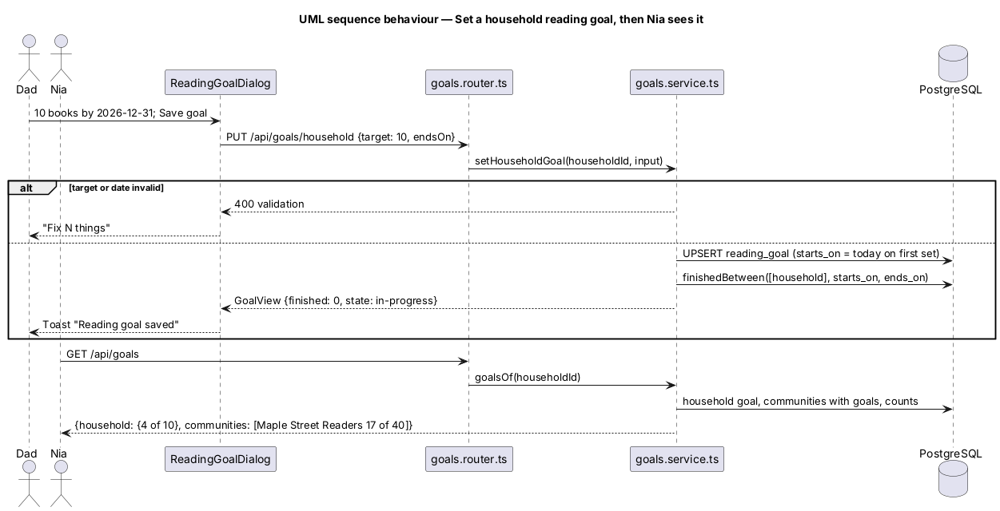

# Reading goals

## Overview

Shelfie is a web application that helps a child read books by logging each chapter she reads and answering short questions about it, while a parent reviews her answers and gives rewards. A **reading goal** is a shared target: a number of **finished books** by an **end date**. A parent sets one for the **household** (counting every reader of the household) and the managing household of a **community** (`community/manage-communities`) sets one for the community (counting every member household). Readers see their goals on the shelf; parents see and change them on the Community pages.

A reading goal is **in progress**, **reached** (the count reached the target, even after the end date) or **ended** (the end date passed short of the target). It is separate from the reward gallery's goal (`review/reward-gallery`, `L2-086` to `L2-089`), which is unchanged and keeps its own words, "Reading toward" and "Your goal"; the new target is always called "Reading goal" (ADR-0021).

## Description

### Data

Migration `013-reading-goals.sql`:

- **`reading_goal(id, household_id NULL, community_id NULL, target, starts_on, ends_on, created_at)`** — exactly one of `household_id` and `community_id` is set (`CHECK`); both cascade; partial unique indexes allow one goal per household and per community. `starts_on` and `ends_on` are `YYYY-MM-DD`.

### Counting

`goals.service.ts`:

- **`finishedBetween(db, householdIds, startsOn, endsOn)`** — per household, the count of its books whose `finished_at`, as a day in that household's `time_zone`, is from `starts_on` to `ends_on` inclusive: `to_char(b.finished_at::timestamptz AT TIME ZONE h.time_zone, 'YYYY-MM-DD') BETWEEN $2 AND $3`. Any reader's book counts; an unfinished book does not (`L2-155`).
- **`GoalView`** — `{ target, startsOn, endsOn, finished, state }` with `state` `reached` when `finished >= target`, else `ended` when the viewer's today is after `ends_on`, else `in-progress` (`L2-157`).
- **Validation** — `target` a whole number 1 to 100 (household) or 1 to 1,000 (community); `endsOn` an ISO date from the setter household's today to today + 366 days; else 400 `validation`.
- **Setting** — `starts_on` is the setter household's today on first set; an edit changes `target` and `ends_on` only (`L2-156`).

### API

`goals.router.ts`, mounted at `/api/goals`, behind `requireSession`:

| Route | Role | Body | Answers |
|---|---|---|---|
| `GET /` | reader or parent | — | `{ household: GoalView \| null, communities: { id, name, goal: GoalView }[] }` (only communities with a goal) |
| `PUT /household` | parent | `{ target, endsOn }` | `GoalView` |
| `DELETE /household` | parent | — | 204; 404 when there is none |

`communities.router.ts` adds, for members (404 otherwise) of the managing household (403 `owner-only` otherwise):

| Route | Body | Answers |
|---|---|---|
| `PUT /api/communities/:id/goal` | `{ target, endsOn }` | `CommunityView` |
| `DELETE /api/communities/:id/goal` | — | 204 |

`CommunityView.families[].finished` is each household's count toward the community goal, or null without one (`L2-161`). Nothing else of a household is returned.

### Frontend

- **`sh-goal-card`** (`components`) — `title`, `note`, `finished`, `target` (optional: none draws no bar), `state`, projected actions; built on `sh-progress`.
- **`CommunitiesPage`** — "Our reading goal": `sh-goal-card` with Edit and Remove, or "No reading goal yet" with Set a reading goal.
- **`CommunityPage`** — "Reading goal": the community's `sh-goal-card`; Edit / Remove / Set only when `manages`.
- **`ReadingGoalDialog`** — `sh-dialog`, `sh-text-field` number and date, states `default`, `edit`, `community`, `busy`, `invalid`, `failed`; toast "Reading goal saved".
- **`RemoveReadingGoalDialog`** — confirmation, states `default`, `community`, `busy`, `failed`.
- **`ShelfPage`** — "Reading goals" section from `GET /api/goals`, read-only `sh-goal-card`s; none hides the section; a reached household goal sits under `sh-celebration`; `ToastService` "Reading goal reached!" once per goal and device (key `shelfie.goal-reached.{startsOn}-{target}` in `localStorage`) (`L2-158`).

## Requirements

| L2 ID | Refines (L1) | Requirement |
|-------|--------------|-------------|
| `L2-154` | `L1-031` | Set a household reading goal; target 1 to 100, end date within a year. |
| `L2-155` | `L1-031` | Books finished from the start day to the end date, in the household's time zone. |
| `L2-156` | `L1-031` | Change or remove a household goal; the start stays. |
| `L2-157` | `L1-031` | In progress, reached and ended. |
| `L2-158` | `L1-031` | Readers see their goals on the shelf; the gallery goal is unchanged. |
| `L2-159` | `L1-031`, `L1-030` | The managing household sets, changes or removes a community goal. |
| `L2-160` | `L1-031`, `L1-030` | Community progress sums every member household. |
| `L2-161` | `L1-031`, `L1-030` | Each family's count, and nothing more. |
| `L2-162` | `L1-030`, `L1-031` | Toasts for joined, left, goal saved and goal reached. |

Cross-references: `L2-086` to `L2-089` (reward-gallery goal, unchanged), `L2-152` (authorisation), `L2-153` (privacy).

## Decisions

- ADR-0021 — books, not chapters; one table for both kinds; counted in each household's time zone; "Reading goal" wording.
- ADR-0020 — only the managing household changes a community goal.

Deferred: repeating goals, goal history, per-reader goals, leaderboards.

## Diagrams

### System context

### Containers

### Components

### Class structure

### Behaviour — set a goal and see progress

