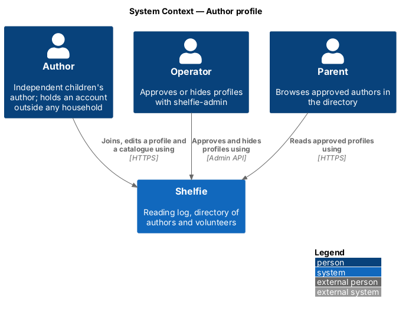
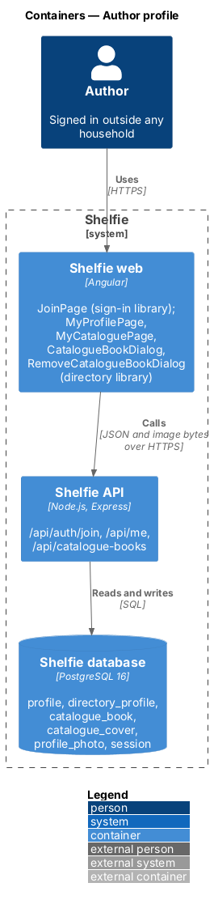
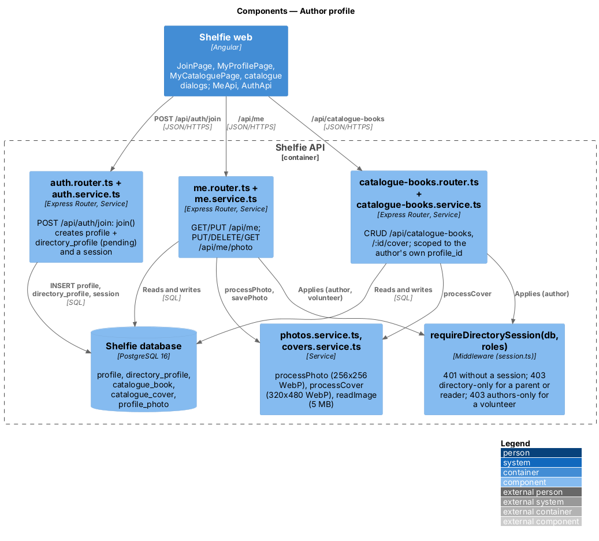
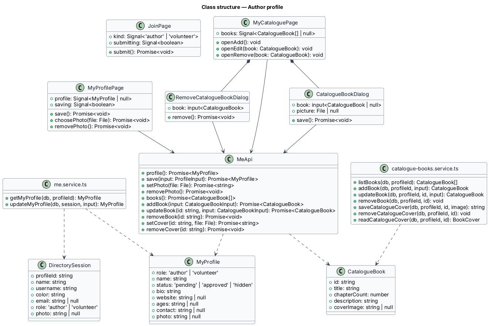
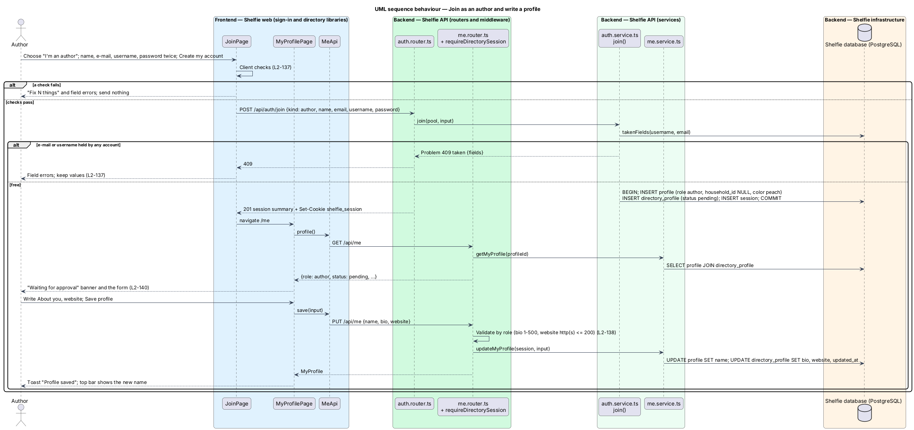
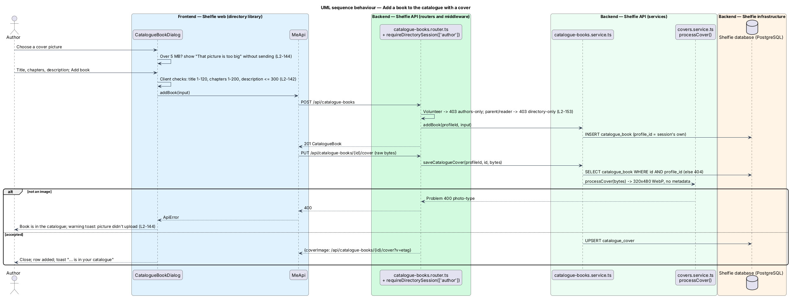

# Author profile

## Overview

Shelfie is a web application that helps a child read books by logging each chapter she reads and answering short questions about it, while a parent reviews her answers and gives rewards. A **household** is a set of parents and readers sharing one bookshelf. An **author** is an independent children's author who holds an account of their own, outside any household (ADR-0020). An author writes a **profile** (a display name, a short bio, an optional photo and an optional website) and keeps a **catalogue** of their books, each with a title, a chapter count, an optional cover picture and a short description.

This feature covers the author's side: joining, writing the profile, seeing whether parents can see it, and keeping the catalogue. A new profile is **pending** until the operator approves it with `shelfie-admin` (ADR-0022, `admin-cli/approve-profiles`); the operator can later hide it. What parents see is designed in `directory/browse-directory`. Joining is free; paid profiles are deferred (ADR-0021).

An author never reaches a household. Every household route turns an author session away with 403 `household-only`, and nothing the author's routes return names or counts a household (`L2-169`, `L2-171`). A catalogue book a parent adds is copied onto the household's shelf, so nothing links it back to the author (ADR-0024).

## Description

The slice runs from the Join page to four tables.

- **Migration `apps/api/migrations/013-directory.sql`** — drops `NOT NULL` on `profile.household_id`; replaces the role check with `('reader','parent','author','volunteer')`; adds `profile_household_by_role` so `household_id IS NULL` exactly when the role is `author` or `volunteer`. Creates:
  - `directory_profile` (`profile_id` primary key, cascades from `profile`; `status` `pending|approved|hidden`, default `pending`; `bio` default `''`; `website`, `ages`, `contact` nullable; `updated_at`).
  - `catalogue_book` (`id`, `profile_id` cascading from `profile`, `title`, `chapter_count` 1–200, `description` default `''`, `created_at`), indexed on `profile_id`.
  - `catalogue_cover` (`book_id` primary key cascading from `catalogue_book`, `image`, `etag`, `updated_at`).
  The display name is `profile.name`; the photo is the existing `profile_photo` row. An author's avatar colour is `peach`.
- **`JoinPage`** — page in the `sign-in` library at `/join`, linked from Sign in. It is shared with volunteers: an "I'm joining as" radio group ("I'm an author", "I volunteer") above name, e-mail, username and the password pair. Client checks match the parent's sign-up (`L2-154`). It owns `docs/mocks/pages/join/`: `default`, `volunteer`, `invalid`, `taken`, `submitting`, `error`. On success it navigates to `/me`.
- **`AuthApi.join(input)`** — `POST /api/auth/join {kind, name, email, username, password}`.
- **`auth.router.ts` / `auth.service.ts` `join()`** — validates `kind` (`author` or `volunteer` only; anything else is 400), name 1–40 after trimming, e-mail, username and password with the existing schemas; `takenFields()` gives 409 `taken` with `fields`. In one transaction it inserts the `profile` (no household), its `directory_profile` (`pending`) and a session, then sets the cookie as sign-up does. Sign-in, the sign-in limit and sessions are shared; `requestPasswordReset` now accepts `role IN ('parent','author','volunteer')` (`L2-158`).
- **`requireDirectorySession(db, roles = ['author','volunteer'])`** — middleware in `session.ts`. It loads the session as `requireSession` does (with a `LEFT JOIN` on `household`), answers 401 without one, 403 `directory-only` for a parent or reader, and 403 `authors-only` when `roles` is `['author']` and the session is a volunteer. It puts a `DirectorySession` (`profileId`, `name`, `username`, `color`, `email`, `role`, `photo`) on `res.locals.session`. `requireSession` itself now answers 403 `household-only` to an author or volunteer, which closes every existing household route (`L2-169`). `GET /api/auth/session` accepts all four roles, with theme `device` and `onboarded` true when there is no household, so the set-up wizard never opens for an author or volunteer and `homeOf` sends them to My profile. An author's own photo URL is `/api/me/photo?v={etag}`.
- **`MyProfilePage`** — page in the new `directory` library at `/me` (`directoryAccountGuard`). It shows a status `sh-banner` (`info` "Waiting for approval", `success` "Parents can see your profile", `warning` "Hidden by Shelfie"; `L2-157`), a "Your photo" card with `sh-photo-picker` that uploads on choose (`L2-156`), and an "About you" form: name (`sh-text-field`), About you (`sh-textarea`, 500), website (optional). Saving shows the toast "Profile saved" and updates the top bar name through `SessionService.update`. It owns `docs/mocks/pages/my-profile/`.
- **`me.router.ts` / `me.service.ts`** at `/api/me`, under `requireDirectorySession`:
  - `GET /api/me` → `MyProfile {role, name, status, bio, website, ages, contact, photo}`.
  - `PUT /api/me` → for an author `{name, bio 1–500, website http(s) up to 200 or null}`; validated with zod by the session's role (`L2-155`). Edits do not change `status` (ADR-0022).
  - `PUT /api/me/photo` (raw, `readImage`, up to 5 MB) → `processPhoto` then `savePhoto` for the session's own id → `{photo}`; `DELETE /api/me/photo` → 204; `GET /api/me/photo` serves the caller's own photo with the headers of `L2-045`. No route takes a profile id (`L2-170`).
- **`MyCataloguePage`** — page in the `directory` library at `/catalogue` (`authorGuard`). Book rows show `sh-cover` sm, the title and "N chapters · description", with Edit and Remove. "Add a book" and Edit open `CatalogueBookDialog`; Remove opens `RemoveCatalogueBookDialog`. Loading, empty and error states use `sh-skeleton`, `sh-empty-state` and `sh-error-state` (`docs/mocks/pages/my-catalogue/`).
- **`CatalogueBookDialog`** — `sh-dialog` with `sh-cover` preview, `sh-cover-picker`, title (1–120), chapters (whole number 1–200) and description (up to 300). A chosen picture is kept in the browser until the book is saved, then uploaded; a failed upload leaves the book without a picture and shows a warning toast (`L2-161`). States in `docs/mocks/dialogs/catalogue-book/`.
- **`RemoveCatalogueBookDialog`** — destructive `sh-dialog`; focus starts on "Keep it"; it says families who added the book keep their copy (`L2-160`).
- **`MeApi`** — service in the `directory` library over `ApiClient` for `/api/me` and `/api/catalogue-books`.
- **`catalogue-books.router.ts` / `catalogue-books.service.ts`** at `/api/catalogue-books`, under `requireDirectorySession(db, ['author'])`:
  - `GET /` → `CatalogueBook[] {id, title, chapterCount, description, coverImage}`, oldest first.
  - `POST /` → 201 `CatalogueBook`; `PATCH /:id` → `CatalogueBook`; `DELETE /:id` → 204.
  - `PUT /:id/cover` (raw) → `processCover` (320 × 480 WebP, no metadata) → `{coverImage}`; `DELETE /:id/cover` → 204; `GET /:id/cover` serves it with the headers of `L2-048`.
  Every query is scoped by `profile_id` = the session's own id, so another author's book reads as 404 (`L2-170`). The author's cover URL is `/api/catalogue-books/:id/cover?v={etag}`.
- **Logs** — the request log writes method, route, status and duration only, so no name, bio, website or catalogue text reaches it (`L2-172`).
- **Erasure** — the operator runs `DELETE FROM profile WHERE id = '<id>' AND role IN ('author','volunteer')` from `docs/runbook.md`. It cascades to `directory_profile`, `catalogue_book`, `catalogue_cover`, `profile_photo`, `session` and `password_reset`. Household books copied from the catalogue have no foreign key to it and stay (`L2-173`).

Statistics about the catalogue, selling books and self-service deletion are deferred.

## Requirements

| L2 ID | Refines (L1) | Requirement |
|-------|--------------|-------------|
| `L2-154` | `L1-030`, `L1-031` | Join as an author or volunteer on one page; validation, taken fields, busy and error states; only `author` or `volunteer` kinds. |
| `L2-155` | `L1-030`, `L1-031` | Edit my profile: name, About you, website for an author; validation; "Profile saved". |
| `L2-156` | `L1-030`, `L1-031` | An author's photo, uploaded on My profile through `/api/me/photo` under the rules of `L2-042` to `L2-045`. |
| `L2-157` | `L1-030`, `L1-031` | The listing status banner: waiting for approval, approved, hidden. |
| `L2-158` | `L1-001` | Sign-in, sessions and password reset shared with parents; landing on My profile; author navigation. |
| `L2-159` | `L1-030` | Add a book to the catalogue: title 1–120, chapters 1–200, description up to 300. |
| `L2-160` | `L1-030` | Edit and remove a catalogue book; households keep their copies. |
| `L2-161` | `L1-030` | A catalogue book's cover picture under `L2-046` and `L2-048`. |
| `L2-169` | `L1-002` | Author and volunteer sessions get 403 `household-only` from every household route. |
| `L2-170` | `L1-002` | An author changes only their own catalogue; volunteers get 403 from catalogue routes. |
| `L2-171` | `L1-002` | Nothing about households reaches an author, and nothing counts who added a book. |
| `L2-172` | `L1-012` | No profile text or contact details in logs. |
| `L2-173` | `L1-012` | The operator erases an author with the runbook statement. |

## Diagrams

### System context

An author joins and keeps a profile and catalogue in Shelfie; the operator approves it and parents read it.

### Containers

The Join, My profile and My catalogue pages call the Express API, which stores the profile, the catalogue and their pictures in PostgreSQL.

### Components

Inside the API, `join()` creates the account, `requireDirectorySession` admits only authors and volunteers, and the `me` and `catalogue-books` routers reuse the photo and cover pipelines.

### Class structure

The `directory` library's pages and dialogs call `MeApi`; the services map rows onto `MyProfile` and `CatalogueBook`.

### Behaviour — join and write a profile

The author joins, lands on My profile waiting for approval and saves an About you (`L2-154`, `L2-155`, `L2-157`).

### Behaviour — add a catalogue book with a cover

The book is saved first and its picture uploaded after; a refused picture leaves the book without one (`L2-159`, `L2-161`, `L2-170`).

