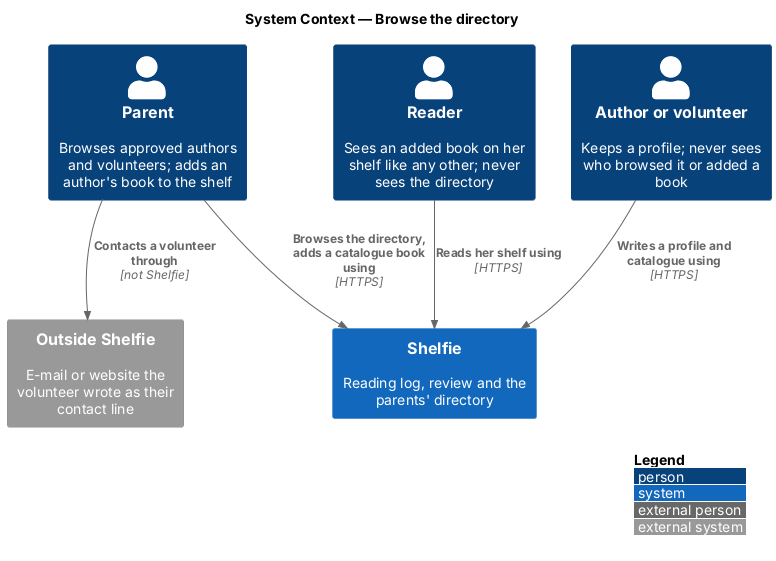
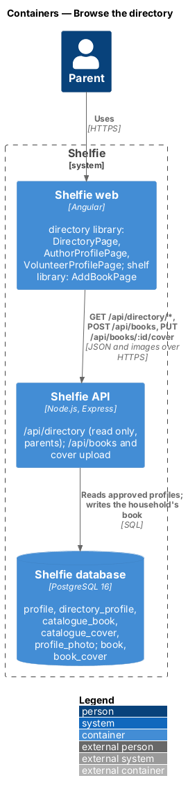
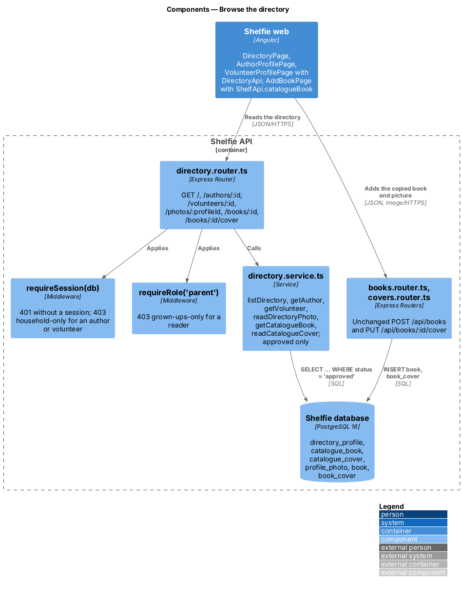
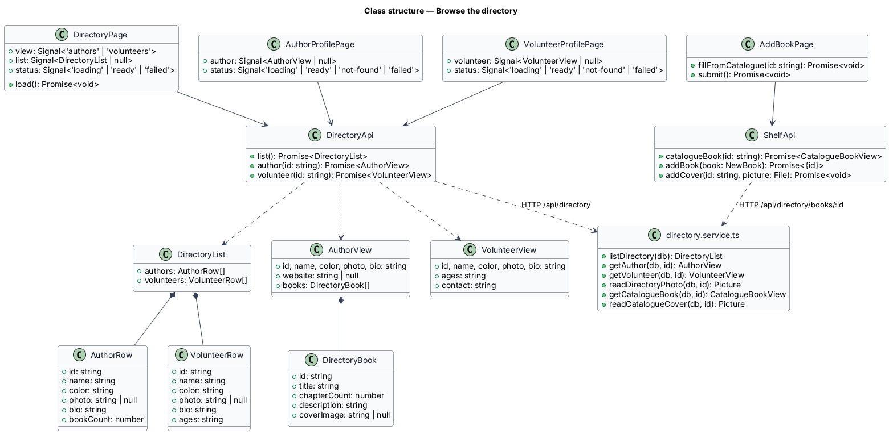
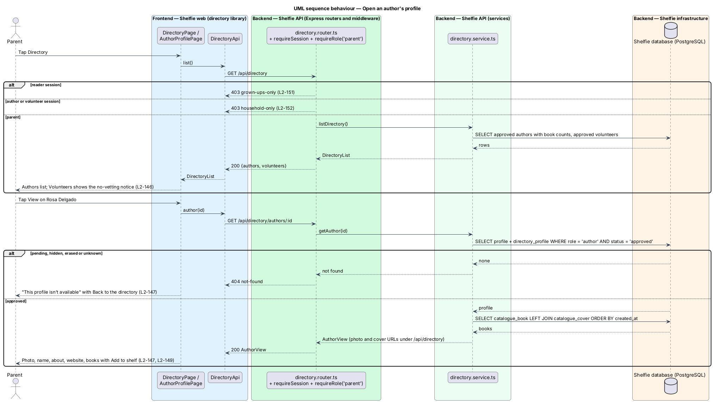
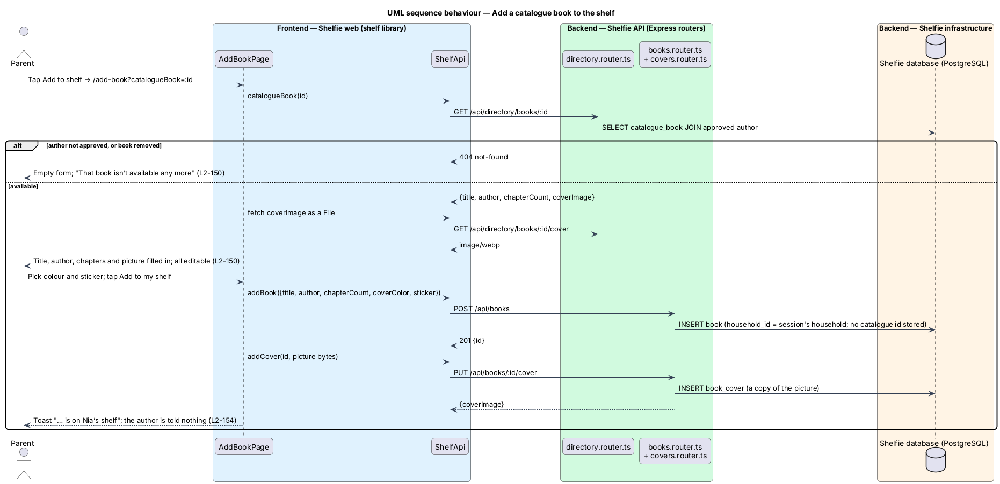

# Browse the directory

## Overview

Shelfie is a web application that helps a child read books by logging each chapter she reads and answering short questions about it, while a parent reviews her answers and gives rewards. A **household** is a set of parents and readers sharing one bookshelf.

Two kinds of grown-up account live outside any household (ADR-0021). An **author** is an independent children's author with a profile and a **catalogue**, a list of the books they wrote. A **volunteer** is a person who offers to help children with reading, with a profile that says which ages they help with and how a parent can reach them. A profile is **listed** only after the operator approves it (ADR-0023); until then it is **pending**, and the operator can later **hide** it.

This feature is the parent's side of the **directory**: a fourth parent tab, Directory, after Books (ADR-0026). It lists the approved authors and volunteers, opens an author's profile with their catalogue, opens a volunteer's profile with their contact line, and lets the parent put a catalogue book on the household's shelf through the existing Add a book flow, filled in from the catalogue entry. The book is copied onto the shelf; nothing links it back to the author (ADR-0025). Shelfie sends nothing between a parent and a volunteer and does not vet volunteers, and the pages say so (ADR-0024).

Readers never see the directory. Authors and volunteers never reach it either: every household route turns them away (`directory/author-profile`, `sign-in/authorize-access`).

## Description

The slice runs from the Directory tab to the `directory_profile` and `catalogue_book` tables.

- **Navigation** — the `shelfie` application's `navLinks` for a parent are Review, Books, Directory (icon `directory`) and Settings, drawn by `sh-top-bar` from 768 px and `sh-tab-bar` below it (`shell/navigate-shell`).
- **Routes** — `/directory`, `/directory/authors/:id` and `/directory/volunteers/:id`, each with `canActivate: [authGuard, grownUpGuard]`. `authGuard` sends an author or volunteer to `/forbidden`; `grownUpGuard` sends a reader to `/forbidden` ("Grown-ups only").
- **`DirectoryPage`** — page component in the new `directory` library. It loads `DirectoryApi.list()` once and shows an `sh-segmented` (Authors / Volunteers) over a list of person rows: `sh-avatar`, name, a meta line (author: "N books · about…"; volunteer: "ages · about…") and an `sh-button`-styled "View" link. The Volunteers view starts with an `sh-banner` `warning` "Shelfie doesn’t vet volunteers". States from `docs/mocks/pages/directory/`: `default`, `volunteers`, `loading` (`sh-skeleton`), `empty` (`sh-empty-state` "No authors yet" / "No volunteers yet") and `error` (`sh-error-state` with Try again).
- **`AuthorProfilePage`** — loads `DirectoryApi.author(id)`. A card holds `sh-avatar` xl, the overline "Author", the name as `h1`, the about text and the website as a plain link with `target="_blank"` and `rel="noopener noreferrer nofollow"`. A second card, "Books by {first name}", lists each book with `sh-cover` sm (its picture through `coverImage`), title, "N chapters · description" and an "Add to shelf" link to `/add-book?catalogueBook={id}`. With no books it says the author hasn't added any yet. A 404 shows `sh-error-state` "This profile isn’t available" with "Back to the directory" (`not-found`); any other failure shows the `error` state.
- **`VolunteerProfilePage`** — loads `DirectoryApi.volunteer(id)`. The header card adds an ages `badge--info`; a "How to reach {first name}" card shows the contact line as plain text, never a link Shelfie builds, and the `warning` banner "Shelfie doesn’t vet volunteers". `not-found` and `error` as on the author's page.
- **`DirectoryApi`** — service in the `directory` library on `ApiClient`: `list(): Promise<DirectoryList>`, `author(id): Promise<AuthorView>`, `volunteer(id): Promise<VolunteerView>`.
- **`DirectoryList`** — `{ authors: AuthorRow[], volunteers: VolunteerRow[] }`. `AuthorRow` is `{ id, name, color, photo, bio, bookCount }`; `VolunteerRow` is `{ id, name, color, photo, bio, ages }`.
- **`AuthorView`** — `{ id, name, color, photo, bio, website, books: DirectoryBook[] }`, `DirectoryBook` being `{ id, title, chapterCount, description, coverImage }`. **`VolunteerView`** — `{ id, name, color, photo, bio, ages, contact }`.
- **Add to shelf** — `AddBookPage` in the `shelf` library reads the `catalogueBook` query parameter. It calls `ShelfApi.catalogueBook(id)` (`GET /api/directory/books/:id`, returning `{ id, title, author, chapterCount, description, coverImage }`), fills Title, Author and Chapters, and, when there is a `coverImage`, fetches it as a `File` and sets it as the chosen picture, exactly as a lookup match does (`books/add-book`). A subtitle names the author's catalogue; the button stays "Add to my shelf" and Cancel goes to the shelf, as for any book. Saving is the unchanged `POST /api/books` followed by `PUT /api/books/:id/cover` with the picture's bytes, so the household gets its own copy; nothing records which catalogue book it came from. A 404 leaves the form empty under an info banner "That book isn’t available any more." The reader later sees the book on her shelf like any other, the author's name as plain text.
- **`directory.router.ts`** — Express router mounted at `/api/directory` with `requireSession(db)` and `requireRole('parent')` on every route. No session answers 401; a reader 403 `grown-ups-only`; an author or volunteer 403 `household-only` (from `requireSession`).
  - `GET /` → `DirectoryList`.
  - `GET /authors/:id` → `AuthorView`; `GET /volunteers/:id` → `VolunteerView`.
  - `GET /photos/:profileId` → the profile photo as `image/webp`.
  - `GET /books/:id` → the catalogue book with its author's name; `GET /books/:id/cover` → its picture as `image/webp`.
  - Every lookup answers 404 `not-found` unless the profile is an author (or volunteer) whose `directory_profile.status` is `approved`. Pending, hidden, erased and unknown ids read the same, so a parent learns nothing about why.
  - Pictures carry `ETag`, `Cache-Control: private, no-cache` and `Content-Security-Policy: default-src 'none'; sandbox`, and answer 304 to a matching `If-None-Match`, as `photos.router.ts` and `covers.router.ts` do.
- **`directory.service.ts`** — parameterised SQL over `profile`, `directory_profile`, `catalogue_book`, `catalogue_cover` and `profile_photo`, each query joined on `status = 'approved'`: `listDirectory`, `getAuthor`, `getVolunteer`, `readDirectoryPhoto`, `getCatalogueBook`, `readCatalogueCover`. Photo URLs are `/api/directory/photos/{id}?v={etag}` and cover URLs `/api/directory/books/{id}/cover?v={etag}`, so a parent's browser never asks an author's own routes. Lists are ordered by name; books oldest first.
- **Privacy** — no route here writes anything, and no response to an author or volunteer depends on what parents read. Nothing counts or records which households opened a profile or added a book (`L2-177`). Request logs carry the method, route, status and duration only (`logging.ts`, `L2-178`).

## Requirements

| L2 ID | Refines (L1) | Requirement |
|-------|--------------|-------------|
| `L2-169` | `L1-030`, `L1-031` | Directory is a fourth parent tab after Books. Given a parent, when they open Directory, then approved authors are listed by name with their photo or initial, how many books they have and the start of their about text; choosing Volunteers lists approved volunteers with the ages they help with, under a warning that Shelfie doesn’t vet volunteers. Pending and hidden profiles are not listed. With none, an empty state says so; a load failure shows an error state with Try again. No horizontal scroll at XS, MD and XL, every control at least 44 by 44 pixels. |
| `L2-170` | `L1-030` | Given a parent opens an approved author, then their photo or initial, name, about text, website (new tab, `rel="noopener noreferrer nofollow"`) and catalogue are shown, each book with cover, title, chapter count, description and Add to shelf; with no books the page says so. A pending, hidden, erased or non-author id shows "This profile isn’t available" and the API answers 404, the same for every case. |
| `L2-171` | `L1-031` | Given a parent opens an approved volunteer, then their photo or initial, name, ages, about text and contact line are shown with the warning "Shelfie doesn’t vet volunteers"; the contact line is plain text and Shelfie sends nothing between them. A pending, hidden, erased or non-volunteer id shows "This profile isn’t available" and the API answers 404. |
| `L2-172` | `L1-030`, `L1-031` | The photo of an approved author or volunteer and the covers of an approved author's books are served to parents with the headers of `L2-045` and `L2-048`; for a pending or hidden profile, or to anyone else, they answer 404 or 403 with no image data. |
| `L2-173` | `L1-030` | Given Add to shelf, then Add a book opens with title, author's name, chapter count and cover picture filled in; the parent can change anything and adding works as `L2-009` and `L2-046` say. The new book is the household's own copy; nothing stores which catalogue book it came from, and later catalogue edits or removal leave it unchanged. A catalogue book of a pending, hidden or unknown author leaves the form empty and says the book isn't available. |
| `L2-174` | `L1-002` | Given a reader, then the navigation has no Directory, opening `/directory` or a profile by URL shows "Grown-ups only", and every directory API or picture answers 403 `grown-ups-only` with no profile data. |
| `L2-177` | `L1-002` | Given an author or volunteer session, then no response names or counts a household, reader, parent, household book, chapter, answer, note, reward or household photo; nothing tells an author that a household added a book or counts how many did. |

## Diagrams

### System context

A parent browses approved authors and volunteers in Shelfie and adds an author's book to the shelf. Authors and volunteers keep their profiles in the same system but never see who browsed them, and a parent contacts a volunteer outside Shelfie.

### Containers

The Directory pages and Add a book call the Express API, which reads approved profiles, catalogues and pictures from PostgreSQL. Adding a book writes only the household's own `book` and `book_cover` rows.

### Components

`directory.router.ts` sits behind `requireSession` and `requireRole('parent')`; `directory.service.ts` reads only approved profiles. Add to shelf reuses the existing books and covers routers.

### Class structure

The three pages use `DirectoryApi`; `AddBookPage` uses `ShelfApi.catalogueBook`. The views carry no household data and no counts beyond an author's own number of books.

### Behaviour — open an author's profile

The parent opens Directory, then an author. A pending, hidden or unknown author answers 404 and the page shows "This profile isn’t available" (`L2-169`, `L2-170`).

### Behaviour — add a catalogue book to the shelf

Add to shelf opens Add a book filled in from the catalogue entry and its cover; saving is the ordinary add and cover upload, so the household's book is a copy with no link back to the author (`L2-173`, `L2-177`).

