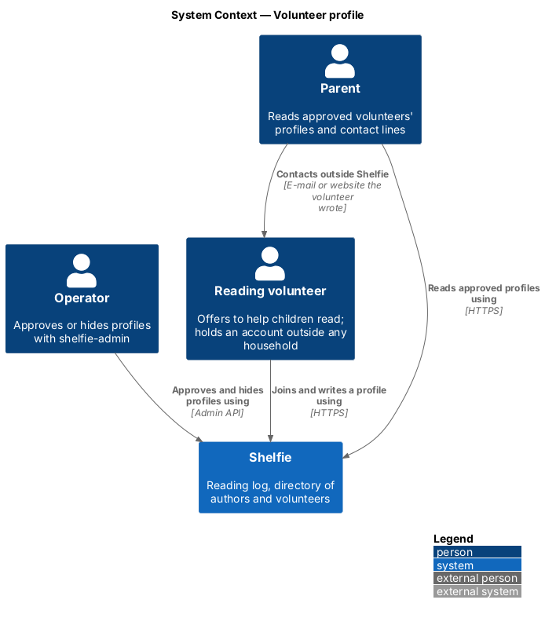
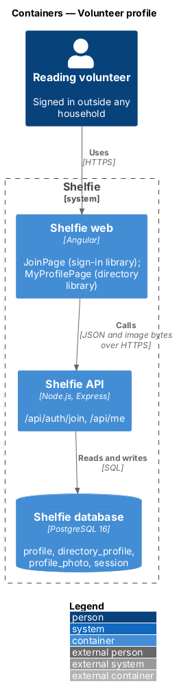
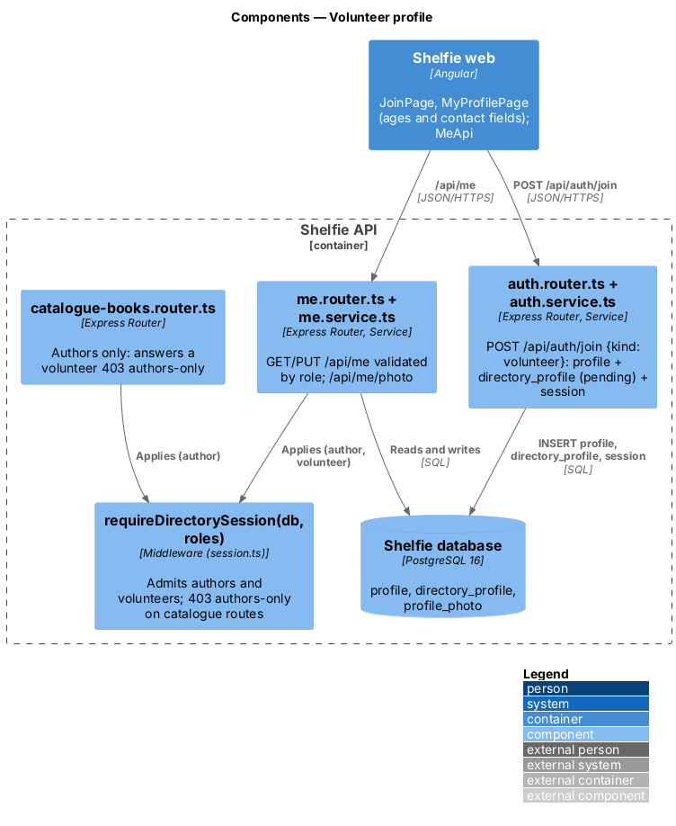
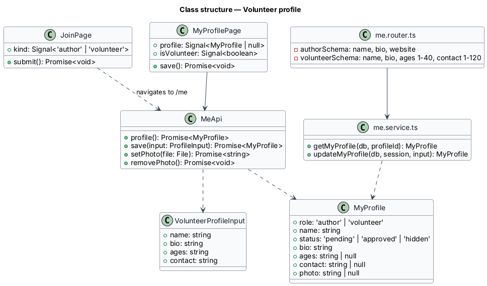
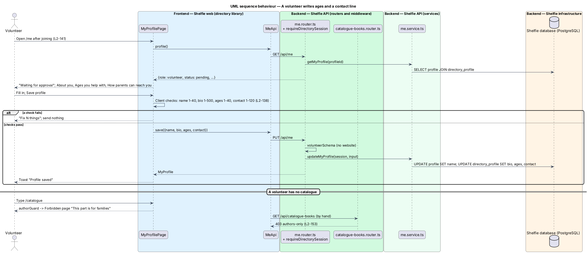

# Volunteer profile

## Overview

Shelfie is a web application that helps a child read books by logging each chapter she reads and answering short questions about it, while a parent reviews her answers and gives rewards. A **household** is a set of parents and readers sharing one bookshelf. A **reading volunteer** is a person who wants to help children with reading. A volunteer holds an account of their own, outside any household (ADR-0018), and writes a **profile**: a display name, a short bio, an optional photo, the ages they help with and a **contact line** saying how a parent can reach them outside Shelfie.

This feature covers the volunteer's side: joining, writing the profile and seeing whether parents can see it. It shares the Join page, `MyProfilePage`, `me.router.ts` and the migration with `directory/author-profile`, which describes them in full; this design lists only what differs. A new profile is **pending** until the operator approves it (ADR-0020, `admin-cli/approve-profiles`). What parents see is designed in `directory/browse-directory`.

Shelfie sends nothing between parents and volunteers. Contact happens outside Shelfie through the line the volunteer wrote, and Shelfie does not vet volunteers; the directory says so to parents (ADR-0021). A volunteer has no catalogue, never reaches a household and sees nothing about one (`L2-152`, `L2-154`).

## Description

- **`JoinPage`** — the shared page at `/join` with "I volunteer" chosen (`docs/mocks/pages/join/volunteer.html`). `POST /api/auth/join {kind: 'volunteer', …}` creates a `profile` with role `volunteer`, no household and the avatar colour `mint`, a `directory_profile` row with status `pending`, and a session (`L2-137`). The volunteer lands on `/me`.
- **Sign-in and password reset** — shared with parents and authors (`L2-141`): a volunteer signs in on the ordinary form and lands on My profile; Forgot password mails a reset link to a volunteer's e-mail.
- **Shell** — a volunteer has no tabs: the top bar shows the brand (home `/me`) and the avatar, and the account menu holds only Sign out (`L2-141`, ADR-0023).
- **`MyProfilePage` for a volunteer** — the same page as an author's, with the role taken from `GET /api/me`. The "About you" card holds name (`sh-text-field`, 1–40), About you (`sh-textarea`, 1–500), "Ages you help with" (`sh-text-field`, 1–40, help "For example “Ages 6 to 10”.") and "How parents can reach you" (`sh-text-field`, 1–120, help "An e-mail address or a website. Parents contact you outside Shelfie; Shelfie sends nothing for you."). There is no website field. The status banner and the photo card are as for an author (`L2-139`, `L2-140`). States: `docs/mocks/pages/my-profile/volunteer.html` and the shared ones.
- **`me.router.ts`** — `PUT /api/me` picks its zod schema from the session's role. The volunteer schema is `{name, bio, ages, contact}`, each trimmed and required; an author's `website` is ignored for a volunteer and `ages` and `contact` are ignored for an author (`L2-138`). `me.service.ts` writes `profile.name` and `directory_profile.bio`, `ages`, `contact` and `updated_at`.
- **No catalogue** — `/catalogue` is guarded by `authorGuard`, so a volunteer gets the forbidden page; every `/api/catalogue-books` route runs `requireDirectorySession(db, ['author'])` and answers a volunteer 403 `authors-only` (`L2-153`).
- **The contact line** — stored and returned as plain text exactly as written. Parents read it on the volunteer's profile (`L2-148`, `directory/browse-directory`), where it is rendered as text, never as a link Shelfie builds. It is never written to a log (`L2-155`).
- **Erasure** — as for an author: the runbook statement deletes the `profile` and cascades to `directory_profile`, `profile_photo`, `session` and `password_reset` (`L2-156`).

Messaging, booking, scheduling, background checks and identity verification are deferred (ADR-0021).

## Requirements

| L2 ID | Refines (L1) | Requirement |
|-------|--------------|-------------|
| `L2-137` | `L1-029`, `L1-030` | Join as a volunteer on the shared Join page. |
| `L2-138` | `L1-029`, `L1-030` | Edit my profile: a volunteer saves name, About you, ages (1–40) and contact (1–120); no website. |
| `L2-139` | `L1-029`, `L1-030` | A volunteer's photo on My profile, under `L2-042` to `L2-045`. |
| `L2-140` | `L1-029`, `L1-030` | The listing status banner. |
| `L2-141` | `L1-001` | Shared sign-in and password reset; landing on My profile; no tabs, menu with Sign out only. |
| `L2-148` | `L1-030` | Parents read the approved volunteer's ages, About you and contact line with the "Shelfie doesn’t vet volunteers" warning. |
| `L2-153` | `L1-002` | A volunteer gets 403 from every catalogue route and the forbidden page on `/catalogue`. |

## Diagrams

### System context

A volunteer joins and writes a profile; the operator approves it; a parent reads it and contacts the volunteer outside Shelfie.

### Containers

The Join and My profile pages call the Express API, which stores the profile in PostgreSQL.

### Components

The `me` router validates by role; the catalogue router admits authors only.

### Class structure

`MyProfilePage` shows the volunteer fields when `MyProfile.role` is `volunteer`; the router holds one schema per role.

### Behaviour — write ages and a contact line

The volunteer saves the profile; a request for the catalogue is turned away (`L2-138`, `L2-153`).

