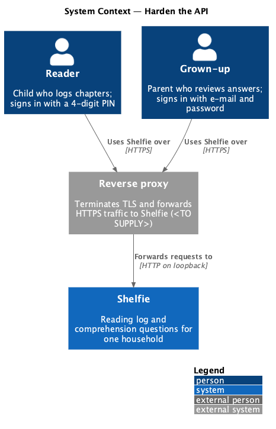
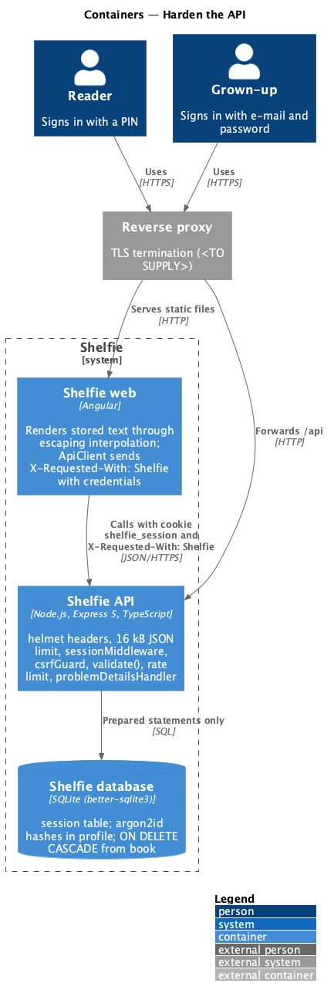
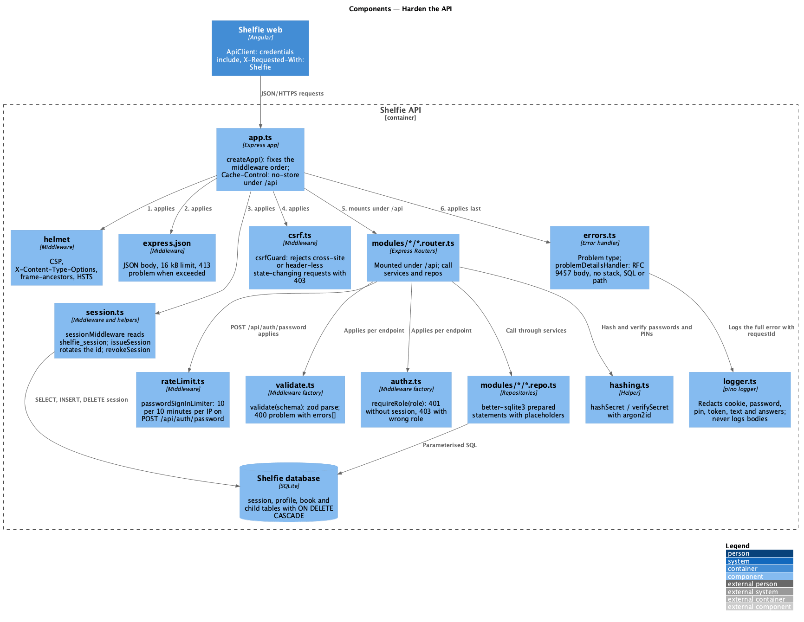
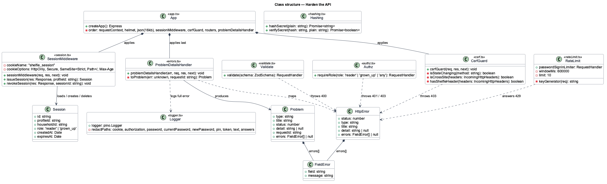
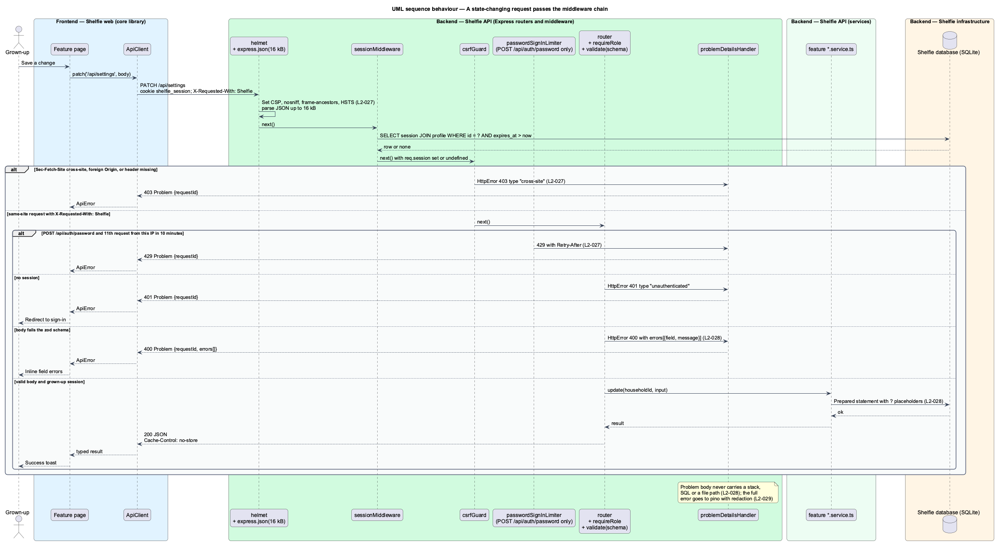
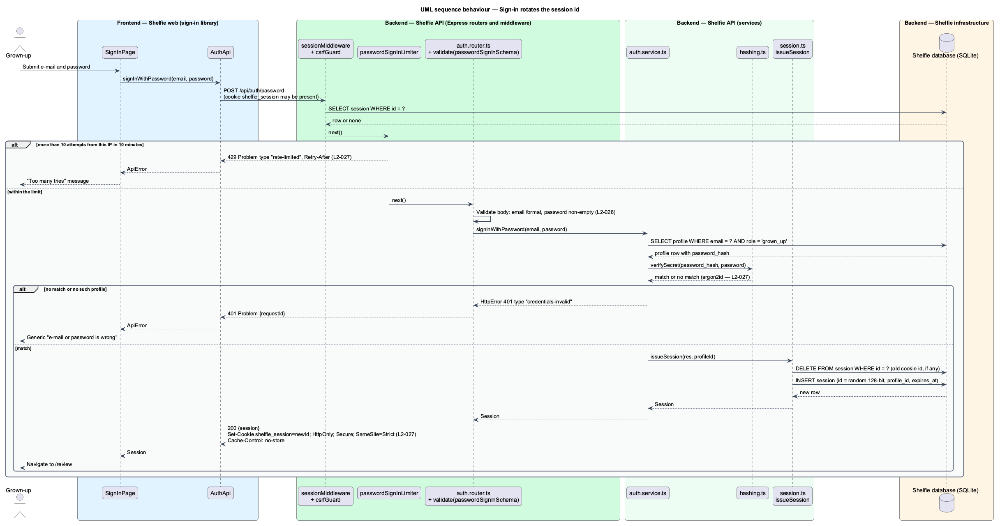

# Harden the API

## Overview

Shelfie is a web application that helps one child read books by logging each chapter she reads and answering short questions about it, while a grown-up in the same household reviews her answers and gives rewards. A **household** is the unit of tenancy: one reader profile and one grown-up profile sharing one bookshelf. The data is a child's answers and a parent's credentials, so the service is expected to resist the common web attacks (the OWASP Top 10) without any feature noticing.

This feature is the cross-cutting security layer of the `platform` subsystem. It has no screen of its own. It is the set of middleware, helpers and conventions in `apps/api/src/platform/` that every router runs through, and the rules the Angular application follows so that stored text is shown as text. Every other detailed design assumes these parts are present and names them without describing them.

Terms used below:

- **session** — server-side row in the `session` table that represents one signed-in profile; the browser holds only its id in the cookie `shelfie_session`
- **state-changing request** — request with method `POST`, `PATCH`, `PUT` or `DELETE`
- **cross-site request** — request whose browser-set `Sec-Fetch-Site` header is `cross-site` or whose `Origin` header names another site
- **problem document** — JSON error body in the RFC 9457 shape (`type`, `title`, `status`, `detail`, `requestId`, optional `errors[]`)
- **argon2id** — memory-hard password hashing function; the only way passwords and PINs are stored

The feature covers credential and session security (`L2-027`), input validation and output encoding (`L2-028`) and data protection (`L2-029`). The health endpoint, logging and backups are the sibling feature `operate-service`.

## Description

The slice is the middleware chain of the Express application plus three helpers and two conventions.

- **`platform/app.ts`** — `createApp()` builds the Express 5 application and fixes the middleware order: `requestContext` (from `logger.ts`, see `operate-service`) → `helmet` → `express.json({ limit: '16kb' })` → `sessionMiddleware` → `csrfGuard` → the module routers under `/api` → `problemDetailsHandler`. `helmet` sets `Content-Security-Policy` (`default-src 'self'; script-src 'self'; style-src 'self' 'unsafe-inline'; img-src 'self' data:; connect-src 'self'; frame-ancestors 'none'; base-uri 'self'; form-action 'self'`), `X-Content-Type-Options: nosniff` and `Strict-Transport-Security` (`max-age=31536000; includeSubDomains`). The body parser rejects JSON larger than 16 kB with a 413 problem document. Every response under `/api` carries `Cache-Control: no-store`.
- **`platform/session.ts`** — `sessionMiddleware` reads cookie `shelfie_session`, loads the matching `session` row, discards it when `expires_at` has passed, otherwise moves `expires_at` to 30 days from now (idle timeout, `L2-003`), and sets `req.session` (`{ id, profileId, householdId, role }`) or leaves it undefined. `issueSession(res, profileId)` deletes any session row referenced by the incoming cookie, inserts a new row with a 128-bit random id, and sets the cookie with `HttpOnly`, `Secure`, `SameSite=Strict`, `Path=/` and `Max-Age` of 30 days, matching the idle timeout. Sign-in therefore never reuses a session id (`L2-027`). `revokeSession(res, id)` deletes the row and clears the cookie.
- **`platform/csrf.ts`** — `csrfGuard` applies to state-changing requests only. It rejects with a 403 problem document of `type: "cross-site"` when `Sec-Fetch-Site` is `cross-site` or `same-site`, when `Origin` is present and is not the application's own origin, or when the header `X-Requested-With: Shelfie` is absent. `ApiClient` in the `core` library sends that header on every request, so browsers' form posts and cross-origin scripts cannot satisfy the guard (`L2-027`). The `SameSite=Strict` cookie is the second, independent defence.
- **`platform/rateLimit.ts`** — `passwordSignInLimiter` is an `express-rate-limit` instance keyed by client IP with a window of 10 minutes and a limit of 10 requests, mounted on `POST /api/auth/password` only. The eleventh attempt inside the window receives a 429 problem document with `Retry-After` (`L2-027`). The IP is read from the connection; when the reverse proxy forwards traffic, `app.set('trust proxy', 1)` reads the first `X-Forwarded-For` hop.
- **`platform/validate.ts`** — `validate(schema)` parses `req.body`, `req.params` and `req.query` with a `zod` schema supplied by the module's `<name>.schemas.ts`. Each schema declares type, length and range (for example `title: z.string().trim().min(1).max(120)`, `chapterCount: z.number().int().min(1).max(500)`). A failure becomes a 400 problem document with `errors: [{ field, message }]`, one entry per failing path, and the handler is never called (`L2-028`). Unknown keys are stripped.
- **`platform/hashing.ts`** — `hashSecret(plain)` and `verifySecret(hash, plain)` wrap the `argon2` package with `type: argon2id`. Passwords and PINs pass through these two functions only; no module stores or compares a plaintext credential (`L2-027`). The cost parameters are the package defaults (`<TO SUPPLY>` if tuned).
- **`platform/errors.ts`** — `Problem` is the type `{ type, title, status, detail?, requestId, errors? }`. `HttpError` is the error class services throw with a status and a `type`. `problemDetailsHandler` maps `HttpError` to its problem document, maps a `zod` error to 400, a body-parser error to 413 and any other error to a 500 whose `title` is "Something went wrong" and whose `detail` is absent. The body never carries `error.message`, a stack, a SQL fragment or a file path; those go only to the logger (`L2-028`).
- **`platform/logger.ts`** — the `pino` logger (described in `operate-service`) is configured with `redact` on `req.headers.cookie`, `req.headers.authorization`, and the fields `password`, `currentPassword`, `newPassword`, `pin`, `token`, `text` and `answers`; request and response bodies are never logged at all. Log lines therefore cannot contain passwords, PINs, tokens or answer text (`L2-029`).
- **Parameterised SQL** — every `<name>.repo.ts` uses `better-sqlite3` prepared statements with `?` or `@name` placeholders. String concatenation into SQL does not occur; sorting and filtering options are mapped through fixed allow-lists (`L2-028`).
- **Output encoding** — the API returns JSON only and never HTML. The Angular application renders stored text (titles, authors, answers, notes, questions, rewards) through default `{{ }}` interpolation and property bindings, which escape markup; `[innerHTML]` and `bypassSecurityTrust*` are not used. Text such as `` in an answer is displayed literally (`L2-028`).
- **TLS** — the API listens on plain HTTP on a loopback address; a reverse proxy (`<TO SUPPLY>`) terminates TLS, redirects port 80 to 443 and forwards to the API. HSTS from `helmet` keeps browsers on HTTPS after the first visit (`L2-029`). Cookies are marked `Secure`, so they are never sent over HTTP.
- **Hard delete** — `migrations/*.sql` declares every child table with `ON DELETE CASCADE` (`question`, `chapter_log`, `reward` reference `book`; `answer` references `chapter_log`), and `db.ts` sets `PRAGMA foreign_keys = ON` on every connection. `DELETE /api/books/:id` runs a single `DELETE FROM book WHERE id = ? AND household_id = ?`, and the engine removes the chapters, answers, questions and reward with it (`L2-029`).

The deployment target that hosts the reverse proxy and its certificate source are `<TO SUPPLY>`.

## Requirements

The feature realizes the following level-2 (L2) requirements. Each refines a level-1 (L1) requirement, cited by identifier.

| L2 ID | Refines (L1) | Requirement |
|-------|--------------|-------------|
| `L2-027` | `L1-012` | Credential and session security. Passwords and PINs shall be stored only as salted, slow hashes (argon2id or bcrypt); the session cookie shall be HttpOnly, Secure and SameSite=Lax or Strict, and its token shall be rotated on sign-in; a state-changing request without a valid CSRF defence shall be rejected; more than 10 failed grown-up sign-ins from one source in 10 minutes shall be answered with 429; responses shall set CSP, X-Content-Type-Options, frame-ancestors and HSTS headers. |
| `L2-028` | `L1-012` | Input validation and output encoding. Every API input shall be validated server-side for type, length and range, and invalid input shall return 400 with field errors; answers, notes and titles containing HTML or script shall be displayed as text and never executed; all database access shall be parameterised; error responses shall never expose stack traces, SQL or internal paths. |
| `L2-029` | `L1-012` | Data protection and privacy. All traffic shall be served over TLS; logs shall never contain passwords, PINs, tokens or answer text; when the grown-up deletes a book, its data shall be removed from the database. |

## Diagrams

### System context

Both people reach Shelfie only through the TLS-terminating reverse proxy; nothing else talks to the API.

### Containers

The reverse proxy forwards HTTPS traffic to the Express API, which keeps sessions and all household data in the SQLite database; the Angular application sends the `X-Requested-With: Shelfie` header on every call.

### Components

Inside the API, every request passes `helmet`, the 16 kB JSON parser, `sessionMiddleware` and `csrfGuard` before reaching a router; routers apply `validate()` and `requireRole()`, and `problemDetailsHandler` shapes every error.

### Class structure

The middleware functions share the `Problem` type produced by `problemDetailsHandler`; `sessionMiddleware` and `issueSession` work on `Session` rows, and `hashing.ts` is the only path to a stored credential.

### Behaviour — a state-changing request passes the middleware chain

A `PATCH /api/settings` request shows the full chain; the alternate paths show a missing session, a cross-site request, an invalid body and (for `POST /api/auth/password`) a rate-limited source, each answered with a problem document and nothing else (`L2-027`, `L2-028`).

### Behaviour — sign-in rotates the session id

A successful password sign-in verifies the argon2id hash, deletes any session the incoming cookie referenced, inserts a new session row and sets the cookie with the new id and the required attributes (`L2-027`).

