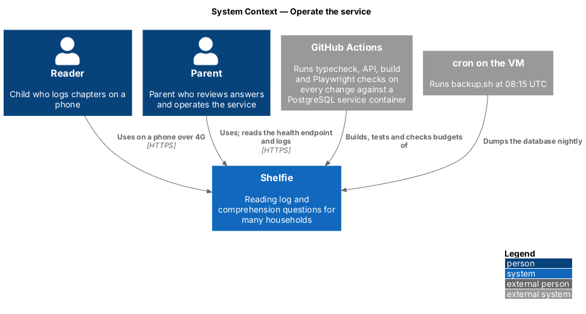
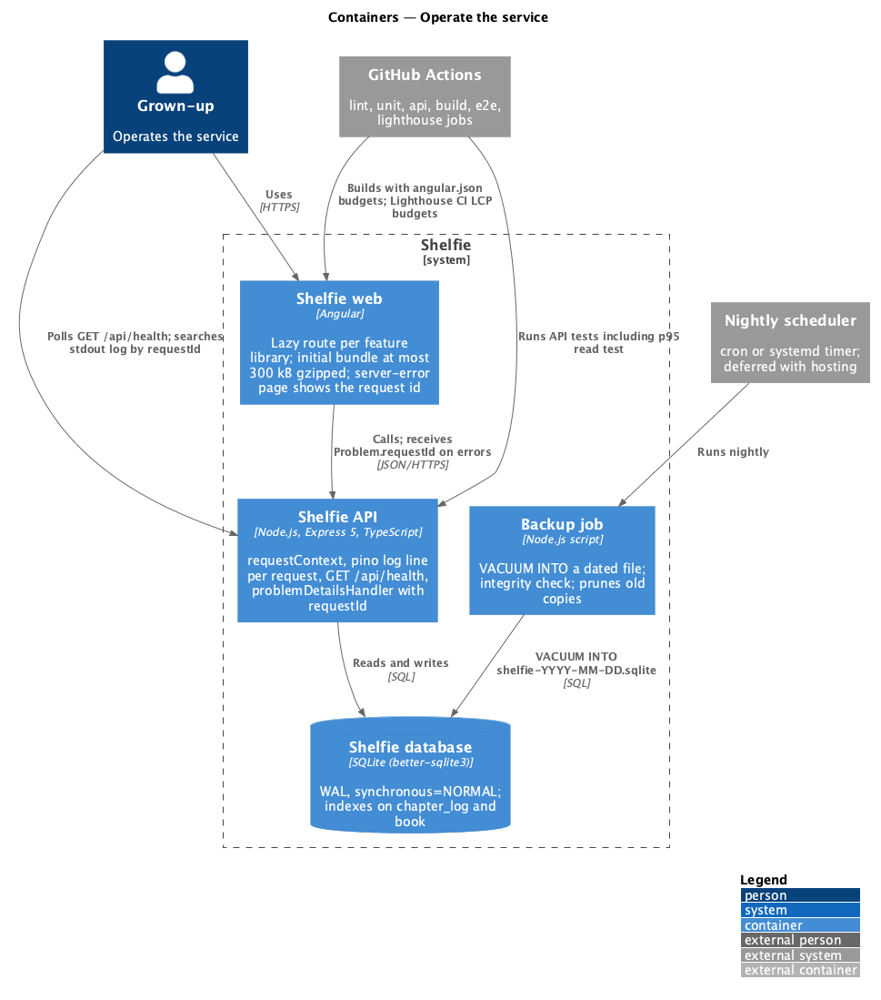
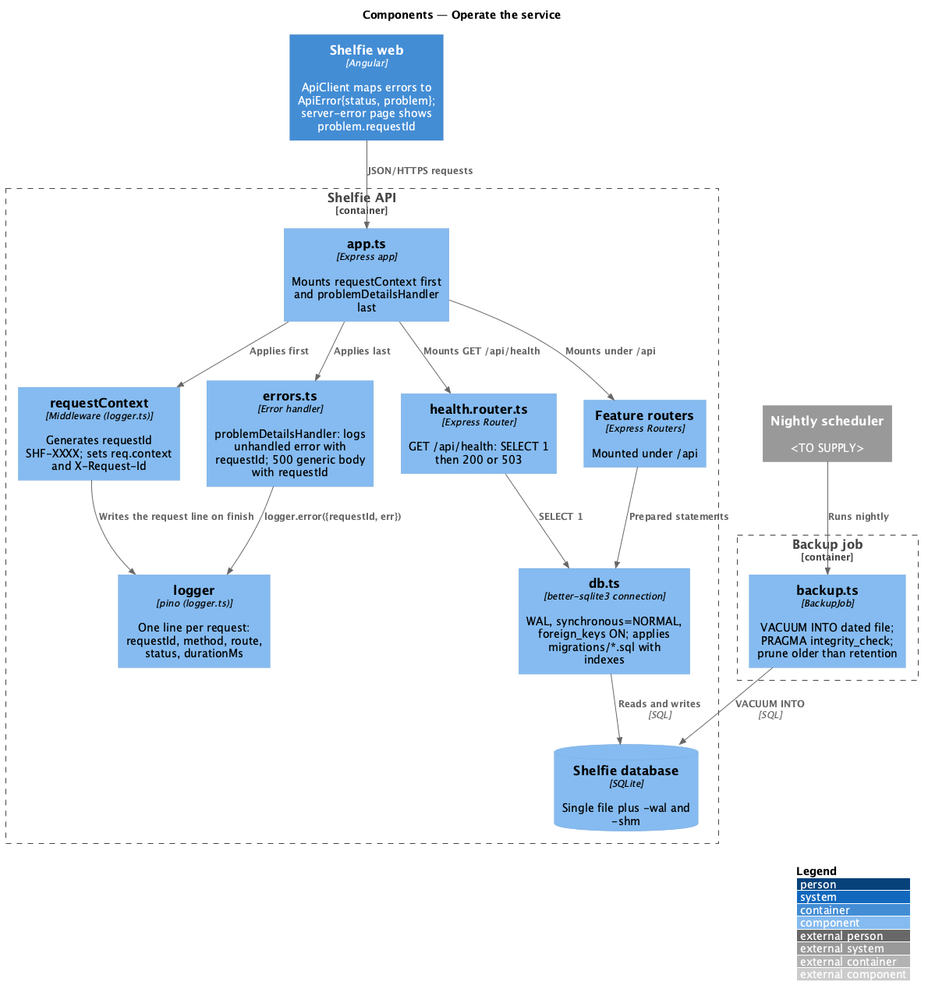
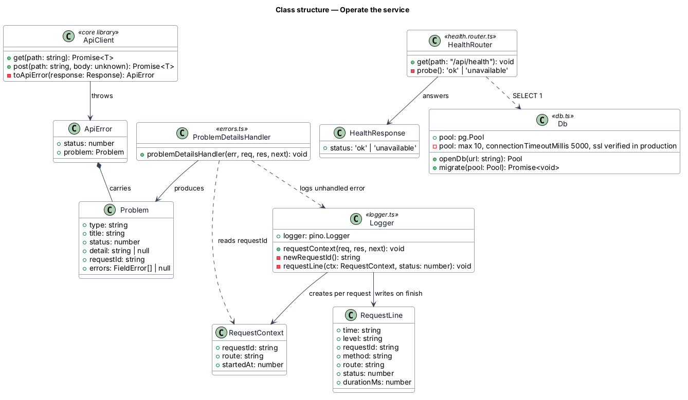
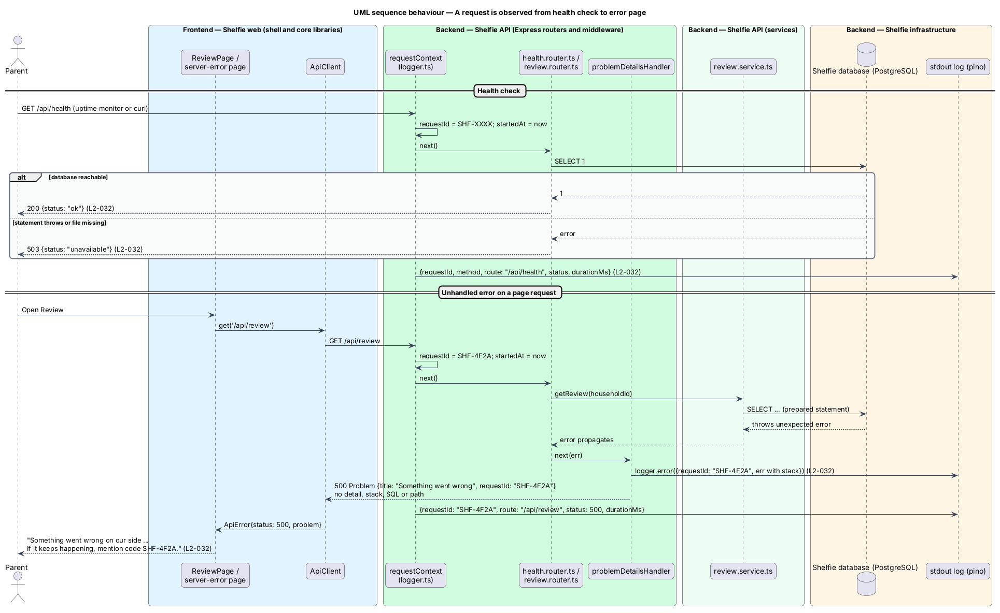
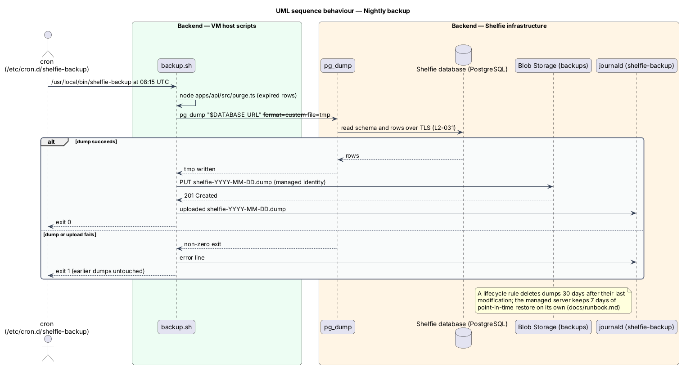

# Operate the service

## Overview

Shelfie is a web application that helps one child read books by logging each chapter she reads and answering short questions about it, while a parent in the same household reviews her answers and gives rewards. The parent is also the person who runs the service: there is no operations team, so the service has to tell him when it is unhealthy, keep a log he can search by a code the screen shows, back itself up every night, and stay fast on a phone.

This feature is the operational half of the `platform` subsystem, beside `harden-api`. It has no screen of its own apart from the code shown on the "Something went wrong" page. It covers the health endpoint, structured request logging, the request id that ties a log line to what a user saw, write durability and the nightly backup, the performance budgets and the indexes and bundle layout that meet them, and the repository, test and continuous-integration setup every other feature is built on. The mocks' budget table counts this setup as "Platform setup: Angular app, Node API, database, auth middleware, Playwright, CI".

Terms used below:

- **request id** — short code generated for every API request, written in its log line, returned in every problem document and shown to the user on the generic error page
- **health endpoint** — `GET /api/health`, an unauthenticated route that reports whether the API can reach its database
- **backup** — dated logical dump of the database produced nightly by `pg_dump`, beside the managed service's own continuous backups (feature `run-production-database`)
- **LCP** — Largest Contentful Paint, the time at which the largest visible element of a page has rendered

The feature realizes performance (`L2-030`), data durability (`L2-031`) and observability (`L2-032`).

## Description

The slice has four parts: observability middleware and the health module, durability and backup, performance budgets, and the workspace with its continuous-integration pipeline.

### Observability

- **`platform/logger.ts`** — exports `logger`, a `pino` instance writing one JSON line per event to stdout, and the `requestContext` middleware. `requestContext` runs first in `app.ts`: it generates `requestId` as `SHF-` followed by 4 uppercase hexadecimal characters from `crypto.randomBytes` (the form the mock shows, `SHF-4F2A`), stores `{ requestId, route, startedAt }` on `req.context`, sets the response header `X-Request-Id`, and on `finish` writes one line `{ level, time, requestId, method, route, status, durationMs }`. `route` is the matched Express route pattern (`/api/books/:id`), not the raw URL, so ids never reach the log. Bodies, headers other than `user-agent`, and query strings are never logged. Redaction paths are listed in `harden-api` (`L2-032`).
- **`RequestContext`** — type `{ requestId: string; route: string; startedAt: number }` attached to the request by `requestContext`.
- **`platform/errors.ts`** — `problemDetailsHandler` (described in `harden-api`) reads `req.context.requestId`, writes it into `Problem.requestId`, and for an unhandled error calls `logger.error({ requestId, err })` with the full error and stack before answering 500 with `title: "Something went wrong"` and no detail (`L2-032`).
- **`ApiClient`** (`core` library) — maps a non-2xx response to `ApiError{ status, problem }`. The shell's `server-error` page (feature `navigate-shell`) reads `problem.requestId` and renders the mock's copy: "If it keeps happening, mention code SHF-4F2A." The code is the only server detail a user ever sees (`L2-032`).
- **`modules/health/health.router.ts`** — `GET /api/health` runs `SELECT 1` through `db.ts` and answers `200 { status: "ok" }`; when the statement throws or the database file is missing it answers `503 { status: "unavailable" }`. The route needs no session and is not rate limited. `deploy.sh` polls it after every release and rolls back when it does not answer 200; an uptime monitor that polls it from outside is deferred (AGENTS.md, Deferred work) (`L2-032`).

### Durability and backup

- **`platform/db.ts`** — opens a `pg` pool against the PostgreSQL database named by `DATABASE_URL` and applies `migrations/*.sql` in file-name order inside one transaction each, recording them in `schema_migration` (feature `run-production-database`). `POST /api/books/:id/chapters/:n` (feature `log-chapter`) inserts the `chapter_log` row and its `answer` rows inside one `transaction()`; the API answers 201 only after `COMMIT` returns, so the answers are durable on the database server before the success response leaves the API and survive a restart (`L2-031`). Criterion 2 of `L2-031`, keeping typed answers in the form and the draft after a failed submission, is realised by `DraftStore` in the `log-chapter` feature.
- **`infra/host/backup.sh`** — on the VM `/etc/cron.d/shelfie-backup` runs it at 08:15 UTC. It runs the nightly purge and then `pg_dump --format=custom` of the database, and uploads the dated dump `shelfie-YYYY-MM-DD.dump` to the `backups` blob container with the VM's managed identity; a lifecycle rule deletes dumps after 30 days. The managed server keeps its own 7 days of continuous backups with point-in-time restore (feature `run-production-database`, `L2-039`).
- **`docs/runbook.md`** — documents both restores: point-in-time restore of the server, and `pg_restore` of a dump into an empty database followed by `GET /api/health`. The runbook is written as part of this slice (`L2-031`).

### Performance

- **Indexes** — `apps/api/migrations/001-initial.sql` creates `UNIQUE(book_id, chapter_number)` on `chapter_log` (which doubles as the chapter lookup index), `chapter_log(reviewed_at)` for the review queue, and `book(household_id)` for the shelf and books list. `GET /api/shelf` and `GET /api/review` each run a fixed number of statements rather than one per book. A seed script `apps/api/test/seed-perf.ts` creates 100 books of 80 chapters, and an API test asserts the p95 of 50 `GET /api/shelf` calls stays under 300 ms (`L2-030`).
- **Bundle layout** — `app.routes.ts` in the `shelfie` application loads every feature library with `loadChildren`, so the initial bundle holds only the shell, `core` and the `components` the shell uses. `angular.json` sets `budgets` with `initial` at `maximumWarning: 250kb` and `maximumError: 300kb` on the gzipped size, which fails the build when exceeded (`L2-030`).
- **Lighthouse CI** — `lighthouserc.json` runs Lighthouse against the built application served by `http-server`, using Lighthouse's default mobile device and simulated 4G throttling, and asserts `largest-contentful-paint` at most 2500 ms on the repeat view and 3000 ms on the first view of `/shelf`, plus `total-byte-weight` of scripts at most 300 kB. Route transitions render from already-loaded data with `sh-skeleton` placeholders while a request is in flight (`L2-030`).

### Workspace and continuous integration

- **`apps/web`** — Angular workspace. Projects under `apps/web/projects/`: application `shelfie` (`AppComponent`, `app.routes.ts`, bootstrapping), libraries `core` and `components`, and the feature libraries `sign-in`, `shelf`, `books`, `log-chapter`, `review`, `settings`. Dependency direction is `shelfie` → feature libraries → `components`, `core`; `components` depends on nothing else. ESLint with `@angular-eslint` and Prettier run on every project; unit tests run with the Angular CLI's default runner in headless Chromium.
- **`apps/api`** — Node.js 24, Express 5, TypeScript, `pg`, `zod`. API tests run with `node --test` against `createApp()` over a throwaway PostgreSQL database that `test-db.ts` creates and drops per test file; locally and in CI the server is PostgreSQL 16 at `DATABASE_URL`.
- **`e2e/`** — Playwright project with Chromium only: `playwright.config.ts` (one project, `baseURL` of the built web app served with the API behind it), `pages/` holding one page object per screen, `tests/` holding acceptance tests each headed `// Traces to: L2-xxx`. Tests state intent and page objects own selectors.
- **`.github/workflows/ci.yml`** — on every pull request, jobs run in this order: `typecheck`, `api` (API tests including the p95 read test), `build` (Angular production build enforcing the `angular.json` budgets and the 300 kB check), `e2e` (each Playwright worker hosts the API over its own database and serves the built web app, Chromium only, HTML report uploaded on failure). The `api` and `e2e` jobs run a `postgres:16` service container and pass its address as `DATABASE_URL`. A failing budget fails the pipeline (`L2-030`).

### Deployment

- **Host** — one Ubuntu 24.04 VM (`Standard_B2ats_v2`, Canada Central) described in `infra/main.bicep` with `infra/cloud-init.yaml`, created once by `infra/bootstrap.sh`, beside the PostgreSQL flexible server in the same virtual network (feature `run-production-database`). Caddy terminates TLS for `app.shelfie.kids` with a Let's Encrypt certificate (and for `www.shelfie.kids` and the redirecting `shelfie.kids`, feature `serve-marketing-site`), serves the Angular build from `/opt/shelfie/current/web` with an `index.html` fallback, and proxies `/api/*` to the API on `127.0.0.1:3000`. systemd keeps the API running as the unprivileged `shelfie` user with `/etc/shelfie/env` as its configuration; stdout goes to journald.
- **`.github/workflows/deploy.yml`** — on every push to `main` (which only arrives through a pull request that passed CI), builds the web app, assembles a release tarball (API source, production `node_modules`, web build, marketing page, `infra/host`), signs in to Azure with OpenID Connect (no stored credentials), uploads the tarball to the `releases` blob container and runs `infra/host/fetch-release.sh` on the VM through `az vm run-command`. That script downloads the tarball with the VM's managed identity, unpacks it to `/opt/shelfie/releases/<sha>` and calls the release's `deploy.sh`, which installs the host files and `postgresql-client`, switches the `current` symlink, restarts the API (which migrates the database before it listens), waits for `GET /api/health`, rolls back to the previous release on failure, reloads Caddy and keeps the last three releases. The job ends by checking `https://app.shelfie.kids/api/health`.
- **Branch protection** — a ruleset on `main` requires a pull request and the CI checks (`typecheck`, `api`, `build`, `e2e`) and blocks force pushes and deletion, so nothing reaches production without passing CI.
- **Mail** — `infra/main.bicep` also declares Azure Communication Services Email (communication service, e-mail service, the customer-managed `shelfie.kids` domain, the `hello` sender with display name "Shelfie") and gives the VM's system-assigned identity the Contributor role on the communication service; the domain is linked only when the deployment passes `linkEmailDomain=true`, after Azure reports it verified. `bootstrap.sh` writes `ACS_EMAIL_ENDPOINT` and `ACS_EMAIL_SENDER` into `/etc/shelfie/env`, and the API sends through ACS with `DefaultAzureCredential` (ADR-0019, sign-in/verify-email).
- **`docs/runbook.md`** — set-up, DNS (including the mail records at Namecheap), deploy, rollback, logs, backups, restore, settings and cost.

Uptime monitoring and log shipping beyond journald are deferred (AGENTS.md, Deferred work).

## Requirements

The feature realizes the following level-2 (L2) requirements. Each refines a level-1 (L1) requirement, cited by identifier.

| L2 ID | Refines (L1) | Requirement |
|-------|--------------|-------------|
| `L2-030` | `L1-013` | Performance. On a mid-range phone on a 4G profile the shelf shall reach Largest Contentful Paint within 2.5 s on a warm cache and within 3 s cold; 95 % of API reads shall respond within 300 ms at the server with 100 books of 80 chapters; the initial JavaScript bundle shall be at most 300 kB gzipped |
| `L2-031` | `L1-013` | Data durability. When the server responds success to a submitted chapter, the answers shall survive a server restart; after a failed submission the reader's typed answers shall remain in the form and the draft; the database shall be backed up nightly and a restore shall be documented. |
| `L2-032` | `L1-013` | Observability. A health endpoint shall return 200 only when the database is reachable; each request shall write a structured log line with request id, route, status and duration; an unhandled error shall be logged with the request id and the user shall see only a generic message with that id. |

## Diagrams

### System context

The parent both uses Shelfie and operates it; GitHub Actions builds, checks and deploys every change to `main`, and cron on the VM runs the nightly backup.

### Containers

The Angular application, the Express API and the PostgreSQL database are joined by the nightly job, which dumps the database to Blob Storage; the API writes its log lines to stdout.

### Components

Inside the API, `requestContext` opens every request and `logger` closes it with one line; `health.router.ts` probes `db.ts`; `problemDetailsHandler` carries the request id into the response; `backup.sh` runs `pg_dump` out of process.

### Class structure

`Logger` owns `requestContext` and the `RequestContext` type; `HealthRouter` depends on `Db`; `ProblemDetailsHandler` reads `RequestContext` to fill `Problem.requestId`.

### Behaviour — a request is observed from health check to error page

The first part shows `GET /api/health` answering 200 or 503 from `SELECT 1`; the second shows an unhandled error on a page request, logged with the request id and shown to the user only as the code on the "Something went wrong" page (`L2-032`).

### Behaviour — nightly backup

cron runs `backup.sh`, which dumps the database with `pg_dump` to a dated file and uploads it to Blob Storage, where a lifecycle rule prunes old dumps; the alternate path shows a failed dump logged and the previous dumps left untouched (`L2-031`).

