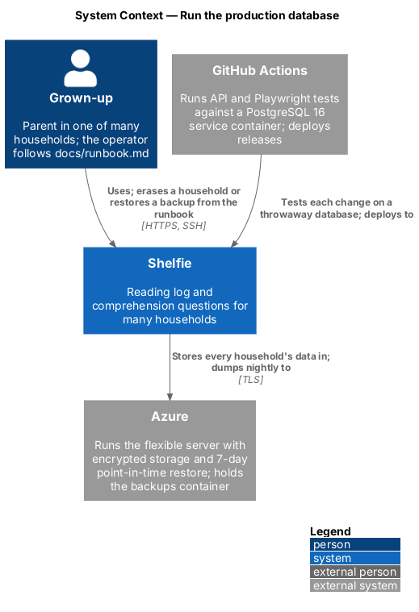
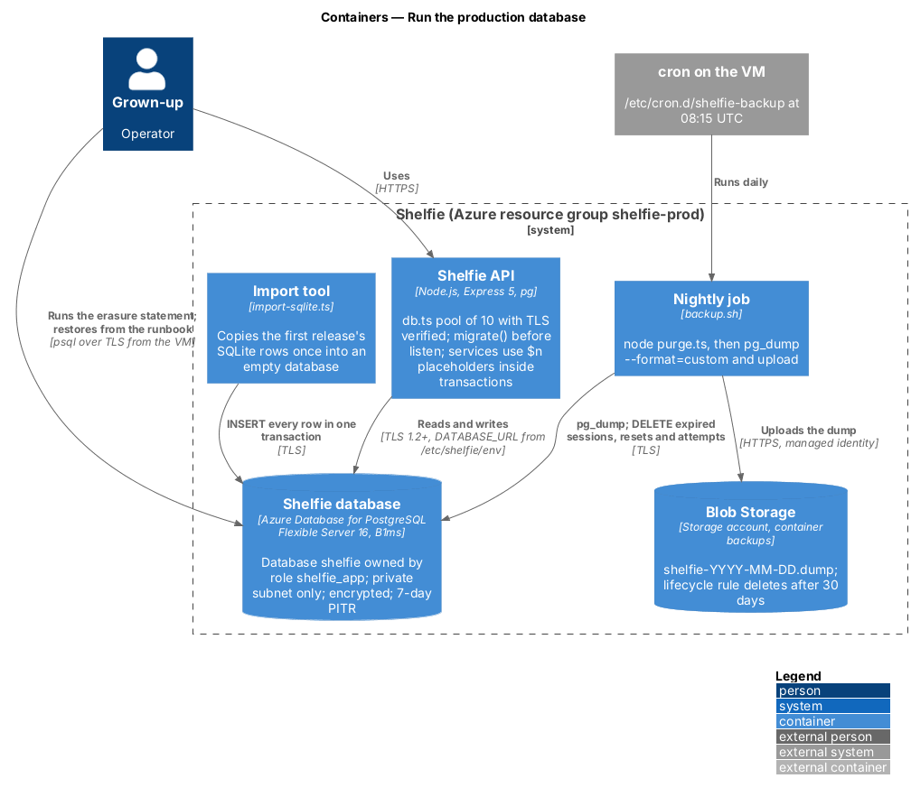
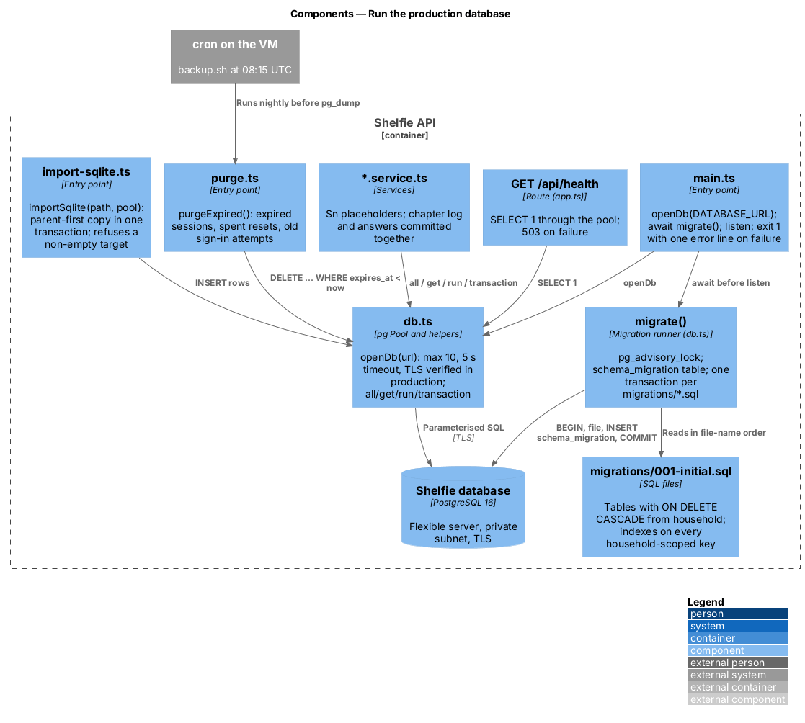
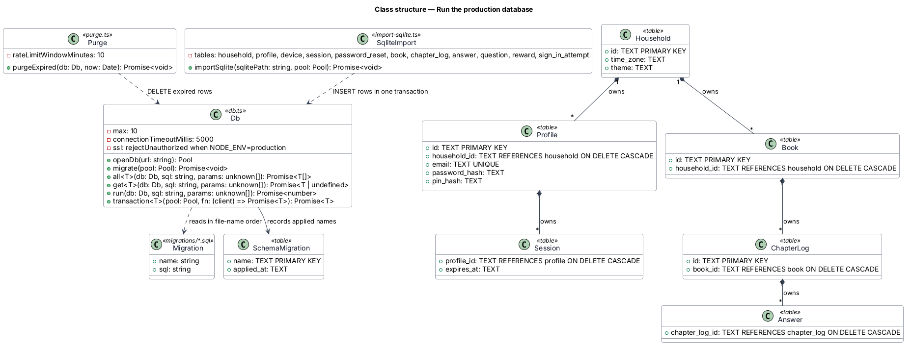
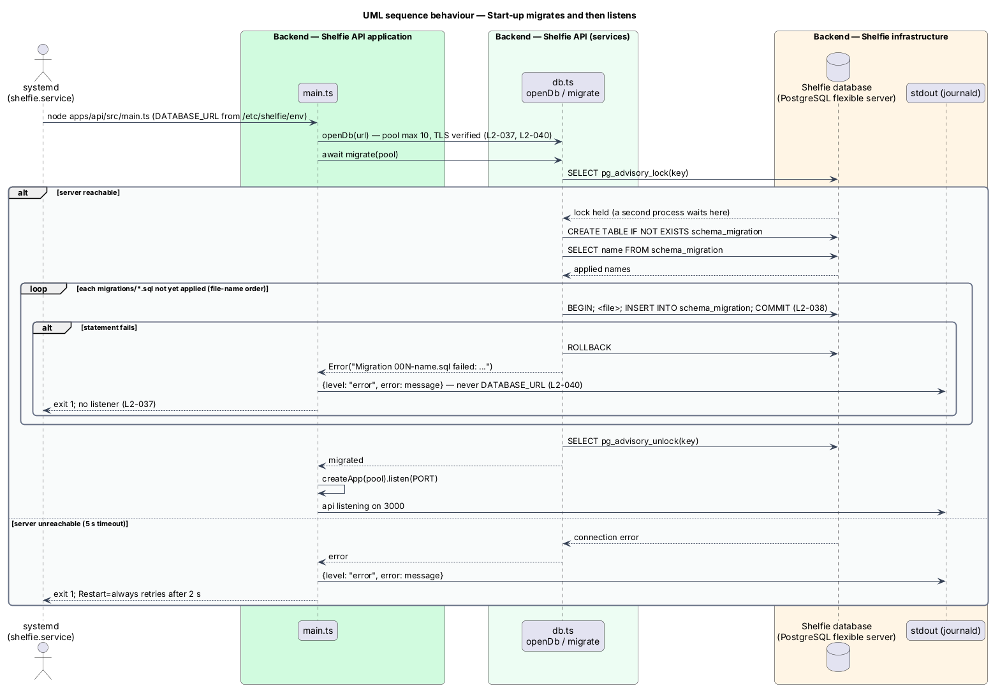
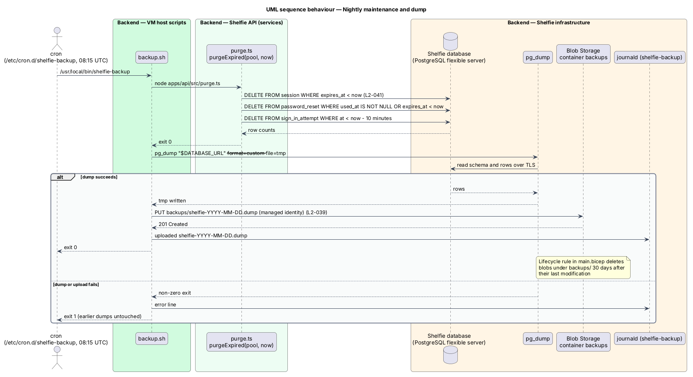
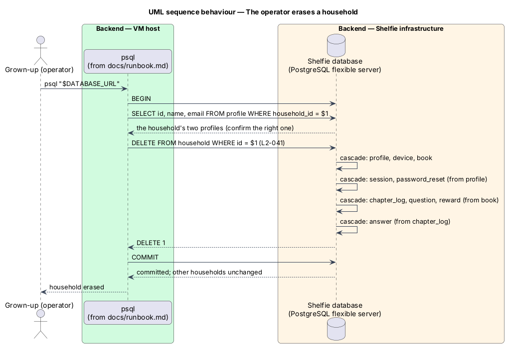

# Run the production database

## Overview

Shelfie is a web application that helps a child read books by logging each chapter she reads and answering short questions about it, while a grown-up in the same household reviews her answers and gives rewards. Shelfie is open to the public: any adult may sign up, so the database holds many households at once, and each one is a stranger to the others. The data is children's answers, parents' e-mail addresses and credential hashes, so it is kept in a managed database that runs apart from the application host, is encrypted, is backed up continuously and can be erased household by household.

This feature is the data half of the `platform` subsystem, beside `operate-service` (health, logs, performance) and `harden-api` (the middleware chain). It has no screen of its own. It covers the PostgreSQL server and how the API reaches it, the versioned migrations that shape the schema, the one-off import of the first release's SQLite file, the backup and restore paths, the protection of the server and its credentials, and the erasure and retention rules that let the operator remove a household or let stale rows expire.

Terms used below:

- **system of record** — the one database that holds every household's data; the API keeps nothing else on disk
- **migration** — numbered SQL file under `apps/api/migrations` that changes the schema once, recorded in the `schema_migration` table
- **advisory lock** — PostgreSQL session lock taken by number (`pg_advisory_lock`) that serialises the migration run across API processes
- **point-in-time restore** — managed-service restore of the whole server to any minute within the retention window, built from continuous backups
- **logical dump** — `pg_dump` output in custom format, a self-contained copy of the schema and rows that `pg_restore` can load into an empty database
- **erasure** — deletion of a household row that cascades to every row the household owns
- **flexible server** — Azure Database for PostgreSQL Flexible Server, the managed PostgreSQL service used in production

The feature realizes the PostgreSQL system of record (`L2-037`), schema migrations (`L2-038`), database backup and restore (`L2-039`), database protection (`L2-040`) and household erasure and data retention (`L2-041`). PostgreSQL is chosen over SQL Server because the `pg` driver is the Node.js standard, PostgreSQL 16 runs free of charge in the developer's shell and in a GitHub Actions service container, and the Burstable flexible server is the cheapest managed tier Azure offers.

## Description

The slice has five parts: the connection and migration runner in the API, the schema and the import tool, the backup path, the server and its network, and the erasure and retention rules.

### Connection and migrations

- **`apps/api/src/db.ts`** — `openDb(url)` returns a `pg.Pool` of at most 10 connections with a 5 s connection timeout. When `NODE_ENV` is `production` the pool uses TLS with `rejectUnauthorized: true`, so the server certificate is checked against the system roots and a plain connection is refused (`L2-037`, `L2-040`). `int8` columns (every `COUNT`) are parsed to numbers. `migrate(pool)` runs once at start-up: it takes `pg_advisory_lock` on a fixed key, creates `schema_migration (name TEXT PRIMARY KEY, applied_at TEXT NOT NULL)` when missing, reads `apps/api/migrations/*.sql` in file-name order, and for each file not yet recorded runs `BEGIN`, the file, an `INSERT INTO schema_migration`, `COMMIT`. A failing file is rolled back and `migrate` throws an error naming the file; a second process starting at the same moment waits on the lock and then finds every file recorded (`L2-038`). The four query helpers `all`, `get`, `run` and `transaction` wrap `pool.query` so that services read rows, one row, a row count, or run a function against one client between `BEGIN` and `COMMIT`.
- **`apps/api/src/main.ts`** — calls `migrate` before `listen`. When the database is unreachable or a migration fails, the process writes one error line (the message, never `DATABASE_URL`) and exits with code 1; systemd restarts it after 2 s and `deploy.sh` rolls the release back when `GET /api/health` does not come up (`L2-037`, `L2-040`).
- **`GET /api/health`** (`operate-service`) — runs `SELECT 1` through the pool; a connection failure answers 503 within the 5 s timeout (`L2-037`).
- **Services and routers** — every statement uses `$n` placeholders and the helpers above. Statements that must commit together (a chapter log with its answers; a password reset with the new hash and the ended sessions; the settings patch) run inside `transaction`, so a 201 for a logged chapter is sent only after `COMMIT` (`L2-037`). Column aliases that are not lower case are quoted (`AS "chapterLogId"`) because PostgreSQL folds unquoted identifiers to lower case.

### Schema and import

- **`apps/api/migrations/001-initial.sql`** — the tables `household`, `profile`, `device`, `session`, `password_reset`, `book`, `chapter_log`, `answer`, `question`, `reward` and `sign_in_attempt` with `TEXT` ids and ISO-8601 `TEXT` timestamps, as the first release stored them. Every child table references its parent with `ON DELETE CASCADE`: `profile`, `device` and `book` reference `household`; `session` and `password_reset` reference `profile`; `chapter_log`, `question` and `reward` reference `book`; `answer` references `chapter_log`. Indexes cover every foreign key that is read by a household-scoped query (`book(household_id)`, `session(profile_id)`, `device(household_id)`, `password_reset(profile_id)`, `sign_in_attempt(source)`), the review queue (`chapter_log(reviewed_at)`) and the unique e-mail (`profile(email)`) (`L2-030`, `L2-041`).
- **`apps/api/src/import-sqlite.ts`** — `importSqlite(sqlitePath, pool)` copies the first release's data once. It refuses a target that already holds a household, opens the SQLite file read-only with `node:sqlite`, and inside one transaction inserts every row of every table in parent-first order with the same column names and values. `npm run import-sqlite -w apps/api` is the entry point; `SHELFIE_DB` names the file and `DATABASE_URL` the target (`L2-038`).
- **`apps/api/src/seed.ts`** — `seed(pool)` replaces the content of a database with the two test households; it is used by the acceptance tests and by `npm run seed -w apps/api` locally. The test helper `apps/api/src/test-db.ts` creates a throwaway database (`CREATE DATABASE shelfie_test_<random>`) on the server named by `DATABASE_URL`, migrates it and drops it afterwards, so every API test file and every Playwright worker runs against real PostgreSQL without sharing state.

### Backup and restore

- **Service backups** — the flexible server keeps 7 days of automated backups with point-in-time restore; `geoRedundantBackup` is off. Restoring to a new server and pointing `DATABASE_URL` at it is the recovery path for a corrupted or wrongly deleted database (`L2-039`).
- **`infra/host/backup.sh`** — runs at 08:15 UTC from `/etc/cron.d/shelfie-backup`. It runs the nightly maintenance (`node apps/api/src/purge.ts`), then `pg_dump --format=custom` of `DATABASE_URL` to a temporary file, and uploads it to the `backups` blob container as `shelfie-YYYY-MM-DD.dump` with the VM's managed identity. A failing dump exits non-zero and is logged under `shelfie-backup`; the blobs already there are untouched (`L2-039`).
- **Lifecycle rule** — `infra/main.bicep` gives the storage account a management policy that deletes blobs under `backups/` 30 days after their last modification, replacing the pruning the SQLite backup job did (`L2-039`).
- **`docs/runbook.md`** — documents the point-in-time restore, the `pg_restore` of a dump into an empty database, the erasure statement and the maintenance schedule (`L2-039`, `L2-041`).

### Server, network and credentials

- **`infra/main.bicep`** — adds a flexible server (`Standard_B1ms`, Burstable, PostgreSQL 16, 32 GiB with auto-grow, system-managed encryption) in a delegated subnet `10.0.1.0/24` of the existing virtual network, a private DNS zone `shelfie.private.postgres.database.azure.com` linked to the network, `publicNetworkAccess: Disabled`, and the database `shelfie`. The server is reachable only from the VM's subnet; TLS 1.2 is the server's minimum and `require_secure_transport` stays on (`L2-040`).
- **`infra/bootstrap.sh`** — generates the administrator password and the application password once, passes the first to Bicep, and then, through `az vm run-command` on the VM (the only host that can reach the server), creates the role `shelfie_app` with `LOGIN` and no superuser or replication rights, makes it the owner of the database `shelfie`, appends `DATABASE_URL` to `/etc/shelfie/env` (mode 0640, group `shelfie`) and keeps the administrator credential in `/etc/shelfie/db-admin` (mode 0600, root). A re-run reuses the stored passwords. GitHub Actions never sees either credential (`L2-040`).
- **`infra/cloud-init.yaml`** and **`infra/host/deploy.sh`** — install `postgresql-client` so `pg_dump` and `psql` exist on the VM; `deploy.sh` installs it when missing so the existing VM gains it without being recreated.
- **Logging** — `problemDetailsHandler` and the start-up error path log `error.message` and the stack; `pg` error messages name the host and database but not the password, and `DATABASE_URL` itself is never written (`L2-040`).

### Erasure and retention

- **Erasure** — `DELETE FROM household WHERE id = $1` removes the household and, through the cascades above, its profiles, devices, sessions, password resets, books, chapter logs, answers, questions and rewards in one statement and one transaction. Other households are untouched. Self-service deletion and export screens are deferred (AGENTS.md, Deferred work); until they exist the operator runs the statement from the runbook (`L2-041`).
- **`apps/api/src/purge.ts`** — `purgeExpired(pool, now)` deletes sessions whose `expires_at` has passed, password resets that are used or expired, and sign-in attempts older than the 10-minute rate-limit window. `backup.sh` runs it nightly before the dump (`L2-041`).

## Requirements

The feature realizes the following level-2 (L2) requirements. Each refines a level-1 (L1) requirement, cited by identifier.

| L2 ID | Refines (L1) | Requirement |
|-------|--------------|-------------|
| `L2-037` | `L1-014` | PostgreSQL as the system of record. The API shall serve every request from the PostgreSQL 16 database named by `DATABASE_URL` through a pool of at most 10 connections; in production the connection shall use TLS with the server certificate verified; when the database is unreachable at start-up the process shall exit non-zero without listening; when it becomes unreachable `GET /api/health` shall answer 503 within 5 s; a logged chapter and its answers shall be committed in one transaction. |
| `L2-038` | `L1-014` | Schema migrations. Migrations shall be applied in file-name order, each in its own transaction, and recorded in `schema_migration`; a second start shall apply none; a failing migration shall be rolled back and shall stop the API with an error naming the file; two processes starting together shall apply each migration exactly once; `npm run import-sqlite -w apps/api` shall copy every row of the SQLite release's database into an empty PostgreSQL database. |
| `L2-039` | `L1-014` | Database backup and restore. The service shall keep 7 days of automated backups with point-in-time restore; a logical dump shall be written to the `backups` container at 08:15 UTC daily and deleted after 30 days by a lifecycle rule; the documented restore of a dump into an empty database shall let the API serve the restored households; a failed dump shall be logged under `shelfie-backup` and shall leave earlier dumps untouched. |
| `L2-040` | `L1-012` | Database protection. The server shall accept connections only from the application's virtual network and shall have no public endpoint; storage and backups shall be encrypted with AES-256; the server shall require TLS 1.2 or later and the API shall verify its certificate; the API's role shall own the application schema only, without superuser or replication rights; the connection string shall live only in `/etc/shelfie/env` (0640) and never in the repository, CI output, logs or error responses; a connection failure shall be logged without the password. |
| `L2-041` | `L1-012` | Household erasure and data retention. Deleting a household row shall delete every profile, device, session, password reset, book, chapter log, answer, question and reward of that household in the same transaction, leaving other households unchanged; nightly maintenance shall delete expired sessions, spent or expired reset tokens and old sign-in attempts; the runbook shall document the erasure statement and the maintenance schedule. |

## Diagrams

### System context

The grown-up operates the service from the runbook; GitHub Actions tests every change against a PostgreSQL service container and deploys releases; the Azure platform runs the managed server with its automated backups.

### Containers

The API on the VM reaches the flexible server over TLS inside the virtual network; the nightly job dumps the database to Blob Storage; the import tool copies the first release's SQLite file once.

### Components

Inside the API, `db.ts` owns the pool, the helpers and the migration runner; `main.ts` migrates before it listens; `purge.ts` and `import-sqlite.ts` are entry points that share the pool.

### Class structure

`Db` builds the `Pool` and runs `Migration` files; `Purge` and `SqliteImport` depend on `Db`; the `household` row is the root of the cascade through the owned tables.

### Behaviour — start-up migrates and then listens

The API takes the advisory lock, applies each pending migration in its own transaction and starts listening; the alternate paths show a failing migration rolled back and the process exiting, and an unreachable server ending start-up with one error line (`L2-037`, `L2-038`).

### Behaviour — nightly maintenance and dump

cron runs the purge, then `pg_dump` and the upload to Blob Storage; the lifecycle rule deletes dumps after 30 days; the alternate path shows a failed dump logged with earlier dumps untouched (`L2-039`, `L2-041`).

### Behaviour — the operator erases a household

The operator runs the erasure statement from the runbook; one `DELETE` cascades through every owned table inside one transaction and another household's rows stay (`L2-041`).

