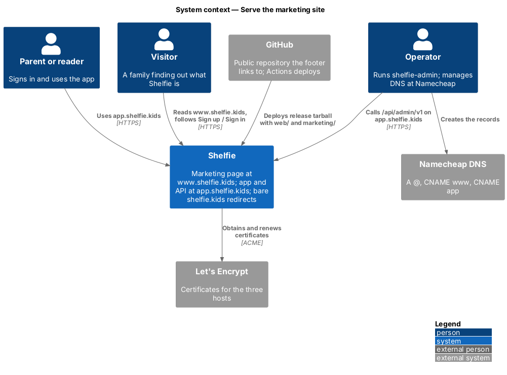
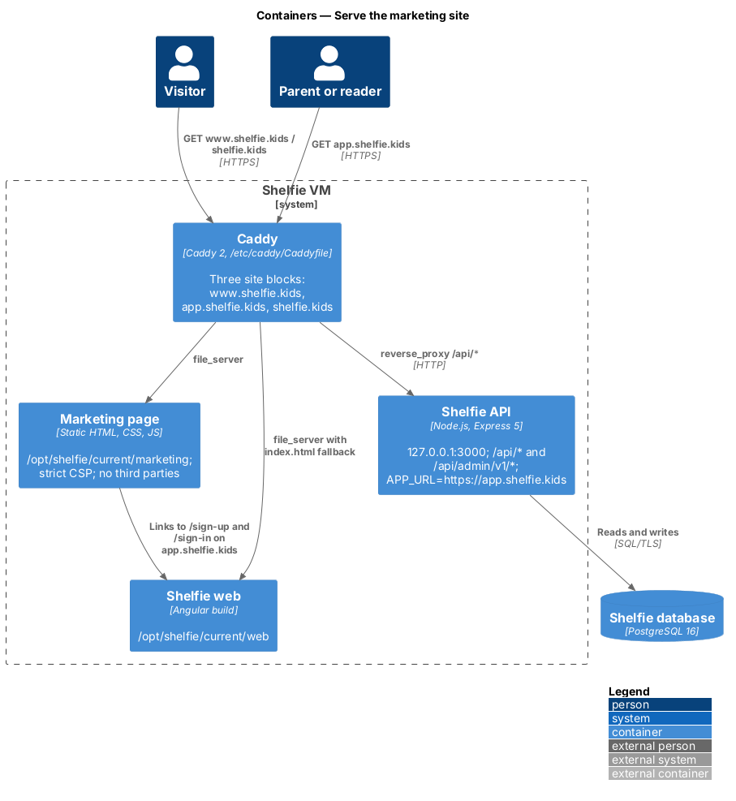
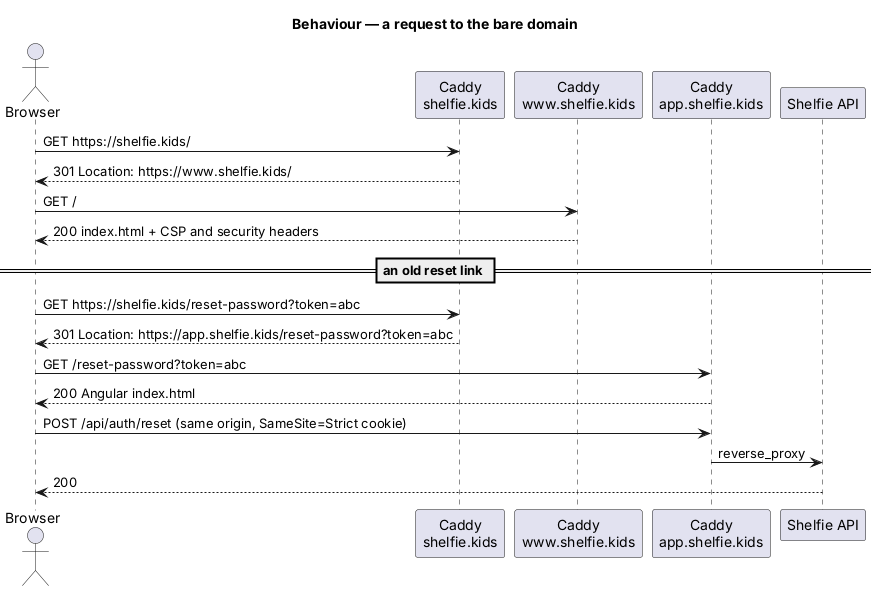
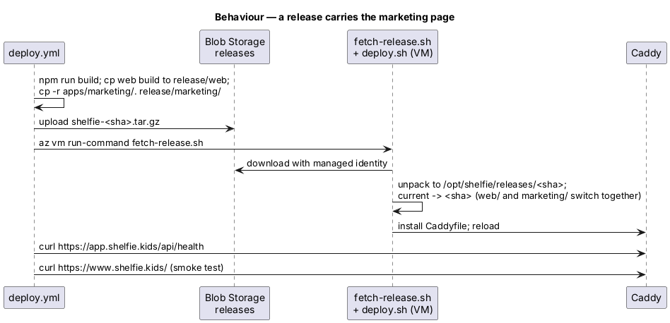

# Serve the marketing site

## Overview

Shelfie is a web application that helps a child read books by logging each chapter she reads and answering short questions about it, while a parent in the same household reviews her answers and gives rewards. Until now the only thing at `shelfie.kids` was the app's sign-in page, so a family hearing about Shelfie had nowhere to find out what it is.

This feature, part of the `platform` subsystem, adds a public marketing page at `https://www.shelfie.kids` and moves the app, with its `/api` and `/api/admin/v1`, to `https://app.shelfie.kids`. The page is one static HTML file with one stylesheet and one small script, built after TwinkleTune's marketing page (`C:\projects\TwinkleTune\marketing`) but with Shelfie's own copy, brand and real screenshots. It lives outside the Angular workspace, so the components library rule does not apply to it (ADR-0017). The app itself does not change.

Terms used below:

- **marketing page** — `apps/marketing/index.html` and its `assets/`, served at `https://www.shelfie.kids/`
- **app host** — `app.shelfie.kids`, which serves the Angular build and proxies `/api/*` to the API
- **bare domain** — `shelfie.kids` with no subdomain, which only redirects
- **release tarball** — `shelfie-<sha>.tar.gz`, built by `deploy.yml` and unpacked on the VM to `/opt/shelfie/releases/<sha>`

The feature realizes the marketing site (`L2-129` to `L2-133`), the host move (`L2-134`, `L2-135`) and the e-mail links (`L2-136`), and changes the admin API host and the CLI default (`L2-053`, `L2-054`).

## Description

### The page

- **`apps/marketing/index.html`** — sections in TwinkleTune's order: skip link; sticky header with the logo, anchor links, "Open the app" (`https://app.shelfie.kids/sign-in`) and a menu button; hero with the H1 "Every chapter is a step to a reward.", "Start reading free" (`https://app.shelfie.kids/sign-up`) and "See how it works"; "Why Shelfie" with three value cards; "How it works" as an ordered list of the five steps of the reading loop; "Inside the app" with four real screenshots in a horizontally scrolling, focusable region; "For families" as a bento grid covering streaks and streak rewards, badges, the reward gallery and voice answers; a final call to action with "Create a parent account" and "Sign in"; and a footer with a Product column and the year; unlike TwinkleTune's, it has no Project column (no GitHub, documentation or license links) (`L2-129`).
- **`assets/tokens.css`** — a copy of `docs/design-system/tokens/tokens.css`, so light and dark follow the device exactly as in the app. No new tokens were needed (`L2-129`).
- **`assets/shelfie.css`** — the layout, using only tokens. The app loads no web fonts (its stack is `ui-rounded`, then system fonts), so the page uses the same stack and ships no font files; TwinkleTune's self-hosted woff2 files have no Shelfie counterpart. Below `--layout-breakpoint-lg` (1024px) the anchor links give way to the menu button (`L2-130`).
- **`assets/shelfie.js`** — adds `reveal-ready` to `<html>`; toggles the menu, keeping `aria-expanded`, the button's name ("Open navigation" / "Close navigation") and the menu's `inert` in step, and closes it on Escape, on a menu link and when the window grows past the breakpoint; marks the header once scrolled; reveals `[data-reveal]` sections with an `IntersectionObserver`, or all at once under `prefers-reduced-motion: reduce`, where the CSS also drops the transition; sets the footer year (`L2-130`, `L2-131`).
- **Metadata** — title, description, `theme-color` per scheme, canonical `https://www.shelfie.kids/`, Open Graph and Twitter `summary_large_image` tags with `assets/social-card.png` (1200x630), `assets/icon.svg` (the logo); `robots.txt` and `sitemap.xml` (`L2-132`).
- **Screenshots** — `tools/marketing-screenshots/` is a Playwright project over the e2e fixture: it seeds Nia and Dad's household, opens four screens from `e2e/support/screens.ts` at 390x844 with reduced motion and writes `assets/screenshots/{shelf,log-chapter,review,answers}.png`; it also renders `social-card.html` to `assets/social-card.png`. Run it with `npx playwright test -c ../tools/marketing-screenshots/playwright.config.ts` from `e2e/`.

### Hosts and Caddy

`infra/host/Caddyfile` has three site blocks on the one VM and one Caddy:

| Site | Serves |
|---|---|
| `app.shelfie.kids` | Today's app block, renamed: `/api/*` to `127.0.0.1:3000`, the Angular build from `/opt/shelfie/current/web` with an `index.html` fallback (`L2-134`) |
| `www.shelfie.kids` | `file_server` from `/opt/shelfie/current/marketing` with `Content-Security-Policy` (`default-src 'self'`, `script-src 'self'`, `style-src 'self'`, `img-src 'self' data:`, `frame-ancestors 'none'`, `object-src 'none'`), `Strict-Transport-Security`, `X-Content-Type-Options`, `Referrer-Policy`, `Permissions-Policy` and `Cache-Control: no-cache` (`L2-133`) |
| `shelfie.kids` | `redir` `/` to `https://www.shelfie.kids/`, every other path to `https://app.shelfie.kids{uri}`, both 301 (`L2-135`) |

The old `www` → bare redirect is gone. The API stays on the app's origin, so there is no CORS. The session cookie stays host-only and `SameSite=Strict` (`apps/api/src/auth.router.ts`); everyone signs in once more on the new host (ADR-0017).

### Release and deploy

- **`.github/workflows/deploy.yml`** — the "Assemble the release tarball" step also copies `apps/marketing/.` to `release/marketing/`; the environment URL and the health check move to `https://app.shelfie.kids`, and a final step loads `https://www.shelfie.kids/` and checks the headline (`L2-134`).
- **`infra/host/deploy.sh`, `fetch-release.sh`** — unchanged: they unpack the whole tarball and switch `current`, so `web/` and `marketing/` go live and roll back together.
- **`infra/main.bicep`, `cloud-init.yaml`, `bootstrap.sh`** — `hostname` defaults to `app.shelfie.kids`, which puts `APP_URL=https://app.shelfie.kids` in a new VM's `/etc/shelfie/env`, so reset and invite links are built on the app host (`L2-136`). `bootstrap.sh` prints the three DNS records.

### DNS

At Namecheap, for `shelfie.kids`: `A @` → the VM's IP, `CNAME www` → `shelfie.kids.`, `CNAME app` → `shelfie.kids.`. Caddy gets a certificate per host when its record resolves. `CNAME app` must exist before the release reaches production, or `app.shelfie.kids` has no certificate and the app is down. On the existing VM the operator also sets `APP_URL=https://app.shelfie.kids` in `/etc/shelfie/env` (`docs/runbook.md`).

### Admin surface

`shelfie-admin` defaults to `https://app.shelfie.kids` (`Target.cs`, `Program.cs`) and `apps/api/admin-api.yaml` names `https://app.shelfie.kids/api/admin/v1` (`L2-053`, `L2-054`). Tokens are stored per base URL, so the operator runs `shelfie-admin login` once more.

### Tests

The e2e fixture (`e2e/support/test.ts`) mounts `apps/marketing` with `express.static` under `/marketing/` on each worker's server and sends the same `Content-Security-Policy` as Caddy, so a test sees what production would block. `e2e/pages/marketing.page.ts` owns the selectors. `marketing.spec.ts` covers the sections and links (`L2-129`), `marketing-layout.spec.ts` the absence of sideways scroll at 390, 820 and 1440px, the keyboard menu and reduced motion (`L2-130`, `L2-131`), and `marketing-metadata.spec.ts` the tags, `robots.txt`, `sitemap.xml` and a load under the policy with no violations and no off-origin requests (`L2-132`, `L2-133`). The Caddy blocks were checked with `caddy validate` and by running a copy on local ports and checking the redirects and headers with `curl` (`L2-133`, `L2-135`). `SignInTests.cs` asserts the new CLI default.

## Requirements

| L2 ID | Refines (L1) | Requirement |
|-------|--------------|-------------|
| `L2-129` | `L1-028` | Marketing page sections and calls to action to `app.shelfie.kids` sign-up and sign-in |
| `L2-130` | `L1-028` | No sideways scroll at phone, tablet and desktop widths; labelled, keyboard-operable, `inert` mobile menu |
| `L2-131` | `L1-028` | Reveal on scroll, switched off under reduced motion |
| `L2-132` | `L1-028` | Meta, Open Graph, Twitter and canonical tags; `robots.txt`; `sitemap.xml` |
| `L2-133` | `L1-028`, `L1-012` | Strict CSP and security headers; no third-party scripts or analytics |
| `L2-134` | `L1-028` | App and API at `app.shelfie.kids`, unchanged; deploy checks both hosts |
| `L2-135` | `L1-028` | Bare-domain split redirect |
| `L2-136` | `L1-028` | Reset and invite links built from `APP_URL=https://app.shelfie.kids` |
| `L2-053`, `L2-054` | `L1-017`, `L1-016` | Admin API host and CLI default target become `https://app.shelfie.kids` |

## Diagrams

### System context

Visitors read the marketing page, users and the operator use the app host, Namecheap holds the records and Let's Encrypt issues the certificates.

### Containers

One Caddy on the VM serves three hosts: static marketing files, the Angular build, and the API behind `/api/*`.

### Behaviour — a request to the bare domain

The home page goes to www; any other path, such as an already-sent reset link, goes to the same path on the app host.

### Behaviour — a release carries the marketing page

The tarball gains `marketing/`; the VM switches `current` so both static trees move together; the workflow checks the API health and loads the marketing page.

## Open questions

- None open. Decided along the way: the menu breakpoint is the token `--layout-breakpoint-lg` (1024px) rather than TwinkleTune's 980px; no web fonts are shipped because the app uses none; `tokens.css` is copied into `apps/marketing/assets/` rather than shared through a build step, since the page has no build.

Deferred: pricing, privacy, terms and blog pages, analytics and a contact form; moving the e-mail sender address.
