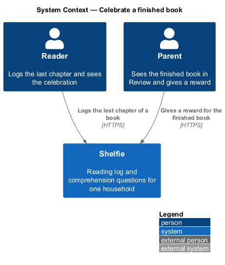
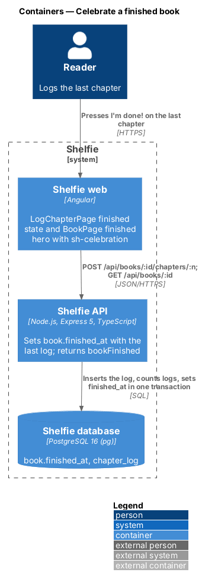
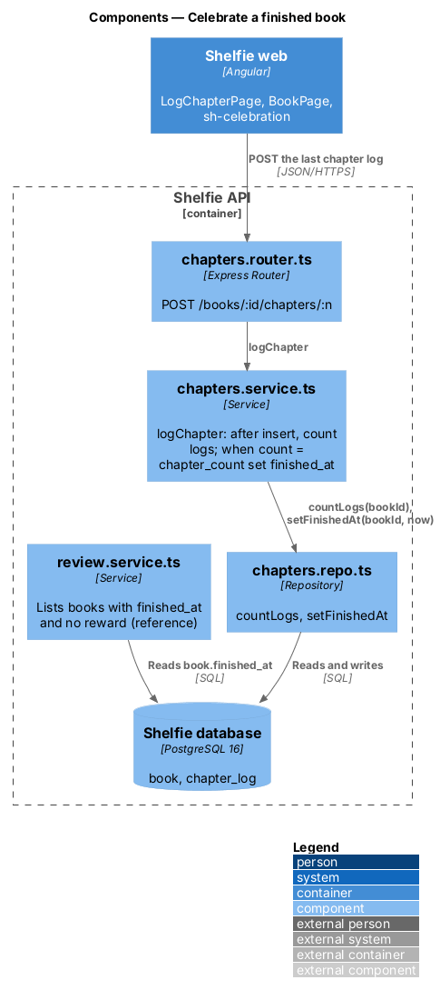
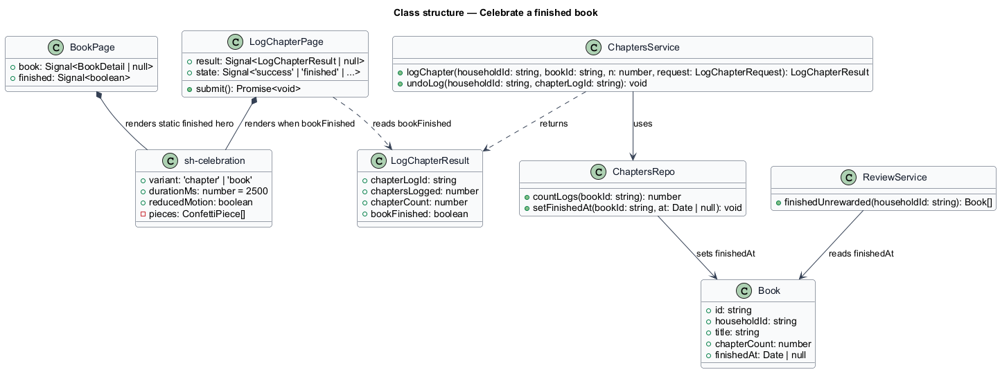
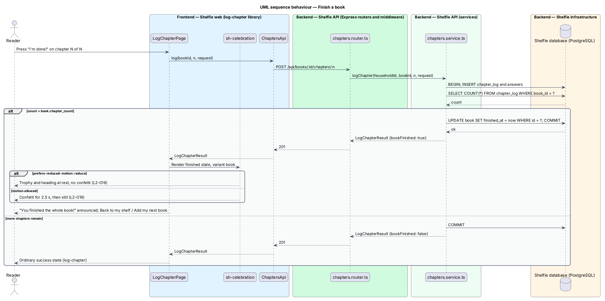

# Celebrate a finished book

## Overview

Shelfie is a web application that helps one child read books by logging each chapter she reads and answering short questions about it, while a parent in the same household reviews her answers and gives rewards. A **book** has a fixed chapter count set when it is added; a book is **finished** when every one of its chapters has a chapter log (log-chapter).

Finishing a book is the moment the whole loop is built around, so it gets its own screen. When the reader logs the last chapter, the log page shows the **finish-book celebration** instead of the ordinary success state: a trophy, "You finished the whole book!", a line that the parent will pick her reward, and the next moves "Back to my shelf" and "Add my next book". The book page then shows a finished hero ("You finished Matilda on Tuesday!") with the reward once it is given, and the shelf moves the book to the Finished row (books/shelf, `L2-018`).

A **celebration** is a short confetti-style animation that runs once and stops. For a reader who has asked the operating system for reduced motion the celebration renders a static state, with no animation, so the moment is still marked.

The server records the finish as `book.finished_at`, set in the same transaction as the last chapter log. The parent's review queue reads `finished_at` to show "finished, give a reward" (review/review-queue and review/give-reward); the reward itself is outside this feature. The feature sits in the `reading-log` subsystem beside log-chapter, view-chapter-answers and track-streak.

## Description

The slice runs from the finished state of `LogChapterPage` and `BookPage` to the `book.finished_at` column.

- **`LogChapterPage`** — page component in the `log-chapter` library (log-chapter). When `LogChapterResult.bookFinished` is true it renders the `finished` state from `docs/mocks/pages/log-chapter/finished.html`: an `sh-celebration` wrapping the 🏆 sticker, the heading "You finished the whole book!", the line "All N chapters of <title>. Dad will pick your reward — watch your shelf." and the actions "Back to my shelf" (to `ShelfPage`) and "Add my next book" (to `AddBookPage`). The heading is announced through a live region. The Undo toast from log-chapter still shows; undoing the last log clears the finish.
- **`BookPage`** — page component in the `shelf` library (books/book-page). For a book with `finishedAt` set it renders the finished hero from `docs/mocks/pages/book/finished.html`: progress "N of N · finished!", the 🏆 sticker, "You finished <title> on <day>!", and either "Dad is picking your reward. It will show up here and on your shelf." or the reward card (`sh-reward-card`, books/shelf) when a reward exists. Chapters list as logged with their review status; the finished hero carries no animation.
- **`sh-celebration`** — component in the `components` library. It renders its content slot over a confetti layer of coloured pieces that fall for 2.5 s and stop (the mock's note), using the cover colours as piece colours. Under `prefers-reduced-motion: reduce` the confetti layer is not rendered and the slot content is shown at rest. The confetti is `aria-hidden`. It accepts `variant: 'chapter' | 'book'` for the two backgrounds in the mocks.
- **`chapters.service.ts`** — in `logChapter()` (log-chapter), after inserting the log and answers in the same transaction, the service counts the book's logs; when the count equals `book.chapter_count` it sets `book.finished_at = now` and returns `bookFinished: true`. In `undoLog()`, when the deleted log belonged to a finished book the service sets `finished_at` back to null. A book whose `finished_at` is set accepts no further logs, because every chapter number is already taken by the UNIQUE constraint.
- **`chapters.repo.ts`** — `countLogs(bookId)`, `setFinishedAt(bookId, at | null)`.
- **`book`** column used: `finished_at NULL`. `GET /api/books/:id` (books) and `GET /api/shelf` (books/shelf) return `finishedAt`, and `GET /api/review` (review) lists books with `finished_at` set and no `reward` row.

The `LogChapterResult` already carries `chapterCount` and `chaptersLogged`, so the finished copy needs no further request. The celebration on the ordinary success state ("Chapter N done!") uses the same `sh-celebration` with `variant: 'chapter'`.

## Requirements

The feature realizes the following level-2 (L2) requirement. It refines a level-1 (L1) requirement, cited by identifier.

| L2 ID | Refines (L1) | Requirement |
|-------|--------------|-------------|
| `L2-019` | `L1-007` | Given the last chapter of a book is logged, the success state shall display a celebration; given the user has reduced motion set, the celebration shall use no animation. |

## Diagrams

### System context

The reader finishes a book in Shelfie and the parent later gives a reward for it.

### Containers

The Angular application shows the celebration from the `bookFinished` flag in the log response; the Express API sets `book.finished_at` in PostgreSQL in the same transaction as the last log.

### Components

Inside the API, `chapters.service.ts` counts the book's logs after the insert and sets `finished_at` through `chapters.repo.ts`; the review module reads it later.

### Class structure

`LogChapterPage` and `BookPage` render `sh-celebration`; `ChaptersService` sets `Book.finishedAt` when the log count reaches the chapter count.

### Behaviour — finish a book

Logging the last chapter sets `finished_at` and returns `bookFinished`; the page renders the celebration, or its static state under reduced motion (`L2-019`).

