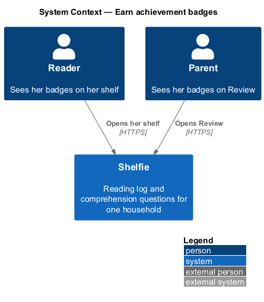
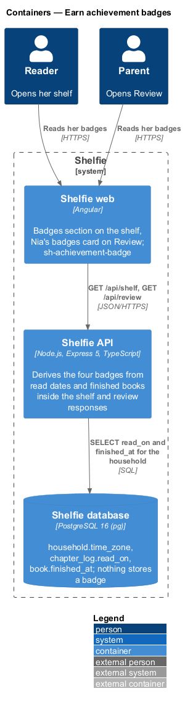
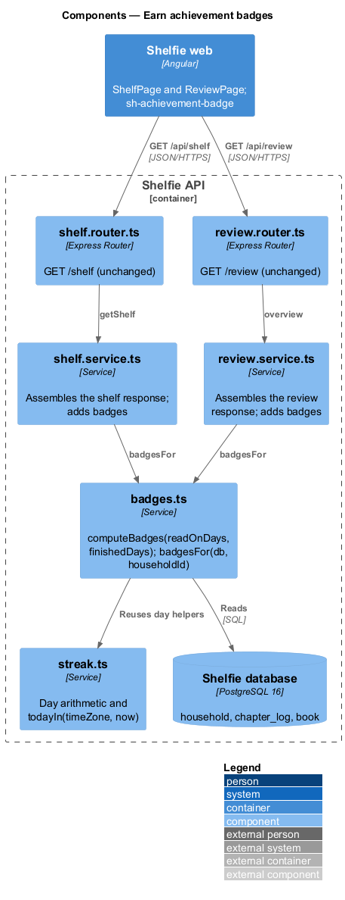
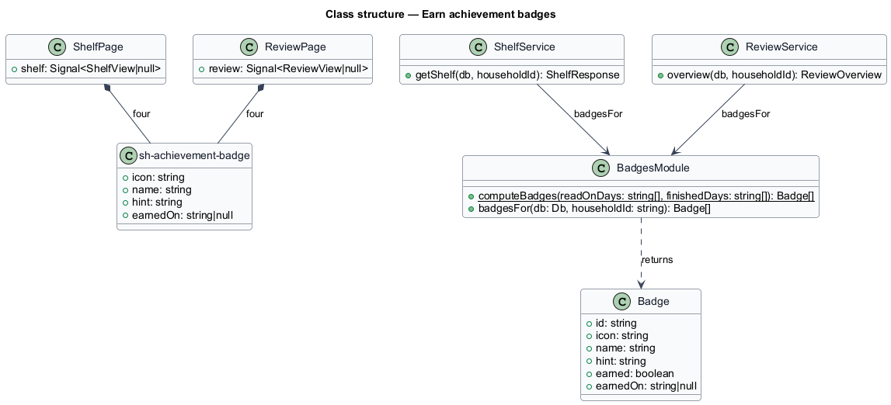
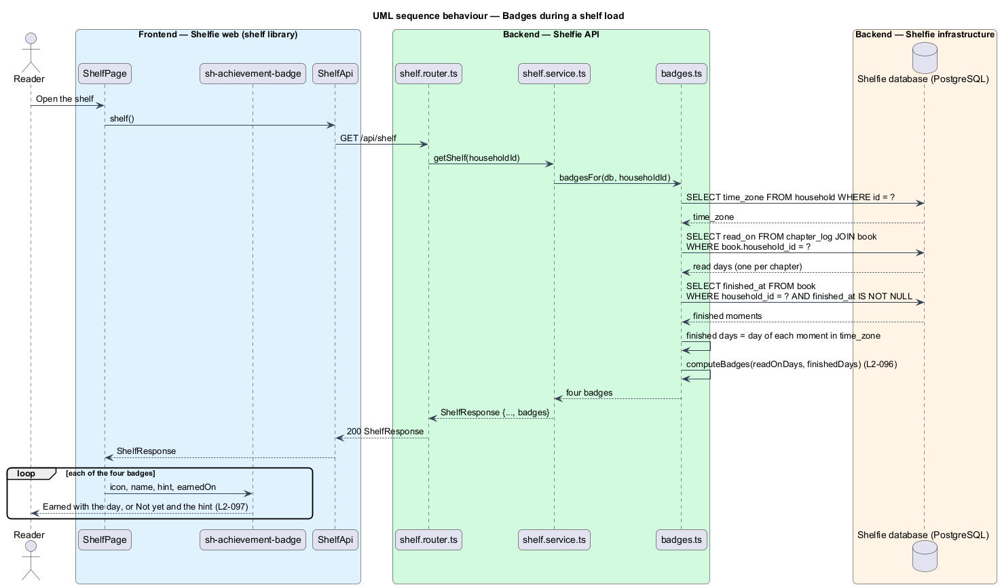

# Earn achievement badges

## Overview

Shelfie is a web application that helps one child read books by logging each chapter she reads and answering short questions about it, while a parent in the same household reviews her answers and gives rewards. A **household** is the unit of tenancy: its parents and readers share one bookshelf.

An **achievement badge** is a small recognition of a reading feat. There are four, always shown in the same order: **First book** (she finished a book), **Double chapter** (two chapters read on one day), **Weekend reader** (chapters read on a Saturday and the Sunday after) and **Week streak** (seven days in a row). Her shelf shows each with the day she earned it, or with a hint of how to earn it; the parent sees the same four on Review.

Badges are **derived**, never stored and never edited (ADR-0011). The API works them out from the household's chapter logs and finished books each time the shelf or Review loads, as it does for the streak (reading-log/track-streak), so there is no table, no migration and no endpoint that writes a badge.

The feature sits in the `reading-log` subsystem beside track-streak. It adds one component to the `components` library and one section each to the shelf and review pages. The streak, the goal and the trophy shelf are unchanged.

## Description

### API

- **`badges.ts`** (`apps/api/src`) — beside `streak.ts`, which it reuses for day arithmetic and the household time zone.
  - `computeBadges(readOnDays: string[], finishedDays: string[]): Badge[]` is a pure function over ISO days (`YYYY-MM-DD`). `readOnDays` has one entry per logged chapter, so duplicates mean several chapters on one day. It returns the four badges in the fixed order.
    - **First book** — earned on the earliest finished day.
    - **Double chapter** — earned on the earliest day that appears at least twice.
    - **Weekend reader** — earned on the earliest Sunday whose previous day is also a read day.
    - **Week streak** — earned on the day that completes the first run of seven consecutive read days.
  - `badgesFor(db, householdId): Promise<Badge[]>` reads the household's time zone, its `chapter_log.read_on` values and its books' `finished_at`, converts each finished moment to a day in the time zone, and calls `computeBadges`.
  - `Badge` is `{ id, icon, name, hint, earned, earnedOn }`; `earnedOn` is the ISO day, or `null` when locked. Icon, name and hint are constants in the same file (📚 First book "Finish a whole book"; ✌️ Double chapter "Read two chapters in one day"; 🌤️ Weekend reader "Read on a Saturday and the Sunday after"; 🔥 Week streak "Read 7 days in a row").
- **`shelf.service.ts`** — `getShelf()` adds `badges: await badgesFor(db, householdId)` to `ShelfResponse`.
- **`review.service.ts`** — `overview()` adds `badges` in the same way.
- No router changes and no new route. Authorisation, household scoping and logging are those of the two existing routes (`L2-099`).

### Frontend

- **`sh-achievement-badge`** (components) — inputs `icon`, `name`, `hint` and `earnedOn: string | null`. It renders `li.achievement` (class `achievement--locked` when `earnedOn` is null): the icon in `.achievement__icon` with `aria-hidden`, the name, and the note, "Earned" and `earnedOn | date: 'EEE d MMM' : 'UTC'` or "Not yet · " and the hint. Styles are `.achievements`, `.achievement` in `docs/design-system/assets/components.css`.
- **`ShelfPage`** (shelf) — a "Badges" section after Finished with a count badge "N of 4" and a `ul.achievements` of `sh-achievement-badge`. The list is not interactive.
- **`ReviewPage`** (review) — a card "Nia’s badges" with the same count and list under This week.
- `ShelfApi` and `ReviewApi` gain the `badges` field on their response types.

### Error mapping

None of its own. The badges travel in the shelf and review responses, so they load, fail and retry with those pages.

### Per reader

Badges count one reader's chapter logs and finished books: `badgesFor(db, householdId, readerId)` (`L2-141`). See `settings/per-reader-records`.

## Requirements

The feature realizes the following level-2 (L2) requirements. Each refines a level-1 (L1) requirement, cited by identifier.

| L2 ID | Refines (L1) | Requirement |
|-------|--------------|-------------|
| `L2-096` | `L1-024` | A badge shall be earned the first time its feat happens, judged on read dates and the household finished day, derived from the logs and never edited by hand. |
| `L2-097` | `L1-024` | The reader's shelf shall list all four badges with the day earned or a hint, accessibly and responsively. |
| `L2-098` | `L1-024` | The parent shall see the same badges on Review, read-only. |
| `L2-099` | `L1-024` | Badges shall be visible only within the household, with no route that changes them. |

`L2-011`, `L2-020`, `L2-025`, `L2-026` and `L2-029` are used unchanged.

## Decisions

- **Derived, not stored.** Recorded in [ADR-0011](../../../adr/0011-badges-are-derived-from-the-logs.md).
- **The API returns the copy.** The icon, name and hint come with each badge, so the shelf and Review show the same words.
- **Week streak is "ever", the streak is "now".** A run of seven days earns the badge for good; the current streak (`L2-020`) can still be lower.

## Diagrams

### System context

Both people see the same badges in Shelfie; neither can change them.

### Containers

The Angular application reads `badges` from the shelf and review responses; the API derives them from chapter logs and finished books.

### Components

`shelf.service.ts` and `review.service.ts` call `badges.ts`, which reads the household's logs and applies the pure function.

### Class structure

`computeBadges` is a pure function; `sh-achievement-badge` shows one badge, and both pages render four.

### Behaviour — badges during a shelf load

The shelf load asks for the household's badges and the page shows four tiles (`L2-096`, `L2-097`).

## Open questions

- **Week streak (resolved).** Earned once for good, not tied to the current streak.
- **Deferred.** A celebration or "new" mark for a freshly earned badge, more badges, per-reader badges and badges on the trophy shelf.
