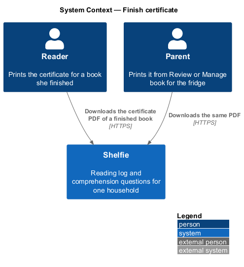
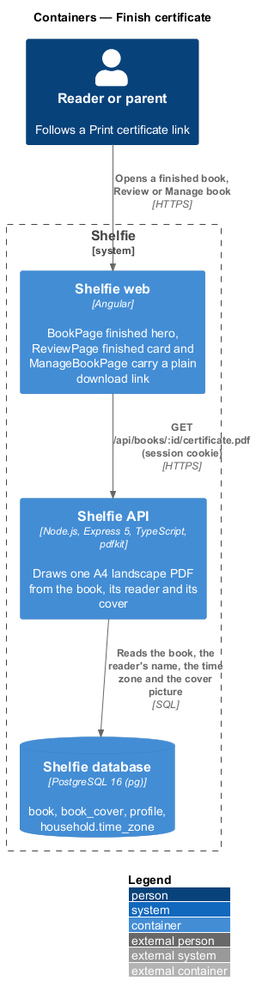
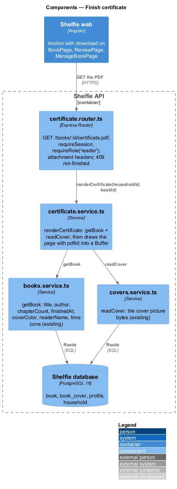
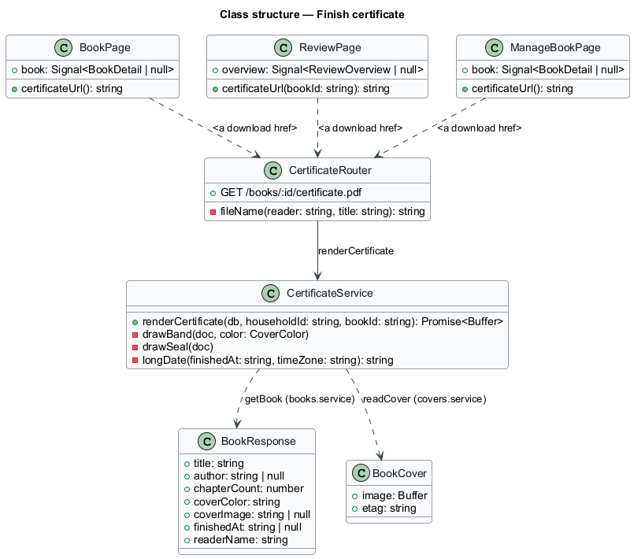
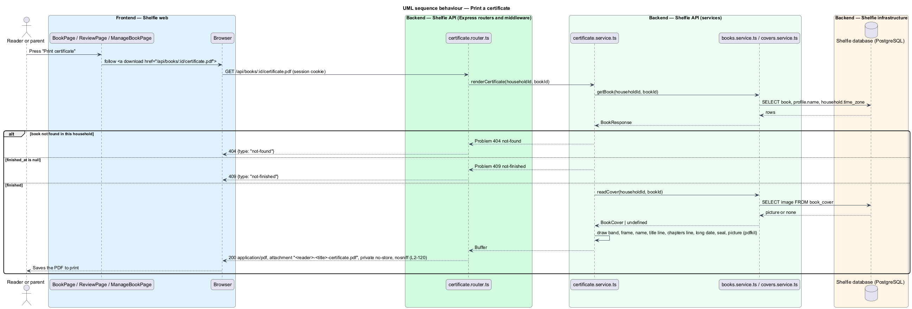

# Finish certificate

## Overview

Shelfie is a web application that helps one child read books by logging each chapter she reads and answering short questions about it, while a parent in the same household reviews her answers and gives rewards. A **book** is **finished** when every one of its chapters has a chapter log; the server records the moment as `book.finished_at` (reading-log/celebrate-finished-book).

A **finish certificate** is one printable page for the fridge: the reader's name, the book's title and author, "all N chapters" and the day she finished it, drawn in the book's cover colour with its cover picture when it has one. The API draws it as a PDF on request (ADR-0015); nothing is stored. It is reached by a plain link from the three places that already show the finish: the reader's book page, the parent's Review card for a finished book, and Manage book.

The certificate never carries the reward, a note or a signature line, and an unfinished book has none. The feature sits in the `reading-log` subsystem beside celebrate-finished-book.

## Description

The slice runs from an anchor on three existing pages to one new API route and service.

- **`BookPage`** — page component in the `shelf` library (books/view-book). In the finished hero of `docs/mocks/pages/book/finished.html`, beside "Back to my shelf", it renders an anchor styled `btn` reading "Print my certificate" with `href="/api/books/<id>/certificate.pdf"` and the `download` attribute. The anchor is rendered only when `book.finishedAt` is set.
- **`ReviewPage`** — page component in the `review` library (review/review-queue). Each "<title> is finished!" card (`overview.finishedUnrewarded`) gets a ghost anchor "Print certificate" beside "Give a reward", pointing at the same route for that book.
- **`ManageBookPage`** — page component in the `books` library (books/manage-book). For a book with `finishedAt` set, rewarded or not, the page offers "Print certificate": inside the Rewarded card once the reward is given (the `rewarded` mock), otherwise in a plain card that names the finish day.
- **`certificate.router.ts`** — Express router mounted at `/api/books` in `app.ts`. `GET /:id/certificate.pdf` runs `requireSession(db)` and `requireRole('reader')`, as `GET /api/books/:id` does, so the reader and both parents can fetch it. It calls `renderCertificate`, then answers 200 with `Content-Type: application/pdf`, `Content-Disposition: attachment; filename="<reader>-<title>-certificate.pdf"` (the name reduced to lower-case letters, digits and hyphens), `Cache-Control: private, no-store` and `X-Content-Type-Options: nosniff`. A `Problem` becomes `{ type }` with its status: 404 `not-found`, 409 `not-finished`.
- **`certificate.service.ts`** — `renderCertificate(db, householdId, bookId): Promise<Buffer>`. It reads the book through `getBook` (books.service.ts), throws `Problem(409, 'not-finished')` when `finishedAt` is null, reads the cover picture through `readCover` (covers.service.ts), and draws one A4 landscape page with `pdfkit`: a band and frame in the cover colour (the six cover tokens of the design system mapped to hex), "Shelfie" and "Certificate of achievement" at the top, the reader's name large, "read <title> by <author>" (or "read <title>" when the author is blank), "all N chapters, start to finish", and "Finished on <weekday> <day> <month> <year>" in the household's time zone. The cover picture, when present, is embedded on the band; a drawn gold circle is the seal at bottom right. Text is set in pdfkit's built-in Helvetica; there is no emoji on the paper (ADR-0015).

No new column, table, Angular route or library component. The anchors rely on the session cookie exactly as the cover `` does.

### Per reader

The certificate names the book's reader (`BookResponse.readerName` is now the book's reader, `L2-142`). See `settings/per-reader-records`.

## Requirements

The feature realizes the following level-2 (L2) requirement. It refines a level-1 (L1) requirement, cited by identifier.

| L2 ID | Refines (L1) | Requirement |
|-------|--------------|-------------|
| `L2-120` | `L1-007` | Given a finished book, a household member shall be able to download a one-page PDF certificate naming the reader, title, author, chapter count and finish day in the book's cover colour, from the book page, Review and Manage book; an unfinished book shall answer 409, another household's book 404, and the file shall be an uncached attachment. |

## Diagrams

### System context

The reader or a parent downloads the certificate of a finished book.

### Containers

Three Angular pages carry a download link; the Express API draws the PDF from PostgreSQL data with pdfkit.

### Components

`certificate.router.ts` guards the route and sets the attachment headers; `certificate.service.ts` reads through the existing `getBook` and `readCover` and draws the page.

### Class structure

The three pages compute the URL; `CertificateService` turns a `BookResponse` and an optional `BookCover` into a `Buffer`.

### Behaviour — print a certificate

Following the link fetches the PDF; a missing book is 404, an unfinished one 409, a finished one is drawn and sent as an attachment (`L2-120`).

