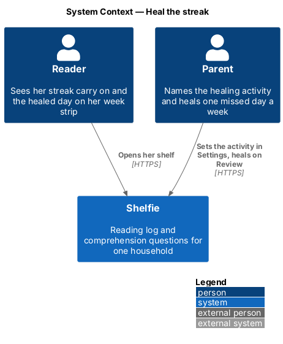
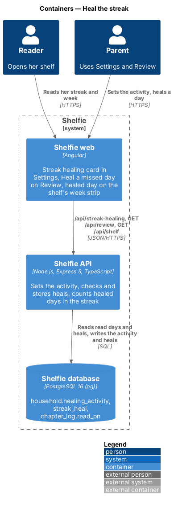
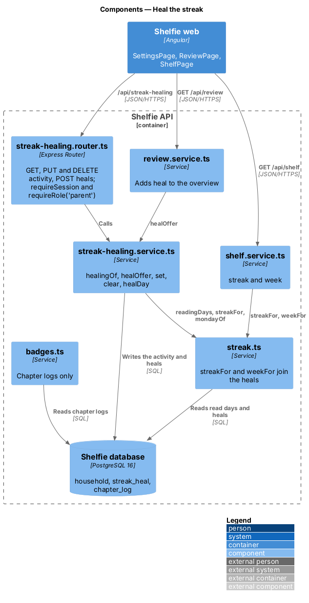
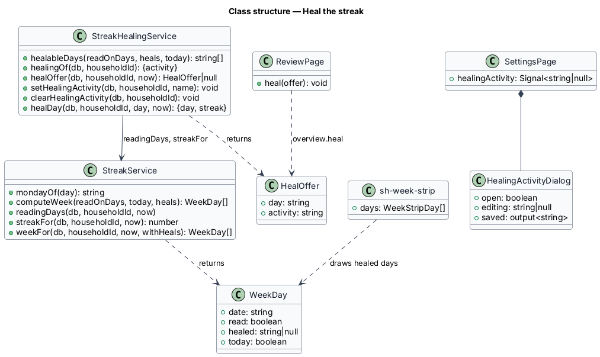
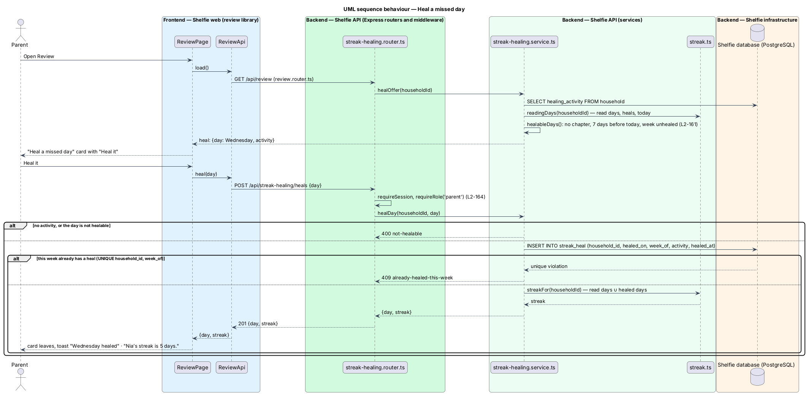

# Heal the streak

## Overview

Shelfie is a web application that helps one child read books by logging each chapter she reads and answering short questions about it, while a parent in the same household reviews her answers and gives rewards. A **household** is the unit of tenancy: its parents and readers share one bookshelf and one reading **streak**, the number of consecutive days with a chapter read (reading-log/track-streak, `L2-020`).

One missed day sets the streak back to 0. This feature lets the parent **heal** one missed day a week. The parent names a **healing activity** in Settings, a reading-related thing the reader does instead, such as "10 minutes reading with your brother". When the reader has missed a day for a good reason and done the activity, the parent heals that day from Review with one tap. A **healed day** counts as a reading day for the streak, so the streak carries on across it, and the reader sees it on her week strip as healed, in a softer fill with a 🩹 and a line that names the activity. It counts for nothing else: not for books, chapters, badges or the reading days on the chapter success card.

Who heals, which days are healable and how the week is counted are recorded in [ADR-0021](../../../adr/0021-heal-one-missed-day-a-week-from-review.md): the parent heals, a healable day is one of the 7 days before today with no chapter, and one heal is allowed per Monday-to-Sunday week of the healed day. The feature sits in the `reading-log` subsystem beside track-streak, because it changes what the streak counts. It touches the `settings`, `review`, `shelf` and `components` libraries. How chapters are logged, the 0 / keep / count rules of `L2-020` for real reading days, the badges and the streak reward milestones are unchanged.

## Description

### Data

- **Migration `014-streak-healing.sql`**
  - `ALTER TABLE household ADD COLUMN healing_activity TEXT`: the activity's name, or null when healing is off.
  - `CREATE TABLE streak_heal`: `household_id TEXT REFERENCES household(id) ON DELETE CASCADE`, `healed_on TEXT NOT NULL` (the household day, `YYYY-MM-DD`, like `chapter_log.read_on`), `week_of TEXT NOT NULL` (the Monday of `healed_on`), `activity TEXT NOT NULL` (the activity's name when it was healed), `healed_at TEXT NOT NULL` (ISO-8601), `PRIMARY KEY (household_id, healed_on)`, `UNIQUE (household_id, week_of)`. The unique key is the once-a-week rule.
  - Both cascade from the household, so the erasure statement in `docs/runbook.md` removes them with no change (`L2-164`).

### API

- **`streak.ts`** — the only place healed days join the streak.
  - `mondayOf(day)` returns the Monday of a day's week; `computeWeek` uses it.
  - `computeStreak(readOnDays, today)` is unchanged; `streakFor` passes it the read days and the healed days together.
  - `computeWeek(readOnDays, today, heals = [])` gives each day `healed: string | null`: the activity when the day was healed and has no chapter, else null.
  - `readingDays(db, householdId, now)` is exported and also returns `heals: { day, activity }[]` from `streak_heal`.
  - `weekFor(db, householdId, now?, withHeals = true)`; `chapters.service.ts` passes `withHeals = false` for the success card's week (`L2-163`).
- **`streak-healing.service.ts`**
  - `healableDays(readOnDays, heals, today)` (pure) lists, newest first, the 7 days before today with no chapter whose week has no heal.
  - `healingOf(db, householdId)` answers `{ activity }`.
  - `healOffer(db, householdId, now?)` answers `{ day, activity }` for the latest healable day, or null when no activity is set or no day is healable.
  - `setHealingActivity(db, householdId, name)` and `clearHealingActivity(db, householdId)` write the column. Clearing leaves `streak_heal` alone.
  - `healDay(db, householdId, day, now?)`: 400 `not-healable` when no activity is set or the day has a chapter, is today or later, or is more than 7 days ago; inserts `(household_id, day, mondayOf(day), activity, now)`; a unique violation answers 409 `already-healed-this-week`. It answers `{ day, streak }` with the new `streakFor`.
- **`streak-healing.router.ts`** — mounted at `/api/streak-healing`; every route applies `requireSession`.
  - `GET /` (reader or parent) answers 200 `{ activity: string | null }`.
  - `PUT /activity` (`requireRole('parent')`) validates `{ name: z.string().trim().min(1).max(100) }` and answers 200 `{ activity }`.
  - `DELETE /activity` (`requireRole('parent')`) answers 204.
  - `POST /heals` (`requireRole('parent')`) validates `{ day: z.iso.date() }` and answers 201 `{ day, streak }`.
  - A reader on a parent-only route gets 403 `grown-ups-only`; a body that fails the schema gets 400 `validation` through `validationProblem`; no session gets 401.
- **`review.service.ts`** — `overview()` adds `heal: await healOffer(...)`. Its `thisWeek.streak` comes from `streakFor` and so counts healed days; `thisWeek.chapters` counts chapter logs only.
- **`shelf.service.ts`** — unchanged: `streak` and `week` come from `streakFor` and `weekFor`, which now carry the heals.
- **`badges.ts`** — unchanged: it reads `chapter_log` only (`L2-163`).
- **Logging** — `requestLogging` writes method, route pattern, status and duration only, so no activity name reaches the log (`L2-164`).

### Frontend

- **`sh-week-strip`** (components) — `WeekStripDay` gains `healed?: string | null`. A healed day carries `day-path__day--done` and `day-path__day--healed`, so it joins the band in the softer `--color-accent-subtle` fill with a 🩹; a `day-path__note` line under the strip reads "🩹 Healed Wednesday: 10 minutes reading with your brother". The strip's accessible name adds "Healed Wednesday: …" after the read days, and the visible line is `aria-hidden`. The styles live in `components.css` (`docs/design-system/components/streak.html`).
- **`ShelfPage`** (shelf) — unchanged apart from the `WeekDay` type: it passes `week` to `sh-week-strip` and `streak` to the top bar's `sh-streak-badge`, which now count healed days.
- **`SettingsPage`** (settings) — loads `StreakHealingApi.get()` with the settings. A "Streak healing" card after Streak rewards shows one row: "No activity set" · "Healing is off" with "Set an activity", or the activity with "Heal one missed day a week from Review" and icon buttons "Edit …" and "Remove …". Remove calls `StreakHealingApi.clear()` and toasts "Healing activity removed", or a danger toast when it fails.
- **`HealingActivityDialog`** (settings) — an `sh-dialog` with an `sh-text-field` "The activity" (`maxlength` 100), as `StreakRewardDialog`: it checks the name is not empty ("Name the activity."), is busy while saving, on a network or server failure shows "… wasn’t saved" with Try again and keeps the name, and toasts "Healing activity set" or "Healing activity saved".
- **`StreakHealingApi`** (settings) — `get()`, `set(name)`, `clear()` over `ApiClient`.
- **`ReviewPage`** (review) — when `overview.heal` is set, a "Heal a missed day" card (🩹 sticker, "Nia didn’t log a chapter on Wednesday. If she did 10 minutes reading with your brother, heal it and her streak carries on.", primary "Heal it"). Heal it calls `ReviewApi.heal(day)`, shows busy, sets `heal` to null and `thisWeek.streak` to the answer's streak, and toasts "Wednesday healed" with "Nia’s streak is N days."; on failure a danger toast says "The day wasn’t healed" and the card stays.

### Error mapping

| Situation | API | Page |
|---|---|---|
| Activity name empty or over 100 | 400 `validation` | Inline error; nothing is sent |
| Heal body without a valid `day` | 400 `validation` | Not offered |
| Heal with no activity, of a day with a chapter, today or later, or over 7 days ago | 400 `not-healable` | Not offered |
| Second heal in a Monday-to-Sunday week | 409 `already-healed-this-week` | Not offered once used |
| Reader sets, removes or heals | 403 `grown-ups-only` | Not offered in the reader's UI |
| Network or server failure | status 0 or 5xx | Banner in the dialog (set), danger toast (remove, heal); values kept |

## Requirements

The feature realizes the following level-2 (L2) requirements. Each refines a level-1 (L1) requirement, cited by identifier.

| L2 ID | Refines (L1) | Requirement |
|-------|--------------|-------------|
| `L2-160` | `L1-030` | The parent shall set, edit and remove one healing activity in Settings; invalid names are refused inline and by the API, and removing it never undoes a heal. |
| `L2-161` | `L1-030` | The parent shall heal, from Review, a day with no chapter among the 7 before today, at most once per Monday-to-Sunday week, and the streak shall carry on across it. |
| `L2-162` | `L1-030` | The reader's week strip shall show a healed day as joined but marked, with the activity named, and her streak badge shall count it. |
| `L2-163` | `L1-030` | A healed day shall count for the streak only, not for badges, books, chapters or the success card's reading days. |
| `L2-164` | `L1-030` | Streak healing shall be visible and changeable only within the household, by parents only, with no activity text in logs, and erased with the household. |

`L2-020`, `L2-025`, `L2-026`, `L2-098`, `L2-100` and `L2-101` are used unchanged; `L2-104` is the pattern `L2-164` applies.

## Decisions

- **The parent heals from Review, with one tap and no confirm dialog; one heal per healed day's week; the 7 days before today; healed days count for the streak only.** Recorded in [ADR-0021](../../../adr/0021-heal-one-missed-day-a-week-from-review.md).
- **The activity is a column, the heals a table.** One activity needs no table; each heal needs its day, its week and its own copy of the name.
- **The heal card's data travels in `GET /api/review`.** Review already loads the streak in one request; a second request would add a loading state for one card.
- **`heal-used` shows nothing.** Once this week's heal is used the card leaves until another week has a healable day; the healed day already shows on the reader's strip.
- **No new token.** The healed fill is `--color-accent-subtle` with `--color-fg-accent` (8.25:1 light), already in the system.

## Diagrams

### System context

The parent names the activity and heals a day; the reader sees her streak carry on.

### Containers

The Angular application calls the new routes and reads `heal` from Review; the API stores the activity on the household and each heal in `streak_heal`.

### Components

`streak-healing.router.ts` checks the session and role and delegates to `streak-healing.service.ts`; `streak.ts` joins the heals to the streak and the week for every caller, while `badges.ts` reads chapter logs only.

### Class structure

Settings owns the dialog, Review heals, and the shelf's week strip draws the healed day.

### Behaviour — heal a missed day

The parent heals the day Review offers; the API checks the day and the week, stores the heal and answers the new streak (`L2-161`, `L2-162`).

## Open questions

- **Healing on behalf of a busy week (resolved).** One heal per week of the healed day, so a Sunday missed last week can still be healed on Monday (ADR-0021).
- **Un-healing (resolved).** Not built: a heal is final, and a later chapter on the day only makes it a read day.
- **Deferred.** More than one activity, a reader-side "I did it" request for the parent to approve, more than one heal a week or a parent-set allowance, push notifications about heals, and healing through `shelfie-admin`.
