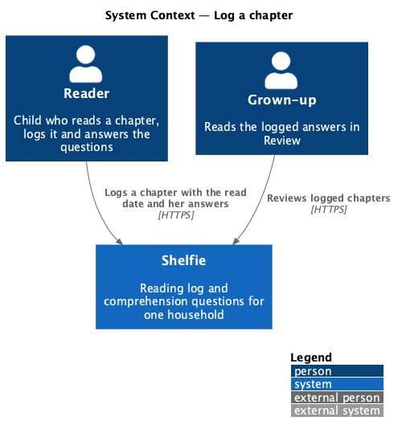
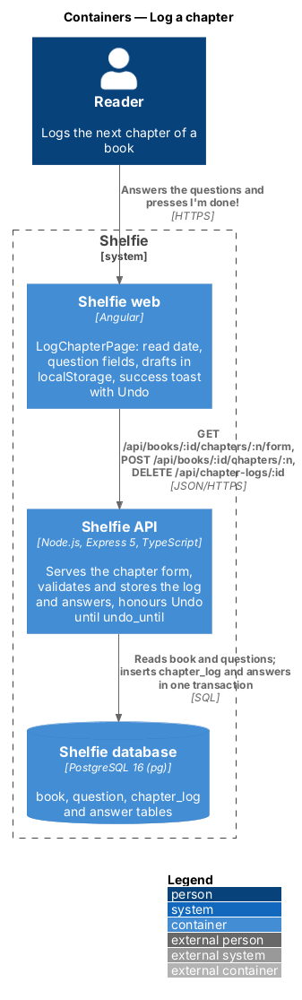
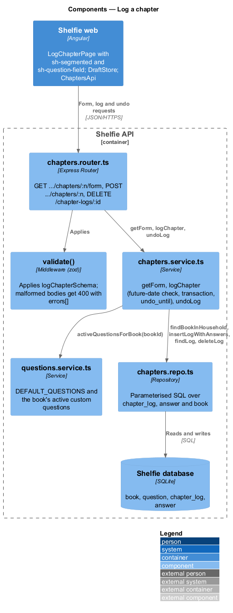
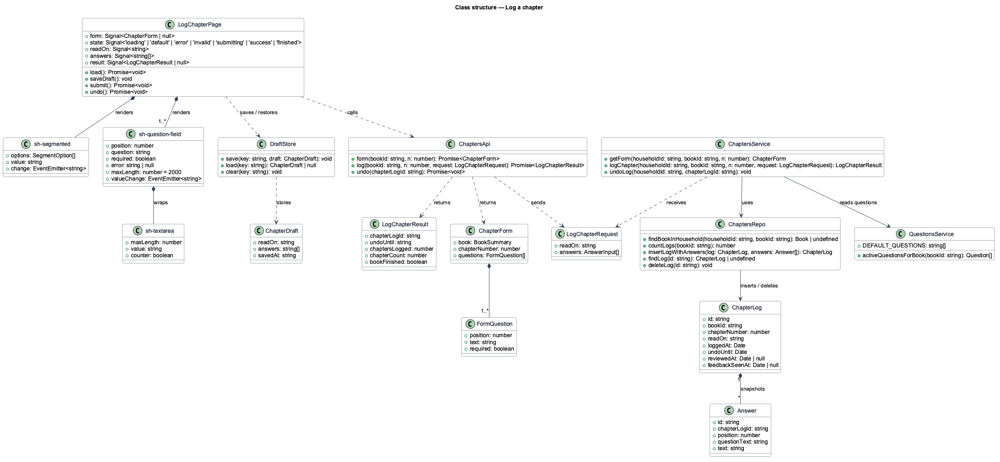
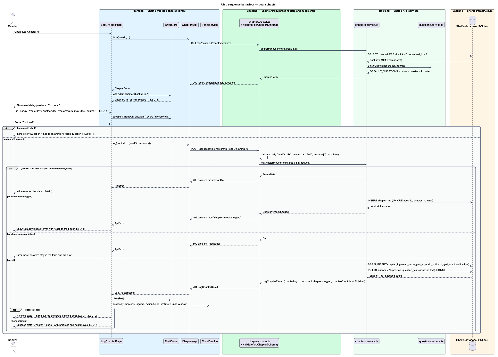
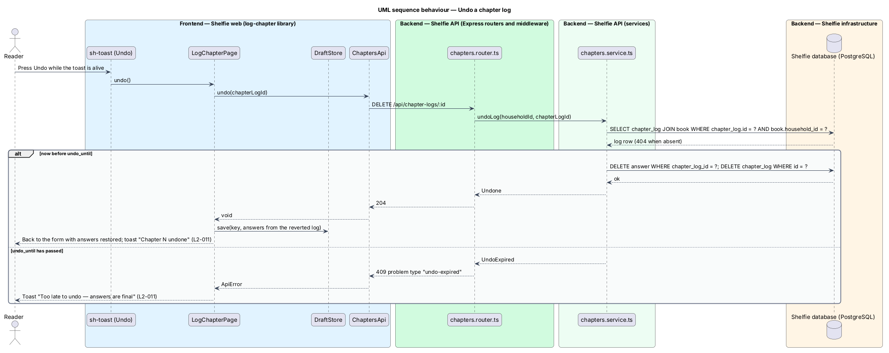

# Log a chapter

## Overview

Shelfie is a web application that helps one child read books by logging each chapter she reads and answering short questions about it, while a grown-up in the same household reviews her answers and gives rewards. A **household** is the unit of tenancy: one reader profile and one grown-up profile sharing one bookshelf. A **book** on that shelf has a title, a chapter count and a cover made of a colour and a sticker; chapters are numbered, not titled.

This feature is the centre of the reading loop. A **chapter log** is the record that the reader has read one chapter of one book: the chapter number, the day she read it, the moment she logged it, and her answers. The reader opens the next unlogged chapter from her shelf or from the book page, says when she read it (Today, Yesterday or Another day), answers the **comprehension questions** for that book, and presses "I'm done!". The questions are the three defaults every book has plus any custom questions the grown-up has added to this book; only question 1 needs an answer, so a tired reader can still log a chapter.

Answers are final once sent. The one way back is **Undo**: the success toast carries an Undo action, and the chapter log can be removed only while that toast is alive. The server stores the deadline as `undo_until`, so the rule holds even when the browser is closed.

Half-written answers are not lost. A **draft** is the current state of the form, saved on the device every few seconds and restored when the reader returns to the same chapter on the same device.

When the chapter logged is the book's last one, the response says so and the page hands over to the finish-book celebration (celebrate-finished-book). Logging while offline is queued on the device and sent later by the shell's offline queue (shell/work-offline). The feature sits in the `reading-log` subsystem beside view-chapter-answers, celebrate-finished-book and track-streak.

## Description

The slice runs from `LogChapterPage` to the `chapter_log` and `answer` tables. The mocks under `docs/mocks/pages/log-chapter/` show a full-page success state and no toast, and the with-action toast mock shows the grown-up's review toast; the design keeps the success page as mocked and adds the Undo toast on top of it, as `L2-011` criterion 5 asks.

- **`LogChapterPage`** — page component in the `log-chapter` library at route `/books/:id/chapters/:n/log`. It loads the form through `ChaptersApi.form()`, renders the book header (`sh-cover`, title, "chapter N of M"), the read-date `sh-segmented`, one `sh-question-field` per question, the "Not yet" and "I'm done!" buttons, and owns the `default`, `loading` (`sh-skeleton`), `error` (`sh-error-state` with "Try again" and "Back to the book"), `invalid`, `submitting` and `success` states from the mocks. On `invalid` it shows the summary "One more thing — Question 1 needs an answer" and the field error, and moves focus to question 1. On `success` it shows the 🎉 card with "Chapter N done!", the progress line and `sh-progress`, and the two next moves "Back to my shelf" and "I read Chapter N+1 too"; the latter opens the same page for `n + 1`. When the result carries `bookFinished: true` the page shows the finished state instead (celebrate-finished-book).
- **`sh-segmented`** — component in the `components` library: a single-choice group of chips. Here it holds Today, Yesterday and Another day; choosing Another day reveals an inline `<input type="date">` with `max` set to today. It emits `change(value)`.
- **`sh-question-field`** — component in the `components` library: numbered question label, an `sh-textarea`, an inline error slot and the character counter. The field for question 1 is marked required.
- **`sh-textarea`** — component in the `components` library: multi-line input with `maxlength`, a counter that appears as the limit nears, and error association through `aria-describedby`. The answer limit is 2000 characters.
- **`DraftStore`** — service in the `core` library over `localStorage`. `save(key, draft)`, `load(key)` and `clear(key)`, with key `draft:chapter:{bookId}:{n}` and value `{ readOn, answers[], savedAt }`. `LogChapterPage` saves on a debounce while the reader types (3 s debounce; the mock says every few seconds), restores on load and clears on a successful log. A failed submission leaves the draft in place.
- **`ChaptersApi`** — service in the `log-chapter` library built on `ApiClient`. `form(bookId, n)` gets `/api/books/:id/chapters/:n/form`; `log(bookId, n, request)` posts to `/api/books/:id/chapters/:n`; `undo(chapterLogId)` deletes `/api/chapter-logs/:id`. Each returns a typed result or throws `ApiError`.
- **`ToastService`** — service in the `core` library (shell). The page shows a success toast "Chapter N logged" with an `Undo` action; this Undo toast lasts 10 s, pausing while hovered or focused, as the one action toast that auto-dismisses (`L2-023`); the API uses the same 10 s for `undo_until`. Pressing Undo calls `ChaptersApi.undo()`, clears the success state, and returns the reader to the form with her answers restored from the draft.
- **`chapters.router.ts`** — Express router. `GET /api/books/:id/chapters/:n/form` (reader or grown-up session). `POST /api/books/:id/chapters/:n` validates the body with `logChapterSchema` through `validate()`: `readOn` is an ISO date, `answers` is an array of `{ position, text }`, each `text` at most 2000 characters, `answers[0].text` non-blank after trimming. `DELETE /api/chapter-logs/:id`. All three run behind `sessionMiddleware` and `csrfGuard`.
- **`chapters.schemas.ts`** — zod schemas `logChapterSchema` and the route parameter schema (`n` is an integer from 1).
- **`chapters.service.ts`** — `getForm(householdId, bookId, n)`: loads the book in this household (404 otherwise), refuses `n` outside `1..chapter_count` with 404, answers 409 with the existing `chapterLogId` when the chapter is already logged, and returns the book summary plus `DEFAULT_QUESTIONS` followed by the book's active custom questions (`removed_at IS NULL`) in creation order. `logChapter(householdId, bookId, n, request)`: rejects `readOn` later than today in `household.time_zone` with 400; in one transaction inserts the `chapter_log` row (`read_on`, `logged_at = now`, `undo_until = logged_at + toast lifetime`) and one `answer` row per question with the question text snapshotted, blank optional answers stored as empty text; a UNIQUE violation on `(book_id, chapter_number)` becomes 409; returns `chapterLogId`, `undoUntil`, `chaptersLogged`, `chapterCount` and `bookFinished`. `undoLog(householdId, chapterLogId)`: loads the log through its book's household (404 otherwise), refuses with 409 `type: "undo-expired"` when `undo_until` has passed, otherwise deletes the log and its answers. `n` shall equal the next unlogged chapter; the service answers 409 `type: "chapter-out-of-order"` otherwise, and the page only ever offers that chapter.
- **`questions.service.ts`** — `DEFAULT_QUESTIONS` constant and `activeQuestionsForBook(bookId)` from the `questions` module; this slice reads them and does not change them.
- **`chapters.repo.ts`** — parameterised SQL over `chapter_log` and `answer`, plus the book lookup by household.
- **`chapter_log`** table: `id`, `book_id`, `chapter_number`, `read_on DATE`, `logged_at`, `undo_until`, `reviewed_at NULL`, `sticker NULL`, `note NULL`, `feedback_seen_at NULL`; UNIQUE(`book_id`, `chapter_number`).
- **`answer`** table: `id`, `chapter_log_id`, `position`, `question_text`, `text`.

The `ChapterForm` response is `{ book: { id, title, author, chapterCount, coverColor, sticker }, chapterNumber, questions: [{ position, text, required }] }`. The problem body for a blank first answer is a 400 with `errors[]` naming `answers.0.text`; for a duplicate it is a 409 with `type: "chapter-already-logged"`. Offline queuing of the `POST` is owned by shell/work-offline and is not shown here.

## Requirements

The feature realizes the following level-2 (L2) requirement. It refines a level-1 (L1) requirement, cited by identifier.

| L2 ID | Refines (L1) | Requirement |
|-------|--------------|-------------|
| `L2-011` | `L1-004` | The reader logs the next chapter of a book. Given question 1 is answered and "I'm done!" is pressed, the chapter shall be saved as waiting for review and a success state shown; a blank question 1 shall show an inline error while blank other answers shall still submit; answers shall be limited to 2000 characters with a counter; a half-written log shall be restored as a draft on the same device; Undo on the success toast shall revert the log within the toast's lifetime, after which answers are final; logging the last chapter shall show the finished-book celebration (`L2-019`); a second log of the same chapter shall be rejected; the chosen read date (Today, Yesterday, Another day) shall be saved and a future date rejected. |

## Diagrams

### System context

The reader logs chapters in Shelfie; the grown-up later reads the answers.

### Containers

`LogChapterPage` in the Angular application fetches the form from the Express API, posts the log, and the API writes the chapter log and answers to SQLite.

### Components

Inside the API, the chapters router validates the body and delegates to `chapters.service.ts`, which reads the questions from `questions.service.ts` and writes through `chapters.repo.ts` in one transaction.

### Class structure

`LogChapterPage` composes `sh-segmented` and `sh-question-field`, saves drafts through `DraftStore`, and calls `ChaptersApi`; the service builds a `ChapterLog` with its `Answer` rows.

### Behaviour — log a chapter

The happy path saves the log and shows the success state with the Undo toast; the alternate paths show a blank first answer or future date, a duplicate chapter, and a server failure that keeps the draft (`L2-011`).

### Behaviour — undo a log

Pressing Undo on the success toast deletes the log while `undo_until` has not passed; after the window the API refuses and the answers stay final (`L2-011`).

