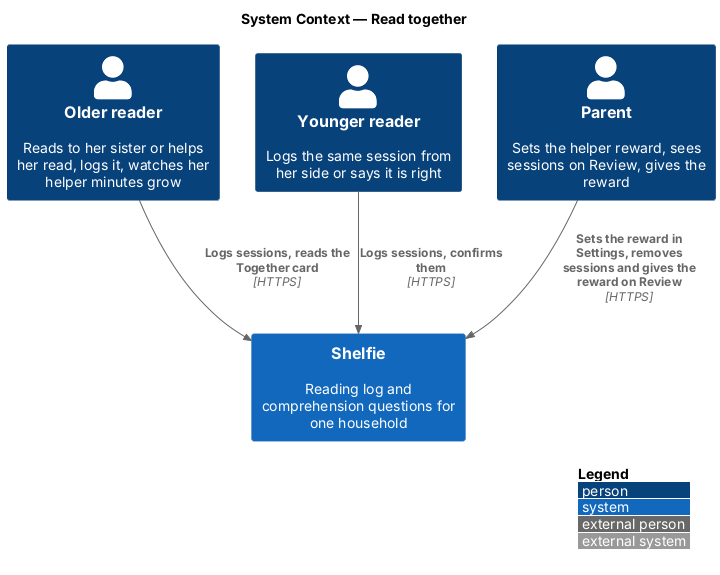
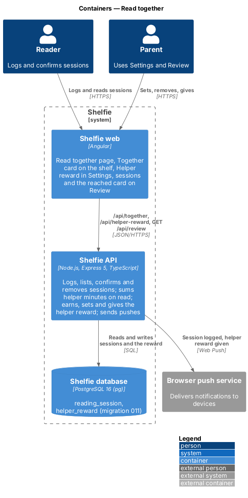
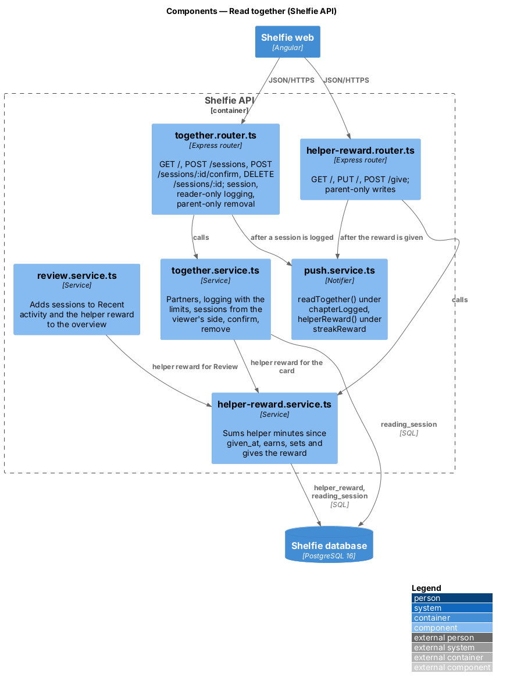
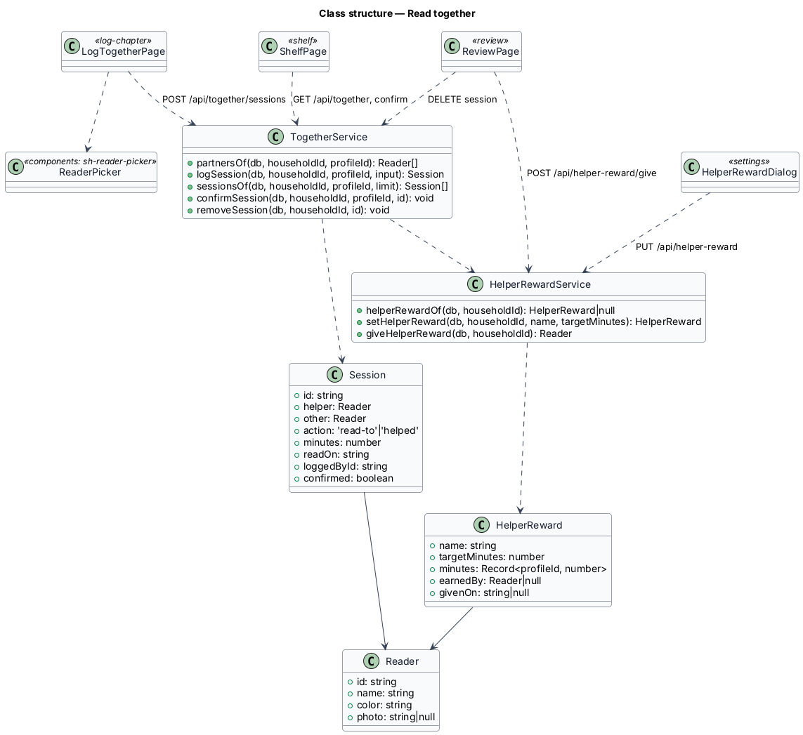
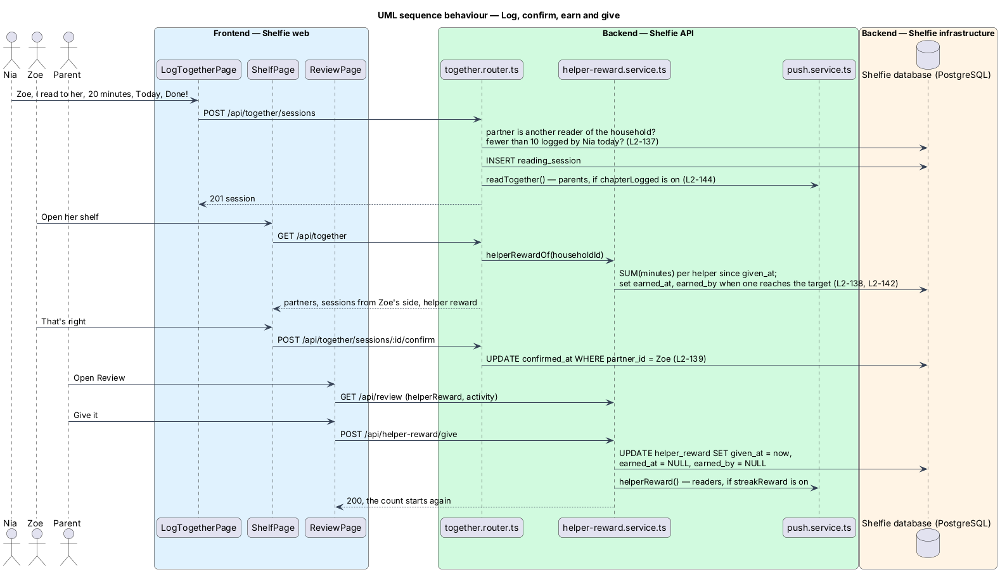

# Read together

## Overview

Shelfie is a web application that helps a child read books by logging each chapter she reads and answering short questions about it, while a parent in the same household reviews her answers and gives rewards. A **household** is the unit of tenancy: its parents and readers share one bookshelf.

This feature lets a reader log time spent reading with another reader of her household: reading to her, helping her read, or being read to by her. A **session** is two readers, what they did, how many minutes and the day. Either reader can log it, it shows on both shelves, and the other reader can say "That’s right". The reader who read aloud or helped is the **helper** and earns **helper minutes**. A parent sets one **helper reward** for the household (a name and a number of minutes), sees each session on Review, removes a mistaken one, and gives the reward when a helper reaches the minutes, after which the count starts again.

Books and chapter logs belong to the household, not to one reader, so sessions are the first data in Shelfie that name two readers. They live in their own table (ADR-0018). Helper minutes are summed on read and never stored. The helper reward follows the shape of the streak rewards (review/streak-rewards, ADR-0012): earned when a read sees the target reached, given with one tap.

The feature sits in the `reading-log` subsystem, because a session is a reading log entry. It touches the `log-chapter` (the Read together page), `shelf`, `settings`, `review` and `components` libraries. Chapter logging, questions and answers, streaks, badges, book and gallery rewards, and everything for a household with one reader are unchanged.

## Description

### Data

- **Migration `011-read-together.sql`** creates:
  - `reading_session`: `id TEXT PRIMARY KEY`, `household_id TEXT REFERENCES household(id) ON DELETE CASCADE`, `logged_by TEXT REFERENCES profile(id) ON DELETE CASCADE`, `partner_id TEXT REFERENCES profile(id) ON DELETE CASCADE`, `kind TEXT CHECK (kind IN ('read-to', 'helped', 'read-to-me'))`, `minutes INTEGER CHECK (minutes BETWEEN 5 AND 180)`, `read_on TEXT` (YYYY-MM-DD), `logged_at TEXT`, `confirmed_at TEXT NULL`, `removed_at TEXT NULL`, `CHECK (logged_by <> partner_id)`, and an index on `(household_id, logged_at)`. A removed session keeps its row with `removed_at` set and is left out of every read.
  - `helper_reward`: `household_id TEXT PRIMARY KEY REFERENCES household(id) ON DELETE CASCADE`, `name TEXT NOT NULL`, `target_minutes INTEGER CHECK (target_minutes BETWEEN 30 AND 600)`, `earned_at TEXT NULL`, `earned_by TEXT NULL REFERENCES profile(id) ON DELETE SET NULL`, `given_at TEXT NULL`. One row per household, present only once the parent has set it. `earned_at` and `earned_by` describe the round under way; `given_at` is when the last round was given.
- Both tables cascade from the household, so the operator's erasure statement needs no change (`L2-041`, `L2-146`).

### Credit rules

- The **helper** of a session is `logged_by` when `kind` is `read-to` or `helped`, and `partner_id` when `kind` is `read-to-me` (`L2-138`). The other reader is the other profile.
- The **action** shown everywhere is `helped` for `helped` and `read-to` otherwise, always told with the helper first: "Nia read to Zoe", "Nia helped Zoe read".
- **Helper minutes** of a reader are `SUM(minutes)` over the household's sessions with `removed_at IS NULL`, `logged_at > given_at` (all of them before the first give) and that reader as helper. Nothing stores a total.
- One session gives one credit. "That’s right" sets `confirmed_at` and changes no minutes.

### API

- **`together.service.ts`**
  - `partnersOf(db, householdId, profileId)` lists the household's other readers as `Reader { id, name, color, photo }`, by name.
  - `logSession(db, householdId, profileId, { partnerId, kind, minutes, readOn })`: 404 `not-found` unless `partnerId` is another reader of the household; 400 `future-date` when `readOn` is after the household's today; 409 `too-many-sessions` when the reader already logged 10 sessions (not removed) whose `logged_at` falls on the household's today. Inserts and answers the session.
  - `sessionsOf(db, householdId, profileId, limit = 5)` lists the sessions the profile is part of, not removed, newest `logged_at` first, as `Session { id, helper: Reader, other: Reader, action, minutes, readOn, loggedById, confirmed }`.
  - `confirmSession(db, householdId, profileId, id)` sets `confirmed_at` when the profile is the session's `partner_id`, it is not removed and not yet confirmed; a second confirmation changes nothing; any other caller gets 404.
  - `removeSession(db, householdId, id)` sets `removed_at`; 404 when the household has no such session.
  - `recentSessions(db, householdId, limit)` for Review: the household's sessions, not removed, newest first.
- **`helper-reward.service.ts`**
  - `helperRewardOf(db, householdId, now?)` returns `null` when none is set. Otherwise it first earns (when `earned_at` is null and a helper's minutes reach `target_minutes`, it stores `earned_at` and `earned_by`, the one with the most minutes), then answers `HelperReward { name, targetMinutes, minutes: { [profileId]: number }, earnedBy: Reader | null, givenOn: string | null }`.
  - `setHelperReward(db, householdId, name, targetMinutes)` upserts the name and minutes, keeping the round.
  - `giveHelperReward(db, householdId)` earns, then sets `given_at = now` and clears `earned_at` and `earned_by` in one `UPDATE … WHERE earned_at IS NOT NULL`, and answers the reader who earned it; 404 `not-found` when none is set, 400 `not-earned`.
- **`together.router.ts`** — mounted at `/api/together`, every route behind `requireSession`.
  - `GET /` answers `{ today, partners, sessions, helperReward }` for the signed-in profile.
  - `POST /sessions` (readers only: a parent gets 403 `readers-only`) validates `{ partnerId: string, kind: 'read-to' | 'helped' | 'read-to-me', minutes: int 5–180, readOn: YYYY-MM-DD }` and answers 201 with the session, then calls `notifier.readTogether`.
  - `POST /sessions/:id/confirm` answers 204.
  - `DELETE /sessions/:id` (`requireRole('parent')`) answers 204.
- **`helper-reward.router.ts`** — mounted at `/api/helper-reward`, behind `requireSession`. `GET /` answers `{ reward: HelperReward | null }`; `PUT /` (`requireRole('parent')`) validates `{ name: trimmed 1–100, targetMinutes: int 30–600 }`; `POST /give` (`requireRole('parent')`) answers 200 and calls `notifier.helperReward`.
- **`review.service.ts`** — `overview()` adds `helperReward` and merges the newest sessions into `activity` as `kind: 'read-together'` items (`sessionId`, `helperName`, `otherName`, `action`, `minutes`; the book fields null), sorted with the rest by time and cut to the same 20. This week's chapters, the streak and the badges do not read sessions (`L2-143`).
- **`push.service.ts`** — the `Notifier` gains `readTogether(householdId, sessionId)`, sent to parents under the `chapterLogged` choice at once (a session has no undo window), titled "Nia read to Zoe for 20 minutes" and opening `/review`; and `helperReward(householdId, parentName, helperName)`, sent to readers under the `streakReward` choice, titled "🤝 Dad gave Nia her helper reward" and opening `/shelf` (`L2-144`). No new household switch.

### Frontend

- **`sh-reader-picker`** (components, new) — `label`, `readers: { id, name, color, photo }[]`, `error`, and a `value` model (a reader id or null). A `role="group"` of reader chips (`chip chip--reader`: `sh-avatar` sm and the name, `aria-pressed`); one tap picks one reader. The error shows under the chips and describes the group.
- **`sh-activity-item`** (components) — projects an optional trailing action after the time.
- **`LogTogetherPage`** (log-chapter, route `/together/log` behind `authGuard`) loads `GET /api/together`, then asks who (`sh-reader-picker`, the only partner picked already), what, how long and when (`sh-segmented`; "Another number" and "Another day" reveal an input as Log a chapter does). Done! checks the answers, posts, and shows `sh-celebration` with "N minutes together!" and "Back to my shelf". A 409 `too-many-sessions` shows "That’s 10 for today. Log more tomorrow."; a network failure shows "That wasn’t saved" with Try again and keeps the answers. `TogetherApi` lives in the same library.
- **`ShelfPage`** (shelf) loads `GET /api/together` beside the shelf, as it loads the reward gallery. With no partners it renders nothing new. Otherwise it shows "Read together" beside "Add a book" and the Together section: the helper line and `sh-progress` while the viewer has minutes this round, `sh-celebration` while she is `earnedBy`, and a row per session told from her side, with "That’s right" on a session the other reader logged that is not confirmed.
- **`SettingsPage`** (settings) loads `GET /api/helper-reward` with the rest and, with two or more readers, shows the Helper reward section; **`HelperRewardDialog`** sets or edits it, shaped like `StreakRewardDialog`.
- **`ReviewPage`** (review) shows the helper-reward card while `helperReward.earnedBy` is set, counted in the summary's rewards, with Give it; renders `read-together` activity lines with Remove.

### Error mapping

| Situation | API | Page |
|---|---|---|
| No partner, minutes outside 5–180 or a day after today | 400 `validation` / `future-date` | Inline error; nothing is sent |
| Partner not another reader of the household | 404 `not-found` | Not offered |
| 10 sessions logged today | 409 `too-many-sessions` | "That’s 10 for today. Log more tomorrow." |
| A parent logs a session | 403 `readers-only` | Not offered |
| Confirm by anyone but the partner | 404 `not-found` | Not offered |
| A reader sets or gives the reward, or removes a session | 403 `grown-ups-only` | Not offered |
| Name empty or over 100, minutes outside 30–600 | 400 `validation` | Inline error; nothing is sent |
| Give before it is earned / with none set | 400 `not-earned` / 404 `not-found` | Not offered |
| Network or server failure | status 0 or 5xx | Banner on the page or in the dialog, toast for confirm, remove and give; values kept |

## Requirements

| L2 ID | Refines (L1) | Requirement |
|-------|--------------|-------------|
| `L2-137` | `L1-029` | A reader shall log a reading-together session with another reader of her household, within the limits. |
| `L2-138` | `L1-029` | The reader who read aloud or helped shall get the helper credit, once per session. |
| `L2-139` | `L1-029` | The other reader shall see the session and may confirm it. |
| `L2-140` | `L1-029` | The shelf shall show a Together card with recent sessions, helper progress and the reached celebration. |
| `L2-141` | `L1-029` | The parent shall set and edit one helper reward per household. |
| `L2-142` | `L1-029` | The helper reward shall be earned at the target, given from Review, and start a new round. |
| `L2-143` | `L1-029` | Review shall list sessions in Recent activity and let the parent remove one. |
| `L2-144` | `L1-029` | The existing notification choices shall cover sessions and the helper reward. |
| `L2-145` | `L1-029` | Households with one reader shall see nothing new. |
| `L2-146` | `L1-029` | Sessions and the helper reward shall stay in the household, with readers logging only their own and parents alone changing the reward or removing. |

`L2-005`, `L2-006`, `L2-011`, `L2-014`, `L2-025`, `L2-041`, `L2-100`, `L2-103` and `L2-124` are used unchanged.

## Decisions

- **Sessions in their own table; minutes computed on read; the helper reward modelled on streak rewards.** Recorded in [ADR-0018](../../../adr/0018-reading-sessions-and-a-computed-helper-reward.md).
- **A removed session is marked, not deleted.** Review can still be explained if a parent asks what happened, and every read filters it out; the round's earned state is kept.
- **The page lives in `log-chapter`.** It is the reading-log library; the shelf links to it by route only, so no feature library imports another.
- **Readers only log.** Sessions with a parent are deferred; a parent session gets 403 `readers-only`.
- **The daily limit counts by when it was logged.** Ten sessions logged on the household's today, whatever day they were read; removed ones do not count.
- **Edit only, no remove, for the helper reward.** The brief asks to set it; it can be renamed or retargeted at any time.

## Diagrams

### System context

Two readers log and confirm sessions; the parent sets and gives the reward.

### Containers

The Angular application calls the new routes and reads the helper reward and sessions from the Review response; the API stores sessions and the reward.

### Components

The routers check the session and role and delegate to the two services; Review and the shelf card read the helper reward through `helper-reward.service.ts`.

### Class structure

### Behaviour — log, confirm, earn and give

## Open questions

- **Earned by whom (resolved).** When two readers pass the target before anyone reads, the one with more minutes earns it; the round is one reward for the household.
- **Pronouns (resolved).** The copy follows the brief ("I read to her", "She read to me"), as the rest of the reader UI does.
- **Deferred.** Tying a session to a book or chapter or to a book's progress; sessions with a parent or anyone outside the household's readers; minutes toward streaks, badges or gallery goals; more than one helper reward or per-reader targets; removing the helper reward; a timer; parent approval before a session counts; a push mock for the two reused events.
