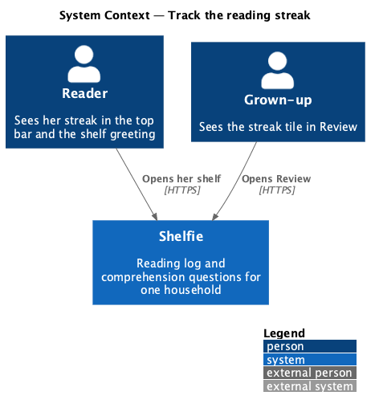
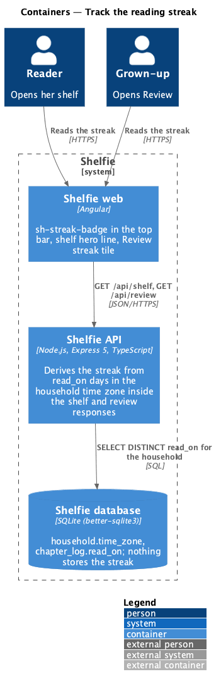
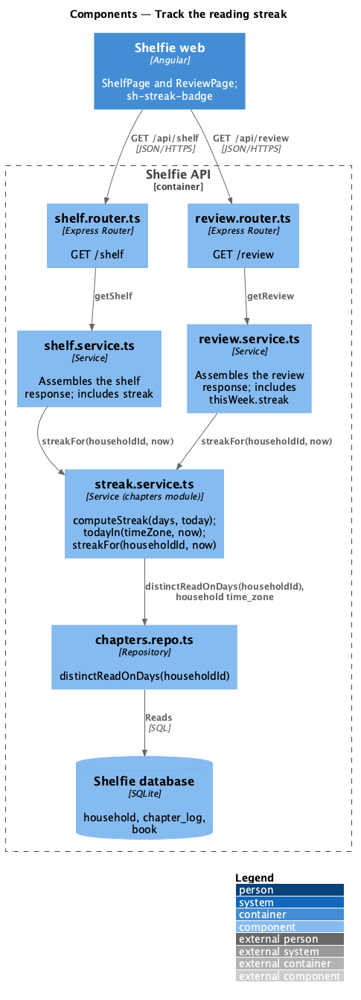
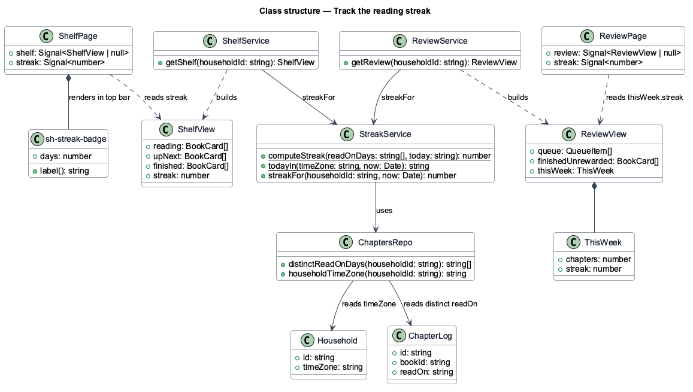
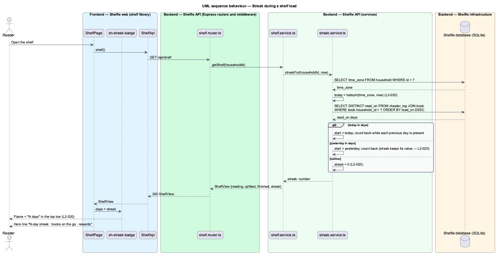

# Track the reading streak

## Overview

Shelfie is a web application that helps one child read books by logging each chapter she reads and answering short questions about it, while a grown-up in the same household reviews her answers and gives rewards. Each **chapter log** records the day the chapter was read as `read_on` (log-chapter).

The **reading streak** is the number of consecutive days, ending today or yesterday, on which at least one chapter was read. It is the reader's standing motivation: it shows as "5 days" with a flame in her top bar on every page, in the shelf greeting ("🔥 5-day streak · 2 books on the go · 1 reward waiting"), and to the grown-up as the "Streak 🔥 5" tile in the This week block of Review. A streak of 5 means chapters were read on each of the last 5 days. A day with no chapter yet does not break the streak until the next day has passed: a chapter read yesterday and none today keeps the streak at its value, and once neither yesterday nor today has a chapter it is 0.

The streak is **derived**, never stored and never edited. The API computes it from the household's chapter logs each time the shelf or the review page is loaded, so there is no counter to drift and nothing to correct. Days are counted in the **household time zone** (`household.time_zone`), so a chapter read at 11 pm counts for that day wherever the server runs.

The feature sits in the `reading-log` subsystem beside log-chapter, view-chapter-answers and celebrate-finished-book. It has no endpoint of its own: the streak travels inside `GET /api/shelf` (books/shelf) and `GET /api/review` (review/review-queue).

## Description

The slice is a pure function on the server plus a badge on the client.

- **`streak.service.ts`** — module file in `apps/api/src/modules/chapters/`. It exports `computeStreak(readOnDays: string[], today: string): number`, a pure function over ISO dates (`YYYY-MM-DD`). It builds a set of the distinct days; if `today` is in the set the streak starts at `today`, else if the day before `today` is in the set it starts there, else the result is 0; from the start day it counts back one day at a time while each day is in the set. It also exports `todayIn(timeZone: string, now: Date): string`, which formats `now` as a calendar day in `timeZone` through `Intl.DateTimeFormat`. `streakFor(householdId, now)` ties the two together: it reads the household's `time_zone` and distinct `read_on` days, and returns `computeStreak(days, todayIn(timeZone, now))`.
- **`chapters.repo.ts`** — `distinctReadOnDays(householdId)`: `SELECT DISTINCT chapter_log.read_on FROM chapter_log JOIN book ON book.id = chapter_log.book_id WHERE book.household_id = ? ORDER BY read_on DESC`. Because `read_on` is already a calendar day chosen by the reader, no time-zone conversion applies to the rows; the time zone decides only which day counts as today.
- **`shelf.service.ts`** — the `shelf` module (books/shelf) calls `streakFor(householdId, now)` while assembling the `GET /api/shelf` response and places the value in `streak: number`.
- **`review.service.ts`** — the `review` module (review/review-queue) does the same for `GET /api/review`, placing the value in `thisWeek.streak`.
- **`sh-streak-badge`** — component in the `components` library: flame icon plus "N days" (or "1 day"), with `aria-label="N-day reading streak"`. It takes `days: number` and renders "0 days" without the flame highlight when the streak is 0. It is placed in `sh-top-bar` for the reader by the shell (shell/top-bar) and fed from the shelf response held in `ShelfPage`.
- **`ShelfPage`** — page in the `shelf` library (books/shelf). It renders the hero line "🔥 N-day streak · …" from `streak` and passes `streak` to the badge in the top bar.
- **`ReviewPage`** — page in the `review` library (review/review-queue). It renders the "Streak 🔥 N" tile from `thisWeek.streak`.

No table or column stores the streak, and no endpoint writes it. The streak is a property of the household, not of a book, so the reader's and the grown-up's values are always the same number. A chapter logged with a past read date (Another day) can lengthen or restart the streak retroactively, which follows from counting `read_on` rather than `logged_at`.

## Requirements

The feature realizes the following level-2 (L2) requirement. It refines a level-1 (L1) requirement, cited by identifier.

| L2 ID | Refines (L1) | Requirement |
|-------|--------------|-------------|
| `L2-020` | `L1-008` | The system shows a reading streak derived from consecutive days with at least one logged chapter. Given chapters logged on 5 consecutive days ending today, the streak shall show 5; given no chapter yesterday or today, it shall show 0; given none today but one yesterday, it shall keep its value; days shall be computed in the household's time zone; the streak shall be shown in the reader's top bar and to the grown-up and shall not be editable. |

## Diagrams

### System context

Both people see the same streak in Shelfie; neither can change it.

### Containers

The Angular application reads `streak` from the shelf and review responses; the Express API derives it from `chapter_log.read_on` in SQLite on every load.

### Components

Inside the API, `shelf.service.ts` and `review.service.ts` call `streak.service.ts`, which reads the household's distinct read days through `chapters.repo.ts` and applies the pure function.

### Class structure

`computeStreak` and `todayIn` are pure functions; `StreakService.streakFor` feeds them from `Household.timeZone` and the distinct `ChapterLog.readOn` days, and `sh-streak-badge` shows the number.

### Behaviour — streak during a shelf load

The shelf load asks the streak service for the household's value; the service resolves today in the household time zone and counts back over the distinct read days (`L2-020`).

