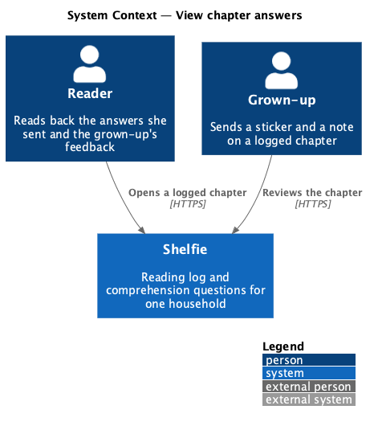
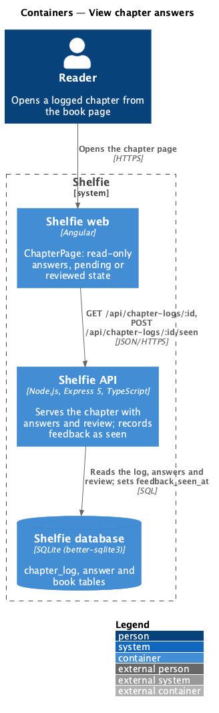
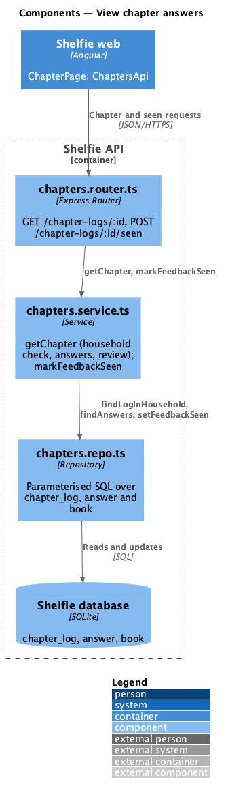
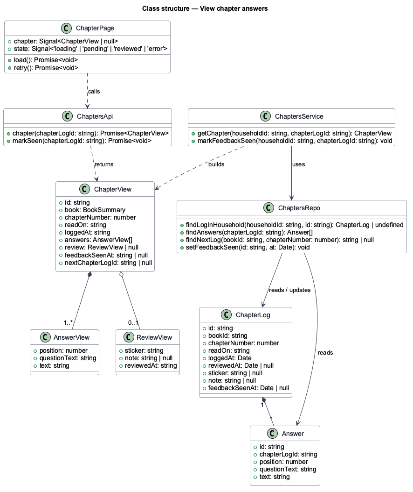
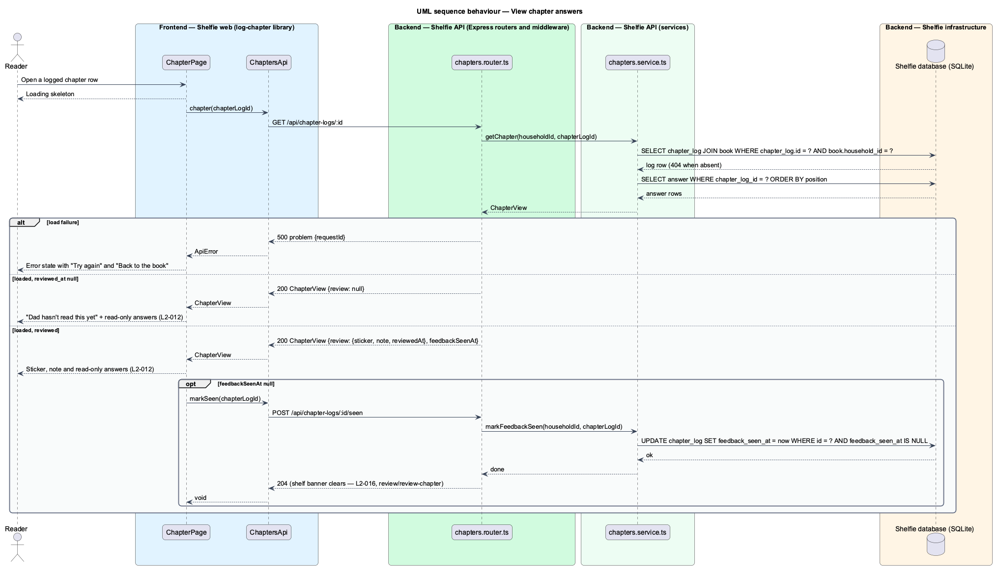

# View chapter answers

## Overview

Shelfie is a web application that helps one child read books by logging each chapter she reads and answering short questions about it, while a grown-up in the same household reviews her answers and gives rewards. A **chapter log** is the record of one chapter read: the day it was read, when it was logged, and the reader's answers to that book's comprehension questions (log-chapter).

Answers are final once sent, so this feature is how the reader looks back at them. The **chapter page** opens from a logged chapter row on the book page and shows the questions and her answers read-only, under a header that names the book and the day she read it. Above the answers sits the **review status**: either "Dad hasn't read this yet", or the **feedback** the grown-up sent — a sticker, an optional note and the time it was sent (review/review-chapter).

Opening a reviewed chapter also tells the server that the feedback has been seen. The shelf shows a banner for new feedback until the reader opens the chapter (review/review-chapter owns that banner, `L2-016`); this page clears it by recording `feedback_seen_at`.

The feature sits in the `reading-log` subsystem beside log-chapter, celebrate-finished-book and track-streak. It is read-only for the reader: no answer can be edited here.

## Description

The slice runs from `ChapterPage` to the `chapter_log` and `answer` tables.

- **`ChapterPage`** — page component in the `log-chapter` library at route `/chapter-logs/:id`. It loads the chapter through `ChaptersApi.chapter()` and owns the `loading` (`sh-skeleton`), `error` (`sh-error-state` with "Try again" and "Back to the book"), `pending` and `default` (reviewed) states from `docs/mocks/pages/chapter/`. The header shows `sh-cover`, "Chapter N", the book title and "you read it on <date>" (or "today at <time>" for a chapter read today). The `pending` state shows the card "Dad hasn't read this yet — when he does, his sticker and note will show up here"; the reviewed state shows the sticker, "Dad gave you a <sticker name>", the note and the review time. The answers list renders each question with its answer as text; a blank optional answer renders as an empty entry. Footer actions are "Back to the book" and, when a later logged chapter exists, "Chapter N+1". The mock copy says "Dad hasn't read this yet" where `L2-012` says "waiting for Dad"; the design follows the mock.
- **`ChaptersApi`** — service in the `log-chapter` library built on `ApiClient`. `chapter(chapterLogId)` gets `/api/chapter-logs/:id`; `markSeen(chapterLogId)` posts to `/api/chapter-logs/:id/seen`. The page calls `markSeen` once, after a load whose `review` is present and whose `feedbackSeenAt` is null; a failure of that call is logged and not shown.
- **`chapters.router.ts`** — Express router. `GET /api/chapter-logs/:id` and `POST /api/chapter-logs/:id/seen`, both for a reader or grown-up session, behind `sessionMiddleware` and `csrfGuard`.
- **`chapters.service.ts`** — `getChapter(householdId, chapterLogId)`: loads the log through its book's household (404 otherwise) with the book summary, the answers ordered by `position`, and the review block when `reviewed_at` is set. `markFeedbackSeen(householdId, chapterLogId)`: sets `feedback_seen_at = now` when `reviewed_at` is set and `feedback_seen_at` is null; otherwise does nothing. Both are idempotent reads or single updates.
- **`chapters.repo.ts`** — parameterised SQL over `chapter_log`, `answer` and `book`.
- **`chapter_log`** columns used: `id`, `book_id`, `chapter_number`, `read_on`, `logged_at`, `reviewed_at`, `sticker`, `note`, `feedback_seen_at`.
- **`answer`** columns used: `position`, `question_text`, `text`. The question text is the snapshot taken at logging time, so a later edit to a custom question does not change what this page shows.

The `ChapterView` response is `{ id, book: { id, title, coverColor, sticker, chapterCount }, chapterNumber, readOn, loggedAt, answers: [{ position, questionText, text }], review: { sticker, note, reviewedAt } | null, feedbackSeenAt, nextChapterLogId }`. `POST .../seen` answers 204. Answer text is rendered as text, never as HTML.

## Requirements

The feature realizes the following level-2 (L2) requirement. It refines a level-1 (L1) requirement, cited by identifier.

| L2 ID | Refines (L1) | Requirement |
|-------|--------------|-------------|
| `L2-012` | `L1-004` | The reader views the answers she has sent. Given a logged chapter is opened, the questions and her answers shall be shown read-only; while the chapter awaits review a "waiting for Dad" state shall be shown; once reviewed, the sticker and note shall be shown. |

## Diagrams

### System context

The reader reads back her answers and the grown-up's feedback in Shelfie.

### Containers

`ChapterPage` in the Angular application fetches the chapter from the Express API and, for a reviewed chapter, posts that the feedback was seen.

### Components

Inside the API, the chapters router delegates to `chapters.service.ts`, which reads the log, its answers and its review through `chapters.repo.ts` and updates `feedback_seen_at`.

### Class structure

`ChapterPage` calls `ChaptersApi`, which returns a `ChapterView` holding `AnswerView` entries and an optional `ReviewView`; the service reads `ChapterLog` and `Answer`.

### Behaviour — view chapter answers

The page loads the chapter, shows the pending or reviewed state, and for unseen feedback records that it was seen (`L2-012`); the alternate path shows a load failure.

