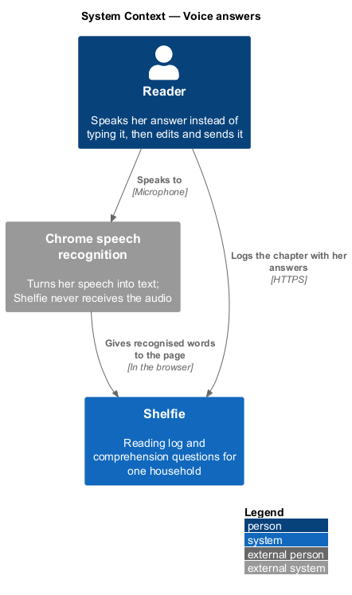
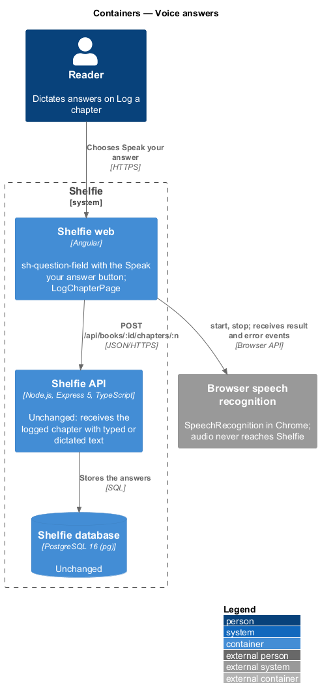
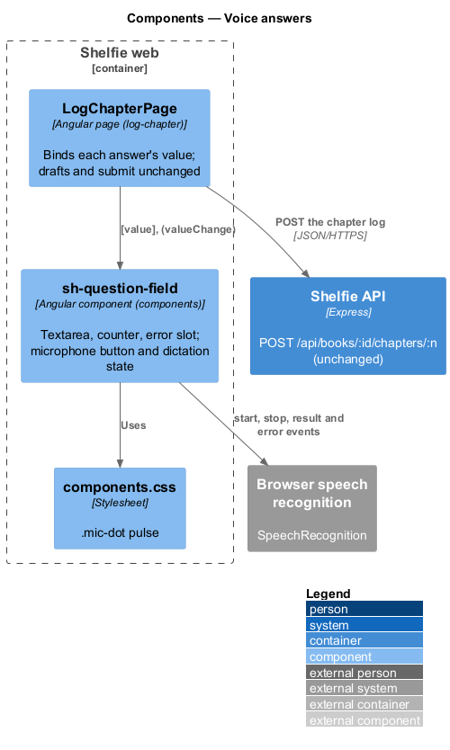
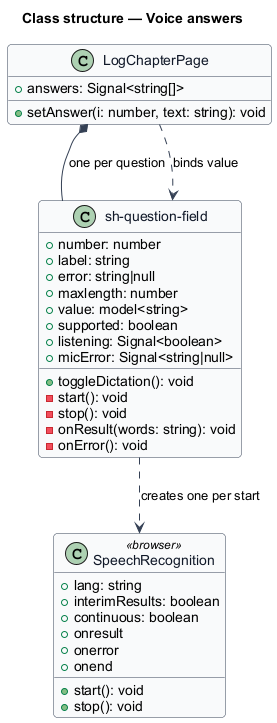
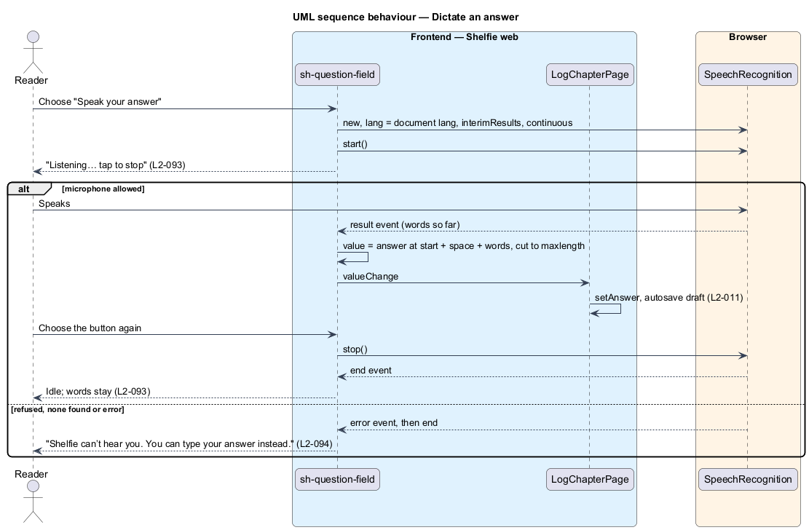

# Voice answers

## Overview

Shelfie is a web application that helps one child read books by logging each chapter she reads and answering short questions about it, while a parent in the same household reviews her answers and gives rewards. A **household** is the unit of tenancy: its parents and readers share one bookshelf.

When the reader logs a chapter (log-chapter, `L2-011`) she types an answer to each question. This feature lets her **dictate** instead: a microphone button under each answer starts the browser's speech recognition, her words appear in the box as she speaks, and she can edit them before she sends the chapter.

Dictation is only a way to fill the box. The answer is the same text it would have been if she had typed it, it is sent only when she logs the chapter, and the request, validation, draft and 2000-character limit are unchanged. Shelfie records, receives and stores no audio. The speech is recognised by the browser (ADR-0010), so the API has no change at all. When the browser has no speech recognition the button is not drawn, and when the microphone is refused she is told she can type instead.

The feature sits in the `reading-log` subsystem beside log-chapter. It changes one component, `sh-question-field`, in the `components` library. It touches no other library, no API and no table.

## Description

### Frontend

- **`sh-question-field`** (components) — gains a microphone button in a `.cluster` row under the textarea, drawn only when `SpeechRecognition ?? webkitSpeechRecognition` exists. Its other inputs and outputs, the `value` model, the counter and the error slot are unchanged.
  - The button is a ghost `.btn` with the microphone icon and "Speak your answer", `aria-pressed="false"` and `aria-label="Speak your answer to question N"`. While listening it shows a pulsing `.mic-dot` in place of the icon, with `aria-pressed="true"` and the same name, and "Listening… tap to stop" as help text beside it.
  - Starting creates a recogniser with `lang = document.documentElement.lang`, `interimResults = true` and `continuous = true`. Each result event rebuilds the dictated part: the answer as it was when listening began, a single space if both parts are non-empty, then the recognised words so far. The interim words show in the box and are committed on every event, so stopping keeps them.
  - The new value is cut to `maxlength`, so the answer never exceeds the limit and the counter stays right.
  - Choosing the button while listening calls `stop()`. The `end` event, whether from the button or from the browser, returns the button to idle.
  - A module-level reference to the active recogniser means starting dictation in another field stops the first.
  - On an `error` event of any kind the field stops, keeps the words, and shows "Shelfie can’t hear you. You can type your answer instead." in a `.field__error` under the button, linked from the textarea with `aria-describedby`. Choosing the button again clears the message and starts again.
  - A visually hidden `aria-live="polite"` region says "Listening" or "Stopped listening". Under reduced motion the dot does not pulse.
  - Typing in the box while listening stops dictation, so the words she types are never overwritten by the next result.
- **`LogChapterPage`** (log-chapter) — unchanged. It already binds the `value` of each `sh-question-field`, so dictated text goes through the same `setAnswer`, the same draft saving and the same submit.
- **`components.css`** — the `.mic-dot` pulse (`docs/design-system/assets/components.css`), documented in `docs/design-system/components/textarea.html`.

### API and data

None. Answers travel in the existing `POST /api/books/:id/chapters/:n` request, and the request log still records method, route, status and duration only (`L2-029`).

### Error mapping

| Situation | Behaviour |
|---|---|
| Browser has no speech recognition | No button; typing as before |
| Microphone refused, none found, or any recognition error | Listening stops; words so far stay; "Shelfie can’t hear you. You can type your answer instead." |
| Recognition ends by itself | Back to idle; words stay |
| Answer reaches `maxlength` | Dictated text is cut at the limit |

## Requirements

The feature realizes the following level-2 (L2) requirements. Each refines a level-1 (L1) requirement, cited by identifier.

| L2 ID | Refines (L1) | Requirement |
|-------|--------------|-------------|
| `L2-093` | `L1-023` | The reader shall dictate an answer with a "Speak your answer" button; the words are added to the answer, which stays editable, with a listening state she can stop. |
| `L2-094` | `L1-023` | Without speech recognition there shall be no button, and a refused or failing microphone shall leave the typed words and offer typing instead. |
| `L2-095` | `L1-023` | Shelfie shall handle no audio; the button shall be accessible, announced, and calm under reduced motion. |

`L2-011` and `L2-029` are used unchanged.

## Decisions

- **The browser does the recognition.** Recorded in [ADR-0010](../../../adr/0010-dictate-answers-with-the-browser.md).
- **The button lives in `sh-question-field`, not in the page.** Every answer box gets it with no change to the page, and the library stays the only place that draws UI.
- **Dictation is not a draft or a separate field.** It writes the same `value` the textarea writes, so drafts, the counter and the submit need no change.

## Diagrams

### System context

The reader speaks to her browser; Shelfie receives only the text she sends.

### Containers

Speech recognition is done by the browser; the API only ever receives the logged chapter.

### Components

Inside the Angular application, `sh-question-field` talks to the browser's `SpeechRecognition` and `LogChapterPage` binds its value.

### Class structure

`sh-question-field` owns one recogniser and the dictation state; the page is unchanged.

### Behaviour — dictate an answer

She starts dictation, the words fill the box and she stops; a refusal leaves her typing (`L2-093`, `L2-094`).

## Open questions

- **Browser support (resolved).** Chrome only, as `AGENTS.md` says; no fallback is built.
- **Deferred.** Dictating in languages other than the document's, punctuation commands, read-aloud questions, and dictation for the parent's notes.
