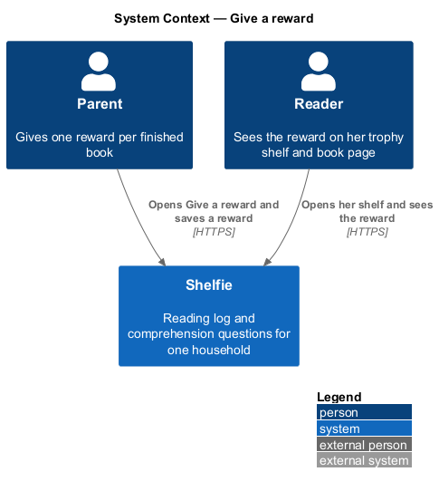
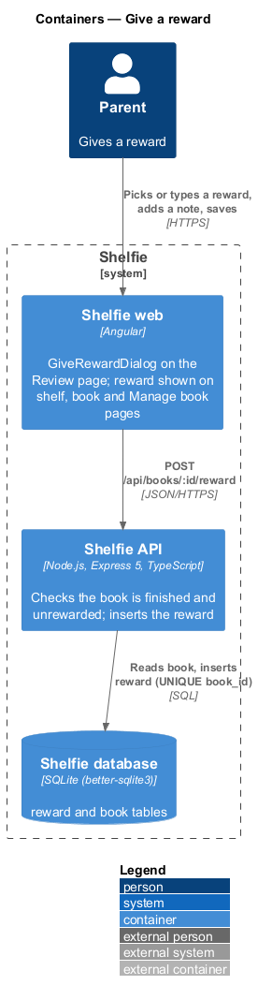
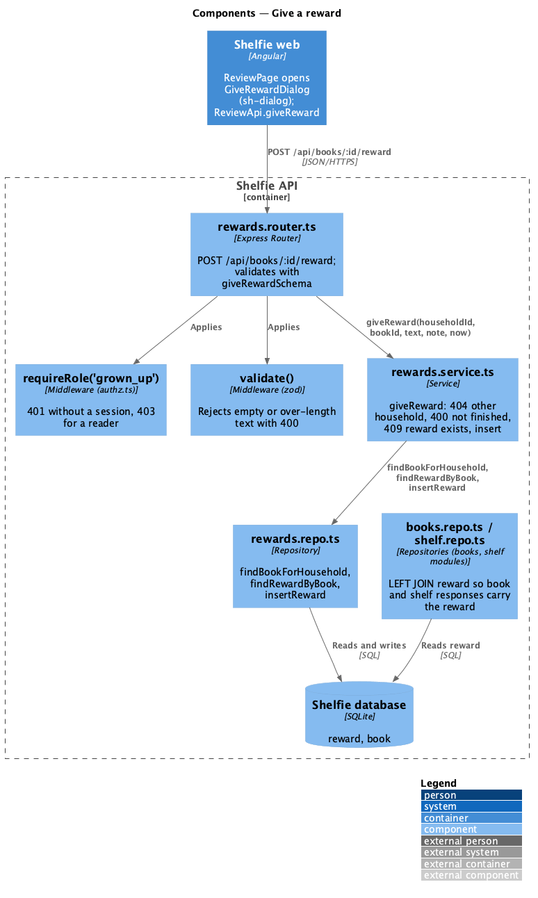
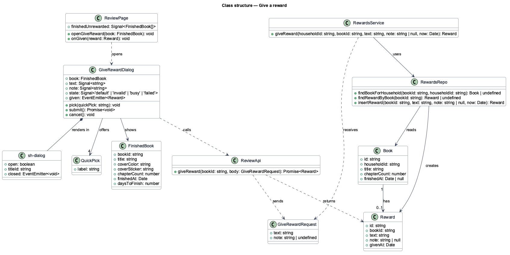
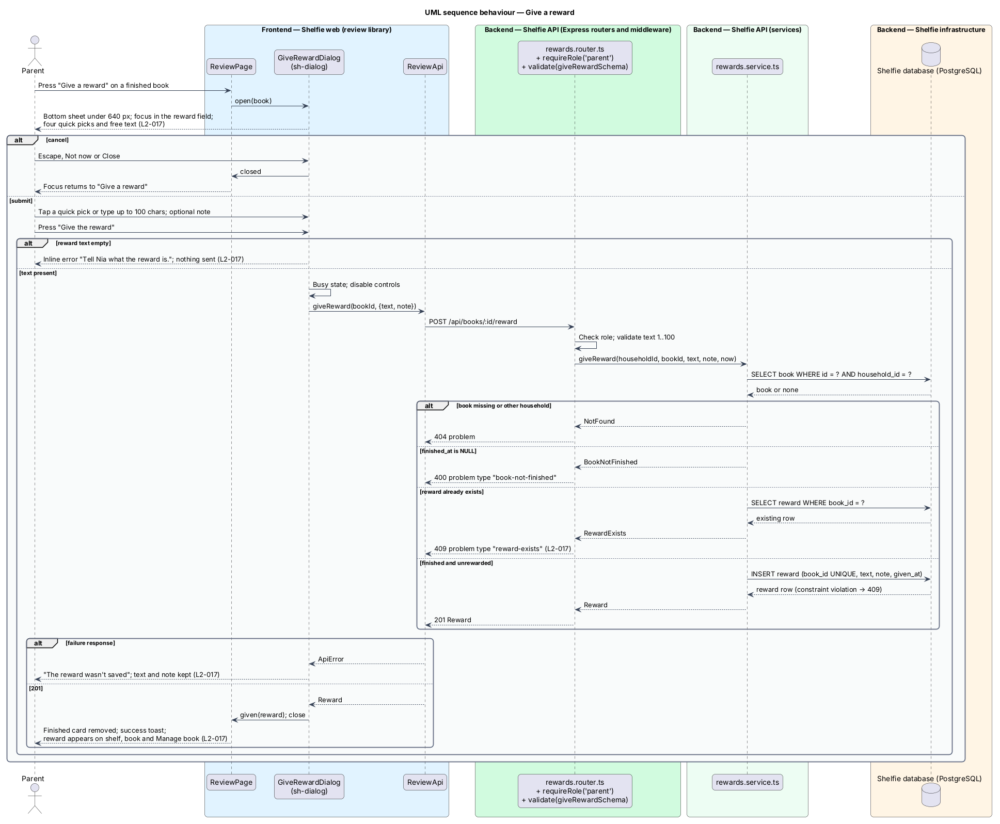

# Give a reward

## Overview

Shelfie is a web application that helps one child read books by logging each chapter she reads and answering short questions about it, while a parent in the same household reviews her answers and gives rewards. A **household** is the unit of tenancy: its parents and readers share one bookshelf.

A **finished book** is a book whose last numbered chapter has been logged; the reading-log subsystem sets `book.finished_at` at that moment and celebrates it for the reader. A **reward** is the prize the parent gives for a finished book: free text of up to 100 characters ("Movie night with popcorn") with an optional note. Each book takes at most one reward, and giving it is the parent's only "finish" step; there is no separate approval of the book. The **trophy shelf** is the finished section of the reader's shelf, where each finished book shows its reward, or "Dad is picking your reward" while none has been given.

This feature is the **Give a reward** dialog and the endpoint behind it. The Review page (review-queue) shows a card for each finished book without a reward; its "Give a reward" button opens the dialog over the page. The dialog offers four **quick picks**, preset reward texts that fill the field with one tap (Ice cream Saturday, Movie night, Stay up 30 min later, Trip to the bookshop), beside a free-text field and an optional note. Once saved, the reward appears on the reader's shelf and book page (books subsystem) and on the parent's Manage book page.

The feature sits in the `review` subsystem beside review-queue and review-chapter.

## Description

The slice runs from the dialog on the Review page to the `reward` table and back out to the pages that show the reward.

- **`GiveRewardDialog`** — dialog component in the `review` library built on `sh-dialog`, which renders as a bottom sheet under 640 px. `ReviewPage` opens it with a `FinishedBook` and it owns the `default`, `busy`, `invalid` and `failed` states in `docs/mocks/dialogs/give-reward/`. The title reads "Matilda is finished! 🏆" with the description "Pick a reward and Nia will see it on her shelf."; a book line shows `sh-cover`, "Matilda · 21 chapters in 24 days" and "Finished Tue 13 Oct". The `sh-text-field` "The reward" (help "Nia sees this on her shelf next to the book.", required, `maxlength` 100) receives focus when the dialog opens. Below it a group labelled "Quick picks" holds four chip buttons, local to the dialog; pressing one writes its text into the reward field and marks that chip pressed while the field matches it. An `sh-textarea` "A note for Nia (optional)" follows (two rows, 300 characters at most). The footer holds `sh-button` "Not now" and the primary `sh-button` "Give the reward"; a close button sits in the header. Escape, "Not now" and the close button cancel the dialog and return focus to the "Give a reward" button that opened it. Submitting an empty reward shows the inline error "Tell Nia what the reward is." on the field and sends nothing; the field's `maxlength` prevents text over 100 characters. While the request is in flight the dialog is busy: the primary button shows a spinner and every control is disabled, so no second request is sent. On failure an alert "The reward wasn't saved — Shelfie couldn't reach the server. What you typed is still here." appears under the description and the entered values stay. On success the dialog closes and emits `given(reward)`. An optional `suggested` input (default empty) is written into the reward field when the dialog opens; Review passes the goal's name for the book that reached the reader's goal (review/reward-gallery). Nothing else about the dialog changes.
- **`ReviewPage`** (review-queue) — on `given` it removes the finished-book card, lowers the "reward to give" count in the heading and shows a success toast through `ToastService` with the copy "Reward given!" (the mocks have no success state for this dialog).
- **`ReviewApi`** — service in the `review` library built on `ApiClient`. `giveReward(bookId, body)` POSTs `/api/books/:id/reward` and returns the created `Reward`, or throws `ApiError`.
- **`GiveRewardRequest`** — `text: string`, `note?: string`. **`Reward`** — `id`, `bookId`, `text`, `note`, `givenAt`.
- **`rewards.router.ts`** — Express router in the `rewards` module. `POST /api/books/:id/reward` applies `requireRole('parent')`, validates the body with `giveRewardSchema` (`text: z.string().trim().min(1).max(100)`, `note: z.string().trim().max(300).optional()`) through `validate()`, then calls the service. It answers 201 with the reward.
- **`rewards.service.ts`** — `giveReward(householdId, bookId, text, note, now)`: loads the book and answers 404 when it is missing or belongs to another household (`L2-006`); answers 400 problem `type: "book-not-finished"` when `finished_at` is null; answers 409 problem `type: "reward-exists"` when a reward row already exists for the book; otherwise inserts the reward. The `UNIQUE(book_id)` constraint backs the pre-check, and a constraint violation on insert is mapped to the same 409, so two concurrent submissions cannot both succeed.
- **`rewards.repo.ts`** — parameterised SQL: `findBookForHousehold(bookId, householdId)`, `findRewardByBook(bookId)`, `insertReward(bookId, text, note, now)`.
- **`reward`** table, created by this feature's migration: `id`, `book_id` (`UNIQUE`, references `book.id`), `text`, `note NULL`, `given_at`. Removing a book (books/manage-book) removes its reward with it.
- **Reward on other pages** — `GET /api/books/:id` and `GET /api/shelf` (books and shelf modules) gain a `reward: Reward | null` field on each book by a left join to `reward`. `ManageBookPage` (books library) uses it for its `rewarded` state: "🎬 Rewarded: Movie night with popcorn" and "Finished Sun 23 Aug · reward given Mon 24 Aug · 22 chapters in 31 days" (`docs/mocks/pages/manage-book/rewarded.html`). The reader's shelf and book page render the reward with `sh-reward-card` in books/view-shelf and books/view-book. The icon on a reward card is always 🏆; the 🎬 beside "Movie night with popcorn" in the mocks shall go, and the `reward` table holds no icon.

The shelf mock `docs/mocks/notifications/banner/success.html` also shows a success banner "Dad gave you a reward for Matilda: Ice cream Saturday!" with the note; `L2-017` and `L2-018` do not ask for it and the `reward` table has no seen marker, so this design does not add one and the mock's reward banner shall go.

## Requirements

The feature realizes the following level-2 (L2) requirement. It refines a level-1 (L1) requirement, cited by identifier.

| L2 ID | Refines (L1) | Requirement |
|-------|--------------|-------------|
| `L2-017` | `L1-007` | For a finished book without a reward, Give a reward shall offer four quick picks and a free-text field; an empty reward or one over 100 characters shall show an inline error; a valid reward shall be shown on the book and on the trophy shelf; a failed submission shall show an error in the dialog and keep the text; a book that already has a reward shall accept no second reward. |

## Diagrams

### System context

The parent gives the reward through Shelfie; the reader sees it on her trophy shelf.

### Containers

The dialog in the Angular application calls the Express API, which checks the book and inserts the reward in the PostgreSQL database.

### Components

Inside the API, the rewards router validates the body and delegates to `rewards.service.ts`, which checks the book and inserts through `rewards.repo.ts`.

### Class structure

`ReviewPage` opens `GiveRewardDialog`, which calls `ReviewApi`; the service checks `Book` and creates a `Reward`.

### Behaviour — give a reward

The happy path inserts the reward and closes the dialog; the alternate paths show the empty reward, an unfinished or already rewarded book and a server failure (`L2-017`).

