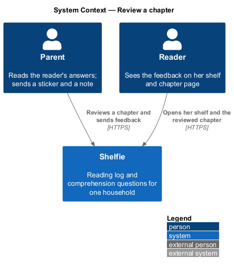
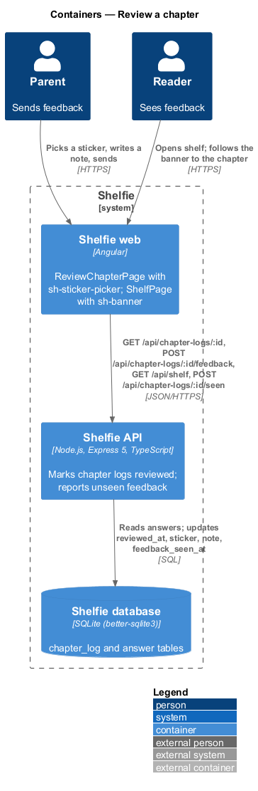
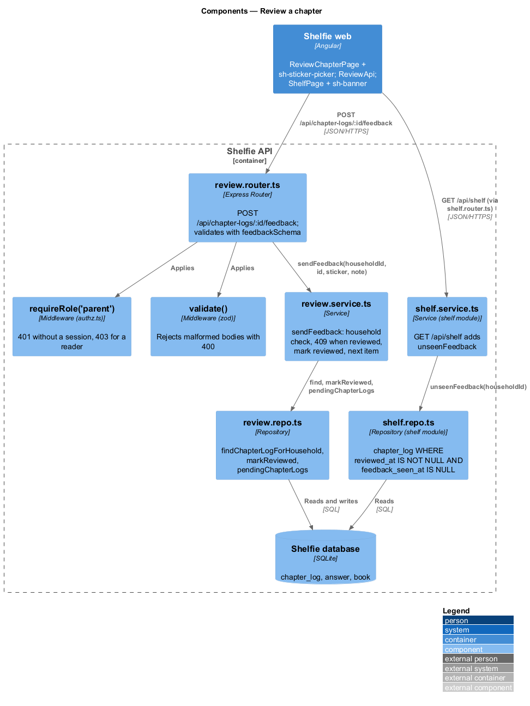
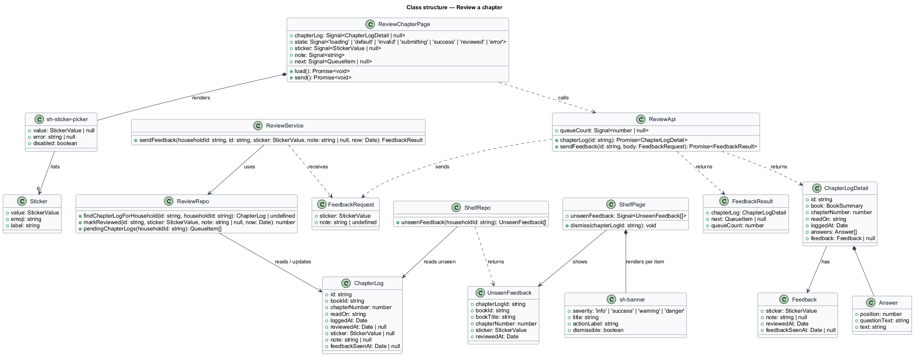
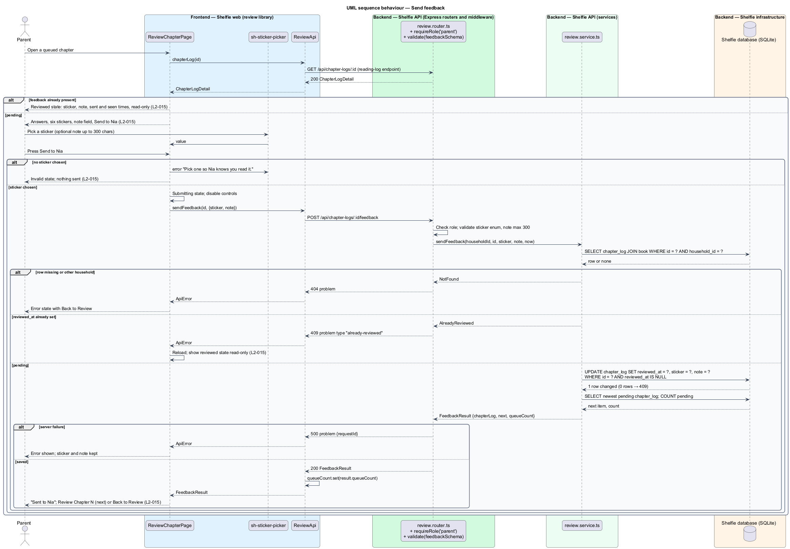
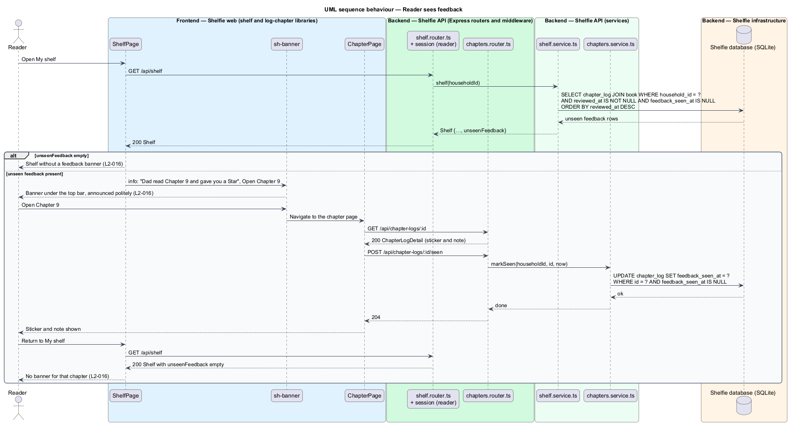

# Review a chapter

## Overview

Shelfie is a web application that helps one child read books by logging each chapter she reads and answering short questions about it, while a parent in the same household reviews her answers and gives rewards. A **household** is the unit of tenancy: its parents and readers share one bookshelf.

A **chapter log** is the record that the reader has read one numbered chapter of a book, with her **answers**: one text per question the book had at logging time (three defaults plus any the parent added). A chapter log is **pending** until the parent reviews it. **Feedback** is what the review produces: a **sticker**, one of six fixed emoji badges (Star, Wise owl, Rocket, Dragon, Cookie, Bright idea), which is required, and a **note**, a short message of up to 300 characters, which is optional. Sending feedback makes the chapter log **reviewed**; feedback cannot be changed afterwards.

This feature covers both halves of that exchange. On the parent's side, the review-chapter page shows the answers, lets him pick a sticker and write a note, sends the feedback, and then offers the next waiting chapter. Once reviewed, the same page shows the sent feedback read-only. On the reader's side, the shelf greets her with a **banner** ("Dad read Chapter 9 and gave you a Star ⭐") that links to the chapter page; opening that page marks the feedback **seen** and the banner stops appearing. The chapter page itself, which shows the sticker and note to the reader, belongs to the reading-log subsystem's view-chapter-answers feature.

The feature sits in the `review` subsystem beside review-queue and give-reward.

## Description

The slice runs from the review-chapter page and the reader's shelf to the `chapter_log` and `answer` tables.

- **`ReviewChapterPage`** — page component in the `review` library at the review-chapter route (path `/review/chapters/:id`), guarded by `parentGuard`. It loads the chapter log through `ReviewApi.chapterLog(id)` and owns the `default`, `loading`, `error`, `invalid`, `submitting`, `success` and `reviewed` states in `docs/mocks/pages/review-chapter/`. The header shows `sh-cover`, "Chapter 11" and "The Lion, the Witch and the Wardrobe · Nia read it today at 4:12 pm · 11 of 17" ("on Tue 13 Oct" for older dates). "Nia's answers" lists each answer as position, question text and answer text, rendered as text and never as HTML (`L2-028`). The "Your feedback" card holds `sh-sticker-picker`, an `sh-textarea` "Say something to Nia (optional)" with the help text "She reads this on her own, so keep it short and warm." and `maxlength` 300, and a primary `sh-button` "Send to Nia". At 1024 px and above (the mock's `64rem` breakpoint) the card is sticky beside the answers; below that it follows them. Pressing Send with no sticker shows the inline error "Pick one so Nia knows you read it." on the picker (`aria-invalid`, error linked by `aria-describedby`) with an alert "One more thing — Pick a sticker" at the top of the card, and sends nothing. While submitting, the button shows a busy state and the controls are disabled, so no second request is sent. On success the page shows the sticker, "Sent to Nia", "She'll see your Star and note the next time she opens Shelfie. One more chapter is waiting.", a primary `sh-button` "Review Chapter 10" for the next queued item, and a "Back to Review" link; when the queue is empty the next-chapter sentence and button are omitted. On a load failure it shows `sh-error-state` ("Nia's answers didn't load", "Try again", "Back to Review"). When the chapter log is already reviewed the feedback card is replaced by a read-only panel: the sticker, "You gave a Star", the note, "Wed 14 Oct, 8:40 pm · Nia saw it Thu 15 Oct" (the second part only when `feedbackSeenAt` is set) and "Back to Review". A 409 from the API on Send switches the page to this reviewed state after a reload.
- **`sh-sticker-picker`** — component in the `components` library: a radio group of the six stickers from the `STICKERS` constant (`value`, emoji, label): `star` 🌟 Star, `wise-owl` 🦉 Wise owl, `rocket` 🚀 Rocket, `dragon` 🐉 Dragon, `cookie` 🍪 Cookie, `bright-idea` 💡 Bright idea. It exposes a `value` model, an `error` input rendered in an inline error slot, and `disabled`; arrow keys move between stickers.
- **`ReviewApi`** — service in the `review` library built on `ApiClient`. `chapterLog(id)` GETs `/api/chapter-logs/:id`, an endpoint owned by reading-log/view-chapter-answers; this feature relies on its response carrying the book summary (`title`, `coverColor`, `coverSticker`, `chapterCount`), `chapterNumber`, `readOn`, `loggedAt`, `answers[]` (`position`, `questionText`, `text`) and `feedback` (`sticker`, `note`, `reviewedAt`, `feedbackSeenAt`) or `null`. `sendFeedback(id, body)` POSTs `/api/chapter-logs/:id/feedback` and returns `FeedbackResult`; it sets `queueCount` from the result so the badge drops by one without reloading the queue.
- **`FeedbackRequest`** — `sticker: StickerValue`, `note?: string`. **`FeedbackResult`** — `chapterLog` (the updated log), `next: QueueItem | null` (the newest remaining pending chapter log), `queueCount: number`.
- **`review.router.ts`** — Express router. `POST /api/chapter-logs/:id/feedback` applies `requireRole('parent')`, validates the body with `feedbackSchema` (`sticker: z.enum(STICKER_VALUES)`, `note: z.string().trim().max(300).optional()`) through `validate()`, then calls the service.
- **`review.service.ts`** — `sendFeedback(householdId, chapterLogId, sticker, note, now)`: loads the chapter log joined to its book and answers 404 when the row is missing or belongs to another household (`L2-006`); answers 409 problem `type: "already-reviewed"` when `reviewed_at` is set; otherwise updates the row with `reviewed_at = now`, `sticker`, `note` where `reviewed_at IS NULL`, and treats an update of 0 rows as the same 409 so two concurrent sends cannot both succeed. It then reads the newest remaining pending chapter log and the pending count through `review.repo.ts`.
- **`review.repo.ts`** — `findChapterLogForHousehold(id, householdId)`, `markReviewed(id, sticker, note, now): number` (rows changed), and `pendingChapterLogs(householdId)` shared with review-queue.
- **`shelf.repo.ts` / `shelf.service.ts`** — the `shelf` module's `GET /api/shelf` response gains `unseenFeedback: UnseenFeedback[]` (`chapterLogId`, `bookId`, `bookTitle`, `chapterNumber`, `sticker`, `reviewedAt`): chapter logs of the household's books where `reviewed_at IS NOT NULL AND feedback_seen_at IS NULL`, newest first.
- **`ShelfPage`** — page component in the `shelf` library (books subsystem). For each `unseenFeedback` item it renders an `sh-banner` of `info` severity directly under the top bar, pushing content down: title "Dad read Chapter 9 and gave you a Star ⭐", body "See what he said.", action "Open Chapter 9" linking to the chapter page, and a Dismiss button. The parent's name comes from the household's parent profile. Dismiss hides the banner for the current page view only; the banner stops appearing once the chapter has been opened, because the chapter page (reading-log/view-chapter-answers) POSTs `/api/chapter-logs/:id/seen`, which sets `feedback_seen_at`. The banner is announced politely (`role="status"`).
- **`chapter_log`** columns used: `id`, `book_id`, `chapter_number`, `read_on`, `logged_at`, `reviewed_at`, `sticker`, `note`, `feedback_seen_at`. **`answer`** columns read: `position`, `question_text`, `text`. The `sticker` column on `chapter_log` holds a `STICKERS` value; it is distinct from `book.sticker`, which is the cover emoji.

The mocks place the sticker banner in the `info` variant (`docs/mocks/notifications/banner/info.html`) and use the `success` variant for a new reward; this design follows the mocks. The mock's note field has no visible counter; the 300-character limit is enforced by `maxlength` and by the schema.

## Requirements

The feature realizes the following level-2 (L2) requirements. Each refines a level-1 (L1) requirement, cited by identifier.

| L2 ID | Refines (L1) | Requirement |
|-------|--------------|-------------|
| `L2-015` | `L1-006` | Opening a pending chapter shall show the questions and answers with the sticker choices Star, Wise owl, Rocket, Dragon, Cookie and Bright idea; pressing Send with no sticker shall show an inline error and send nothing; sending a sticker and an optional note of up to 300 characters shall make the chapter reviewed and show the success state; opening an already reviewed chapter shall show the sent feedback read-only. |
| `L2-016` | `L1-006` | When new feedback exists and the reader opens her shelf, a banner shall announce it and link to the chapter; once the reader opens that chapter the banner shall no longer appear. |

## Diagrams

### System context

The parent sends feedback through Shelfie and the reader sees it on her shelf and chapter page.

### Containers

The review-chapter page and the shelf page in the Angular application call the Express API, which updates and reads `chapter_log` in the SQLite database.

### Components

Inside the API, the review router validates the body and delegates to `review.service.ts`, which marks the chapter log reviewed through `review.repo.ts`; the shelf module reads unseen feedback for the reader's banner.

### Class structure

`ReviewChapterPage` composes `sh-sticker-picker` and calls `ReviewApi`; the service updates `ChapterLog` and returns a `FeedbackResult` with the next queued item.

### Behaviour — send feedback

The happy path marks the chapter log reviewed and offers the next chapter; the alternate paths show the missing sticker, an already reviewed chapter and a server failure (`L2-015`).

### Behaviour — reader sees feedback

The shelf load returns unseen feedback and the shelf shows a banner; opening the chapter marks the feedback seen so the next shelf load shows no banner (`L2-016`).

