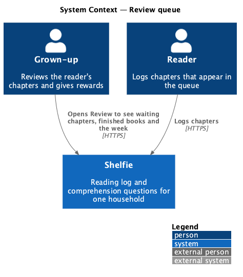
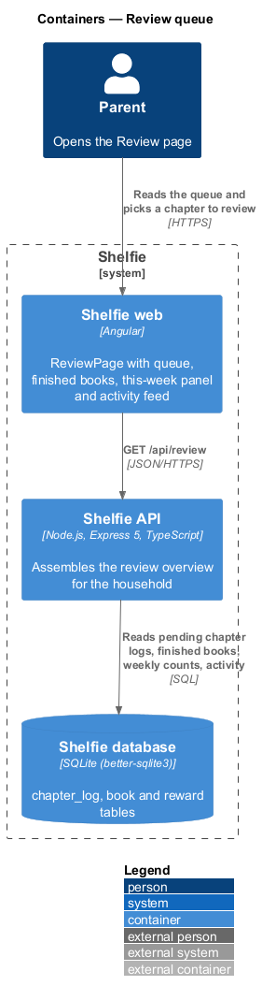
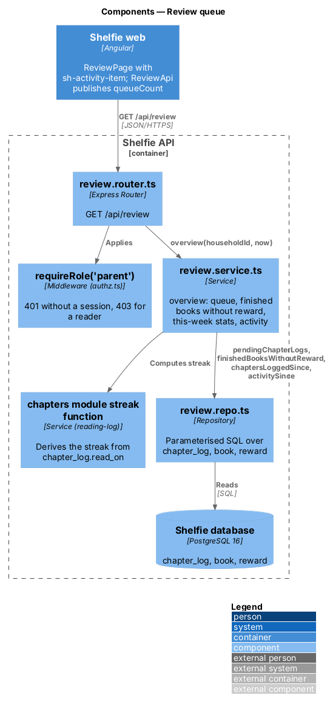
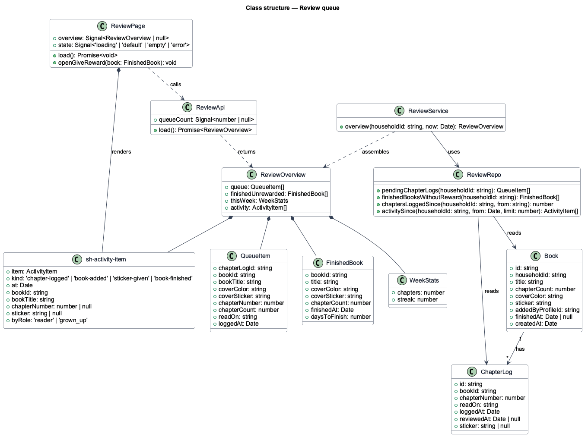
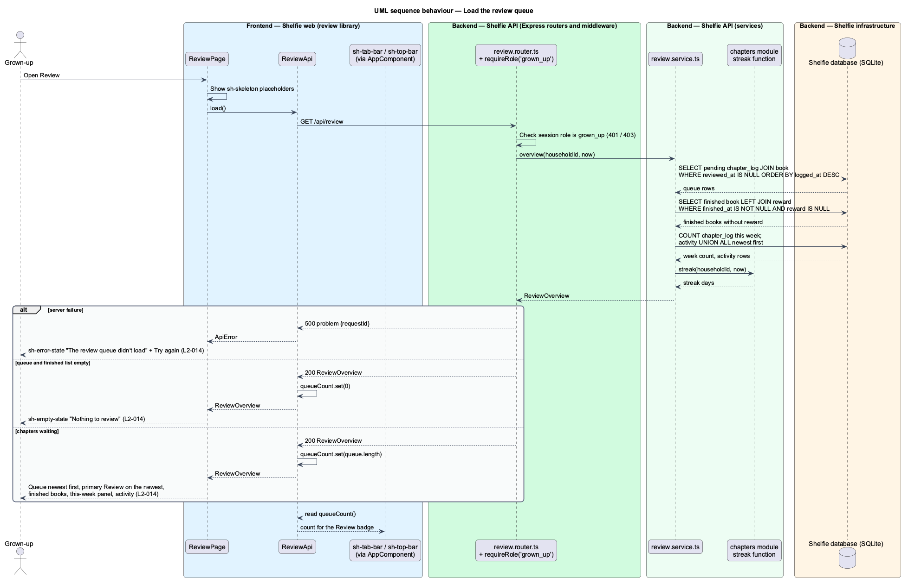

# Review queue

## Overview

Shelfie is a web application that helps one child read books by logging each chapter she reads and answering short questions about it, while a parent in the same household reviews her answers and gives rewards. A **household** is the unit of tenancy: its parents and readers share one bookshelf.

A **chapter log** is the record that the reader has read one numbered chapter of a book, together with her answers to that book's questions. A chapter log is **pending** from the moment it is saved until the parent sends feedback for it (review-chapter feature); the set of pending chapter logs is the **review queue**. A **finished book** is a book whose last chapter has been logged; the reading-log subsystem sets `book.finished_at` when that happens. A **reward** is the free-text prize the parent gives once per finished book (give-reward feature). The **streak** is the number of consecutive days, ending today or yesterday, on which at least one chapter was logged; it is derived from `chapter_log.read_on` in the household time zone by the reading-log subsystem's track-streak feature and is never stored.

This feature is the parent's Review page, the page he lands on after signing in (`L2-002`). It answers four questions at a glance: which chapters are waiting for him, which finished books still lack a reward, how the week is going (chapters logged and the streak), and what has happened recently (chapters logged, books added, stickers given, books finished). Each queue row leads to the review-chapter page; each finished book leads to the give-reward dialog.

The page also feeds the **queue badge**: the count shown beside "Review" in the parent's top bar (from MD) and bottom tab bar (at XS). The bars belong to the shell subsystem's navigate-shell feature; this feature publishes the number they display.

The feature sits in the `review` subsystem beside review-chapter and give-reward.

## Description

The slice runs from the Review page to the `chapter_log`, `book` and `reward` tables.

- **`ReviewPage`** — page component in the `review` library at the parent's Review route, guarded by `parentGuard`. On init it calls `ReviewApi.load()` and owns the `default`, `loading`, `empty`, `error` and `long` states shown in `docs/mocks/pages/review/`. A failed load shows `sh-empty-state` with `tone="error"`, "Review didn’t load" with "Try again" (`L2-014`). The heading line reads "N chapters to read · M reward to give"; when the queue is long it appends "· back from a week away?" (from 10 queued chapters; the mock shows the phrase at 14). The "Waiting for you" card lists the queue newest first with a count badge and the caption "Newest first"; each row shows `sh-cover` (small), "Chapter N · Title", "Nia read it today, 4:12 pm" / "yesterday" / "Tue 13 Oct", and an `sh-button` link "Review" to the review-chapter route. Only the first (newest) row's button uses the primary variant. Each finished book without a reward is a card "Matilda is finished!" with "Nia logged the last chapter on Tuesday · 21 chapters in 24 days" and an `sh-button` "Give a reward" that opens `GiveRewardDialog`. The "This week" panel shows two tiles, Chapters and Streak (🔥 N), above the activity feed. When the queue and the finished-book list are both empty the page shows `sh-empty-state` ("Nothing to review", "See her books" linking to Books) in place of the cards and the panel. While loading it shows `sh-skeleton` placeholders; on failure `sh-error-state` ("The review queue didn't load", "Try again") re-issues the request. The queue list is a plain scrolling list with no paging, so a long queue stays usable at XS.
- **`sh-activity-item`** — component in the `components` library: a leading emoji, one line of text and a trailing timestamp. The emoji follows the item kind: 📖 chapter logged, 📚 book added, the given sticker's emoji for a sticker given, 🏆 book finished. The text names the actor: "Nia logged Chapter 11 of The Lion, the Witch and the Wardrobe", "You added Because of Winn-Dixie", "You gave Chapter 9 a Star", "Nia finished Matilda". The book title is omitted when it repeats the previous item's book.
- **`ReviewApi`** — service in the `review` library, provided in root, built on `ApiClient`. `load()` GETs `/api/review` and returns a typed `ReviewOverview`. It also holds `queueCount: Signal<number | null>`, set from `overview.queue.length` after each load and from the `queueCount` field of the review-chapter feedback response. This signal is how the badge is published: `AppComponent` injects `ReviewApi` and passes `queueCount()` to `sh-top-bar` and `sh-tab-bar`; the badge is hidden while the value is `null`. The dependency direction holds because the `shelfie` application depends on the `review` library, not the reverse.
- **`ReviewOverview`** — response type: `queue: QueueItem[]` (`chapterLogId`, `bookId`, `bookTitle`, `coverColor`, `coverSticker`, `chapterNumber`, `chapterCount`, `readOn`, `loggedAt`), `finishedUnrewarded: FinishedBook[]` (`bookId`, `title`, `coverColor`, `coverSticker`, `chapterCount`, `finishedAt`, `daysToFinish`), `thisWeek: WeekStats` (`chapters`, `streak`), `activity: ActivityItem[]` (`kind: 'chapter-logged' | 'book-added' | 'sticker-given' | 'book-finished'`, `at`, `bookId`, `bookTitle`, `chapterNumber`, `sticker`, `byRole`).
- **`review.router.ts`** — Express router. `GET /api/review` applies `requireRole('parent')` and calls `review.service.ts`.
- **`review.service.ts`** — `overview(householdId, now)`: reads the four data sets through `review.repo.ts`, computes `daysToFinish` as the inclusive span from the book's earliest `read_on` to its latest, computes `thisWeek.streak` with the streak function exported by the `chapters` module (`computeStreak` through `streakFor`, defined by reading-log/track-streak), and assembles `ReviewOverview`. The "this week" window is the 7 days ending today in the household time zone.
- **`review.repo.ts`** — parameterised SQL: `pendingChapterLogs(householdId)` selects `chapter_log` joined to `book` where `book.household_id = ?` and `reviewed_at IS NULL`, ordered by `logged_at DESC`; `finishedBooksWithoutReward(householdId)` left-joins `reward` and keeps rows where `finished_at IS NOT NULL` and no reward exists; `chaptersLoggedSince(householdId, from)` counts `chapter_log` rows by `read_on`; `activitySince(householdId, from, limit)` is a `UNION ALL` of chapter logs (`logged_at`), books (`created_at`, `added_by_profile_id`), stickers (`reviewed_at`, `sticker`) and finishes (`finished_at`), ordered newest first. The activity list holds at most 20 items.
- **Tables read**: `chapter_log` (`id`, `book_id`, `chapter_number`, `read_on`, `logged_at`, `reviewed_at`, `sticker`), `book` (`id`, `household_id`, `title`, `chapter_count`, `cover_color`, `sticker`, `added_by_profile_id`, `finished_at`, `created_at`), `reward` (`book_id`). Nothing is written.

`L2-014` lists the queue oldest first, while the mock lists it newest first and gives the newest chapter the primary button; the design follows the mock. Unauthenticated calls receive 401 and reader calls 403 from `requireRole`, which the shell maps to the sign-in and "Grown-ups only" pages (`L2-005`).

## Requirements

The feature realizes the following level-2 (L2) requirement. It refines a level-1 (L1) requirement, cited by identifier.

| L2 ID | Refines (L1) | Requirement |
|-------|--------------|-------------|
| `L2-014` | `L1-006` | The parent's Review page shall list chapters awaiting review with book, chapter and logged time (the spec orders them oldest first; the mock, followed here, newest first); shall show an empty "all caught up" state when none wait; shall remain scrollable and usable at XS with a long queue; and Review / Books / Settings shall appear as a bottom tab bar at XS and in the top bar at MD and above. |

## Diagrams

### System context

The parent reviews the reader's chapters through Shelfie; the reader produces the chapter logs the queue shows.

### Containers

The Review page in the Angular application calls the Express API, which reads the queue, finished books, weekly stats and activity from the PostgreSQL database.

### Components

Inside the API, the review router applies the parent role guard and delegates to `review.service.ts`, which reads through `review.repo.ts` and borrows the streak function from the `chapters` module.

### Class structure

`ReviewPage` renders `sh-activity-item` rows and calls `ReviewApi`, whose `queueCount` signal the shell reads for the badge; the service assembles `ReviewOverview` from the repository.

### Behaviour — load the review queue

The happy path renders the queue, the finished books and the week panel and publishes the badge count; the alternate paths show the empty state and a server failure (`L2-014`).

