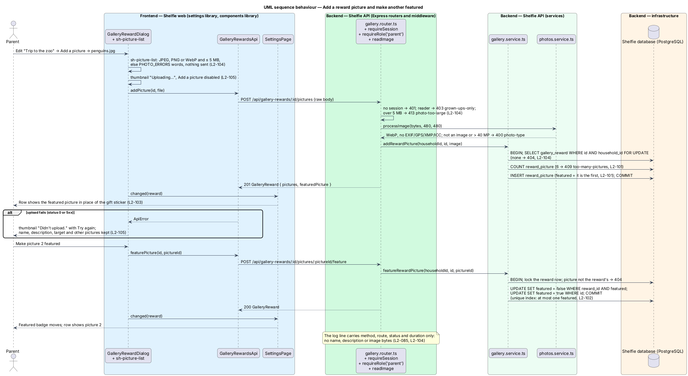

# Reward gallery

## Overview

Shelfie is a web application that helps one child read books by logging each chapter she reads and answering short questions about it, while a parent in the same household reviews her answers and gives rewards. A **household** is the unit of tenancy: its parents and readers share one bookshelf.

A **finished book** is a book whose last chapter has been logged (`book.finished_at` is set). A **reward** is the free-text prize the parent gives for one finished book through Give a reward (review/give-reward, `L2-017`); it shows on the reader's **trophy shelf** (`L2-018`). Until now the reader learned what a book would earn only after finishing it.

This feature adds a **reward gallery**: a short list of rewards the parent keeps in Settings, each with a **target**, the number of finished books that earns it ("Trip to the zoo", 3 books). On her shelf the reader sees the gallery under "Reading toward" and **picks** one as her **goal**. Her **progress** is the number of books she finishes from the moment she picks it. When the progress reaches the target the goal is **reached**: she sees a celebration, and on Review the parent sees which finished book reached it and gives the reward through the usual Give a reward dialog, with the goal's name already typed in. Once that book has its reward the goal is **complete** and she picks her next one.

A gallery reward may also have a **description**, free text the parent writes ("We'll see the penguins and have ice cream after."), and **pictures** the parent uploads. When it has at least one picture, exactly one is its **featured picture**, which stands for the reward wherever the 🎁 sticker stood: on the Settings → Rewards row and on the reader's gallery card. The description shows on her card too.

The feature sits in the `review` subsystem beside give-reward, because its end is a reward given by the parent; it touches the `settings`, `shelf`, `review` and `components` libraries. The free-text reward per finished book, the four quick picks, the trophy shelf and the admin CLI reward commands (`L2-061`) are unchanged.

## Description

### Data

- **Migration `005-reward-gallery.sql`** creates `gallery_reward`: `id TEXT PRIMARY KEY`, `household_id` (references `household`, `ON DELETE CASCADE`), `name TEXT`, `target INTEGER CHECK (target BETWEEN 1 AND 20)`, `created_at TEXT`, `picked_at TEXT NULL`. Ids and timestamps follow `001-initial.sql` (TEXT, ISO-8601). An index on `household_id` serves every read, and a partial unique index on `household_id WHERE picked_at IS NOT NULL` lets a household hold at most one goal. The cascade means erasing a household (`docs/runbook.md`) erases its gallery with no change to the statement.
- **Migration `006-reward-pictures.sql`** (`005` is not edited) adds `gallery_reward.description TEXT NOT NULL DEFAULT ''` (empty means none) and creates `reward_picture`: `id TEXT PRIMARY KEY`, `reward_id` (references `gallery_reward`, `ON DELETE CASCADE`), `image BYTEA`, `etag TEXT`, `featured BOOLEAN NOT NULL DEFAULT false`, `created_at TEXT`, following `book_cover` (`003-book-cover.sql`). An index on `reward_id` serves the reads. **One featured picture** is enforced by the partial unique index `reward_picture_featured ON reward_picture (reward_id) WHERE featured`, the same device as the one goal per household: the data can never hold two. "At least one when there are pictures" and the limit of 6 are kept by the service, which changes a reward's pictures only inside a transaction that first locks the reward's row (`SELECT … FOR UPDATE`), so two uploads or removals of the same reward run one after the other (ADR-0012). Removing a reward removes its pictures through the cascade, and erasing a household removes them through the chain household → `gallery_reward` → `reward_picture`.
- **Limits.** A description is 0 to 500 characters after trimming; a reward has at most 6 pictures; each picture is stored as a 480 × 480 WebP, centre-cropped (twice the 64 px large sticker, with room to spare for a later full view; under 40 kB at quality 80).
- **Goal and progress are derived, never stored** (ADR-0009). The goal is the household's row with `picked_at` set. Its books are the household's books with `finished_at >= picked_at`, ordered by `finished_at`, then `id`. `finished` is their count, capped at the target. The **goal book** is the book at position `target`; the goal is `reached` when it exists. When the goal book has a `reward` row the goal is complete and is reported as `null`.

### API

- **`gallery.router.ts`** — Express router mounted at `/api/gallery-rewards`. Every route applies `requireSession`; the household comes from the session, never from the request.
  - `GET /` (reader or parent) answers 200 `GalleryView`: `{ rewards: GalleryReward[], goal: Goal | null }`, rewards oldest first.
  - `POST /` (`requireRole('parent')`) validates `galleryRewardSchema` (`name: z.string().trim().min(1).max(100)`, `description: z.string().trim().max(500).default('')`, `target: z.number().int().min(1).max(20)`), inserts and answers 201 `GalleryReward`.
  - `PATCH /:id` (`requireRole('parent')`) validates the same schema and answers 200 `GalleryReward`, or 404 `not-found` when the id is not the household's.
  - `DELETE /:id` (`requireRole('parent')`) answers 204, or 404.
  - `POST /:id/pick` (reader or parent) makes that reward the goal and answers 200 `GalleryView`, or 404.
  - `POST /:id/pictures` (`requireRole('parent')`, then the 5 MB raw body reader `readImage` from `photos.router.ts`) runs `processRewardPicture` and `addRewardPicture`, and answers 201 `GalleryReward`. An empty body or a file `processImage` refuses answers 400 `photo-type`; over 5 MB answers 413 `photo-too-large`; a seventh picture answers 409 `too-many-pictures`; another household's reward answers 404.
  - `DELETE /:id/pictures/:pictureId` (`requireRole('parent')`) answers 200 `GalleryReward`, so the dialog learns which picture is featured now, or 404.
  - `POST /:id/pictures/:pictureId/feature` (`requireRole('parent')`) answers 200 `GalleryReward`, or 404.
  - `GET /:id/pictures/:pictureId` (reader or parent) serves the image as `image/webp` with its ETag, `Cache-Control: private, no-cache` and `Content-Security-Policy: default-src 'none'; sandbox`, answers 304 to a matching `If-None-Match`, and 404 for a picture that is not the household's, exactly as the cover route does.
  - A reader on a parent-only route gets 403 `grown-ups-only` (`L2-084`); a body that fails the schema gets 400 `validation` through `validationProblem`; no session gets 401.
- **`GalleryReward`** — `id`, `name`, `target`, `description` (`''` for none), `pictures: { id, url }[]` oldest first, and `featuredPicture: string | null`, the featured picture's URL. A picture URL is `/api/gallery-rewards/{rewardId}/pictures/{pictureId}?v={etag}`, versioned like a cover's.
- **`gallery.service.ts`** — `getGallery(db, householdId)`, which reads the household's rewards and then their pictures (`id`, `reward_id`, `etag`, `featured`, never the bytes) in one query each; `goalOf(db, householdId): Goal | null` as above; `addGalleryReward`, `updateGalleryReward`, `removeGalleryReward` (each scoped by `household_id`, `Problem(404, 'not-found')` when nothing matched); `pickGoal(pool, householdId, id)`, which in one transaction clears `picked_at` on the household's rows and sets it to now on the chosen one, then returns `getGallery`. `processRewardPicture(bytes)` is `processImage(bytes, 480, 480)` from `photos.service.ts`: the content decides the type (JPEG, PNG or WebP), over 40 megapixels is refused, and the result is a WebP with no EXIF, GPS, XMP or ICC data. `addRewardPicture(pool, householdId, rewardId, image)`, `removeRewardPicture(pool, householdId, rewardId, pictureId)` and `featureRewardPicture(pool, householdId, rewardId, pictureId)` each lock the household's reward row in a transaction (404 when it is not theirs) and return the reward: adding refuses a seventh and makes the first picture featured; removing the featured picture makes the oldest picture left (`created_at`, then `id`) featured; featuring clears the old mark before setting the new one. `readRewardPicture(db, householdId, rewardId, pictureId)` joins `gallery_reward` so another household's picture reads as absent.
- **`Goal`** — `rewardId`, `name`, `target`, `finished`, `reached`, `bookId` (the goal book's id once reached, else `null`).
- **`review.service.ts`** — `overview()` gains `goal: await goalOf(db, householdId)`; nothing else in the review overview changes.
- **Logging** — the existing `requestLogging` writes method, route pattern, status and duration only, so no reward name, description or image byte reaches the log (`L2-085`, `L2-104`).
- `rewards.service.ts`, `POST /api/books/:id/reward`, `GET /api/shelf` and the admin API are unchanged.

### Frontend

- **`sh-sticker`** (components, new) — `emoji` (required), `image: string | null`, `size: 'md' | 'lg'`. Draws `.sticker` with the emoji and, when there is an `image`, an `img.sticker__img` over it; the image's `error` event removes it, so the emoji shows instead of a broken picture (as `sh-avatar` and `sh-cover` do). Decorative: `aria-hidden`, `alt=""`.
- **`sh-picture-list`** (components, new; `docs/design-system/components/picture-list.html`) — `pictures: PictureItem[]` (`url`, `featured`, `state?: 'uploading' | 'failed'`), `max` (6), `help`, `disabled`, `error` (the owner's message, such as the server's refusal); outputs `picked: File` (after the same type and size checks and `PHOTO_ERRORS` copy as `sh-photo-picker`), and `removed`, `featured` and `retried`, each the picture's index. It shows the thumbnails, the Featured badge, "Make featured" on the others, Remove on each, "Didn't upload." with Try again on a failed one, "Uploading…" and a busy thumbnail on an uploading one, and disables Add a picture while one is uploading or at `max`, with the help "That's 6 pictures, the most a reward can have. Remove one to add another." After a removal focus returns to Add a picture.
- **`sh-reward-card`** (components) — gains `target: number | null` and `progress: number | null`, and `link`, `coverColor` and `sticker` become optional; it also gains `picture: string | null` and `description: string | null`. With a `target` it renders the gallery form from `docs/design-system/components/trophy.html`: class `trophy trophy--gallery`, an `sh-sticker` lg showing `picture` over a 🎁 in place of the cover, the `description` in `.trophy__description` after the note when it is not empty, the title as text, the `note`, and projected content in `.trophy__actions`. With `progress` set as well it adds `trophy--goal`, a badge ("Your goal", or "Ready!" when `progress >= target`) and an `sh-progress` labelled "N of T books finished". The trophy form is unchanged.
- **`SettingsPage`** (settings) — loads `SettingsApi.get()` and `GalleryRewardsApi.list()` together; either failing shows the existing error state. A "Rewards" card after Readers lists each reward (`sh-sticker` with its `featuredPicture` over a 🎁, name, "Finish N books", icon buttons "Edit …" and "Remove …"), or "No rewards yet. Add one and Nia can pick it to read toward." "Add a reward" and Edit open `GalleryRewardDialog`; on `saved` the row is added or replaced and a toast says "… added" or "… saved"; on `changed` (a picture added, removed or featured) the row is added or replaced silently, so the row matches the pictures even when the dialog is then cancelled. Remove opens an `sh-dialog` "Remove “…”?" with "Keep it" (focused) and danger "Remove reward"; it shows `busy`, and on failure the banner "The reward wasn’t removed"; on success the row goes and a toast says "… removed".
- **`GalleryRewardDialog`** (settings) — takes `open`, `editing` and `readerName` (the household's readers, for the help text "Nia sees this in her reward gallery."); an `sh-dialog` with `sh-text-field` "The reward" (`maxlength` 100), `sh-textarea` "Description (optional)", `sh-text-field` `type="number"` "Books to finish" and `sh-picture-list` "Pictures". The description is checked like the name (0–500 after trimming: "Use 500 characters or fewer.", summary "Shorten the description"); it has no `maxlength`, so a pasted text is never cut silently. Pictures follow ADR-0012: editing a saved reward, a chosen file uploads at once through `addPicture` (that thumbnail `uploading`, then replaced by the answer), Remove calls `removePicture` and Make featured calls `featurePicture`, each answer replacing the list and emitting `changed`; a failed upload keeps its `File` on a `failed` thumbnail for Try again, and a 4xx answer such as `photo-type` shows its words as the list's error. Adding a reward, chosen files are kept in memory with object-URL previews (first one featured, Remove and Make featured act on that list) until "Add reward"; after `add` answers, they upload in order and the chosen one is featured if it is not the first, as `upload-book-cover`'s ADR-001 does for Add a book. If one of them fails the reward stays added: the dialog emits `changed` and goes on as the edit dialog of the new reward, with that thumbnail failed and Try again. It checks the name (1–100 after trimming: "Name the reward." / "Use 100 characters or fewer.") and the target (whole number 1–20: "Use a whole number from 1 to 20."), shows the "Fix N things" summary and sends nothing while either fails; it is busy while saving and shows "… wasn’t saved" with Try again on a network or server failure, keeping the values.
- **`GalleryRewardsApi`** (settings) — `list()` (the rewards of `GET /api/gallery-rewards`), `add(input)`, `update(id, input)`, `remove(id)`, `addPicture(id, file)`, `removePicture(id, pictureId)` and `featurePicture(id, pictureId)` over `ApiClient`; `ApiClient.delete` gains an optional result type for the removal's answer.
- **`ShelfPage`** (shelf) — loads the gallery through `ShelfApi.gallery()` beside the shelf, so a gallery failure leaves the shelf usable. Between Up next and Finished, a "Reading toward" section shows: `sh-empty-state` "No rewards to pick yet" (no rewards); `sh-empty-state` `tone="error"` "Your rewards didn’t load" with Try again (failed); otherwise an intro line and one `sh-reward-card` per reward with its `featuredPicture` as `picture` and its `description`, the goal with `progress`. `ShelfApi.gallery()` returns the same `GalleryReward` shape, and the reader's page offers no picture or description controls. While no goal is reached each other card carries "Pick this" (`aria-label` "Pick …"); `pick()` calls `ShelfApi.pickGoal(id)` and replaces the gallery with the answer, or shows a danger toast "Your goal wasn’t picked". A reached goal shows `sh-celebration` `variant="book"` above the list: "You did it! 🎉" and "You finished 3 books. Dad is getting your Trip to the zoo ready.", and hides the pick buttons.
- **`ReviewPage`** (review) — `goalNameOf(overview, book)` names the goal when the goal is reached and `book.bookId` equals `overview.goal.bookId`; that card adds "🎯 Nia reached her goal: Trip to the zoo" and passes the goal's name to the dialog.
- **`GiveRewardDialog`** (review) — gains one optional input, `suggested` (default `''`), written into the reward field when the dialog opens. Validation, quick picks, the note, the request and its errors are unchanged.

### Error mapping

| Situation | API | Page |
|---|---|---|
| Name empty or over 100, target not a whole 1–20 | 400 `validation` | Inline errors and "Fix N things"; nothing is sent |
| Reader adds, edits or removes | 403 `grown-ups-only` | Not offered in the reader's UI |
| Id of another household, or removed meanwhile | 404 `not-found` | Thrown to the global error handling, as for readers |
| Network or server failure while saving or removing | status 0 or 5xx | Banner in the dialog; values kept |
| Network or server failure while picking | status 0 or 5xx | Danger toast; gallery unchanged |
| Gallery fails to load on the shelf | any | "Your rewards didn’t load" with Try again |
| Description over 500 after trimming | 400 `validation` | Inline error and "Shorten the description" in the summary; nothing is sent |
| Picture not a JPEG, PNG or WebP by content, over 40 MP, or empty | 400 `photo-type` | "Shelfie can’t use that file. Pick a JPEG, PNG or WebP photo." under the list (the wrong type is caught before sending) |
| Picture over 5 MB | 413 `photo-too-large` | "That photo is too big. Pick one under 5 MB." (caught before sending) |
| Seventh picture | 409 `too-many-pictures` | Not offered: Add a picture is disabled at 6 with help |
| Reader uploads, removes or features a picture | 403 `grown-ups-only` | Not offered in the reader's UI |
| Reward or picture of another household, or removed meanwhile | 404 `not-found` | Thrown to the global error handling |
| Network or server failure while uploading | status 0 or 5xx | That thumbnail "Didn’t upload." with Try again; everything else kept |
| Network or server failure while removing or featuring | status 0 or 5xx | Danger toast "The picture wasn’t changed"; pictures unchanged |
| Featured picture fails to load | — | `sh-sticker` shows the 🎁 |

## Requirements

The feature realizes the following level-2 (L2) requirements. Each refines a level-1 (L1) requirement, cited by identifier.

| L2 ID | Refines (L1) | Requirement |
|-------|--------------|-------------|
| `L2-081` | `L1-021` | The parent shall add a gallery reward with a name of 1 to 100 characters and a target of 1 to 20 finished books; invalid values shall be refused inline and by the API. |
| `L2-082` | `L1-021` | The parent shall edit a gallery reward's name and target under the same rules; a changed target shall apply to the reader's goal at once. |
| `L2-083` | `L1-021` | The parent shall remove a gallery reward after confirming; a removed goal shall leave the reader without a goal, and rewards already given shall stay. |
| `L2-084` | `L1-021` | Only the household's own gallery shall be visible or changeable, and a reader shall not add, edit or remove gallery rewards. |
| `L2-085` | `L1-021` | The API log shall never contain a gallery reward's name. |
| `L2-086` | `L1-021` | The reader's shelf shall show the gallery, an empty message when there is none, and a retryable error when it fails to load. |
| `L2-087` | `L1-021` | The reader shall pick a goal and change it; progress shall count the books finished since the pick, and picking another shall start again at 0. |
| `L2-088` | `L1-021` | A reached goal shall be celebrated on the reader's shelf. |
| `L2-089` | `L1-021` | The parent shall see which finished book reached the goal and give the reward through Give a reward with the goal's name filled in; once that book is rewarded the goal shall be complete. |
| `L2-100` | `L1-021` | The parent shall give a gallery reward an optional description of up to 500 characters after trimming, and change or clear it. |
| `L2-101` | `L1-021` | The parent shall add up to 6 pictures to a gallery reward and remove them; the first is featured, and removing the featured one features the oldest left. |
| `L2-102` | `L1-021` | The parent shall make any picture the featured one, and a reward shall never have more than one. |
| `L2-103` | `L1-021` | The featured picture and the description shall show on the Settings row and the reader's card, with the 🎁 when there is no picture or it fails to load. |
| `L2-104` | `L1-021` | Reward pictures shall be validated, re-encoded and stripped as cover pictures are, changed by parents only, isolated by household and kept out of the log. |
| `L2-105` | `L1-021` | An upload in flight shall be shown and block a second one; a failed one shall offer Try again and keep everything else. |

`L2-017`, `L2-018` and `L2-061` are used unchanged. `L2-044`, `L2-045` and `L2-048` are applied to reward pictures through `L2-104`.

## Decisions

- **One goal per household, counted from the pick, completed by the existing reward.** Recorded in [ADR-0009](../../../adr/0009-reward-gallery-goal-and-progress.md).
- **Picking is open to both roles.** The gallery is read by both; only changing it is parent-only. A parent picking for her is harmless and needs no extra check.
- **The settings page loads the gallery with the settings.** The mocks have no separate failure state for the Rewards card, so one load and one error state cover both. The shelf loads its gallery separately because the mocks give it its own failure state.
- **Pictures upload one at a time, apart from saving the reward, and the featured mark lives on the picture row.** Recorded in [ADR-0012](../../../adr/0012-reward-pictures-upload-apart-and-one-featured.md).
- **One image pipeline.** Reward pictures reuse `processImage`, `readImage` and the cover route's headers, so the rules of `L2-044`, `L2-045` and `L2-048` hold with no second implementation.
- **Prefill, not a new flow.** The only change to Give a reward is its initial text, so `L2-017`'s rules hold for gallery rewards exactly as for typed ones.

## Diagrams

### System context

The parent keeps the gallery and gives the reward; the reader picks her goal.

### Containers

The Angular application calls the new gallery routes and the existing review routes; the API stores the gallery and derives the goal from books and rewards.

### Components

`gallery.router.ts` checks the session and role and delegates to `gallery.service.ts`; the review service asks the same service for the goal, and the reward itself goes through the unchanged `rewards.service.ts`.

### Class structure

Settings owns the gallery dialogs, the shelf renders one `sh-reward-card` per reward, and Review passes the goal's name to Give a reward.

### Behaviour — manage the gallery

The parent adds, edits and removes rewards; the reader is refused and other households' ids are not found (`L2-081` to `L2-084`).

### Behaviour — add a picture and make another featured

Editing a reward, the parent uploads a picture, which the API validates and re-encodes; the first one is featured, and Make featured moves the mark inside one locked transaction (`L2-101`, `L2-102`, `L2-104`, `L2-105`).

### Behaviour — pick a goal and reach it

The reader picks a reward, progress counts finished books since the pick, and the shelf celebrates the reached goal (`L2-086` to `L2-088`).

### Behaviour — give the reached goal

Review names the goal on the book that reached it and gives the reward through the unchanged endpoint, which completes the goal (`L2-089`).

## Open questions

- **Interpretation of "progress" (resolved).** Progress is the books finished from the moment she picks the reward, as the feature request proposed. No simpler reading fits: counting all finished books would make most rewards reached on the day they are added. Recorded in ADR-0009.
- **Limits chosen for descriptions and pictures (resolved).** A description is 0 to 500 characters after trimming; a reward has at most 6 pictures; a picture is stored as a 480 × 480 WebP. The feature request proposed these values and nothing in the mocks or the screens argues for others.
- **Adding a reward with pictures (resolved).** The reward does not exist until it is saved, so its pictures are sent after it, following `books/upload-book-cover` ADR-001. Recorded in ADR-0012.
- **Deferred.** Streak rewards (#5), badges (#6), notifications (#11), ordering, several goals at once and a history of past goals are not built. Of reward pictures: reordering, captions, cropping or rotating, a full-size viewer or carousel, pictures or descriptions on the trophy shelf, Review or Give a reward, admin CLI and admin API support, and AI-generated or catalogue pictures are not built.
