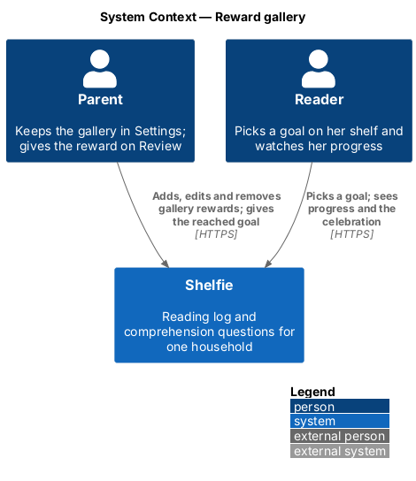
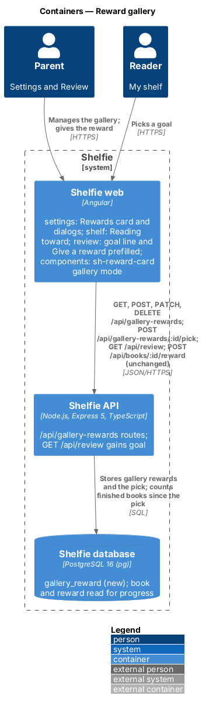
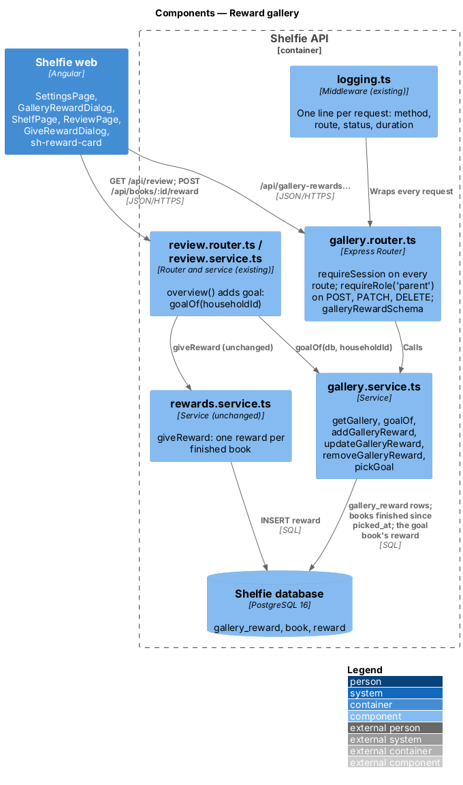
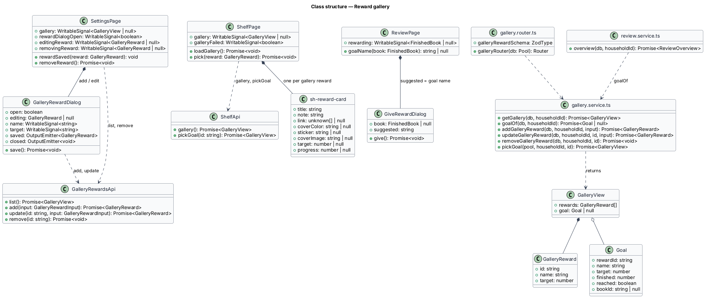
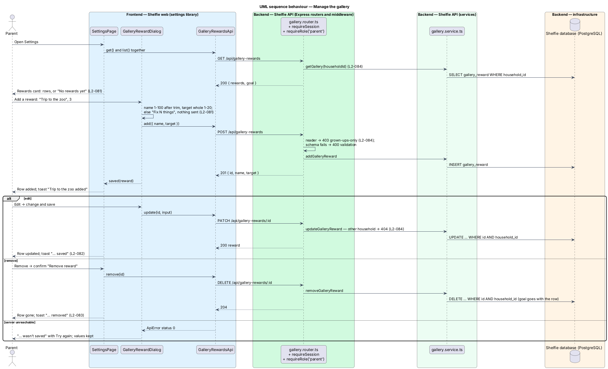
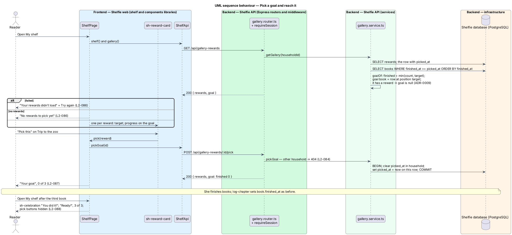
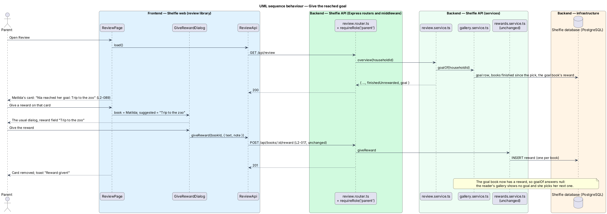

# Reward gallery

## Overview

Shelfie is a web application that helps one child read books by logging each chapter she reads and answering short questions about it, while a parent in the same household reviews her answers and gives rewards. A **household** is the unit of tenancy: its parents and readers share one bookshelf.

A **finished book** is a book whose last chapter has been logged (`book.finished_at` is set). A **reward** is the free-text prize the parent gives for one finished book through Give a reward (review/give-reward, `L2-017`); it shows on the reader's **trophy shelf** (`L2-018`). Until now the reader learned what a book would earn only after finishing it.

This feature adds a **reward gallery**: a short list of rewards the parent keeps in Settings, each with a **target**, the number of finished books that earns it ("Trip to the zoo", 3 books). On her shelf the reader sees the gallery under "Reading toward" and **picks** one as her **goal**. Her **progress** is the number of books she finishes from the moment she picks it. When the progress reaches the target the goal is **reached**: she sees a celebration, and on Review the parent sees which finished book reached it and gives the reward through the usual Give a reward dialog, with the goal's name already typed in. Once that book has its reward the goal is **complete** and she picks her next one.

The feature sits in the `review` subsystem beside give-reward, because its end is a reward given by the parent; it touches the `settings`, `shelf`, `review` and `components` libraries. The free-text reward per finished book, the four quick picks, the trophy shelf and the admin CLI reward commands (`L2-061`) are unchanged.

## Description

### Data

- **Migration `005-reward-gallery.sql`** creates `gallery_reward`: `id TEXT PRIMARY KEY`, `household_id` (references `household`, `ON DELETE CASCADE`), `name TEXT`, `target INTEGER CHECK (target BETWEEN 1 AND 20)`, `created_at TEXT`, `picked_at TEXT NULL`. Ids and timestamps follow `001-initial.sql` (TEXT, ISO-8601). An index on `household_id` serves every read, and a partial unique index on `household_id WHERE picked_at IS NOT NULL` lets a household hold at most one goal. The cascade means erasing a household (`docs/runbook.md`) erases its gallery with no change to the statement.
- **Goal and progress are derived, never stored** (ADR-0009). The goal is the household's row with `picked_at` set. Its books are the household's books with `finished_at >= picked_at`, ordered by `finished_at`, then `id`. `finished` is their count, capped at the target. The **goal book** is the book at position `target`; the goal is `reached` when it exists. When the goal book has a `reward` row the goal is complete and is reported as `null`.

### API

- **`gallery.router.ts`** — Express router mounted at `/api/gallery-rewards`. Every route applies `requireSession`; the household comes from the session, never from the request.
  - `GET /` (reader or parent) answers 200 `GalleryView`: `{ rewards: GalleryReward[], goal: Goal | null }`, rewards oldest first.
  - `POST /` (`requireRole('parent')`) validates `galleryRewardSchema` (`name: z.string().trim().min(1).max(100)`, `target: z.number().int().min(1).max(20)`), inserts and answers 201 `GalleryReward` (`id`, `name`, `target`).
  - `PATCH /:id` (`requireRole('parent')`) validates the same schema and answers 200 `GalleryReward`, or 404 `not-found` when the id is not the household's.
  - `DELETE /:id` (`requireRole('parent')`) answers 204, or 404.
  - `POST /:id/pick` (reader or parent) makes that reward the goal and answers 200 `GalleryView`, or 404.
  - A reader on a parent-only route gets 403 `grown-ups-only` (`L2-084`); a body that fails the schema gets 400 `validation` through `validationProblem`; no session gets 401.
- **`gallery.service.ts`** — `getGallery(db, householdId)`; `goalOf(db, householdId): Goal | null` as above; `addGalleryReward`, `updateGalleryReward`, `removeGalleryReward` (each scoped by `household_id`, `Problem(404, 'not-found')` when nothing matched); `pickGoal(pool, householdId, id)`, which in one transaction clears `picked_at` on the household's rows and sets it to now on the chosen one, then returns `getGallery`.
- **`Goal`** — `rewardId`, `name`, `target`, `finished`, `reached`, `bookId` (the goal book's id once reached, else `null`).
- **`review.service.ts`** — `overview()` gains `goal: await goalOf(db, householdId)`; nothing else in the review overview changes.
- **Logging** — the existing `requestLogging` writes method, route pattern, status and duration only, so no reward name reaches the log (`L2-085`).
- `rewards.service.ts`, `POST /api/books/:id/reward`, `GET /api/shelf` and the admin API are unchanged.

### Frontend

- **`sh-reward-card`** (components) — gains `target: number | null` and `progress: number | null`, and `link`, `coverColor` and `sticker` become optional. With a `target` it renders the gallery form from `docs/design-system/components/trophy.html`: class `trophy trophy--gallery`, a 🎁 `sticker` in place of the cover, the title as text, the `note`, and projected content in `.trophy__actions`. With `progress` set as well it adds `trophy--goal`, a badge ("Your goal", or "Ready!" when `progress >= target`) and an `sh-progress` labelled "N of T books finished". The trophy form is unchanged.
- **`SettingsPage`** (settings) — loads `SettingsApi.get()` and `GalleryRewardsApi.list()` together; either failing shows the existing error state. A "Rewards" card after Readers lists each reward (🎁, name, "Finish N books", icon buttons "Edit …" and "Remove …"), or "No rewards yet. Add one and Nia can pick it to read toward." "Add a reward" and Edit open `GalleryRewardDialog`; on `saved` the row is added or replaced and a toast says "… added" or "… saved". Remove opens an `sh-dialog` "Remove “…”?" with "Keep it" (focused) and danger "Remove reward"; it shows `busy`, and on failure the banner "The reward wasn’t removed"; on success the row goes and a toast says "… removed".
- **`GalleryRewardDialog`** (settings) — `sh-dialog` with `sh-text-field` "The reward" (`maxlength` 100) and `sh-text-field` `type="number"` "Books to finish". It checks the name (1–100 after trimming: "Name the reward." / "Use 100 characters or fewer.") and the target (whole number 1–20: "Use a whole number from 1 to 20."), shows the "Fix N things" summary and sends nothing while either fails; it is busy while saving and shows "… wasn’t saved" with Try again on a network or server failure, keeping the values.
- **`GalleryRewardsApi`** (settings) — `list()`, `add(input)`, `update(id, input)`, `remove(id)` over `ApiClient`.
- **`ShelfPage`** (shelf) — loads the gallery through `ShelfApi.gallery()` beside the shelf, so a gallery failure leaves the shelf usable. Between Up next and Finished, a "Reading toward" section shows: `sh-empty-state` "No rewards to pick yet" (no rewards); `sh-empty-state` `tone="error"` "Your rewards didn’t load" with Try again (failed); otherwise an intro line and one `sh-reward-card` per reward, the goal with `progress`. While no goal is reached each other card carries "Pick this" (`aria-label` "Pick …"); `pick()` calls `ShelfApi.pickGoal(id)` and replaces the gallery with the answer, or shows a danger toast "Your goal wasn’t picked". A reached goal shows `sh-celebration` `variant="book"` above the list: "You did it! 🎉" and "You finished 3 books. Dad is getting your Trip to the zoo ready.", and hides the pick buttons.
- **`ReviewPage`** (review) — for the finished-book card whose `bookId` equals `overview.goal.bookId` it adds "🎯 Nia reached her goal: Trip to the zoo" and passes the goal's name to the dialog.
- **`GiveRewardDialog`** (review) — gains one optional input, `suggested` (default `''`), written into the reward field when the dialog opens. Validation, quick picks, the note, the request and its errors are unchanged.

### Error mapping

| Situation | API | Page |
|---|---|---|
| Name empty or over 100, target not a whole 1–20 | 400 `validation` | Inline errors and "Fix N things"; nothing is sent |
| Reader adds, edits or removes | 403 `grown-ups-only` | Not offered in the reader's UI |
| Id of another household, or removed meanwhile | 404 `not-found` | Thrown to the global error handling, as for readers |
| Network or server failure while saving or removing | status 0 or 5xx | Banner in the dialog; values kept |
| Network or server failure while picking | status 0 or 5xx | Danger toast; gallery unchanged |
| Gallery fails to load on the shelf | any | "Your rewards didn’t load" with Try again |

## Requirements

The feature realizes the following level-2 (L2) requirements. Each refines a level-1 (L1) requirement, cited by identifier.

| L2 ID | Refines (L1) | Requirement |
|-------|--------------|-------------|
| `L2-081` | `L1-021` | The parent shall add a gallery reward with a name of 1 to 100 characters and a target of 1 to 20 finished books; invalid values shall be refused inline and by the API. |
| `L2-082` | `L1-021` | The parent shall edit a gallery reward's name and target under the same rules; a changed target shall apply to the reader's goal at once. |
| `L2-083` | `L1-021` | The parent shall remove a gallery reward after confirming; a removed goal shall leave the reader without a goal, and rewards already given shall stay. |
| `L2-084` | `L1-021` | Only the household's own gallery shall be visible or changeable, and a reader shall not add, edit or remove gallery rewards. |
| `L2-085` | `L1-021` | The API log shall never contain a gallery reward's name. |
| `L2-086` | `L1-021` | The reader's shelf shall show the gallery, an empty message when there is none, and a retryable error when it fails to load. |
| `L2-087` | `L1-021` | The reader shall pick a goal and change it; progress shall count the books finished since the pick, and picking another shall start again at 0. |
| `L2-088` | `L1-021` | A reached goal shall be celebrated on the reader's shelf. |
| `L2-089` | `L1-021` | The parent shall see which finished book reached the goal and give the reward through Give a reward with the goal's name filled in; once that book is rewarded the goal shall be complete. |

`L2-017`, `L2-018` and `L2-061` are used unchanged.

## Decisions

- **One goal per household, counted from the pick, completed by the existing reward.** Recorded in [ADR-0009](../../../adr/0009-reward-gallery-goal-and-progress.md).
- **Picking is open to both roles.** The gallery is read by both; only changing it is parent-only. A parent picking for her is harmless and needs no extra check.
- **The settings page loads the gallery with the settings.** The mocks have no separate failure state for the Rewards card, so one load and one error state cover both. The shelf loads its gallery separately because the mocks give it its own failure state.
- **Prefill, not a new flow.** The only change to Give a reward is its initial text, so `L2-017`'s rules hold for gallery rewards exactly as for typed ones.

## Diagrams

### System context

The parent keeps the gallery and gives the reward; the reader picks her goal.

### Containers

The Angular application calls the new gallery routes and the existing review routes; the API stores the gallery and derives the goal from books and rewards.

### Components

`gallery.router.ts` checks the session and role and delegates to `gallery.service.ts`; the review service asks the same service for the goal, and the reward itself goes through the unchanged `rewards.service.ts`.

### Class structure

Settings owns the gallery dialogs, the shelf renders one `sh-reward-card` per reward, and Review passes the goal's name to Give a reward.

### Behaviour — manage the gallery

The parent adds, edits and removes rewards; the reader is refused and other households' ids are not found (`L2-081` to `L2-084`).

### Behaviour — pick a goal and reach it

The reader picks a reward, progress counts finished books since the pick, and the shelf celebrates the reached goal (`L2-086` to `L2-088`).

### Behaviour — give the reached goal

Review names the goal on the book that reached it and gives the reward through the unchanged endpoint, which completes the goal (`L2-089`).

## Open questions

- **Interpretation of "progress" (resolved).** Progress is the books finished from the moment she picks the reward, as the feature request proposed. No simpler reading fits: counting all finished books would make most rewards reached on the day they are added. Recorded in ADR-0009.
- **Deferred.** Streak rewards (#5), badges (#6), notifications (#11), reward pictures, ordering, several goals at once and a history of past goals are not built.
