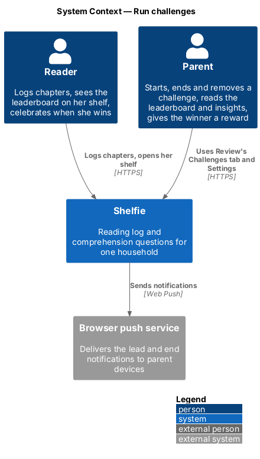
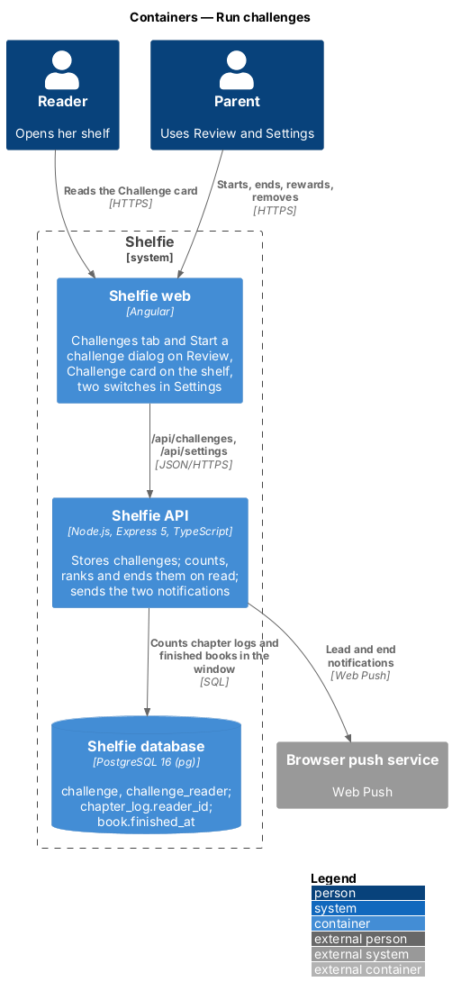
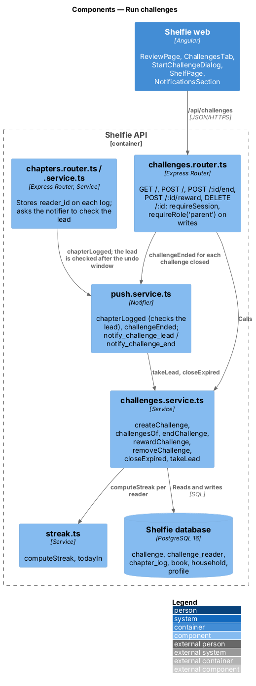
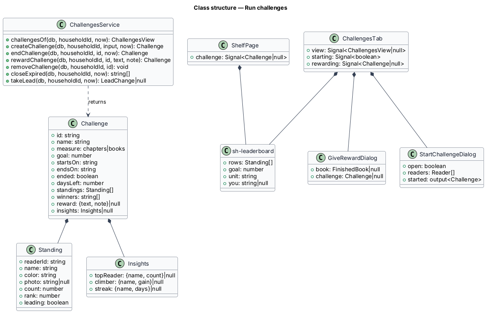
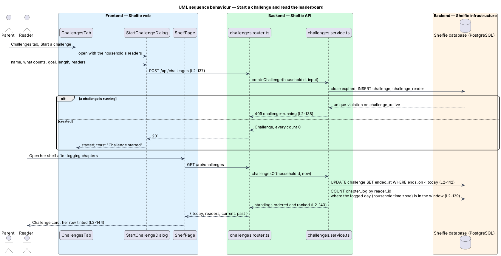
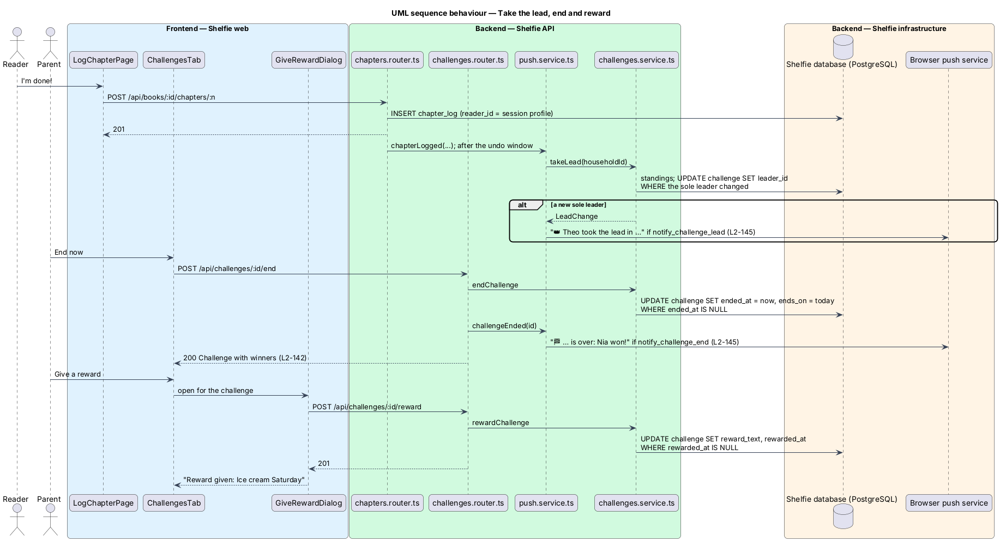

# Run challenges

## Overview

Shelfie is a web application that helps a child read books by logging each chapter she reads and answering short questions about it, while a parent in the same household reviews her answers and gives rewards. A **household** is the unit of tenancy: its parents and readers share one bookshelf.

A **challenge** is a time-boxed reading race a parent runs for some or all of the household's readers: a name, a **measure** (chapters logged or books finished), a **goal** (a number each reader aims for), and a **window** of one week, two weeks or a month starting the day it is created. Shelfie counts what each reader taking part logged inside the window and shows a **leaderboard**: the readers ranked by their count, each with progress toward the goal, the **leader** crowned. Under it the parent reads three **insights**: the week's top reader, the biggest climber since the week before, and the longest streak. A challenge **ends** the day after its last day, or when a parent presses End now; the readers at the top then **win**, the winner celebrates on her shelf, and the parent can give a reward through the usual Give a reward dialog. Parents can switch on two push notifications: a reader takes the lead, and a challenge ends.

Until now nothing in the database said which reader logged a chapter: books and chapter logs belong to the household. A leaderboard needs that, so this feature stores the logging reader on every new chapter log (`chapter_log.reader_id`); in a household with one reader, older logs are given to her. Everything else is counted on read from data Shelfie already keeps (ADR-0018).

The feature sits in the `review` subsystem beside streak-rewards, because the parent runs it from Review and its end is a reward. It touches the `review`, `shelf`, `settings` and `components` libraries of the web app and the `challenges`, `chapters`, `push` and `settings` modules of the API. Chapter logging, rewards for books, streaks, badges and the Review queue are unchanged.

## Description

### Data

- **Migration `011-challenges.sql`**
  - `chapter_log.reader_id TEXT NULL REFERENCES profile(id) ON DELETE SET NULL`. Filled from the session when a reader logs a chapter; null for a parent's log. Older logs in households with exactly one reader are given to her by the migration; logs in households with several readers stay null and count for no one.
  - `challenge`: `id TEXT PRIMARY KEY`, `household_id TEXT NOT NULL REFERENCES household(id) ON DELETE CASCADE`, `name TEXT NOT NULL`, `measure TEXT NOT NULL CHECK (measure IN ('chapters','books'))`, `goal INTEGER NOT NULL CHECK (goal BETWEEN 1 AND 500)`, `starts_on TEXT NOT NULL` and `ends_on TEXT NOT NULL` (days, `YYYY-MM-DD`, in the household time zone, both included), `created_at TEXT NOT NULL`, `ended_at TEXT NULL` (set when the challenge closes), `leader_id TEXT NULL REFERENCES profile(id) ON DELETE SET NULL` (the last reader announced as leader), `reward_text TEXT NULL`, `reward_note TEXT NULL`, `rewarded_at TEXT NULL`.
  - `CREATE UNIQUE INDEX challenge_active ON challenge (household_id) WHERE ended_at IS NULL` — one running challenge per household.
  - `challenge_reader (challenge_id REFERENCES challenge(id) ON DELETE CASCADE, profile_id REFERENCES profile(id) ON DELETE CASCADE, PRIMARY KEY (challenge_id, profile_id))`.
  - `household.notify_challenge_lead` and `household.notify_challenge_end`, `BOOLEAN NOT NULL DEFAULT TRUE`.
  - No count is stored. Everything cascades from `household`, so the operator's erasure statement needs no change.

### API

- **`challenges.service.ts`**
  - `challengesOf(db, householdId, now)` closes expired challenges first (`closeExpired`), then answers `ChallengesView { today, readers, current, past }`: `readers` are the household's readers (id, name, colour, photo) for the dialog; `current` is the newest challenge, running or ended; `past` the other ended ones, newest first.
  - `closeExpired(db, householdId, now)` runs `UPDATE challenge SET ended_at = $now WHERE household_id = $1 AND ended_at IS NULL AND ends_on < $today RETURNING id`, so each challenge closes once; the router sends one end notification per returned id.
  - `createChallenge(db, householdId, input, now)` closes expired challenges, checks every `readerId` is a reader of the household (400 `validation` on `readerIds` otherwise), inserts the challenge with `starts_on = today` and `ends_on = today + 6 | 13 | 29`, and its readers, in one transaction. A unique violation on `challenge_active` answers 409 `challenge-running`.
  - `endChallenge(db, householdId, id, now)` sets `ended_at = now` and `ends_on = today` where `ended_at IS NULL`; 404 `not-found` for another household's id; 409 `challenge-ended` when it has already ended.
  - `rewardChallenge(db, householdId, id, text, note)` sets the reward on an ended challenge with a winner; 409 `challenge-running`, `no-winner` or `reward-exists`.
  - `removeChallenge(db, householdId, id)` deletes it; 404 when it is not the household's.
  - `takeLead(db, householdId, now)` reads the running challenge's standings; when exactly one reader holds rank 1 with a count above 0 and she is not `leader_id`, it sets `leader_id` with a guarded `UPDATE … WHERE leader_id IS DISTINCT FROM $reader` and answers `{ challengeId, name, leader, runnerUp, unit }`; otherwise null.
  - **Counting** (`standingsOf`). The logged day is `to_char(c.logged_at::timestamptz AT TIME ZONE household.time_zone, 'YYYY-MM-DD')`. Chapters: `chapter_log` rows of the household whose `reader_id` takes part, whose logged day is between `starts_on` and `ends_on`, and, when `ended_at` is set, whose `logged_at <= ended_at`. Books: books of the household whose `finished_at` day is in the window (and before `ended_at`), counted for the `reader_id` of the log of their last chapter. Each reader taking part gets a row, 0 when she has nothing.
  - **Ranking.** Ordered by count descending, then name; `rank` is 1 plus the number of readers with a higher count, so equal counts share a rank; `leading` is rank 1 with a count above 0. **Winners** of an ended challenge are the leading readers; with one reader taking part she wins only when her count reached the goal.
  - **Insights** (running challenge only, readers taking part): chapters by `read_on` in the last 7 days and the 7 before (the `thisWeek` window of `review.service.ts`); `topReader` is the most this week (ties by name), `climber` the largest positive gain, `streak` the longest `computeStreak` over the reader's own `read_on` days. Each is null when it has nothing to say.
  - `daysLeft` is `ends_on − today` in days.
- **`challenges.router.ts`** — mounted at `/api/challenges`; every route applies `requireSession`; writes add `requireRole('parent')`.
  - `GET /` (reader or parent) closes expired challenges and sends `challengeEnded` for each (`closeExpiredAndNotify`), then answers 200 `ChallengesView`. `POST /` does the same before creating.
  - `POST /` validates `{ name: z.string().trim().min(1).max(60), measure: z.enum(['chapters','books']), goal: z.number().int().min(1).max(500), length: z.enum(['week','two-weeks','month']), readerIds: z.array(z.string()).min(1) }` with unique ids, answers 201 `Challenge`.
  - `POST /:id/end` answers 200 `Challenge` and sends `challengeEnded`.
  - `POST /:id/reward` validates `giveRewardSchema` of `review.router.ts` and answers 201 `Challenge`.
  - `DELETE /:id` answers 204.
- **`chapters.service.ts` / `chapters.router.ts`** — `logChapter` takes the session's profile id when the session is a reader and stores it as `reader_id`. The router's existing `notifier.chapterLogged` call now also checks the challenge after the undo window.
- **`push.service.ts`** — two more choices, `challengeLead` and `challengeEnd`, on `notify_challenge_lead` and `notify_challenge_end`, sent to parents only.
  - `chapterLogged`'s one undo-window job (`schedule`), after the chapter notification, closes expired challenges (sending their end notifications) and calls `takeLead`; a change sends "👑 Theo took the lead in Half-term reading race" / "Theo has 7 chapters; Nia has 6." to `/review?tab=challenges`, tag `challenge-lead-<id>`. Folding it into the same job keeps one timer per logged chapter.
  - `challengeEnded(householdId, challengeId)` reads the result through `challengeById` and sends "🏁 Half-term reading race is over: Nia won!" / "Give her a reward from Review." (or no name and "No winner this time."), tag `challenge-end-<id>`.
- **`settings.service.ts` / `settings.router.ts`** — `NotificationChoices` gains `challengeLead` and `challengeEnd`; the strict schema accepts both.

### Frontend

- **`sh-progress`** (components) — gains `large`, the taller bar, for the single reader's goal.
- **`sh-leaderboard`** (components) — `rows: Standing[]`, `goal`, `unit` and `you: string | null`. An `<ol class="leaderboard" aria-label="Leaderboard">`; per row the rank (👑 when `leading`, with an `aria-label` "1st, in the lead"), `sh-avatar`, the name with "(you)" and "In the lead", and `sh-progress` of the count out of the goal, labelled "Nia: 9 of 15 chapters". Styles in its own `.css`, mirrored in `docs/design-system/assets/components.css`.
- **`ReviewPage`** (review) — an `sh-segmented` "Show" with To review and Challenges under the header; the To review tab is everything Review showed before. `?tab=challenges` opens the second.
- **`ChallengesTab`** (review) — loads `ReviewApi.challenges()`: skeleton while loading, an error `sh-empty-state` with Try again, the empty state "No challenge yet" with Start a challenge, or the current challenge card (subtitle "Chapters logged · goal 15 · Mon 12 Oct to Sun 25 Oct · 8 days left", `sh-leaderboard`, insights list, End now) followed by Past challenges. An ended card shows "🏆 Nia won with 8 chapters!", Give a reward (or "Reward given: …") and Remove. It toasts "Challenge started", "Challenge ended", "Challenge removed", or a danger toast when End now or Remove fails.
- **`StartChallengeDialog`** (review) — `sh-dialog` with `sh-text-field` Name (`maxlength` 60), `sh-segmented` What counts, `sh-text-field` `number` Goal, `sh-segmented` How long with "Starts today, Fri 17 Oct.", one `sh-switch` per reader (all on), Not now and Start the challenge (busy while sending). Inline errors and an `sh-banner` summary; "The challenge wasn’t started" on a network or server failure; on 409 `challenge-running` it closes, toasts "A challenge is already running" and the tab reloads.
- **`GiveRewardDialog`** (review) — gains an optional `challenge` input. With a challenge it is titled "Nia won! 🏆", shows a 🏁 line with the challenge's name and end day instead of the book, says "Nia sees this on the challenge card.", posts to `ReviewApi.rewardChallenge` and emits `challengeRewarded`; with a book nothing changes.
- **`ShelfPage`** (shelf) — loads `ShelfApi.challenges()` beside the shelf. A Challenge card after the hero when `current` exists, the signed-in reader takes part, and it is running or ended no more than 7 days ago: `sh-leaderboard` with `you`, or a large `sh-progress` when she is the only reader taking part, and one line ("You’re in the lead. Keep going!", "3 to catch Theo. You can do it!"). When she won, the card is an `sh-celebration` `book` headed "You won!" over the challenge's name, with "Your reward: …" or "Your reward is on its way."; when she lost, "Theo won this one. You read 5 chapters, well done!".
- **`NotificationsSection`** (settings) — two more `sh-switch`: "Tell me when a reader takes the lead in a challenge", "Tell me when a challenge ends"; the hint says "six choices".

### Error mapping

| Situation | API | Page |
|---|---|---|
| Name, goal or readers invalid | 400 `validation` | Inline errors and summary; nothing is sent |
| Start while one runs | 409 `challenge-running` | Dialog closes; toast "A challenge is already running" |
| End an ended challenge | 409 `challenge-ended` | Not offered once ended |
| Reward while running, with no winner, or twice | 409 `challenge-running`, `no-winner`, `reward-exists` | Not offered |
| Reader writes | 403 `grown-ups-only` | Not offered in the reader's UI |
| Another household's id | 404 `not-found` | Thrown to the global error handling |
| Network or server failure | status 0 or 5xx | Banner in the dialog; danger toast for End now and Remove; error state for the tab |

## Requirements

The feature realizes the following level-2 (L2) requirements. Each refines a level-1 (L1) requirement, cited by identifier.

| L2 ID | Refines (L1) | Requirement |
|-------|--------------|-------------|
| `L2-137` | `L1-029` | A parent shall start a challenge with a name, measure, goal, length and readers, validated in the dialog and by the API. |
| `L2-138` | `L1-029` | A household shall run at most one challenge at a time. |
| `L2-139` | `L1-029` | Counts shall be chapters logged, or books finished, by each reader taking part inside the window in the household time zone, computed on read. |
| `L2-140` | `L1-029` | The leaderboard shall order readers by count then name, share ranks on ties and crown the leaders. |
| `L2-141` | `L1-029` | The parent shall see the week's top reader, the biggest climber and the longest streak. |
| `L2-142` | `L1-029` | A challenge shall end at its end date or with End now, show its winners and hand off to Give a reward. |
| `L2-143` | `L1-029` | Review shall list past challenges with their results and let a parent remove one. |
| `L2-144` | `L1-029` | A reader shall see the Challenge card on her shelf, a progress bar when alone, and a celebration when she wins. |
| `L2-145` | `L1-029` | Parents shall be able to switch on notifications for a new leader and for the end of a challenge. |
| `L2-146` | `L1-029` | Challenge writes shall be parent-only, and challenges shall stay inside their household. |

`L2-006`, `L2-011`, `L2-017`, `L2-020`, `L2-121`, `L2-124` and `L2-125` are used unchanged.

## Decisions

- **Household only, counted on read, one at a time, attributed by `reader_id`.** Recorded in [ADR-0018](../../../adr/0018-household-challenges-counted-on-read.md).
- **The logged day, not the read day, counts.** A reader can say she read a chapter yesterday; counting by when it reached the server stops a log from landing before the challenge began. Insights keep `read_on`, as the streak and This week do.
- **A book counts for whoever logged its last chapter.** Books have no owner; the last chapter is the moment it is finished.
- **The end is noticed on read.** There is no scheduler; the first read after the last day (a shelf, Review, or the next chapter logged) closes the challenge and sends its notification once.
- **The reward lives on the challenge row.** `reward` is keyed by book; a challenge reward is one text and note, shown on the winner's card.
- **The tab switch is `sh-segmented`.** The design system has no tabs; chips with `aria-pressed` match the mocks.
- **`sh-leaderboard` is one component, not a row.** Review and the shelf draw the same list; the rows never appear alone.

## Diagrams

### System context

The parent runs challenges and gives the reward; the reader takes part by logging chapters; push messages go through the browser vendors' services.

### Containers

The Angular application reads `/api/challenges`; the API counts chapter logs and finished books in PostgreSQL and sends the two notifications.

### Components

`challenges.router.ts` checks the session and role and delegates to `challenges.service.ts`; the chapter routes ask the notifier to check the lead after a log.

### Class structure

A `Challenge` carries its ranked `Standing` rows and `Insights`; the Challenges tab owns the start and reward dialogs, and both pages draw `sh-leaderboard`.

### Behaviour — start a challenge and read the leaderboard

A parent starts the challenge; every later read closes it if it has expired and counts the window (`L2-137` to `L2-140`, `L2-144`).

### Behaviour — take the lead, end and reward

A logged chapter can make a new leader; End now closes the challenge and the parent rewards the winner (`L2-142`, `L2-145`).

## Open questions

- **Attribution of older logs (resolved).** Before this release no log names its reader. Households with one reader get their history; households with several start counting from this release, which only affects insights for the first two weeks.
- **End notification timing (resolved).** With no scheduler, a challenge whose last day passes while nobody opens Shelfie notifies on the next read. A reader opens her shelf most days, so this is accepted.
- **A shared shelf (unchanged).** Readers in one household share books, and a chapter is logged once per household, so two siblings cannot log the same chapter of the same book. Challenges count what the existing model records.
- **Deferred.** Challenges across households or with friends, templates, recurring or overlapping challenges, counting answers, review marks or minutes, reader-created challenges, a badge for winning, and a reward notification to the winner.
