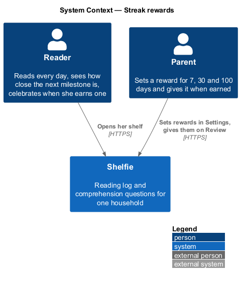
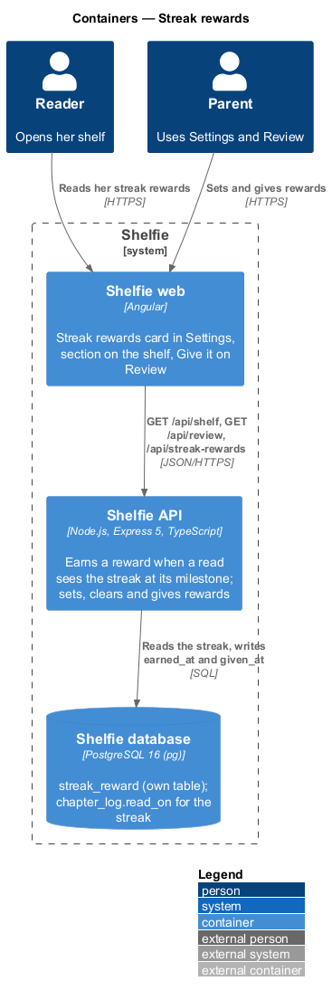
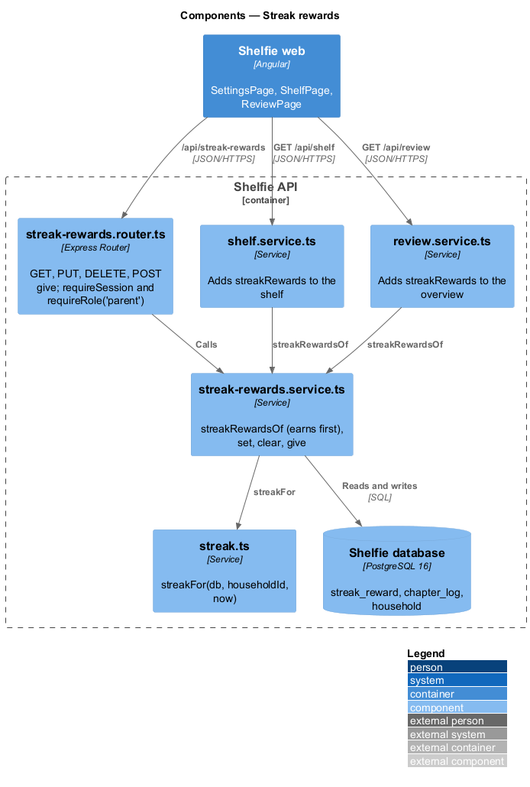
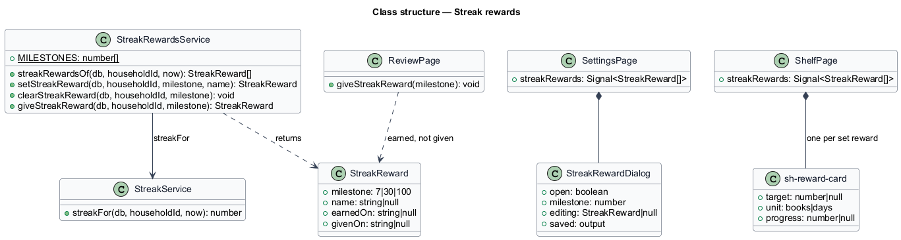
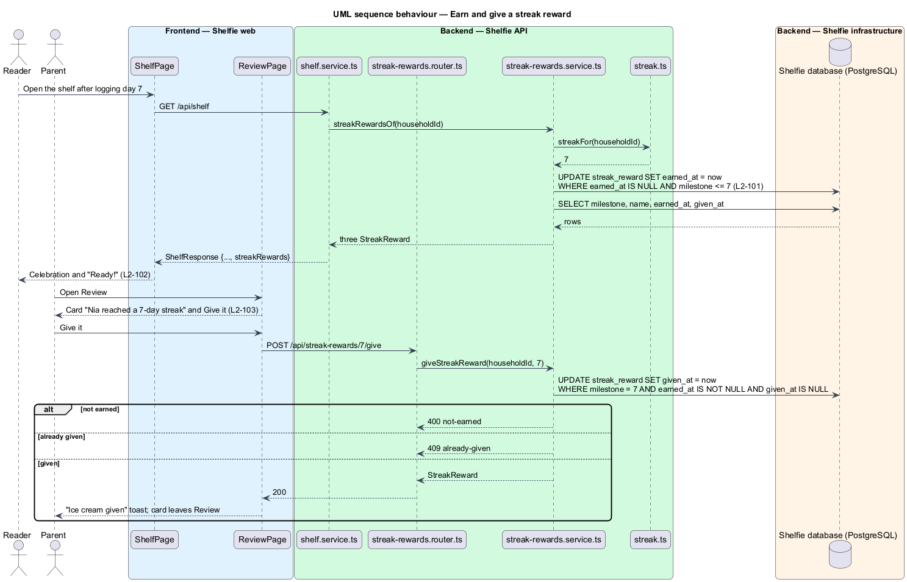

# Streak rewards

## Overview

Shelfie is a web application that helps one child read books by logging each chapter she reads and answering short questions about it, while a parent in the same household reviews her answers and gives rewards. A **household** is the unit of tenancy: its parents and readers share one bookshelf.

The reading **streak** (reading-log/track-streak, `L2-020`) is the number of consecutive days with a chapter read. This feature lets the parent set a **streak reward** for each of three milestones: 7, 30 and 100 days. When the streak reaches a milestone that has a reward, the reward is **earned**; the reader sees a celebration on her shelf, the parent sees on Review that it is ready and **gives** it with one tap, and it then shows on her shelf as given.

The streak forgets once it breaks, so the fact that a milestone was reached is stored when it is first seen (ADR-0012). That is the only new state: the streak itself is still derived. Each milestone is earned once and given once.

The feature sits in the `review` subsystem beside reward-gallery, because its end is a reward given by the parent. It touches the `settings`, `shelf`, `review` and `components` libraries. The free-text reward per finished book, the reward gallery, the trophy shelf and the admin CLI reward commands are unchanged.

## Description

### Data

- **Migration `006-streak-reward.sql`** creates `streak_reward`: `household_id TEXT REFERENCES household(id) ON DELETE CASCADE`, `milestone INTEGER CHECK (milestone IN (7, 30, 100))`, `name TEXT NOT NULL`, `earned_at TEXT NULL`, `given_at TEXT NULL`, `PRIMARY KEY (household_id, milestone)`. Timestamps are ISO-8601 like the rest of the schema. A row exists only while a reward is set.

### API

- **`streak-rewards.service.ts`**
  - `MILESTONES = [7, 30, 100]`.
  - `streakRewardsOf(db, householdId, now?)` first earns, then returns the three milestones as `StreakReward { milestone, name | null, earnedOn | null, givenOn | null }`. Earning is `UPDATE streak_reward SET earned_at = $now WHERE household_id = $1 AND earned_at IS NULL AND milestone <= $streak`, with `streak` from `streakFor`. `earnedOn` and `givenOn` are days in the household time zone.
  - `setStreakReward(db, householdId, milestone, name)` upserts the name, keeps `earned_at`, answers 409 `already-given` when `given_at` is set, and earns before answering.
  - `clearStreakReward(db, householdId, milestone)` deletes the row; 404 `not-found` when there is none; 409 `already-given`.
  - `giveStreakReward(db, householdId, milestone)` earns, then sets `given_at`; 404 when no reward is set, 400 `not-earned`, 409 `already-given`.
- **`streak-rewards.router.ts`** — mounted at `/api/streak-rewards`; every route applies `requireSession`. A `milestone` that is not 7, 30 or 100 answers 404 `not-found`.
  - `GET /` (reader or parent) answers 200 `{ rewards: StreakReward[] }`.
  - `PUT /:milestone` (`requireRole('parent')`) validates `streakRewardSchema` (`name: z.string().trim().min(1).max(100)`) and answers 200 `StreakReward`.
  - `DELETE /:milestone` (`requireRole('parent')`) answers 204.
  - `POST /:milestone/give` (`requireRole('parent')`) answers 200 `StreakReward`.
  - A reader on a parent-only route gets 403 `grown-ups-only`; a body that fails the schema gets 400 `validation` through `validationProblem`; no session gets 401.
- **`shelf.service.ts`** and **`review.service.ts`** — `getShelf()` and `overview()` add `streakRewards: await streakRewardsOf(...)`, which earns first. Nothing else in either response changes.
- **Logging** — `requestLogging` writes method, route pattern, status and duration only, so no reward name reaches the log (`L2-104`).

### Frontend

- **`sh-reward-card`** (components) — gains `unit: 'books' | 'days'` (default `'books'`); with `days` its progress label reads "N of T days in a row" instead of "N of T books finished". Nothing else changes.
- **`SettingsPage`** (settings) — loads `StreakRewardsApi.list()` with the settings and the gallery. A "Streak rewards" card after Rewards lists the three milestones: a set row shows "7 days in a row · Ice cream", "Nia gets it when she reaches 7 days" and icon buttons "Edit …" and "Remove …"; an unset row shows "No reward set" and "Set a reward"; a given row shows "Given Sat 10 Oct" and no buttons. Remove calls `StreakRewardsApi.clear` and toasts "… removed".
- **`StreakRewardDialog`** (settings) — an `sh-dialog` with one `sh-text-field` "The reward" (`maxlength` 100). The field stops at 100 characters; it checks the name is not empty ("Name the reward."), is busy while saving, and on a network or server failure shows "… wasn’t saved" with Try again, keeping the name. On save it toasts "… set for 7 days" or "… saved".
- **`StreakRewardsApi`** (settings) — `list()`, `set(milestone, name)`, `clear(milestone)` over `ApiClient`.
- **`ShelfPage`** (shelf) — a "Streak rewards" section between Up next and Finished, only when at least one reward is set. One `sh-reward-card` per set reward with `target` the milestone and `unit="days"`: the next unearned one gets `progress` (the streak, capped at the milestone); an earned, ungiven one gets `progress` equal to the milestone ("Ready!"); a given one has no progress and the note "Given Sat 10 Oct". An earned, ungiven reward shows `sh-celebration` `variant="book"` above the list.
- **`ReviewPage`** (review) — a card "Nia reached a 7-day streak" with "Her reward: Ice cream" and an `sh-button` "Give it" for each earned, ungiven reward; the summary counts them among the rewards to give. Give it calls `ReviewApi.giveStreakReward(milestone)`, shows busy, replaces the reward with the answer, and toasts "… given"; on failure a danger toast says "The reward wasn’t given".

### Error mapping

| Situation | API | Page |
|---|---|---|
| Name empty or over 100 | 400 `validation` | Inline error; nothing is sent |
| Reader sets, removes or gives | 403 `grown-ups-only` | Not offered in the reader's UI |
| Milestone not 7, 30 or 100, or none set | 404 `not-found` | Thrown to the global error handling |
| Edit, remove or give of a given reward | 409 `already-given` | Not offered once given |
| Give before it is earned | 400 `not-earned` | Not offered before it is earned |
| Network or server failure | status 0 or 5xx | Banner in the dialog (set), danger toast (give); values kept |

## Requirements

The feature realizes the following level-2 (L2) requirements. Each refines a level-1 (L1) requirement, cited by identifier.

| L2 ID | Refines (L1) | Requirement |
|-------|--------------|-------------|
| `L2-100` | `L1-025` | The parent shall set, edit and remove a reward for the 7, 30 and 100 day milestones; invalid names are refused inline and by the API, and a given reward cannot be changed. |
| `L2-101` | `L1-025` | A reward shall be earned the first time the streak is at or above its milestone while it is set, and stay earned after the streak breaks. |
| `L2-102` | `L1-025` | The reader's shelf shall show the streak rewards, progress to the next, a celebration when one is earned, and the given ones. |
| `L2-103` | `L1-025` | The parent shall see an earned reward on Review and give it with one tap. |
| `L2-104` | `L1-025` | Streak rewards shall be visible and changeable only within the household, by parents only, with no reward text in logs. |

`L2-020`, `L2-025` and `L2-026` are used unchanged.

## Decisions

- **Earned when read and stored once earned; its own table.** Recorded in [ADR-0012](../../../adr/0012-streak-rewards-are-earned-when-read.md).
- **Giving is a button, not a dialog.** The reward's name is already set, and a note would add a flow nobody asked for.
- **`sh-reward-card` gets a `unit`.** The gallery card already has the goal border, badge and bar; only its label said "books".

## Diagrams

### System context

The parent sets and gives the rewards; the reader earns them by reading.

### Containers

The Angular application calls the new routes and reads `streakRewards` from the shelf and review responses; the API stores earned rewards in `streak_reward`.

### Components

`streak-rewards.router.ts` checks the session and role and delegates to `streak-rewards.service.ts`, which earns using `streak.ts`; the shelf and review services call the same service.

### Class structure

Settings owns the dialog, the shelf renders one `sh-reward-card` per reward, and Review gives the earned ones.

### Behaviour — earn and give a streak reward

A read earns the reward when the streak reaches the milestone; the parent gives it from Review (`L2-101` to `L2-103`).

## Open questions

- **A missed milestone (resolved).** Earning on read can miss a streak that rose and broke between reads; accepted in ADR-0012 because the reader opens her shelf after each log.
- **Deferred.** Custom milestones, repeating rewards, a note on giving, a history of earned rewards, notifications, streak freeze and showing streak rewards on the trophy shelf.
