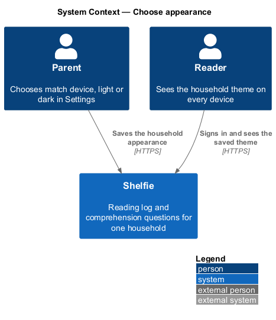
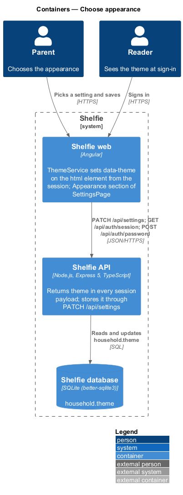
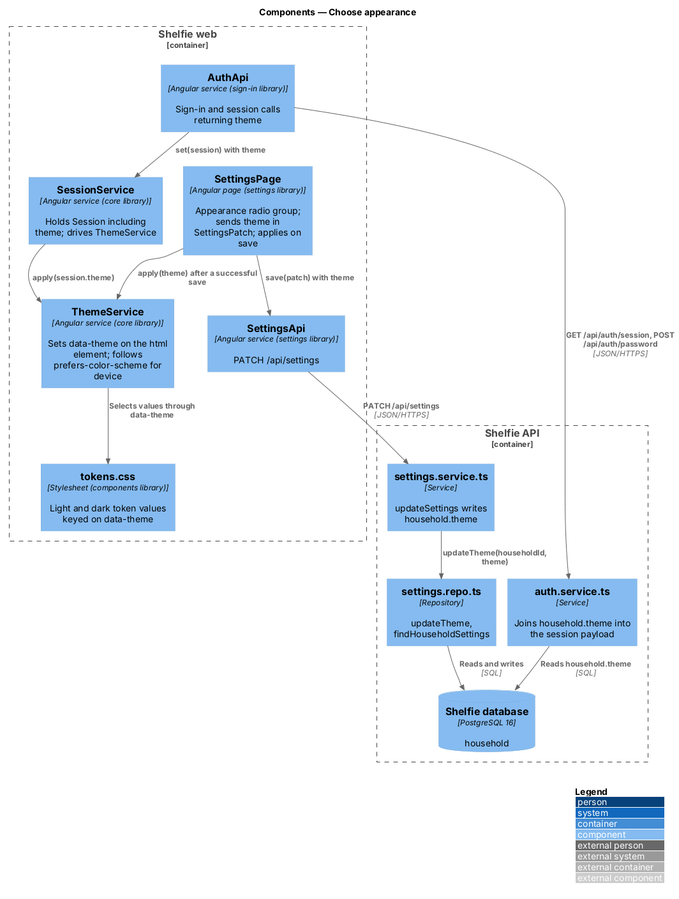
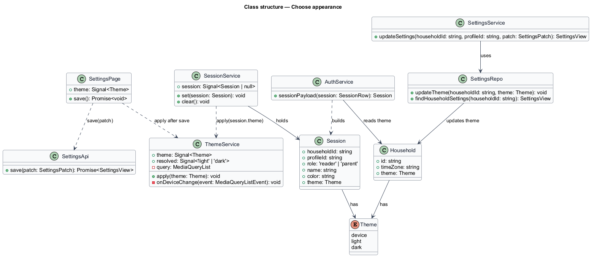
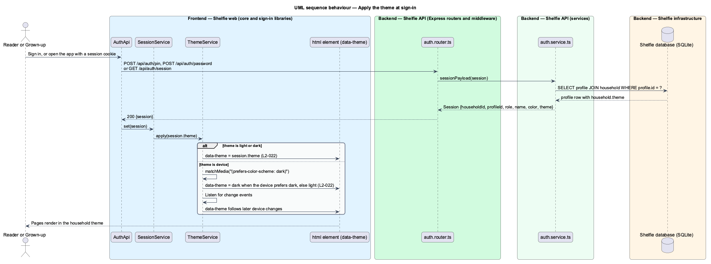
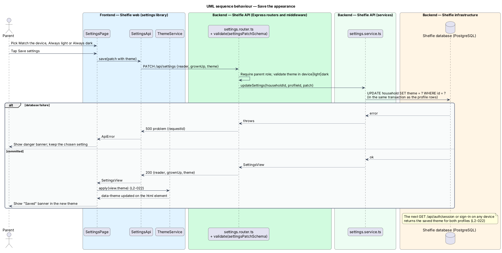

# Choose appearance

## Overview

Shelfie is a web application that helps one child read books by logging each chapter she reads and answering short questions about it, while a grown-up in the same household reviews her answers and gives rewards. A **household** is the unit of tenancy: exactly one reader profile and one grown-up profile, sharing one bookshelf.

This feature is the Appearance section of the grown-up's Settings page. A **theme** is the colour scheme the application renders in: light or dark. The grown-up chooses one of three settings: **Match the device** (light in the day, dark at night, when the device does that), **Always light** or **Always dark**. The choice belongs to the household, not to a device or a profile: once saved, the reader and the grown-up both see it on every device they sign in from.

The application learns the household theme from the session. Every sign-in response and the session lookup on page load carry the saved value, and a service in the core library writes it onto the document before any page renders. For Match the device, the service reads the operating system preference and follows it as it changes during the day. Before sign-in no household is known, so the sign-in page follows the device preference.

The feature sits in the `settings` subsystem beside edit-household-settings, which owns the rest of the Settings page and the load and save calls that this section shares.

## Description

The slice runs from the Appearance radio group to the `household` table and back to the `<html>` element on every device.

- **Appearance section of `SettingsPage`** — a `fieldset` in the `settings` library with three native radio inputs styled as choice rows (`device`, `light`, `dark`), described by `Applies on every device for both of you.` It is local UI, not an `sh-*` component. The mock's radio value `system` maps to the brief's column value `device`. The value travels in `SettingsPatch.theme` of the shared `PATCH /api/settings`; on a successful save the page calls `ThemeService.apply(view.theme)` so the change shows at once without a reload.
- **`ThemeService`** — service in the `core` library. `apply(theme: 'device' | 'light' | 'dark')` sets `data-theme="light"` or `data-theme="dark"` on `document.documentElement`. For `device` it resolves the value from `matchMedia('(prefers-color-scheme: dark)')`, sets `data-theme` to the result and listens to the query's `change` event so the attribute follows the operating system while the app is open. `theme: Signal<'device' | 'light' | 'dark'>` and `resolved: Signal<'light' | 'dark'>` expose the current values. `SessionService` calls `apply(session.theme)` whenever a session is set, and `apply('device')` when the session is cleared.
- **`SessionService`** — service in the `core` library; its `Session` gains a `theme` field read from the API.
- **Design tokens** — the `components` library ships `tokens.css` copied from `docs/design-system/tokens/tokens.css`: light values on `:root`, dark values under `[data-theme="dark"]` and under `@media (prefers-color-scheme: dark)` for `:root:not([data-theme="light"])`, plus `color-scheme`. Because `ThemeService` always writes an explicit `data-theme`, the attribute decides the theme and the media-query rule serves only the moment before the service runs.
- **`AuthApi` responses** — `GET /api/auth/session`, `POST /api/auth/pin` and `POST /api/auth/password` include `theme` in the session payload; `auth.service.ts` reads it by joining `household` through the profile. `GET /api/auth/profiles` also carries the theme, so the sign-in page renders in the household theme on a known device.
- **`settings.router.ts`** — `settingsPatchSchema` accepts `theme` in `device|light|dark`; `GET /api/settings` returns the current value.
- **`settings.service.ts`** / **`settings.repo.ts`** — `updateSettings` writes `household.theme` through `updateTheme(householdId, theme)` inside the same transaction as the profile rows; `findHouseholdSettings` reads it.
- **`household`** table column used: `theme` (`'device' | 'light' | 'dark'`).

`ThemeService` caches the last applied theme in `localStorage` (reads and writes wrapped in try/catch) so that a reload renders in the saved theme before the session response arrives.

## Requirements

The feature realizes the following level-2 (L2) requirement. It refines a level-1 (L1) requirement, cited by identifier.

| L2 ID | Refines (L1) | Requirement |
|-------|--------------|-------------|
| `L2-022` | `L1-009` | The household appearance is one of match device, light or dark, chosen in Settings. Given "match device" and a dark device theme, the app shall render dark; given "light" or "dark" saved, both users shall see that theme on every device. |

## Diagrams

### System context

The grown-up chooses the appearance; both people see it on every device they sign in from.

### Containers

The Angular application reads the theme from every session response and applies it to the document; the Express API stores it on the household row in the SQLite database.

### Components

In the web application `SessionService` hands the theme to `ThemeService`, which writes `data-theme` on `<html>`; in the API the auth service joins `household.theme` into the session payload and the settings service writes it.

### Class structure

`ThemeService` is driven by `SessionService` and by `SettingsPage`; `Session` carries the `theme` that `AuthService` reads from `Household`.

### Behaviour — apply the theme at sign-in

Each sign-in and each page load carries the household theme into `ThemeService`; the alternate path shows Match the device following the operating system (`L2-022`).

### Behaviour — save the appearance

The grown-up picks a setting and saves; the household row is updated and the page applies the theme at once, so the next session on any device renders the same way (`L2-022`).

