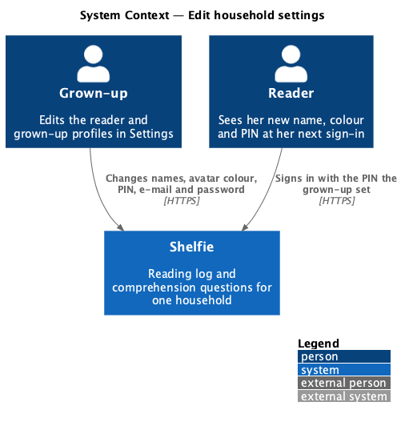
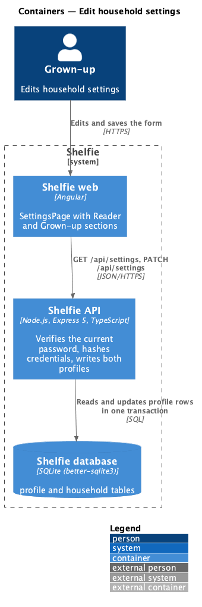
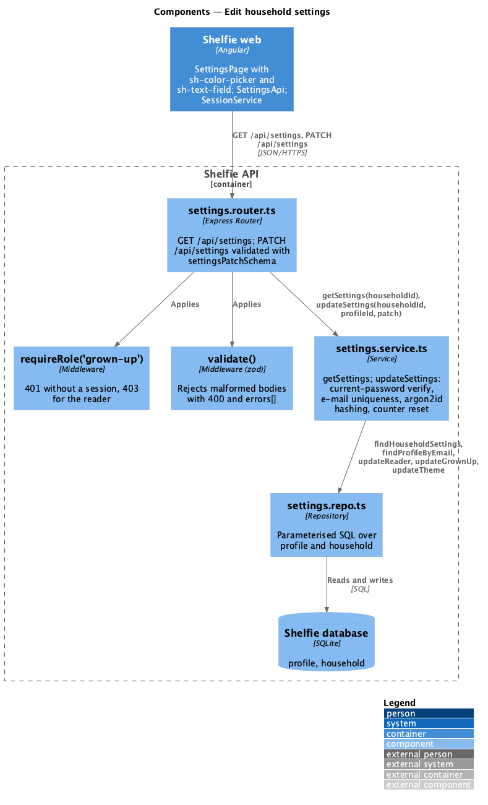
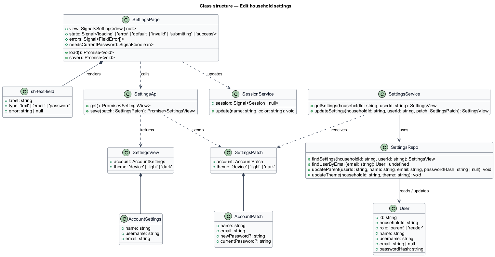
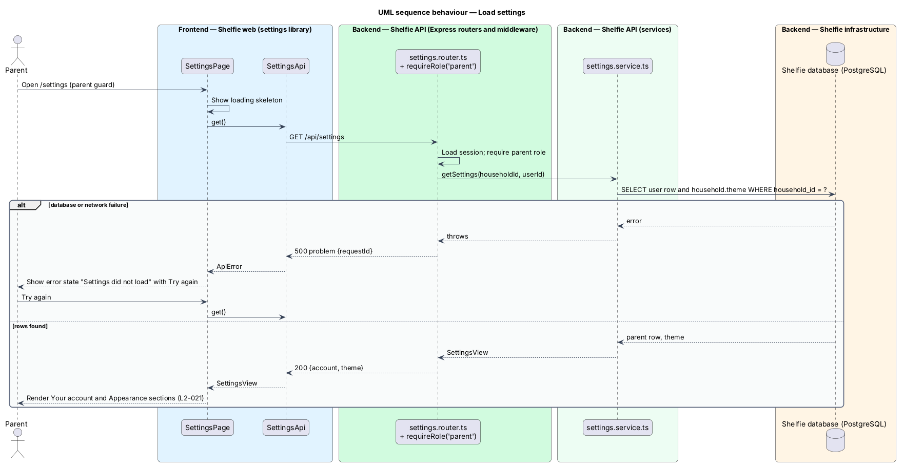
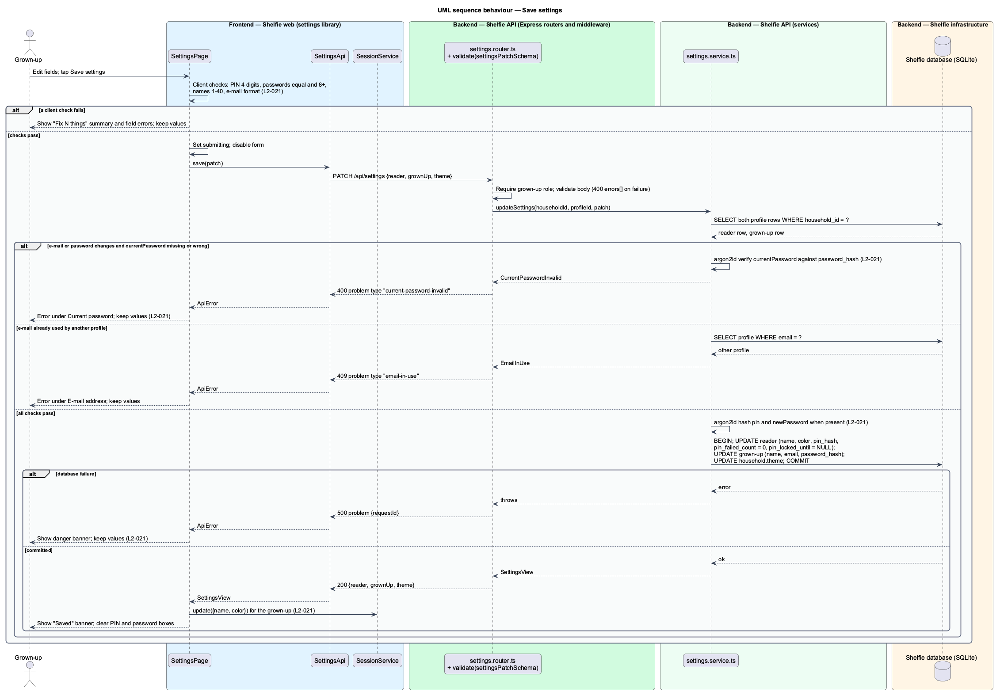

# Edit household settings

## Overview

Shelfie is a web application that helps a child read books by logging each chapter she reads and answering short questions about it, while a parent in the same household reviews her answers and gives rewards. A **household** is the unit of tenancy: a set of parents and readers sharing one bookshelf. Only parents hold accounts. A **parent** signs in with a username and a password and has an e-mail address and a display name. A **reader** is a profile that a parent creates for a child. An **avatar colour** is one of five pastel colours (Rose, Sky, Sun, Mint, Lilac) that tints the initial shown in the top bar.

This feature is the "Your account" section of the Settings page. A parent changes their own display name, e-mail address and password there. The username is shown read-only. The page is reachable only with a parent session; a reader never sees it. Two other sections of the same page belong to other features: Appearance (choose-appearance) shares the load and save calls, and the Parents and Readers lists (invite-parent and manage-readers) save in their own dialogs.

Changes land in one save. The page validates what it can before sending (a new password under 8 characters, two new-password boxes that differ) and lists each problem in a summary that links to the field. A change to the e-mail address or the password is a **credential change**, so the API asks for the **current password** and verifies it before writing anything. A failed save keeps every entered value on screen so the parent can fix one thing and save again.

The feature sits in the `settings` subsystem beside choose-appearance. Signing out from the link at the bottom of the page is owned by the `sign-in` subsystem (manage-session).

## Description

The slice runs from the Settings page to the `users` table.

- **`SettingsPage`** — page component in the `settings` library, routed at `/settings` behind the parent guard. On entry it calls `SettingsApi.get()` and renders `sh-skeleton` cards (`loading`), an `sh-error-state` with Try again (`error`) or the form (`default`). The "Your account" section has Your name, Username (read-only), E-mail address, New password, Type it again and Current password. The page owns the `invalid`, `submitting` and `success` states shown in `docs/mocks/pages/settings/`.
- **Client checks** — run on save, before any request: name 1–40 characters; e-mail in a valid format; new password empty or at least 8 characters, equal in both boxes (`These don't match. Type the same password in both boxes.`). Failures render an `sh-banner` (`danger`) headed `Fix N things` whose items link to the fields, each field carrying `aria-invalid` and its error text. No request is sent while a check fails.
- **Current password** — an `sh-text-field` (`type="password"`, `autocomplete="current-password"`) with the hint "Needed to change e-mail or password." The API requires it when the e-mail differs from the stored value or a new password is present.
- **`sh-text-field`**, **`sh-button`**, **`sh-banner`**, **`sh-skeleton`**, **`sh-error-state`** — components in the `components` library, reused from earlier slices.
- **`SettingsApi`** — service in the `settings` library built on `ApiClient`. `get()` calls `GET /api/settings` and returns `SettingsView`; `save(patch: SettingsPatch)` calls `PATCH /api/settings` and returns the updated `SettingsView` or throws `ApiError`.
- **`SettingsView`** — the parent's `{ name, username, email }` and `theme`. The lists of parents and readers on the same page are owned by invite-parent and manage-readers.
- **`SettingsPatch`** — `{ account: { name, email, newPassword?, currentPassword? }, theme }`. The confirmation box is checked on the client only and is not sent.
- **`notifications`** — for a parent, `getSettings` and `PATCH /api/settings` also carry `{ chapterLogged, feedback, bookReward, streakReward }`, the household's four push-notification choices, all true by default. A reader's settings omit it. The "Notifications" card that edits it, with the device switch, is described in [push notifications](../../shell/push-notifications/README.md) (L2-124).
- **`SessionService`** — service in the `core` library. After a successful save the page calls `update(name, color)` with the parent's values so `sh-top-bar` and the account menu re-render at once (`L2-021` criterion 1).
- **`settings.router.ts`** — Express router under `requireRole('parent')`. `PATCH /api/settings` validates the body with `settingsPatchSchema` through `validate()` (name 1–40, `email` format, `newPassword` minimum 8, `theme` in `device|light|dark`) and calls the service. The route keeps its path; the reader fields leave the body.
- **`settings.service.ts`** — `getSettings(householdId, userId)` and `updateSettings(householdId, userId, patch)`. The update: when `email` differs from the stored value or `newPassword` is present, it requires `currentPassword` and verifies it with argon2id against the parent's `password_hash`, answering 400 problem type `current-password-invalid` on a mismatch; it refuses an e-mail already registered with 409 problem type `email-in-use`; it hashes `newPassword` into `password_hash`; it writes the user row and `household.theme` in one transaction.
- **`settings.repo.ts`** — parameterised SQL over `users` and `household`: `findSettings`, `findUserByEmail`, `updateParent`, `updateTheme`.
- **`users`** table columns used: `id`, `household_id`, `role`, `name`, `username`, `email`, `password_hash`. The `username` column is unique and case-insensitive and is never written by this feature. The code keeps the table name `profile`.

On success the page shows an `sh-banner` (`success`) headed `Saved` and keeps the form on screen with the password boxes cleared. On a 500 or a network failure it shows an `sh-banner` (`danger`) and keeps every value (`L2-021` criterion 4). Avatar initials derive from the display name (first letter of up to two words).

- **Profile photo** — every row of the Parents list draws `sh-avatar` from `ParentView.photo`, and Your account starts with a "Your photo" row (`sh-avatar` lg and "Add a photo" / "Change photo") that opens `ProfilePhotoDialog`. The photo is saved by that dialog, not by Save settings. See `settings/upload-profile-photo` (`L2-042`, `L2-043`).

### Read together

- **Helper reward (reading-log/read-together).** With two or more readers Settings shows a Helper reward section after Streak rewards and opens `HelperRewardDialog`; it loads `GET /api/helper-reward` with the rest (`L2-141`).

## Requirements

The feature realizes the following level-2 (L2) requirement. It refines a level-1 (L1) requirement, cited by identifier.

| L2 ID | Refines (L1) | Requirement |
|-------|--------------|-------------|
| `L2-021` | `L1-009` | A parent changes their own display name, e-mail and password from Settings. Given Settings, when a parent changes their own display name, then it is reflected across the app. Given a change to the parent's e-mail or password, when saved, then the current password must be provided and is verified first. Given a new password shorter than 8 characters or two boxes that differ, when saved, then inline errors are shown and nothing is saved. Given a save failure, then an error is shown and the entered values are kept. |

## Diagrams

### System context

The parent edits their own account in Shelfie.

### Containers

The Settings page in the Angular application loads and saves through the Express API, which reads and writes the parent's row in the PostgreSQL database.

### Components

Inside the API, the settings router guards the role, validates the body and delegates to `settings.service.ts`, which verifies the current password, hashes the new one and writes through `settings.repo.ts` in one transaction.

### Class structure

`SettingsPage` composes the text fields, calls `SettingsApi` and updates `SessionService`; the service maps `SettingsPatch` onto the `User` row.

### Behaviour — load settings

The page requests the current values on entry and shows the skeleton until they arrive; the alternate path shows the error state with Try again.

### Behaviour — save settings

The happy path writes the user row and the theme in one transaction and confirms with `Saved`; the alternate paths show client validation, a wrong current password, an e-mail already registered and a server failure, each keeping the entered values (`L2-021`).

