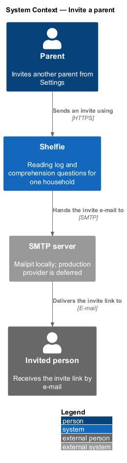
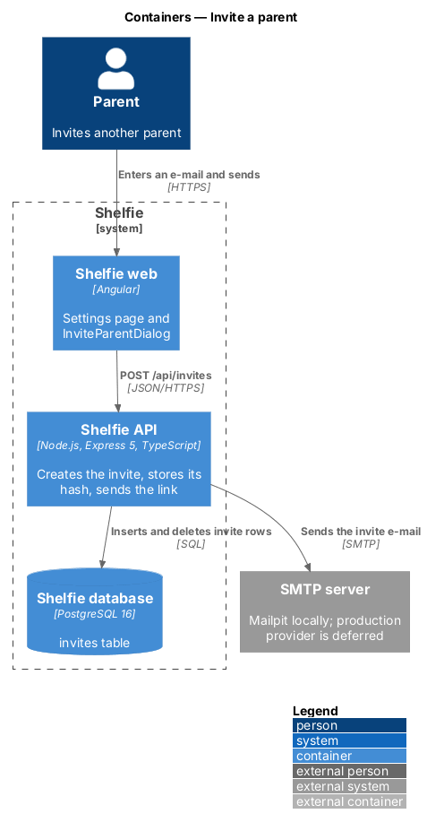
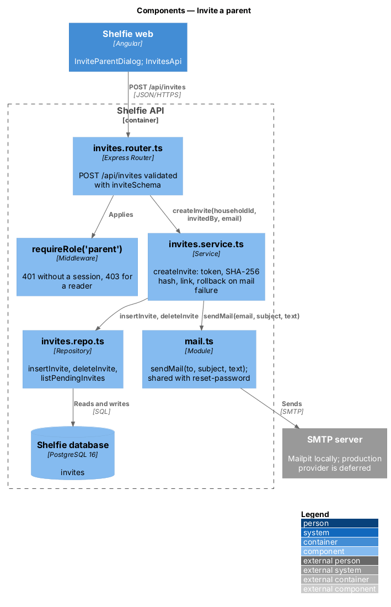
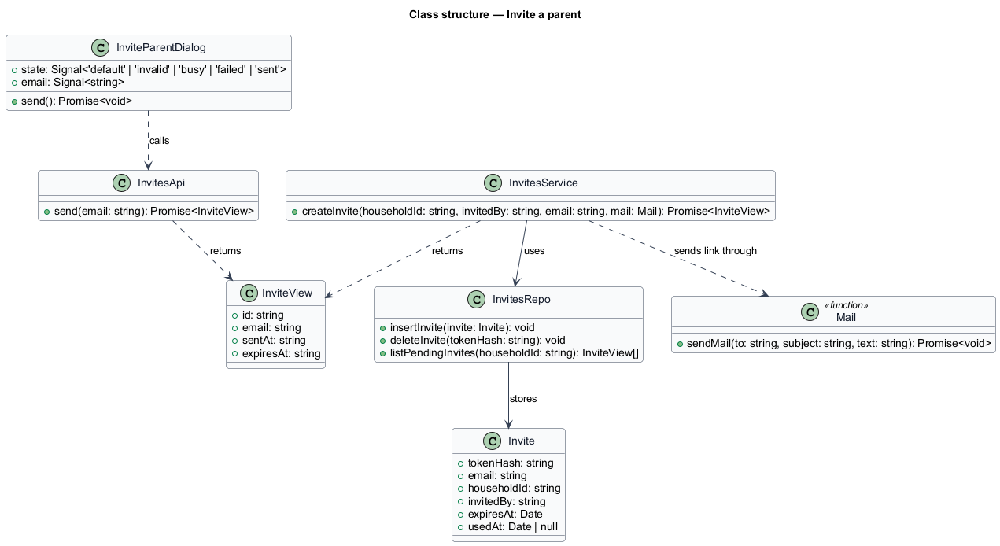
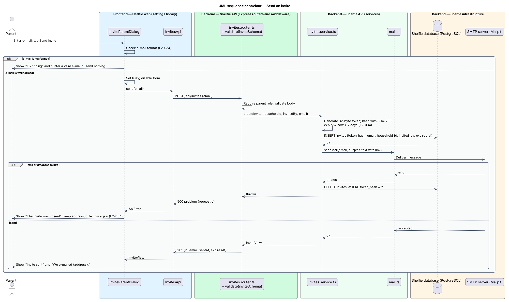

# Invite a parent

## Overview

Shelfie is a web application that helps a child read books by logging each chapter she reads and answering short questions about it, while a parent reviews her answers and gives rewards. A **household** is a set of parents and readers sharing one bookshelf. Only parents hold accounts, and a household can have any number of them.

An **invite** is a single-use, time-limited link that lets another person create a parent account inside an existing household. This feature is the sending half: a parent opens the Invite a parent dialog from the Parents list in Settings, enters the e-mail address of the person to invite and sends. Shelfie e-mails a link to that address and shows a confirmation. The receiving half, where the invited person opens the link and creates the account, is the accept-invite feature in the `sign-in` subsystem.

The link is valid for 7 days and can be used once. Shelfie stores only a **token hash**, the SHA-256 digest of the random link token, so a copy of the database cannot be used to build a working link. The mail is sent through the same mailer that sends password-reset links. It sends the branded HTML mail with a plain-text part (`L2-151`): through Azure Communication Services from `hello@shelfie.kids` in production, to Mailpit locally (sign-in/verify-email, ADR-0019).

## Description

The slice runs from the Settings page to the `invites` table and the mailer.

- **`SettingsPage`** — page component in the `settings` library. Its Parents section lists each parent and each pending invite (badge `Invited`, "Invite sent") and holds the Invite a parent button that opens the dialog.
- **`InviteParentDialog`** — dialog in the `settings` library composed from `sh-dialog`, `sh-text-field`, `sh-button` and `sh-banner`. It holds one field, "Their e-mail address", with the hint "The link works for 7 days." and the buttons Cancel and Send invite. It owns the states in `docs/mocks/dialogs/invite-parent/`: `default`, `invalid`, `busy`, `failed` and `sent`.
- **Client check** — runs on Send invite before any request: the e-mail needs an `@` and a dot. A failure shows the summary `Fix 1 thing` and the field error `Enter a valid e-mail.`, and sends nothing (`L2-034` criterion 2).
- **`InvitesApi`** — service in the `settings` library built on `ApiClient`. `send(email: string)` calls `POST /api/invites` and returns `InviteView` or throws `ApiError`.
- **`InviteView`** — `{ id, email, sentAt, expiresAt }`. The Parents list renders it as a pending invite.
- **`sent` state** — the dialog replaces the form with "Invite sent" and "We e-mailed {address}.", with a Done button. The Parents list then shows the address as Invited.
- **`failed` state** — the dialog keeps the address and shows an `sh-banner` (`danger`) headed "The invite wasn't sent" with a Try again action that resubmits (`L2-034` criterion 4).
- **`invites.router.ts`** — Express router under `requireRole('parent')`. `POST /api/invites` validates the body with `inviteSchema` through `validate()` (`email` format) and calls the service.
- **`invites.service.ts`** — `createInvite(householdId, invitedBy, email, mail)`. It generates a 32-byte random token, computes its SHA-256 hash, inserts the invite row, builds the link `{APP_URL}/accept-invite?token={token}` and calls the shared `sendMail` function. The mail states that the link works once for 7 days. If `sendMail` throws, the service deletes the row and rethrows, so a failed send leaves no pending invite. The plain token appears only in the mail.
- **`invites.repo.ts`** — parameterised SQL over `invites`: `insertInvite`, `deleteInvite`, `listPendingInvites`.
- **`mail.ts`** — the shared `sendMail(to, subject, text, html)`; `createInvite` passes it `renderMail` output with heading "Join {name} on Shelfie", the unchanged sentence and the button "Create my account". It sends through ACS when `ACS_EMAIL_ENDPOINT` is set and over `SMTP_URL` (Mailpit) otherwise (sign-in/verify-email).
- **`invites`** table — `token_hash` (primary key), `email`, `household_id`, `invited_by`, `expires_at`, `used_at`. `expires_at` is the creation time plus 7 days. `used_at` is set by accept-invite and is NULL while the invite is unused. The table is created by `schema.sql` on start-up like every other.

The "Send again" action shown in the Parents list mock re-sends a pending invite. It posts the same address again: the API replaces the household's unused invite to that address with a fresh token and mails the new link, and the page shows a toast. An address that already belongs to a user is refused with 409 problem type `email-in-use`, shown on the field as "That e-mail already has an account.".

## Requirements

The feature realizes the following level-2 (L2) requirement. It refines a level-1 (L1) requirement, cited by identifier.

| L2 ID | Refines (L1) | Requirement |
|-------|--------------|-------------|
| `L2-034` | `L1-009` | A parent invites another parent to the household by e-mail. Given Settings, when a parent enters an e-mail and sends an invite, then an e-mail carrying an invite link is sent to that address and a confirmation is shown. Given a malformed e-mail, when sent, then an inline error is shown and no request is sent. Given an invite link, then it is valid for 7 days and can be used once. Given a failure, when sent, then an error is shown and the address is kept. |

## Diagrams

### System context

A parent invites another person through Shelfie, which sends the link through the mail server.

### Containers

The Settings page calls the Express API, which stores the invite hash in PostgreSQL and hands the mail to the SMTP server (Mailpit locally).

### Components

Inside the API, the invites router validates the body and delegates to `invites.service.ts`, which stores the hash through `invites.repo.ts` and sends the link through `mail.ts`.

### Class structure

`InviteParentDialog` calls `InvitesApi`; `InvitesService` creates an `Invite` row holding only the token hash and sends the plain token through `sendMail`.

### Behaviour — send an invite

The happy path stores the hash, mails the link and confirms; the alternate paths show the client check that sends nothing and a mail failure that removes the invite and keeps the address (`L2-034`).

