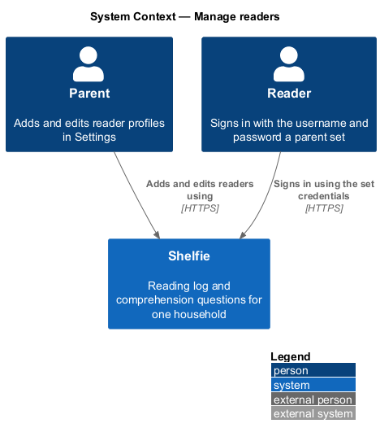
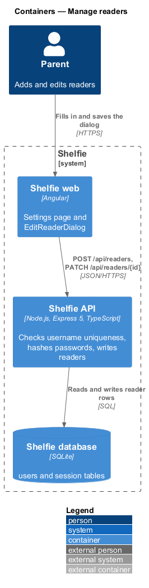
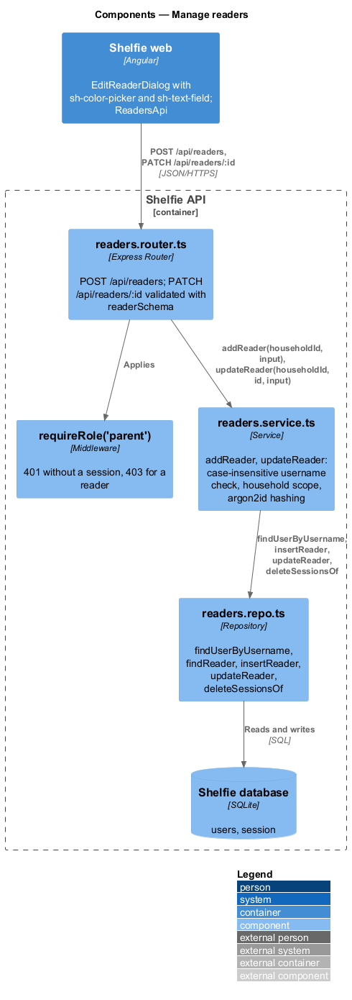
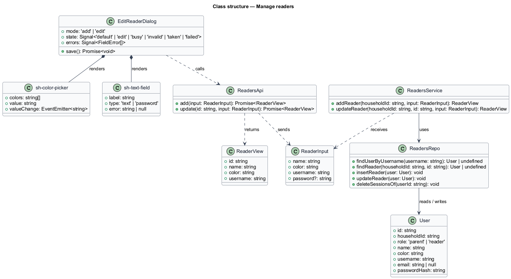
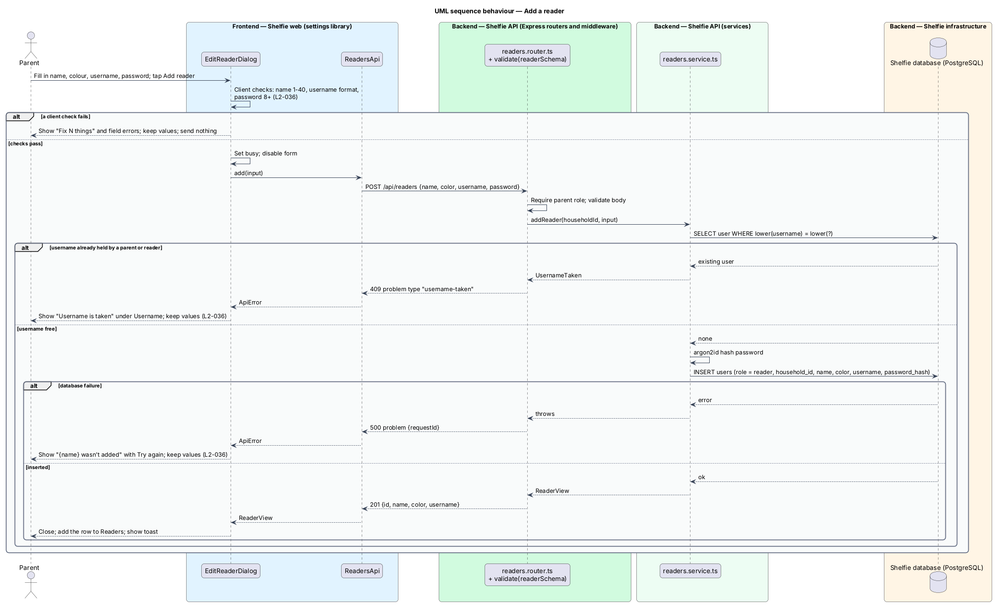
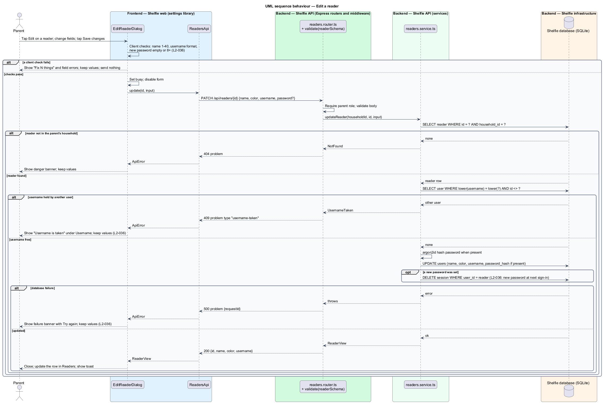

# Manage readers

## Overview

Shelfie is a web application that helps a child read books by logging each chapter she reads and answering short questions about it, while a parent reviews her answers and gives rewards. A **household** is a set of parents and readers sharing one bookshelf. A **reader** is a profile that a parent creates for a child. A reader has a display name, an **avatar colour** (one of Rose, Sky, Sun, Mint and Lilac, which tints her initial in the top bar), a **username** and a password. She has no e-mail address and no way to create or change her own account.

This feature lets a parent add a reader and edit a reader from the Readers list in Settings. Both actions use one dialog, the edit-reader dialog: "Add a reader" from the Add a reader button, and "Edit {name}" from the Edit button on a reader's row. A parent sets the reader's username and password. The reader signs in with them on the ordinary sign-in page, as a parent does, and lands on her shelf. The sign-in itself belongs to the `sign-in` subsystem (sign-in-with-password).

A username is unique across all parents and readers in every household, ignoring case. When a parent sets a new password for a reader, that password applies at her next sign-in. The dialog keeps what the parent typed when a save fails.

## Description

The slice runs from the Settings page to the `users` table.

- **`SettingsPage`** — page component in the `settings` library. Its Readers section lists each reader with her avatar, name and `@username`, an Edit button, and the Add a reader button. Both buttons open `EditReaderDialog`.
- **`EditReaderDialog`** — dialog in the `settings` library composed from `sh-dialog`, `sh-text-field`, `sh-color-picker`, `sh-button` and `sh-banner`. It holds Name, Colour, Username (hint "3–20 letters, numbers, . or _") and Password. In add mode the password is required (hint "At least 8 characters"). In edit mode the field reads "New password (optional)" with the hint "Leave blank to keep it." It owns the states in `docs/mocks/dialogs/edit-reader/`: `default`, `edit`, `busy`, `invalid`, `taken` and `failed`.
- **Client checks** — run on save before any request: name 1–40 characters; username 3–20 characters from letters, numbers, `.` and `_`; password at least 8 characters (add mode) or empty or at least 8 characters (edit mode). A failure renders an `sh-banner` (`danger`) headed `Fix N things` with a link per field, sets `aria-invalid` on each field and sends nothing (`L2-036` criterion 4).
- **`sh-color-picker`** — component in the `components` library: a `radiogroup` of the five swatches with visually hidden labels and arrow-key movement.
- **`ReadersApi`** — service in the `settings` library built on `ApiClient`. `add(input: ReaderInput)` calls `POST /api/readers`; `update(id: string, input: ReaderInput)` calls `PATCH /api/readers/{id}`. Both return `ReaderView` or throw `ApiError`.
- **`ReaderInput`** — `{ name, color, username, password? }`. `password` is required on add and optional on update.
- **`ReaderView`** — `{ id, name, color, username }`. After a save the page replaces the row in the Readers list and shows a toast through `ToastService`. The page also refreshes `SessionService` data that shows reader names so the change is reflected across the app (`L2-036` criterion 2).
- **`taken` state** — a 409 problem of type `username-taken` shows `Fix 1 thing`, "Username is taken" and the field error "That username is taken." Nothing is saved (`L2-036` criterion 4).
- **`failed` state** — a 500 or a network failure shows an `sh-banner` (`danger`) headed "{name} wasn't added", with the text "Nothing changed." and a Try again action that resubmits. The dialog stays open and keeps every value (`L2-036` criterion 5).
- **`readers.router.ts`** — Express router under `requireRole('parent')`. `POST /api/readers` and `PATCH /api/readers/:id` validate the body with `readerSchema` through `validate()` (name 1–40, `color` in `rose|sky|sun|mint|lilac`, `username` matching `/^[A-Za-z0-9._]{3,20}$/`, `password` minimum 8) and call the service.
- **`readers.service.ts`** — `addReader(householdId, input)` and `updateReader(householdId, id, input)`. Each checks the username against all users case-insensitively and answers 409 problem type `username-taken` when another user holds it. `updateReader` answers 404 when the id is not a reader in the session's household, which enforces household isolation. A password is hashed with argon2id into `password_hash`. In `updateReader`, a new password also ends the reader's sessions so she must use it at her next sign-in (`L2-036` criterion 3).
- **`readers.repo.ts`** — parameterised SQL over `users`: `findUserByUsername`, `findReader`, `insertReader`, `updateReader`, `deleteSessionsOf`.
- **`users`** table columns used: `id`, `household_id`, `role` (`reader`), `name`, `color`, `username` (unique, case-insensitive), `email` (NULL for a reader), `password_hash`. The code keeps the table name `profile`; `db.ts` rebuilds it with the `username` column and the `parent` role on start-up.

Deleting a reader and changing a reader's username on the sign-in page are not in `L2-036` and are not designed here.

- **Profile photo** — `ReaderView` carries `photo: string | null`, and each Readers row draws `sh-avatar` from it. A parent cannot set or remove a reader's photo; when the reader has one, `EditReaderDialog` shows the help "Shows when {name} has no photo." under Colour. See `settings/upload-profile-photo` (`L2-043`).

### Per reader

Adding the first reader to a household that had books without a reader gives her those books (ADR-0018). Each reader's records are her own (`settings/per-reader-records`). See `settings/per-reader-records`.

## Requirements

The feature realizes the following level-2 (L2) requirement. It refines a level-1 (L1) requirement, cited by identifier.

| L2 ID | Refines (L1) | Requirement |
|-------|--------------|-------------|
| `L2-036` | `L1-009` | A parent adds and edits reader profiles. A reader has no e-mail; she signs in with the username and password a parent sets. Given Settings, when a parent adds a reader with a name of 1-40 characters, an avatar colour, a valid username and a password of at least 8 characters, then the reader appears in the household and can sign in with those credentials. Given a parent edits a reader's name or avatar colour, when saved, then it is reflected across the app. Given a parent sets a new password for a reader, when saved, then the reader must use it at her next sign-in. Given a taken or invalid username, an empty name or a password under 8 characters, when saved, then inline errors are shown and nothing is saved. Given a save failure, then an error is shown and the entered values are kept. |

## Diagrams

### System context

A parent manages the household's readers in Shelfie, and each reader later signs in with the credentials the parent set.

### Containers

The Settings page and its dialog call the Express API, which reads and writes reader rows in PostgreSQL.

### Components

Inside the API, the readers router guards the role and validates the body; `readers.service.ts` enforces username uniqueness, hashes the password and writes through `readers.repo.ts`.

### Class structure

`EditReaderDialog` composes `sh-color-picker` and the text fields and calls `ReadersApi`; `ReadersService` maps `ReaderInput` onto a `User` row with the role `reader`.

### Behaviour — add a reader

The happy path creates the reader and confirms with a toast; the alternate paths show client validation, a taken username and a server failure, each keeping the entered values (`L2-036`).

### Behaviour — edit a reader

The edit path updates the name, colour and username, sets a new password only when one is typed, and ends the reader's sessions when it does (`L2-036`).

