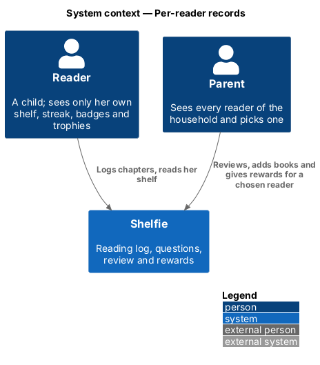
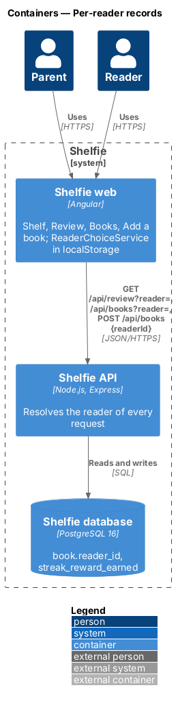
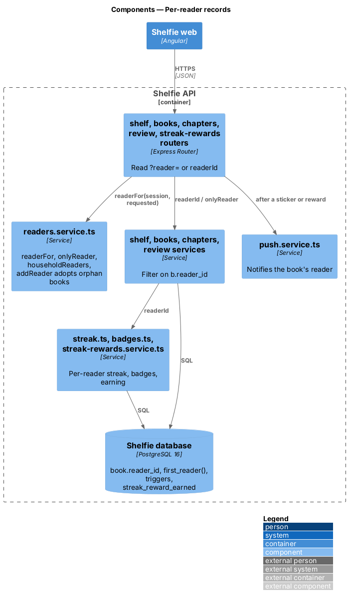
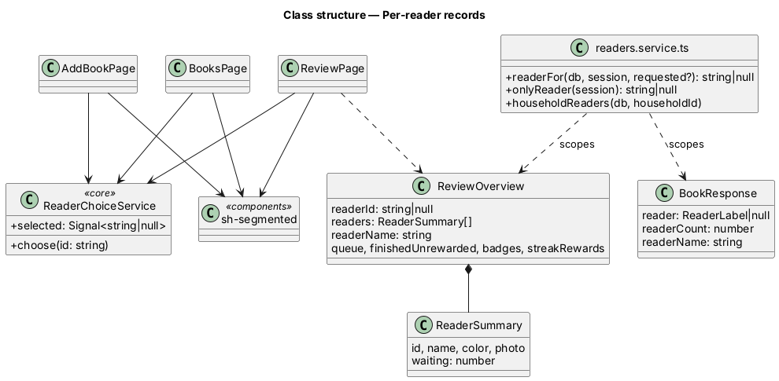
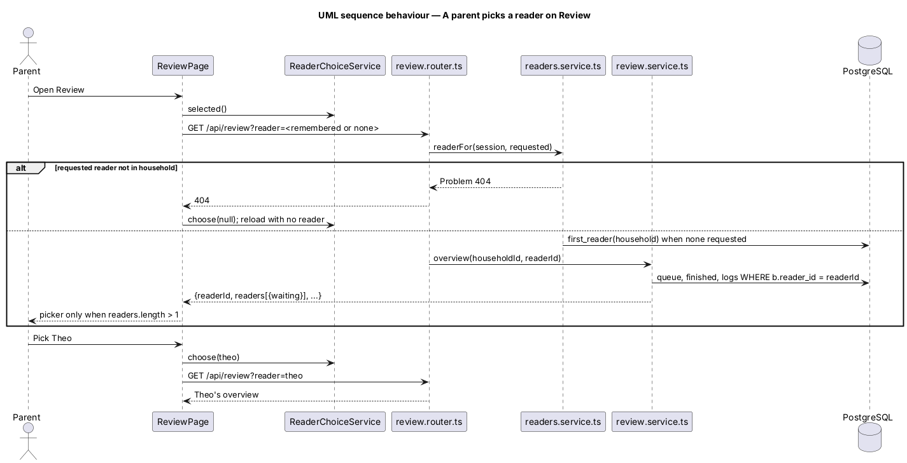
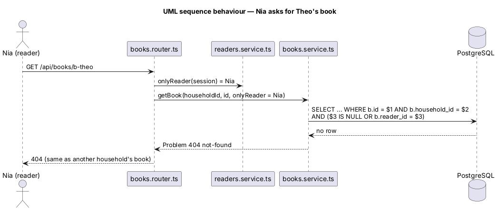

# Per-reader records

## Overview

Shelfie is a web application that helps a child read books by logging each chapter she reads and answering short questions about it, while a parent reviews her answers and gives rewards. A **household** holds any number of parents and **readers** (`settings/manage-readers`, `L2-036`). Until now everything a reader does was stored and counted per household: two readers shared one shelf, one streak and one set of badges, and Review named "the first reader by name".

This feature gives each reader her own records. A **book belongs to one reader**; her chapter logs, answers, feedback, finished books, rewards, trophy shelf and certificates follow the book. Her **streak** and **badges** count her own logs. A **streak reward** is still set once per household but is **earned and given per reader**. A signed-in reader sees only her own; a parent sees every reader and, with two or more readers, picks one on Review, Books and Add a book with a remembered **reader picker**. A household with one reader looks and works exactly as before. The reward gallery's goal stays one per household (`L2-086` to `L2-089`).

## Description

### Data

Migration `011-per-reader-records.sql` (ADR-0018):

- **`book.reader_id`** — `TEXT REFERENCES profile(id) ON DELETE CASCADE`, indexed. Existing books are set to `first_reader(household_id)`.
- **`first_reader(household)`** — SQL function: the household's reader ordered by `name`, then `id`. Profiles have no creation time, and name order is the reader the app already showed (`L2-144`).
- **Trigger `book_default_reader`** — `BEFORE INSERT ON book`: a row without `reader_id` gets `first_reader(household_id)`. Writers that know nothing of readers (`import-sqlite.ts`, `shelfie-admin`, fixtures) keep working; a reader-less household's books stay NULL until `addReader` adopts them.
- **`streak_reward_earned(household_id, milestone, reader_id, earned_at, given_at)`** — primary key `(reader_id, milestone)`, foreign key `(household_id, milestone)` to `streak_reward` (deferred, cascading) and `reader_id` to `profile` (cascading). Earned and given state moves here for the first reader.
- **Trigger `streak_reward_legacy_state`** — `BEFORE INSERT OR UPDATE ON streak_reward`: a non-NULL `earned_at` / `given_at` is upserted into `streak_reward_earned` for the first reader and cleared on `streak_reward`, so the old columns never hold state.

No other table changes: `chapter_log`, `answer`, `question`, `reward`, `book_cover` reach the reader through `book`.

### API

- **`readers.service.ts`** — `readerFor(db, session, requested?)` resolves the reader a request is about: a reader session always gets herself; a parent gets `requested` when it is a reader of the household (otherwise `Problem(404)`), else `first_reader`, else NULL. `onlyReader(session)` is the profile id for a reader session and NULL for a parent; book-level queries add `AND ($n::text IS NULL OR b.reader_id = $n)`. `householdReaders(db, householdId)` lists `{ id, name, color, photo }`. `addReader` adopts the household's books whose `reader_id` is NULL.
- **`shelf.service.ts`** — `getShelf(db, householdId, readerId)` filters books and unseen feedback on `b.reader_id IS NOT DISTINCT FROM $reader` and passes the reader to the streak, badges and streak rewards. `GET /api/shelf?reader=` (parent only).
- **`streak.ts`, `badges.ts`** — `streakFor(db, householdId, readerId, now)` and `badgesFor(db, householdId, readerId)` read one reader's `read_on` days and finish days.
- **`streak-rewards.service.ts`** — `streakRewardsOf(db, householdId, readerId, now)` earns into `streak_reward_earned` for that reader; `setStreakReward` and `clearStreakReward` answer 409 `already-given` once any reader has been given it; `giveStreakReward(db, householdId, milestone, readerId)`. `POST /api/streak-rewards/:milestone/give` takes an optional `readerId`; `GET` takes `?reader=`.
- **`books.service.ts`** — `createBook` takes `readerId` (`POST /api/books` body `readerId`, optional; a reader always gets herself). `listBooks(db, householdId, readerId)` returns `{ readerId, readerName, readers, books }`. `getBook`, `updateBook`, `deleteBook` take `onlyReader`; `BookResponse` gains `reader: { id, name, color, photo } | null` and `readerCount`, and `readerName` is the book's reader.
- **`chapters.service.ts`** — `getForm`, `logChapter`, `undoLog`, `getChapter`, `markFeedbackSeen` take `onlyReader`; `ChapterView` gains `reader` and `readerCount`, and `readerName` is the book's reader.
- **`review.service.ts`** — `overview(db, householdId, readerId, now)` scopes the activity, queue, finished books, This week, badges and streak rewards to the reader, and adds `readerId` and `readers: { id, name, color, photo, waiting }[]`. The "first reader by name" lookup is removed. `GET /api/review?reader=`.
- **`certificate.service.ts`** — unchanged code: it draws `getBook(...).readerName`, now the book's reader.
- **`push.service.ts`** — `feedback`, `bookReward` and `streakReward` notify the owning reader's devices only (`L2-140`).

### Frontend

- **`ReaderChoiceService`** (`core`) — a `signal<string | null>` stored in `localStorage` under `shelfie.reader` (ADR-0019).
- **`ReviewPage`**, **`BooksPage`** — load with `?reader=` of the remembered choice; with `readers.length > 1` show `sh-segmented` "Reader" (Review's labels add the waiting count) and reload on change. The shell's Review badge sums `readers[].waiting`.
- **`AddBookPage`** — for a parent with two or more readers, a "Who is reading it?" `sh-segmented` first and `readerId` in the request; the button names her.
- **`ManageBookPage`**, **`ReviewChapterPage`** — with `readerCount > 1`, `sh-avatar` sm and "{name}’s book" / "{name}’s chapter" in the header.
- **`GiveRewardDialog`** — names the overview's reader (unchanged input, now per reader).

## Requirements

| L2 ID | Refines (L1) | Requirement |
|-------|--------------|-------------|
| `L2-137` | `L1-029`, `L1-002` | A reader sees only her own books; another reader's book is 404. |
| `L2-138` | `L1-029` | A parent sees every reader; the remembered picker shows only with two or more. |
| `L2-139` | `L1-029`, `L1-003` | A parent adds a book for a chosen reader. |
| `L2-140` | `L1-029`, `L1-004` | Chapter logs, feedback and notifications follow the book's reader. |
| `L2-141` | `L1-029`, `L1-012` | Streaks and badges are per reader. |
| `L2-142` | `L1-029`, `L1-007` | Review, rewards and certificates name the reader. |
| `L2-143` | `L1-029`, `L1-025` | Streak rewards are set per household and earned per reader. |
| `L2-144` | `L1-029` | Existing data moves to the first reader; one-reader households are unchanged. |

Cross-references: `L2-036` (manage readers), `L2-020` (streak), `L2-096` to `L2-099` (badges), `L2-100` to `L2-104` (streak rewards), `L2-014` to `L2-018` (review, rewards, trophy shelf), `L2-120` (certificate), `L2-084` (isolation pattern).

## Decisions

- ADR-0018 — a book belongs to one reader; existing books go to the first reader by name; streak rewards earned per reader; the gallery goal stays per household.
- ADR-0019 — the reader picker is `sh-segmented`, shown only with two or more readers, remembered on the device.

Deferred: books shared between readers with per-reader progress; moving a book to another reader; a reward-gallery goal per reader; deleting a reader.

## Diagrams

### System context

Readers and parents use Shelfie; each reader's records are her own.

### Containers

### Components

Every service that read "the household's books" now resolves a reader first through `readers.service.ts`.

### Class structure

### Behaviour — a parent picks a reader on Review

### Behaviour — a reader opens another reader's book

