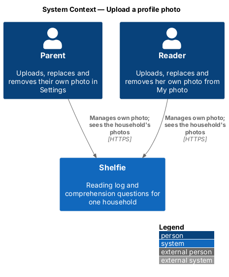
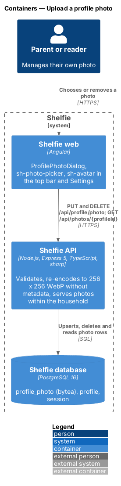
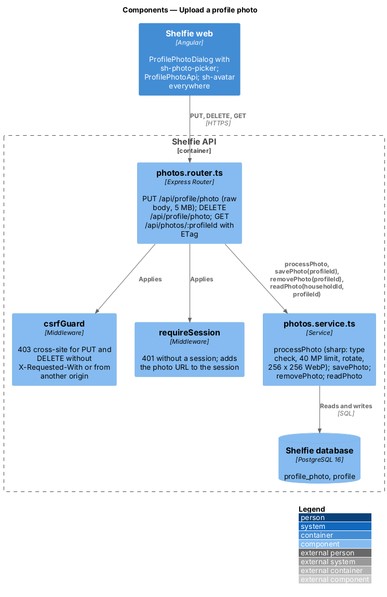
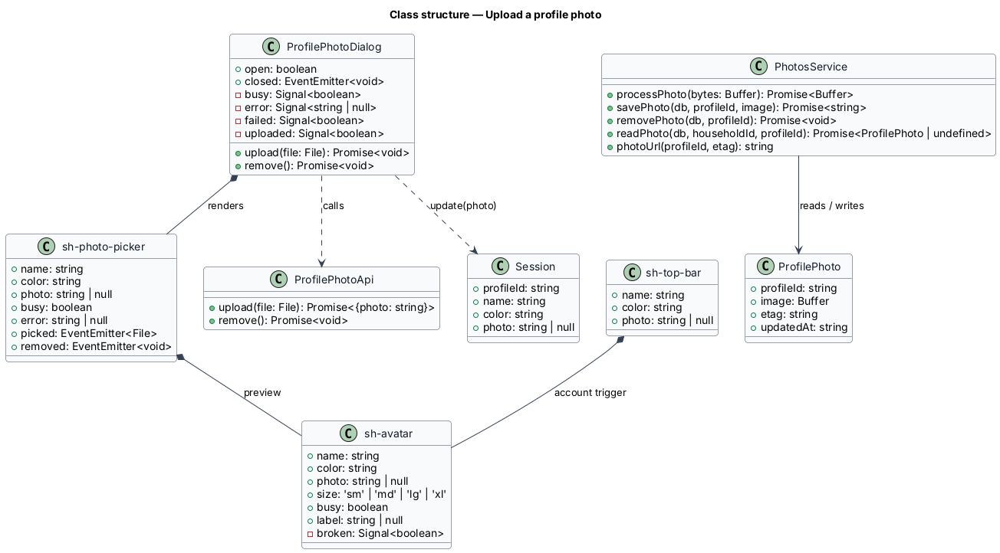
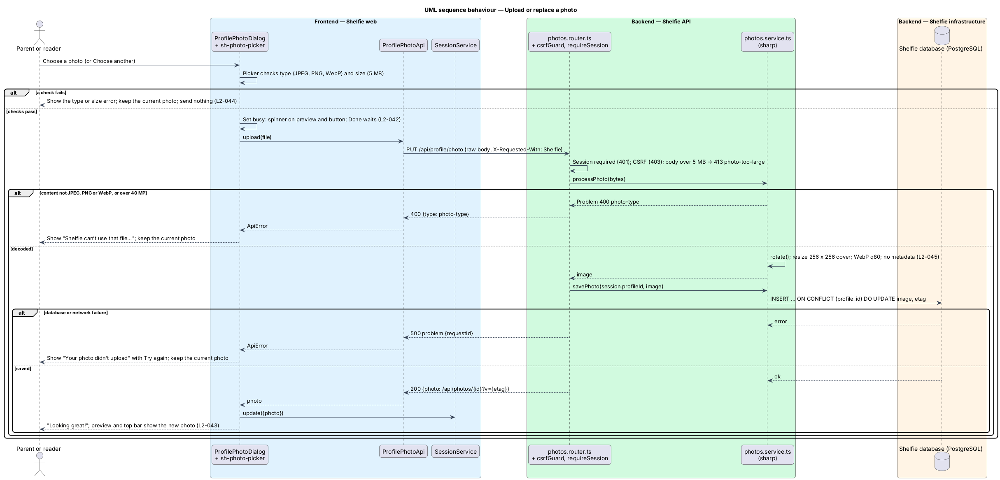
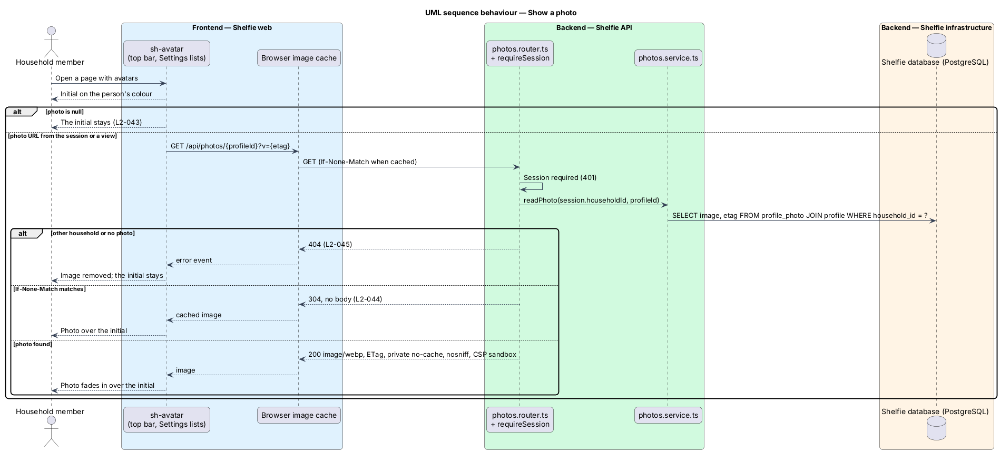
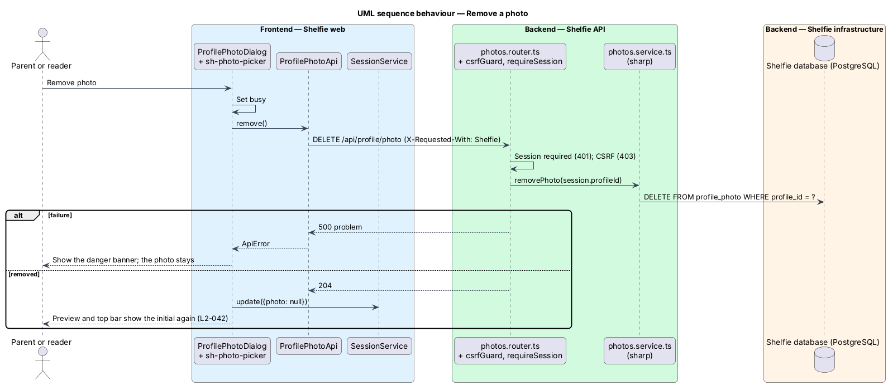

# Upload a profile photo

## Overview

Shelfie is a web application that helps a child read books by logging each chapter she reads and answering short questions about it, while a parent reviews her answers and gives rewards. A **household** is a set of parents and readers sharing one bookshelf. Every person in it, parent or reader, has a **profile** with a display name and an avatar colour; until now the **avatar** has always been the person's initial on that colour.

This feature lets each person upload, replace and remove a **profile photo** of themselves. The photo replaces the initial wherever the avatar appears: the top-bar account trigger, the Parents and Readers lists in Settings and the preview in the "Your photo" dialog. Without a photo, while it loads, or if it fails to load, the initial on the person's colour shows exactly as before. A parent opens "Your photo" from Settings → Your account; a reader opens it from "My photo" in her account menu. Choosing a file uploads it at once; there is no separate save.

A person manages only their own photo. The API identifies the profile from the session and accepts no profile id for an upload or a removal, so a parent cannot change a reader's photo. The API decodes every upload, re-encodes it as a 256 × 256 WebP without metadata and stores only that result in PostgreSQL. Photos are served only to signed-in members of the same household.

The feature belongs to the `settings` subsystem because a photo is profile data next to the display name (`edit-household-settings`) and the reader colour (`manage-readers`), and its dialog lives in the `settings` library. The shell opens the same dialog for the reader, as it already composes `review` for the queue badge.

## Description

The slice runs from the "Your photo" dialog to the `profile_photo` table, and from every avatar to `GET /api/photos/:profileId`.

### Frontend

- **`sh-avatar`** (`Avatar`) — component in the `components` library. Inputs: `name`, `color`, `photo: string | null`, `size: 'sm' | 'md' | 'lg' | 'xl'` (default `md`), `busy` and `label`. It renders the initial (first letter of `name`, upper case) on `avatar--{color}` and, when `photo` is set, an `img.avatar__img` with `alt=""` over it. An image `error` event removes the image so the initial stays (`L2-043` criterion 3); a new `photo` value tries again. Without `label` the host is `aria-hidden="true"`; with `label` it is `role="img"` with that label. Every avatar in the application is an `sh-avatar`.
- **`sh-top-bar`** — gains a `photo` input and draws `sh-avatar` (`sm`) inside the account-menu trigger, whose `triggerClass` becomes `avatar-trigger` (a borderless round button with the avatar hover ring).
- **`sh-photo-picker`** (`PhotoPicker`) — component in the `components` library composed from `sh-avatar` (`xl`, labelled "Your photo" or "No photo yet"). Inputs: `name`, `color`, `photo`, `busy`, `error`. Outputs: `picked: File`, `removed: void`. "Choose a photo" ("Choose another" with a photo) is a `label.btn` around a visually hidden `input type="file" accept="image/jpeg,image/png,image/webp"`; "Remove photo" shows only with a photo. Before emitting `picked` it refuses a file whose type is not JPEG, PNG or WebP ("Shelfie can’t use that file. Pick a JPEG, PNG or WebP photo.") or whose size exceeds 5 MB ("That photo is too big. Pick one under 5 MB.") and shows that error itself (`L2-044` criteria 1 and 2). The status line under the buttons reads "Uploading your photo…" while `busy`.
- **`ProfilePhotoDialog`** — dialog in the `settings` library composed from `sh-dialog`, `sh-photo-picker`, `sh-banner` and `sh-button`. It reads the person from `SessionService.current()`. On `picked` it sets busy and calls `ProfilePhotoApi.upload(file)`; success calls `SessionService.update({ photo })` and shows `sh-banner` `success` "Looking great, {name}!"; a 400 `photo-type` or a 413 `photo-too-large` becomes the picker error; any other failure shows `sh-banner` `danger` "Your photo didn’t upload" with "Try again", which re-sends the same file (`L2-042` criterion 6). On `removed` it calls `ProfilePhotoApi.remove()` and sets `photo` to `null`; a failed removal shows "Your photo wasn’t removed" with "Try again". The picker moves focus to the Choose button before the Remove button disappears. "Done" and the close button emit `closed`. It owns the states in `docs/mocks/dialogs/profile-photo/`.
- **`ProfilePhotoApi`** — service in the `settings` library: `upload(file: File)` sends the file as the raw body of `PUT /api/profile/photo` and returns `{ photo: string }`; `remove()` sends `DELETE /api/profile/photo`.
- **`ApiClient`** (`core`) — gains `put<T>(path, body)`. A `File` body is sent as-is with its own `Content-Type`, with the same `X-Requested-With: Shelfie` header as every other request.
- **`Session`** (`core`) — gains `photo: string | null`, filled by `GET /api/auth/session` and sign-in. `SessionService.update` accepts `photo`, so the top bar changes as soon as the dialog succeeds (`L2-043` criterion 4).
- **Shell (`shelfie` application)** — passes `session.photo` to `sh-top-bar`. The reader's account menu gains "My photo", which opens `ProfilePhotoDialog`.
- **`SettingsPage`** — draws `sh-avatar` in every Parents and Readers row from `ParentView.photo` and `ReaderView.photo`, and adds a "Your photo" row to Your account: `sh-avatar` (`lg`) and an "Add a photo" / "Change photo" button that opens `ProfilePhotoDialog`. The parent's own row and the Your photo row read the photo from `SessionService`, so a change shows as soon as the dialog succeeds.
- **`EditReaderDialog`** — when the reader being edited has a photo, the Colour field (`sh-color-picker`, which gains a `help` input described to the radiogroup) shows the help "Shows when {name} has no photo."; a parent cannot change the photo there.
- **`AcceptInvitePage`** — draws the inviting parent as `sh-avatar` (`lg`) with no photo; the page is signed out (`L2-043` criterion 6).

### API

- **`002-profile-photo.sql`** — migration that adds `profile_photo (profile_id TEXT PRIMARY KEY REFERENCES profile(id) ON DELETE CASCADE, image BYTEA NOT NULL, etag TEXT NOT NULL, updated_at TEXT NOT NULL)`. The cascade from `profile`, which cascades from `household`, erases photos with the household in the same statement (`L2-045` criterion 6, `L2-041`).
- **`photos.service.ts`** —
  - `processPhoto(bytes: Buffer): Promise<Buffer>` decodes with `sharp` limited to 40 megapixels (`limitInputPixels`), refuses any format other than `jpeg`, `png` or `webp` as `Problem(400, 'photo-type')`, applies the EXIF orientation (`rotate()`), centre-crops and resizes to 256 × 256 (`fit: 'cover'`) and encodes WebP at quality 80. `sharp` writes no EXIF, GPS, XMP or ICC data unless asked, so none survives (`L2-044` criteria 1, 3 and 4, `L2-045` criterion 3).
  - `savePhoto(db, profileId, image)` upserts the row with `etag` = the first 16 hex characters of the SHA-256 of `image`.
  - `removePhoto(db, profileId)` deletes the row.
  - `readPhoto(db, householdId, profileId)` joins `profile` so a photo of another household reads as absent (`L2-045` criterion 2).
  - `PHOTO_COLUMN` is the same URL as a SQL column over `profile p LEFT JOIN profile_photo pp`, used by the session, settings and reader queries.
  - `photoUrl(profileId, etag)` returns `/api/photos/{profileId}?v={etag}`; the version changes with every new photo, so a replaced photo is never shown from an old URL (`L2-042` criterion 3).
- **`photos.router.ts`** — mounted under `/api` after `csrfGuard`, every route behind `requireSession` (401 without a session, `L2-045` criterion 1):
  - `PUT /api/profile/photo` reads the body with `express.raw({ type: () => true, limit: '5mb' })`. An oversized body is answered 413 `{ type: 'photo-too-large' }`; an empty body 400 `photo-type`. It processes, saves and answers 200 `{ photo }`.
  - `DELETE /api/profile/photo` removes and answers 204.
  - `GET /api/photos/:profileId` answers 404 when no photo exists in the session's household. Otherwise it sets `ETag: "{etag}"`, `Content-Type: image/webp`, `Cache-Control: private, no-cache` and `Content-Security-Policy: default-src 'none'; sandbox`, keeps `X-Content-Type-Options: nosniff`, and answers 304 without a body when `If-None-Match` matches (`L2-044` criterion 5, `L2-045` criterion 4).
- **Session and views** — `requireSession` left-joins `profile_photo` and puts `photo` (the URL or `null`) on `RequestSession`; `GET /api/auth/session` and the sign-in answers include it. `getSettings` and `listReaders` add `photo` to `ParentView` and `ReaderView`, and the reader add and edit answers carry it.
- **CSRF** — `PUT` and `DELETE` pass through the existing `csrfGuard`, so a request without `X-Requested-With: Shelfie` or from another origin is answered 403 `cross-site` (`L2-045` criterion 5, `L2-027`).
- **Logging** — the request log records route, status and duration only; image bytes never reach a log line (`L2-045` criterion 7).

### Limits

| Limit | Value | Where |
|---|---|---|
| Types accepted | JPEG, PNG, WebP (decoded content) | `sh-photo-picker` (declared type), `processPhoto` (content) |
| Upload size | 5 MB | `sh-photo-picker`, `express.raw` limit |
| Decoded size | 40 megapixels | `sharp` `limitInputPixels` |
| Stored photo | 256 × 256 WebP, quality 80, no metadata (about 10–20 kB) | `processPhoto` |

Cropping, filters, photo galleries and one person setting another's photo are out of scope. Self-service household deletion stays deferred; the operator's erasure statement in `docs/runbook.md` removes photos through the cascade.

## Requirements

The feature realizes the following level-2 (L2) requirements. Each refines a level-1 (L1) requirement, cited by identifier. It applies `L2-005`, `L2-006`, `L2-025`, `L2-026`, `L2-027`, `L2-028`, `L2-029`, `L2-031`, `L2-039` and `L2-041` to photos without restating them, and leaves `L2-021` and `L2-036` (display name and colour) unchanged.

| L2 ID | Refines (L1) | Requirement |
|-------|--------------|-------------|
| `L2-042` | `L1-015` | A parent from Settings and a reader from My photo choose a JPEG, PNG or WebP photo of at most 5 MB; it uploads at once and replaces the initial. Choosing another replaces it everywhere; Remove photo deletes it and the initial returns. Busy while uploading; a failure keeps the old photo and offers Try again. A session changes only its own photo. |
| `L2-043` | `L1-015` | The photo shows in place of the initial in the top bar, Settings lists and the dialog preview; without a photo or when it fails to load the initial shows; changes show without signing in again; the image is decorative; the signed-out accept-invite page shows the initial only. |
| `L2-044` | `L1-015` | Content that is not JPEG, PNG or WebP is refused with 400 `photo-type`; over 5 MB is refused in the browser and with 413 `photo-too-large`; over 40 megapixels is refused; accepted photos are oriented, centre-cropped and stored as 256 × 256 WebP only; served photos carry an `ETag` and answer 304 to a matching `If-None-Match`. |
| `L2-045` | `L1-015` | 401 without a session; 404 across households; no EXIF, GPS, XMP or ICC data; served as `image/webp` with `nosniff`, a sandboxing CSP and `private, no-cache`; CSRF-protected; erased with the household; never logged. |

## Decisions

- **Storage in PostgreSQL** — photos are stored as `bytea` in `profile_photo`, not on the VM's disk. See [ADR-001](adr-001-store-profile-photos-in-postgresql.md).
- **Raw body, not multipart** — `PUT /api/profile/photo` takes the file as the request body. One file per request needs no multipart parser and no new dependency beyond `sharp`.
- **Upload on choose** — the mocks have no Save step for a photo; the dialog uploads as soon as the picker emits.
- **Removal without confirmation** — removing is reversible by choosing a photo again and the initial comes straight back, so the dialog asks nothing (`docs/mocks/manifest.json`, `profile-photo` `not_applicable`).
- **One dialog for both roles** — the reader has no Settings page, so the shell opens the same `ProfilePhotoDialog` from her account menu.

## Diagrams

### System context

Each parent and reader manages their own photo in Shelfie, and everyone in the household sees it in place of the initial.

### Containers

The web app sends the file to the Express API, which re-encodes it with `sharp` and stores the result in PostgreSQL; every avatar then loads the photo from the API.

### Components

Inside the API the photos router applies the session and CSRF guards and the size limit; `photos.service.ts` decodes, re-encodes and stores the photo, and reads it back scoped to the household.

### Class structure

`ProfilePhotoDialog` composes `sh-photo-picker`, which composes `sh-avatar`; `ProfilePhotoApi` calls the photos router, and `Session` carries the photo URL to the top bar.

### Behaviour — upload or replace a photo

The happy path uploads, re-encodes and stores the photo and updates the session; the alternate paths show the client checks, a refused file and a failed upload (`L2-042`, `L2-044`).

### Behaviour — show a photo

Every avatar loads the photo URL from the session or a view; the API checks the household, answers 304 to a matching `ETag`, and an image that fails to load leaves the initial (`L2-043`, `L2-045`).

### Behaviour — remove a photo

Removing deletes the row and clears the session photo, so the initial returns at once (`L2-042`).

## Open questions

- None block the build. A future self-service household deletion (deferred) needs no photo-specific work because of the cascade.
