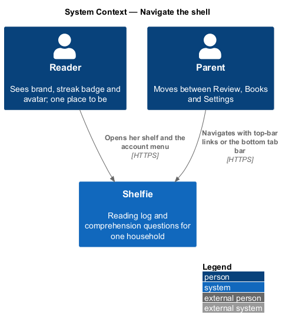
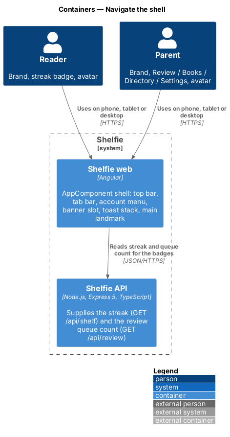
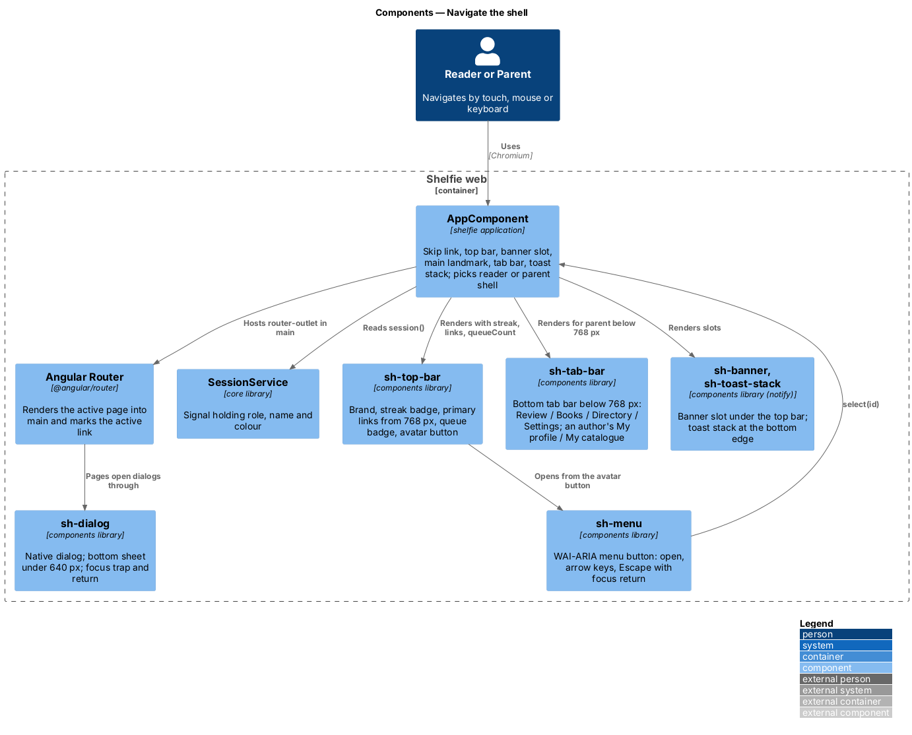
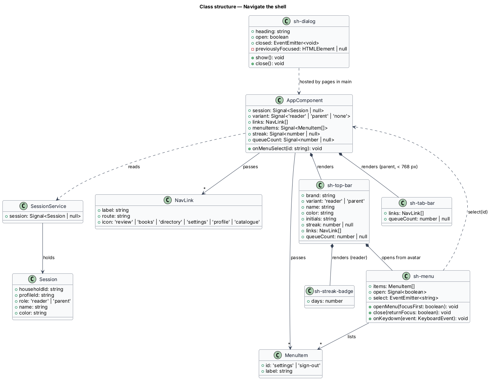
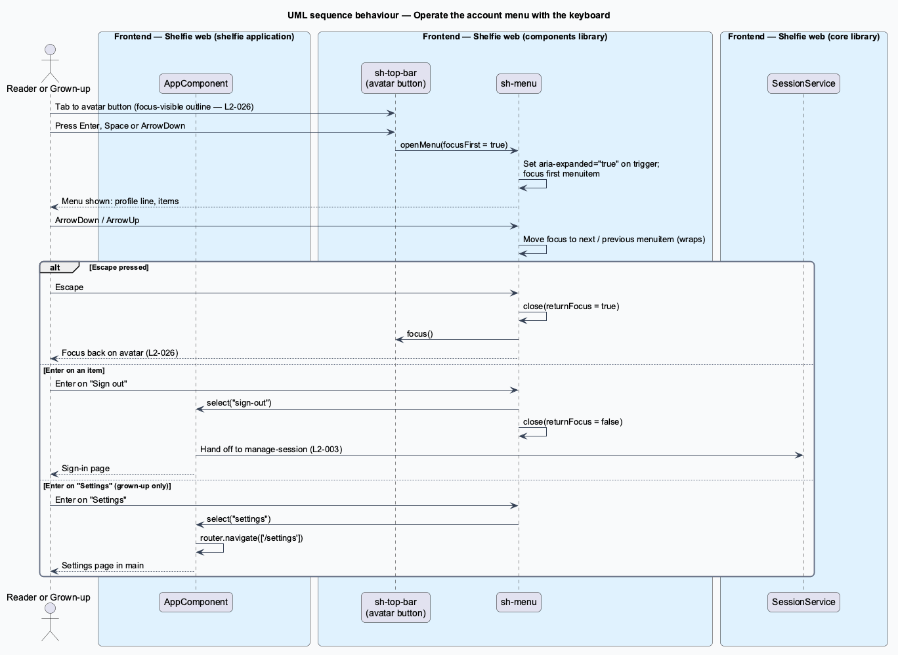
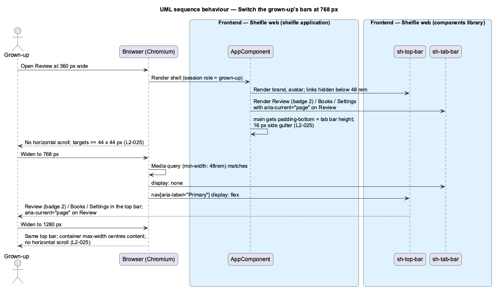

# Navigate the shell

## Overview

Shelfie is a web application that helps one child read books by logging each chapter she reads and answering short questions about it, while a grown-up in the same household reviews her answers and gives rewards. A **household** holds exactly one reader profile and one grown-up profile, and every page of the application is shown inside one frame that both of them share.

That frame is the **shell**: the parts of the screen that stay in place while pages change underneath. The shell has a **top bar** along the top, a **tab bar** along the bottom on phones, an **account menu** that drops down from the avatar, a slot for banners, a stack for toasts and a `<main>` landmark the current page renders into. The shell is what makes the application feel like one place rather than a set of pages.

The two people see different shells. The reader has one place to be, her shelf, so her top bar holds only the brand, her **streak badge** (consecutive days with at least one chapter logged) and her avatar. The grown-up moves between three areas, Review, Books and Settings, so his top bar carries those links from 768 px wide, with a **queue badge** on Review showing how many chapters wait for him. Below 768 px the links move to a bottom tab bar within thumb reach.

The shell also carries the application-wide rules that no single page owns: the layout holds at 360, 768 and 1280 px without horizontal scroll; every control is at least 44 × 44 CSS px; dialogs become **bottom sheets** (panels that slide up from the bottom edge) under 640 px; keyboard focus is always visible and never lost; text contrast meets 4.5:1 in both themes; non-essential animation stops under `prefers-reduced-motion`.

The feature sits in the `shell` subsystem beside notifications (`notify`) and offline behaviour (`work-offline`). The actions behind the account menu's items, Switch reader and Sign out, are owned by the `sign-in` subsystem's `manage-session` feature; this feature only renders the menu and emits the chosen item.

## Description

The slice is frontend-only. It spans the `shelfie` application and the `components` library, with one read of the `core` library's session.

- **`AppComponent`** — root component of the `shelfie` application. It renders, in order: the skip-to-content link (`<a href="#main">Skip to content</a>`, visually hidden until focused), `sh-top-bar`, the banner slot (`sh-banner` instances from `BannerService`, owned by `notify`), `<main id="main">` holding the `<router-outlet>`, `sh-tab-bar` when the session role is `grown-up`, and `sh-toast-stack` (owned by `notify`). It reads `SessionService.session()` for the role, name and colour and chooses the reader or grown-up shell. Without a session (sign-in pages) it renders the brand only.
- **`sh-top-bar`** — component in the `components` library. Inputs: `brand`, `variant: 'reader' | 'grown-up'`, `name`, `color`, `initials`, `streak: number | null`, `links: NavLink[]`, `queueCount: number | null`. It renders the brand as a link to the home route, `sh-streak-badge` when `streak` is set, a `<nav aria-label="Primary">` of links that is displayed from 48 rem (768 px) when `variant` is `grown-up`, a count badge on the Review link when `queueCount` is greater than 0 (aria-label "N chapters to review"), and the avatar button (`aria-haspopup="menu"`, `aria-expanded`, aria-label "Account menu for {name}") that opens `sh-menu`.
- **`sh-tab-bar`** — component in the `components` library. Input: `links: NavLink[]`, `queueCount`. It renders a `<nav aria-label="Primary, phone">` fixed to the bottom edge with one link per item (icon above a caption, `aria-current="page"` on the active route, `padding-bottom: env(safe-area-inset-bottom)`) and is hidden from 48 rem. The page body receives bottom padding equal to the bar height so content is never hidden behind it.
- **`NavLink`** — type `{ label: string; route: string; icon: 'review' | 'books' | 'settings' }`.
- **`sh-menu`** — component in the `components` library implementing the WAI-ARIA menu button pattern. Inputs: `items: MenuItem[]`, `header` content (profile line). Output: `select(id: string)`. The trigger opens the menu on click, Enter, Space or ArrowDown; ArrowDown and ArrowUp move focus between `role="menuitem"` elements and wrap; Home and End jump to first and last; Escape closes and returns focus to the trigger; a click outside closes. The menu element has `role="menu"`; the header line is `role="none"`.
- **`MenuItem`** — type `{ id: 'settings' | 'switch-reader' | 'sign-out'; label: string }`. The reader's menu lists a profile line ("Nia · Reader · 🔥 5-day streak"), Switch reader and Sign out. The grown-up's lists the profile line ("Marcus Bell · marcus@example.com · grown-up"), Settings, Switch reader and Sign out. `AppComponent` routes `settings` to `/settings` and hands `switch-reader` and `sign-out` to the `manage-session` feature (`L2-003`).
- **`sh-dialog`** — component in the `components` library wrapping a native `<dialog>` opened with `showModal()`. Inputs: `heading`, `open`. Output: `closed`. Under 40 rem (640 px) it is styled as a bottom sheet (full width, 24 px top radius, slide-up); from 40 rem it is a centred panel. On open, focus moves to the first focusable element in the panel; the browser's modal focus trap keeps Tab inside; Escape and the close control emit `closed`; on close the component returns focus to the element that was focused before opening (`L2-026`). It is paid for here because the shell owns the bottom-sheet and focus rules, and reused at no cost by `give-reward`, `delete-book` and `edit-question`.
- **Global styles** in the `shelfie` application (`styles.css`), composed from the design tokens in `docs/design-system/`: a 16 px side gutter at XS (`--layout-gutter`), `max-width` containers, `:focus-visible` outline of 2 px accent with 2 px offset on every interactive element, a minimum 44 × 44 px target size (`--target-comfortable`), colour tokens whose text pairs meet 4.5:1 in light and dark, and a `@media (prefers-reduced-motion: reduce)` block that sets animation and transition durations to 0 ms.
- **Field errors** — the `sh-text-field`, `sh-textarea` and `sh-question-field` components (paid for by the features that introduce them) link their error text to the input through `aria-describedby` and set `aria-invalid`; the page-level form summary is a `role="status"` live region. This feature states the rule and verifies it in the axe scan; it adds no component.
- **Acceptance tests** — Playwright, Chromium only, through `e2e/pages/ShellPage` (top bar, tab bar, account menu, dialog) with `@axe-core/playwright` for the axe scan. Tests run at 360, 768 and 1280 px viewports and assert no horizontal overflow (`document.documentElement.scrollWidth <= innerWidth`), the bar switch, the menu keyboard contract, focus return from `sh-dialog`, and zero serious or critical axe violations on each page.

The queue badge value comes from `GET /api/review` through the `review` library's `ReviewApi`, and the streak from `GET /api/shelf` through the `shelf` library's `ShelfApi`; both features own those calls, and the shell receives the numbers as inputs. The shell refreshes them on each page load and from the responses of the mutations that change them (feedback sent, chapter logged). The mocks set the review-queue reminder banner on every grown-up page except Review; it is a `BannerService` call owned by `review-queue`, not by the shell.

## Requirements

The feature realizes the following level-2 (L2) requirements. Each refines a level-1 (L1) requirement, cited by identifier.

| L2 ID | Refines (L1) | Requirement |
|-------|--------------|-------------|
| `L2-025` | `L1-011` | Responsive layout. Each page at 360, 768 and 1280 px widths shall have no horizontal page scroll and no clipped controls; dialogs under 640 px shall appear as bottom sheets; each interactive control shall be at least 44 × 44 CSS px; with the 16 px side gutter at XS, content shall never touch the viewport edge. |
| `L2-026` | `L1-011` | Accessibility. Every action on any page shall be reachable by keyboard in a logical order with a visible focus indicator; when a dialog opens, focus shall move into it and be trapped, and on close return to the trigger; text contrast shall be at least 4.5:1 (3:1 for large text) in both themes; form errors shall be associated with their field and announced to assistive technology; non-essential animation shall be disabled under `prefers-reduced-motion`; an automated axe scan of each page shall report no serious or critical violations. |

The grown-up's top-bar links at MD and above and the bottom tab bar at XS are also acceptance criterion 4 of `L2-014`, which the `review-queue` feature lists; this feature builds the bars that criterion relies on.

## Diagrams

### System context

Both people use Shelfie through the same shell; the reader sees a one-place shell, the grown-up a three-area shell.

### Containers

The shell lives entirely in the Angular application; the API is shown only because the queue badge and streak values originate in its responses.

### Components

Inside Shelfie web, `AppComponent` composes `sh-top-bar`, `sh-tab-bar`, `sh-menu` and the notification slots, reads the session from `SessionService`, and the Angular router renders pages into `<main>`.

### Class structure

`AppComponent` owns the shell components and maps `sh-menu` selections to routes or to `manage-session`; `sh-dialog` carries the bottom-sheet and focus-return behaviour every dialog reuses.

### Behaviour — operate the account menu with the keyboard

The avatar button opens the menu on Enter, Space or ArrowDown; the arrow keys move focus; Escape closes and returns focus to the avatar; Enter on an item emits `select` and `AppComponent` acts on it (`L2-026`).

### Behaviour — switch the grown-up's bars at 768 px

A viewport change across 48 rem swaps the bottom tab bar for top-bar links with no page reload and no horizontal overflow; the active link keeps `aria-current="page"` (`L2-025`).

