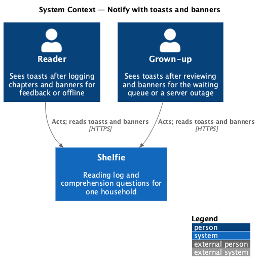
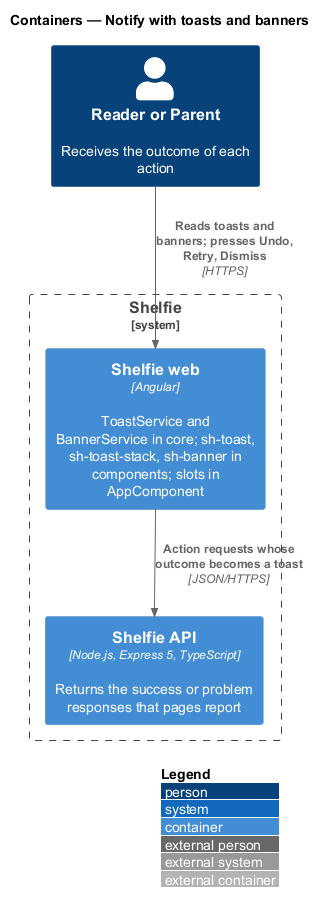
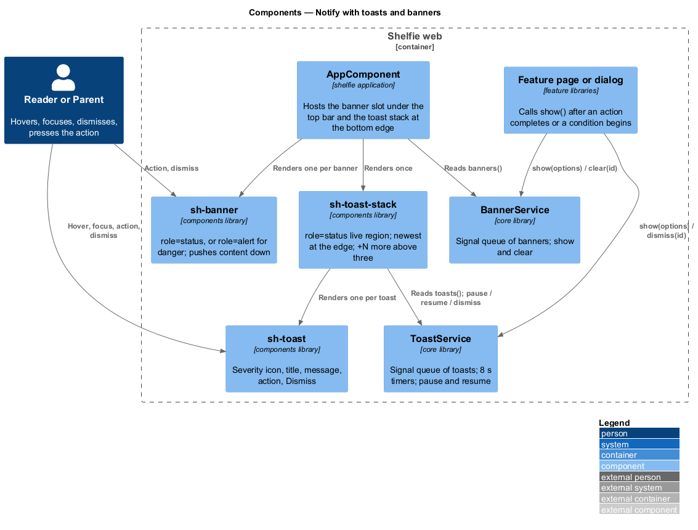
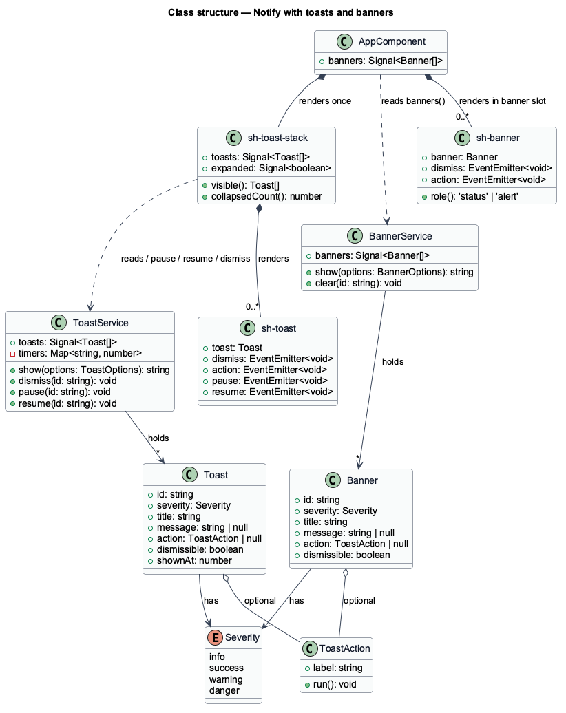
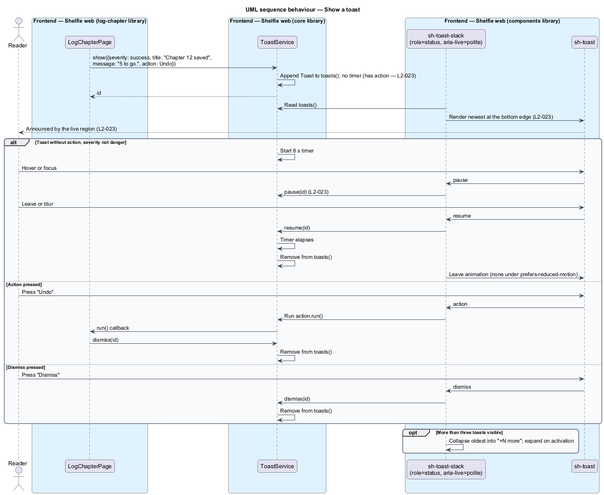
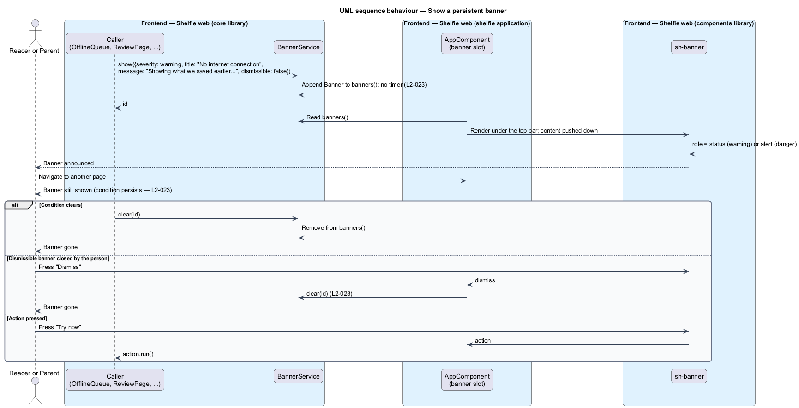

# Notify with toasts and banners

## Overview

Shelfie is a web application that helps one child read books by logging each chapter she reads and answering short questions about it, while a parent in the same household reviews her answers and gives rewards. Most of what either of them does ends in a small outcome that the application has to report: a chapter saved, a book added, feedback sent, a server that stopped answering, a connection that dropped.

This feature gives the application two ways to say so. A **toast** is a short message that appears at the bottom edge of the screen, says one thing about an action that just completed, and leaves on its own. A **banner** is a strip under the top bar that describes a condition rather than an event, such as being offline or having chapters waiting for review, and stays as long as the condition does. Toasts are for "that worked" and "that failed"; banners are for "this is still true".

Both carry a **severity**, one of `info`, `success`, `warning` and `danger`, which sets the colour, the icon and how assistive technology announces the message. A toast may carry one **action**, a button such as Undo or Retry, and a toast with an action waits for the person instead of leaving on a timer. Several toasts stack, newest nearest the edge, and more than three collapse into a "+1 more" line so the stack never covers the page.

The feature sits in the `shell` subsystem beside shell navigation (`navigate-shell`), which renders the toast stack and the banner slot inside `AppComponent`, and offline behaviour (`work-offline`), which is the first caller of the persistent offline banner. Every page and dialog in the application uses these services; none of them renders a toast or banner of its own. A third surface, the push notification that reaches a device while Shelfie is closed, is described in [push notifications](../push-notifications/README.md); it does not use these services.

## Description

The slice is frontend-only. It spans the `core` library (two services) and the `components` library (three components), and is hosted by `AppComponent`.

- **`ToastService`** — service in the `core` library. It holds `toasts: Signal<Toast[]>`, the queue of visible toasts in the order shown. `show(options: ToastOptions): string` appends a toast with a generated `id` and returns it; `dismiss(id: string): void` removes one; `pause(id)` and `resume(id)` stop and restart its timer. The service owns the timers: a toast without an action and with severity other than `danger` is dismissed 8 s after it is shown; a toast with an action, or a `danger` toast, stays until dismissed or until its action's caller dismisses it (for example when a retry succeeds).
- **`Toast`** — type `{ id: string; severity: Severity; title: string; message?: string; action?: ToastAction; dismissible: boolean; shownAt: number }`. **`ToastAction`** is `{ label: string; run: () => void }`. **`Severity`** is `'info' | 'success' | 'warning' | 'danger'`.
- **`BannerService`** — service in the `core` library. It holds `banners: Signal<Banner[]>`. `show(options: BannerOptions): string` adds a banner and returns its `id`; `clear(id: string): void` removes it. A banner has no timer: it stays until the caller clears it (the condition ended) or, when `dismissible` is true, until the person closes it.
- **`Banner`** — type `{ id: string; severity: Severity; title: string; message?: string; action?: ToastAction; dismissible: boolean }`.
- **`sh-toast`** — component in the `components` library. Inputs: `toast: Toast`. Outputs: `dismiss`, `action`. It renders the severity icon, the title, the optional message, the optional action button and a close button (aria-label "Dismiss"). `mouseenter` and `focusin` on the toast emit `pause`; `mouseleave` and `focusout` emit `resume`, so the timer stops while the person hovers or focuses it.
- **`sh-toast-stack`** — component in the `components` library rendered once by `AppComponent`. It reads `ToastService.toasts()` and renders an `sh-toast` per entry inside a region with `role="status"` and `aria-live="polite"`, so each new toast's text is announced without stealing focus. The region is fixed to the bottom edge: full width minus the 16 px gutter at XS, bottom centre; from 40 rem (640 px) a 24 rem column at the bottom right. New toasts enter at the bottom; older ones move up. When more than three are visible, the oldest are collapsed into a single "+N more" line that expands the stack when activated. Under `prefers-reduced-motion` the enter and leave animations are removed.
- **`sh-banner`** — component in the `components` library. Inputs: `banner: Banner`. Outputs: `dismiss`, `action`. It renders the severity icon, the title, the message, the optional action button and, when `dismissible`, a close button. The element has `role="status"` for `info`, `success` and `warning`, and `role="alert"` for `danger`, so a server outage is announced at once and the others politely. `AppComponent` renders one `sh-banner` per entry in `BannerService.banners()` in the banner slot directly under the top bar; banners sit in normal flow and push the page content down rather than overlapping it.
- **Copy from the mocks** that callers pass through these services, for reference: success "Chapter 12 saved — 5 to go. Dad will read your answers soon." with Undo (`log-chapter`); info "Dad added a book" with See it (`add-book`); warning "You're offline — We saved Chapter 12 on this device…" (`work-offline`); danger "Couldn't save your answers — They're still on the page. Check your connection and try again." with Retry (`log-chapter`); banner warning "No internet connection" (`work-offline`); banner danger "Shelfie's server isn't answering" with Try now (`work-offline`); banner info "Dad read Chapter 9 and gave you a Star" with Open Chapter 9 (`view-chapter-answers`); banner persistent "2 chapters are waiting for your feedback" with Review Chapter 11 (`review-queue`). The services carry text; they hold no copy of their own.
- **Acceptance tests** — Playwright, Chromium only, through `e2e/pages/NotificationsPage` (toast region, individual toasts, banner slot). A test fixture page or an existing flow (`log-chapter` success) triggers the toasts; tests assert the live region role, the 8 s dismissal with the Playwright clock, no dismissal while hovered or focused, the newest-at-edge order, the "+N more" collapse, and a banner that remains across a route change until cleared.

The L2 states a 6 s auto-dismiss while the toast mock's design note says 8 s; the design follows the mock and the figure is one constant in `ToastService`. Danger toasts staying until dismissed, and the collapse above three toasts, come from the mock notes and are not in the L2.

## Requirements

The feature realizes the following level-2 (L2) requirement. It refines a level-1 (L1) requirement, cited by identifier.

| L2 ID | Refines (L1) | Requirement |
|-------|--------------|-------------|
| `L2-023` | `L1-010` | Toasts and banners. When a completed action succeeds or fails, a toast with the matching severity shall be shown, announced by a live region, and dismissed after 6 seconds unless it has an action; several toasts shall stack with the newest nearest the edge; a persistent condition such as offline shall show a banner that remains until the condition clears or the user dismisses a dismissible one; hover or keyboard focus on a toast shall pause its timer. |

## Diagrams

### System context

Both people receive toasts and banners; the feature has no external system.

### Containers

Toasts and banners are produced and rendered inside the Angular application; the API appears only as the source of the outcomes that pages report.

### Components

Pages call `ToastService` and `BannerService` in `core`; `AppComponent` renders `sh-toast-stack` and the banner slot, which read the services' signals.

### Class structure

`ToastService` and `BannerService` hold signal queues of `Toast` and `Banner`; `sh-toast-stack` composes `sh-toast`; both components emit `dismiss` and `action` back to the caller.

### Behaviour — show a toast

A page calls `ToastService.show()`; the stack renders the toast in the live region; the timer pauses on hover or focus and dismisses after 8 s, or the action runs and the caller dismisses (`L2-023`).

### Behaviour — show a persistent banner

A caller shows a banner for a condition and clears it when the condition ends; a dismissible banner can also be closed by the person (`L2-023`).

