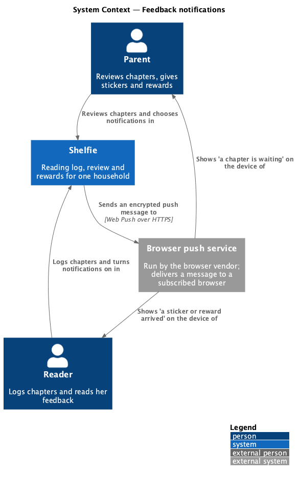
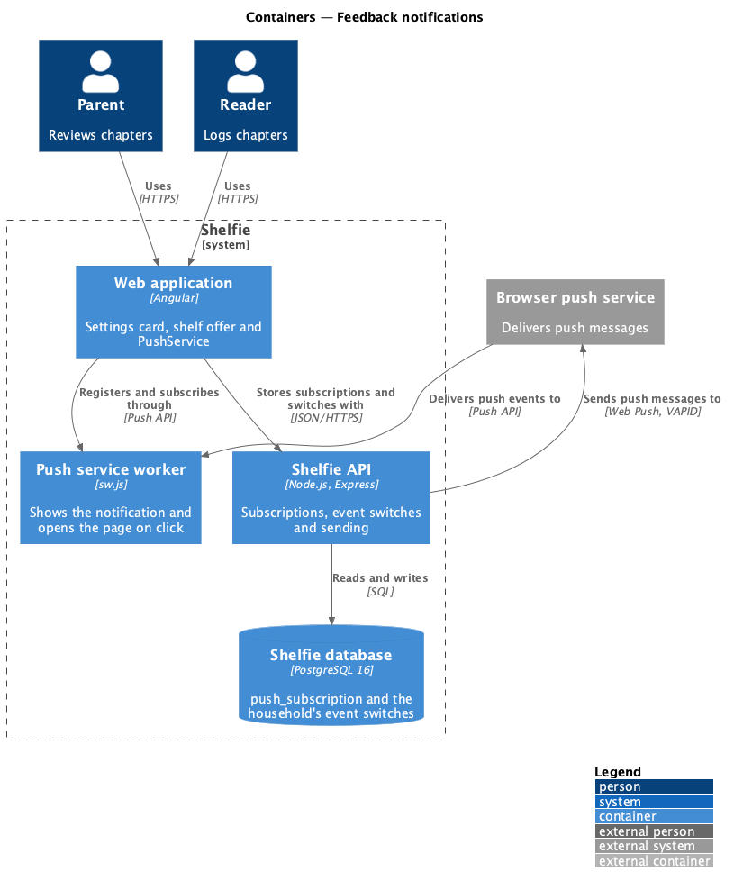
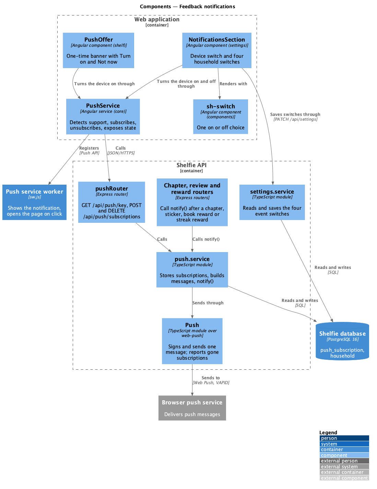
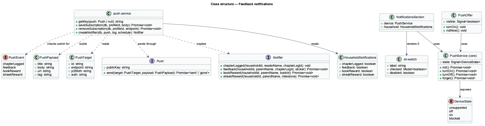
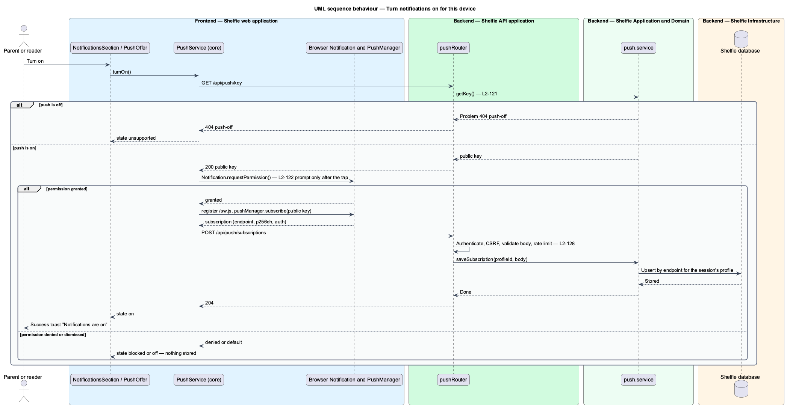
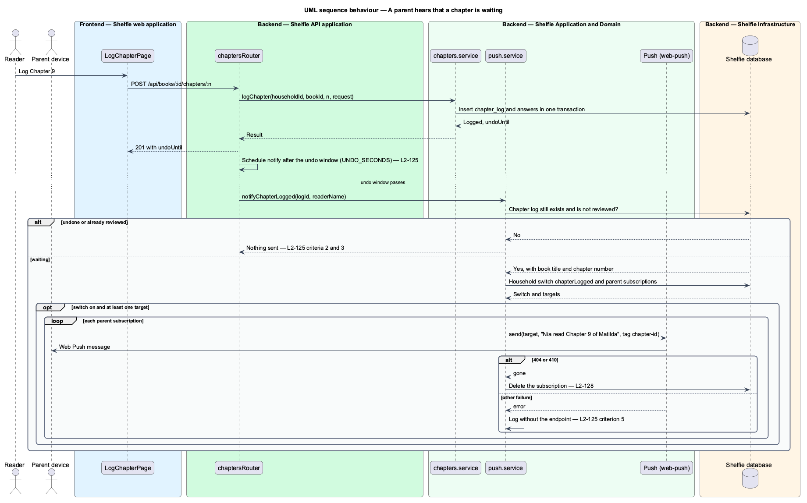
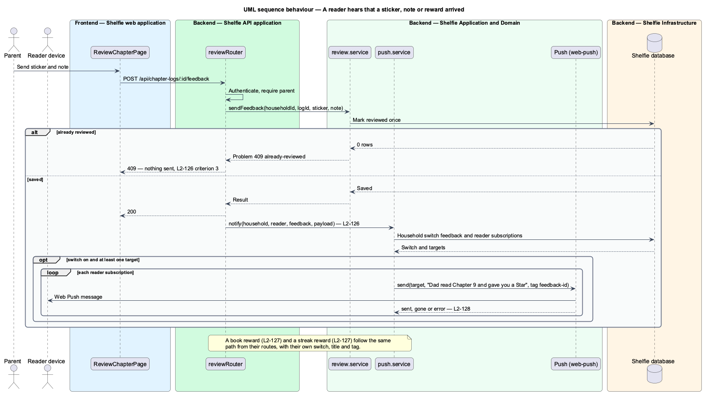

# Push notifications for feedback

## Overview

Shelfie is a web application that helps one child read books by logging each chapter she reads and answering short questions about it, while a parent in the same household reviews her answers, sends a sticker and a note, and gives rewards. The two people are rarely in the app at the same time. A chapter can wait for review for hours, and a sticker can wait just as long for the reader to see it.

This feature lets the browser tell each of them while Shelfie is closed. A **push notification** is a short message that the operating system shows on the device, sent by the API through the browser vendor's **push service**. It is the same news that the in-app banner carries ("Dad read Chapter 9 and gave you a Star"), delivered earlier.

Four events send a notification. A chapter logged tells every parent in the household. A sticker or note sent, a book reward given and a streak reward given each tell every reader in the household. Each person turns notifications on for the device in front of them: a parent with the "Notify this device" switch in Settings, a reader with a one-time offer at the top of her shelf. A **subscription** is the browser's address for push messages, with the keys that encrypt them. A parent also chooses, for the whole household, which of the four events send one. All four start on.

Sending is optional. Where the server has no VAPID keys, the API reports that push is off, nothing is sent, and no switch or offer appears. Toasts and banners work exactly as before with notifications off.

The feature sits in the `shell` subsystem beside `notify`, which owns the in-app toasts and banners, and `work-offline`, which plans the application's caching service worker. It adds a second, smaller service worker whose only job is to show a notification and open a page when it is tapped. It touches the chapter, review, reward and settings code in the API only at the point each of them succeeds.

## Description

The slice spans the Node API (`apps/api`), the `core`, `components`, `settings` and `shelf` libraries, and one static file in the `shelfie` application. It has no external dependency beyond the `web-push` package.

### Data

Migration `010-push.sql`, with a header comment pointing here and to ADR-0016.

- **`push_subscription`** — `id TEXT PRIMARY KEY`, `profile_id TEXT NOT NULL` referencing `profile(id) ON DELETE CASCADE`, `endpoint TEXT NOT NULL UNIQUE`, `p256dh TEXT NOT NULL`, `auth TEXT NOT NULL`, `created_at TEXT NOT NULL` (ISO). An index on `profile_id`. A subscription belongs to one profile and reaches its household through `profile.household_id`, so no household column is stored and removing a household removes its subscriptions through the existing cascade (L2-128).
- **`household`** gains `notify_chapter_logged`, `notify_feedback`, `notify_book_reward` and `notify_streak_reward`, each `BOOLEAN NOT NULL DEFAULT TRUE` (L2-124).

### API

All routes sit behind `requireSession` and the CSRF guard (`csrf.ts`). Parent-only means `requireRole('parent')`.

- **`push.ts`** — the `Push` interface `{ publicKey: string; send(target: PushTarget, payload: PushPayload): Promise<'sent' | 'gone'> }` and `createPush(env): Push | null`. `createPush` returns `null` when `VAPID_PUBLIC_KEY` or `VAPID_PRIVATE_KEY` is unset; otherwise it sets the VAPID details (`VAPID_SUBJECT`, default `APP_URL`) on `web-push` and returns an implementation whose `send` signs and posts one message and answers `gone` for a 404 or 410 from the push service. Any other failure throws. `createApp(db, options)` accepts `push` through `options`, as it does `mail`, so tests and the end-to-end stack pass a recording fake (L2-121).
- **`push.router.ts`** and **`push.service.ts`**:
  - `GET /api/push/key` answers 200 `{ publicKey }`, or 404 `push-off` when `push` is `null` (L2-121).
  - `POST /api/push/subscriptions` takes `{ endpoint, keys: { p256dh, auth } }`, validated with zod: an `https` URL of at most 2,048 characters and two base64url strings of at most 256 characters. It upserts by endpoint against the session's profile, so a second sign-in on the same browser takes the subscription over, and answers 204 (L2-128).
  - `DELETE /api/push/subscriptions` takes `{ endpoint }` and deletes the row only when it belongs to the session's profile; it answers 204 whether or not a row was deleted, so it reveals nothing about another profile's subscription (L2-128).
  - Both subscription routes sit behind `pushLimiter`, 20 requests per profile in ten minutes, defined in `rate-limit.ts` beside `feedbackLimiter` and answering 429 `too-many-attempts` with `Retry-After`.
  - A malformed body answers 400 `validation` through `Problem` (`problem.ts`). The log records method, route, status and duration only.
- **`notify`** and **`createNotifier`** in `push.service.ts`. The private `notify(db, push, log, householdId, role, choice, payload)` returns at once when `push` is `null`, reads the household's switch for `choice` and returns when it is off, selects the subscriptions of the household's profiles with `role`, and calls `push.send` for each. A `gone` result deletes that subscription. A thrown error is logged as `push-failed` with the profile id and not the endpoint. `notify` never throws, so a route that calls it cannot fail because of it. `createNotifier(db, push, log, schedule)` returns the `Notifier` the routers call: `chapterLogged`, `feedback`, `bookReward` and `streakReward`. `createApp` builds one `Notifier` and passes it to the chapter, review and streak routers.
- **`Schedule`** in `push.ts`, `(work, delayMs) => void`, with `inProcess` as the default (`setTimeout`, unreferenced). `createApp` accepts `schedule` in `options` so tests capture the undo-window work and run it at once.
- **Messages** are built in `push.service.ts`: `{ title, body, url, tag }`, with copy from `docs/mocks/notifications/push/`.

  | Event | Title | Body | `url` | `tag` |
  |---|---|---|---|---|
  | `chapterLogged` | "Nia read Chapter 9 of Matilda" | "Ready for your feedback." | `/review/chapters/<logId>` | `chapter-<logId>` |
  | `feedback` | "Dad read Chapter 9 and gave you a Star 🌟" | "Come and see what they said." | `/chapter-logs/<logId>` | `feedback-<logId>` |
  | `bookReward` | "🏆 Dad gave you a reward for Matilda" | "Come and see what it is." | `/shelf` | `reward-<bookId>` |
  | `streakReward` | "🔥 7 days in a row! Dad gave you a reward" | "Come and see what it is." | `/shelf` | `streak-<milestone>` |

  The sticker's name and emoji come from a `STICKER_LABELS` map that mirrors `sticker-picker`'s list (`star` 🌟, `wise-owl` 🦉, `rocket` 🚀, `dragon` 🐉, `cookie` 🍪, `bright-idea` 💡). The sender's name is the parent's `profile.name`; the reader's name is the logging profile's. A message never contains an answer, a note, a reward's text or its amount (L2-125 to L2-127).
- **Triggers**, one call each, after the route's own work has succeeded:
  - `chapters.router.ts` after `logChapter`: a timer for `UNDO_SECONDS` plus 1 s, then `notifyChapterLogged`, which loads the log and sends only when it still exists and `reviewed_at IS NULL` (L2-125). The router passes `session.profileId` so the title can name the reader. The API keeps no queue; a pending timer is lost on restart (ADR-0016).
  - `review.router.ts` after `sendFeedback` succeeds: event `feedback` to role `reader`. A 409 `already-reviewed` never reaches `notify` (L2-126).
  - The reward route after `giveReward`: event `bookReward` to `reader`. The streak route after `giveStreakReward`: event `streakReward` to `reader` (L2-127).
- **Settings.** `settings.service.ts` adds `notifications: { chapterLogged, feedback, bookReward, streakReward }` to `getSettings` and accepts it in `PATCH /api/settings` as an optional strict zod object of four booleans; a save that leaves it out changes nothing. The whole settings router is parent-only, so a reader's `GET` and `PATCH` both answer 403 `grown-ups-only` (L2-124).
- **Environment.** `VAPID_PUBLIC_KEY`, `VAPID_PRIVATE_KEY` and `VAPID_SUBJECT`, all optional, documented in `docs/runbook.md` with `npx web-push generate-vapid-keys`. `infra/host/Caddyfile` adds `Cache-Control: no-cache` for `/sw.js`, because the `*.js` immutable rule would otherwise pin the worker.

### Frontend

- **`sh-switch`** — new component in the `components` library, in `switch/` as `switch.ts`, `switch.html` and `switch.css`. Inputs: `label` (required), `name`, `disabled`; model: `checked`. It renders `label.switch` around a native checkbox and a `switch__text` span, as in `docs/design-system/components/switch.html`. It has no helper line (L2-122).
- **`PushService`** — service in `core/src/lib/push/`, with a `PushApi` beside it that wraps the three routes through `ApiClient`.
  - `state: Signal<DeviceState>`, with `DeviceState = 'unsupported' | 'off' | 'on' | 'blocked'`.
  - `init()` calls `GET /api/push/key`; a 404 or a browser without `serviceWorker`, `PushManager` or `Notification` sets `unsupported`. Otherwise it sets `blocked` when `Notification.permission` is `denied`, `on` when the browser holds a subscription whose endpoint it can find, and `off` in every other case (L2-122 criterion 7).
  - `turnOn()` calls `Notification.requestPermission()` first, only from a tap; on `granted` it registers `/sw.js`, calls `pushManager.subscribe({ userVisibleOnly: true, applicationServerKey })` and posts the subscription. If the post fails, it unsubscribes the browser again so the two never disagree, sets `off` and rethrows for the caller to toast. `denied` sets `blocked`; a dismissed prompt sets `off`.
  - `turnOff()` unsubscribes the browser, then calls `DELETE`.
  - `forget()` does the same for sign-out and never throws. `SessionService.signOut()` awaits it before `POST /auth/sign-out` (L2-128 criterion 5).
- **`NotificationsSection`** — component in `settings/src/lib/notifications-section/`, as `notifications-section.ts`, `.html` and `.css`, placed in `SettingsPage` between Streak rewards and Your account. It shows: for `unsupported`, an `sh-banner` `info` "Notifications aren't set up" and nothing else; otherwise the device `sh-switch` "Notify this device" (disabled when `blocked`, with an `sh-banner` `warning` above it) and a group "Pings for the whole house" of four `sh-switch` ("Tell me when Nia logs a chapter", "Tell Nia when I send a sticker or note", "Tell Nia when I give a book reward", "Tell Nia when I give a streak reward"). The device switch acts at once and shows a `success` toast "Notifications are on" through `ToastService`; a failed turn-on shows a `warning` toast "Couldn't turn notifications on. Try again." The four household switches are fields of the settings form and save with Save settings (L2-122, L2-124).
- **`PushOffer`** — component in `shelf/src/lib/push-offer/`, rendered by `ShelfPage` as its first element. It is an `sh-banner` `info` "Want a ping when Dad sends a sticker?" with projected `button.btn.btn--sm` "Turn on" and `button.btn.btn--sm.btn--ghost` "Not now", as the page's feedback banner has, because `sh-button` has no small size. It is visible only for a reader when `PushService.state()` is `off` and the key `shelfie.push-offer.dismissed` is absent from `localStorage` (read and written in `try/catch`). "Turn on" calls `turnOn()`; "Not now" sets the key. Either hides the offer. It is not a `BannerService` banner, because the slot renders messages and this one holds two buttons (L2-123).
- **`sw.js`** — static file at `apps/web/projects/shelfie/public/sw.js`, registered with scope `/` only by `PushService.turnOn()`. The `push` handler parses `event.data.json()` and calls `self.registration.showNotification(title, { body, icon: '/logo.png', tag, data: { url } })`; a payload that does not parse shows nothing. The `notificationclick` handler closes the notification, focuses an open Shelfie window and navigates it to `data.url`, or opens `data.url` when none is open.
- **Acceptance tests.** API tests in `apps/api/src/push.test.ts` (key, subscriptions, validation, isolation, pruning, limits), `push-notify.test.ts` (each trigger, switches off, undone log, failure does not fail the route) and `settings-notifications.test.ts` (the four switches), all with a recording fake `Push` and each starting with `// Traces to:`. Playwright tests in `e2e/tests/push-notifications.spec.ts`, Chromium only, through `e2e/pages/settings.page.ts` and `e2e/pages/shelf.page.ts`; the fake `Push` is passed to `createApp` in `e2e/support/test.ts` as the mailbox is, and the browser's permission is granted through the Playwright context.

### Error mapping

| Situation | API | Page |
|---|---|---|
| No VAPID keys | 404 `push-off` on `GET /api/push/key` | Settings card shows "Notifications aren't set up"; no shelf offer |
| Browser lacks the Push API | no request | As above |
| Permission denied | no request | Device switch disabled; `warning` banner explaining where to allow |
| Permission prompt dismissed | no request | Switch stays off; offer stays |
| Subscription body invalid | 400 `validation` | `warning` toast "Couldn't turn notifications on. Try again."; browser unsubscribed; state `off` |
| More than 20 subscription requests in ten minutes | 429 `too-many-attempts`, `Retry-After` | Same toast |
| Network failure on `POST` | none | Same toast |
| No session | 401 | Existing sign-in redirect |
| No CSRF header | 403 | Same toast |
| `PATCH /api/settings` with a bad `notifications` value | 400 `validation` | Existing "Fix N things" banner |
| Reader calls `GET` or `PATCH /api/settings` | 403 `grown-ups-only` | Not reachable from the UI |
| Push service answers 404 or 410 | Subscription deleted | None |
| Push service fails otherwise | Logged without the endpoint | None |

## Requirements

The feature realizes the following level-2 (L2) requirements. Each refines level-1 requirement `L1-027`.

| L2 ID | Refines (L1) | Requirement |
|-------|--------------|-------------|
| `L2-121` | `L1-027` | Notifications are optional. Without the VAPID keys the API shall report `push-off`, nothing shall send, and neither Settings nor the shelf shall offer them. |
| `L2-122` | `L1-027` | A parent shall turn notifications on and off for this device in Settings; the browser prompt shall follow the tap, and a blocked browser shall disable the switch and explain. |
| `L2-123` | `L1-027` | A reader shall turn notifications on from a one-time offer on her shelf; "Not now" shall hide it on that device. |
| `L2-124` | `L1-027` | A parent shall choose, for the household, which of the four events send a notification; all shall start on, and only parents shall change them. |
| `L2-125` | `L1-027` | Every subscribed parent device shall be told that a chapter is waiting, after the undo window and only if the log still exists and is not reviewed. |
| `L2-126` | `L1-027` | Every subscribed reader device shall be told when a sticker or note is sent; the message shall not contain the note. |
| `L2-127` | `L1-027` | Every subscribed reader device shall be told when a book reward or a streak reward is given; the message shall not contain the reward's text or amount. |
| `L2-128` | `L1-027` | Subscriptions shall be validated, scoped to the session's profile and household, removed on sign-out, on 404 or 410 and with the household, rate-limited, and never logged. |

## Decisions

- [ADR-0016](../../../adr/0016-push-with-a-push-only-service-worker.md): a hand-written push-only `sw.js`, the `web-push` package, best-effort in-process sending, and a timer for the undo window.

## Diagrams

### System context

The parent and the reader use Shelfie; the browser push service is the one external system, and it carries every notification from Shelfie to a device.

### Containers

The web application registers the push service worker and stores subscriptions through the API; the API sends through the push service, which wakes the worker on the device.

### Components

`NotificationsSection` and `PushOffer` share `PushService` in `core`; the chapter, review and reward routers call `notify()` in `push.service`, which sends through `Push`.

### Class structure

`PushService` on the API reads the household's switches and the subscriptions and sends a `PushPayload` through `Push`; on the web, `PushService` exposes a `DeviceState` to the settings section and the shelf offer.

### Behaviour — turn notifications on

A tap leads to the key request, the browser's permission prompt, the subscription and its storage, each step able to end in `off`, `blocked` or `unsupported`.

### Behaviour — a chapter is waiting

The route answers the reader at once and sends after the undo window, and only when the log is still there and unreviewed.

### Behaviour — a sticker, note or reward arrives

The same path serves feedback, a book reward and a streak reward, each with its own switch, title and tag.

## Open questions

- **Which readers are told (resolved).** Every reader in the household. Books, rewards and chapter logs carry no reader id, and the shelf belongs to the household, so the design adds no column to route a message to one reader.
- **Whose choices (resolved).** The four event switches belong to the household, as the other settings do, not to each parent.
- **Undo (resolved).** The chapter notification waits out the undo window, so a log that is undone never notifies (L2-125). A restart during that window loses the ping (ADR-0016).
- **Shared devices (resolved).** A subscription belongs to the last profile that stored it from that browser, and sign-out removes it first, so a parent's pings do not follow a reader who signs in on the same device.
- **How the end-to-end suite shows the notification (open).** Playwright cannot read the operating system's notification centre. The first choice is the DevTools Protocol `ServiceWorker.deliverPushMessage` followed by `registration.getNotifications()`; the API side is proved through the recording fake `Push`. The choice is confirmed in slice 5.
- **Deferred.** Quiet hours, routing to one reader, a per-person choice of events, a notification centre, an e-mail fallback and the weekly digest (#20) are not built. The caching service worker in `work-offline` is still deferred.
