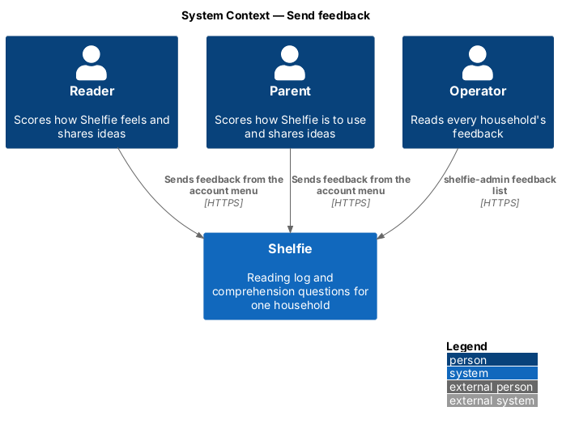
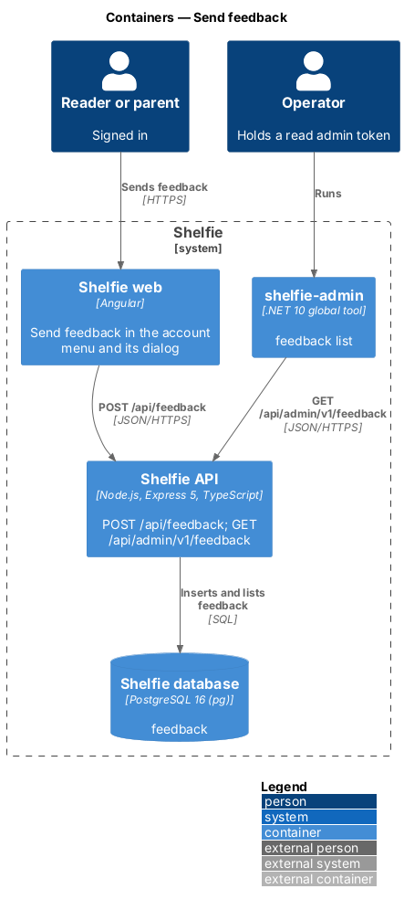
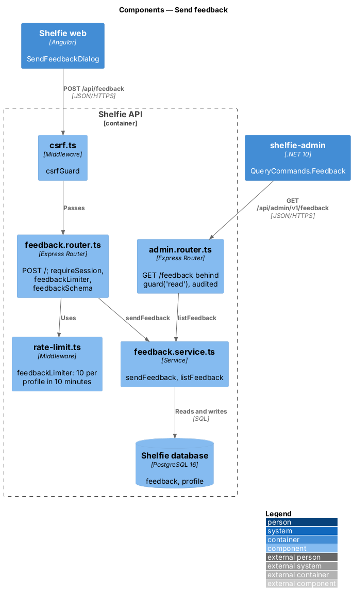
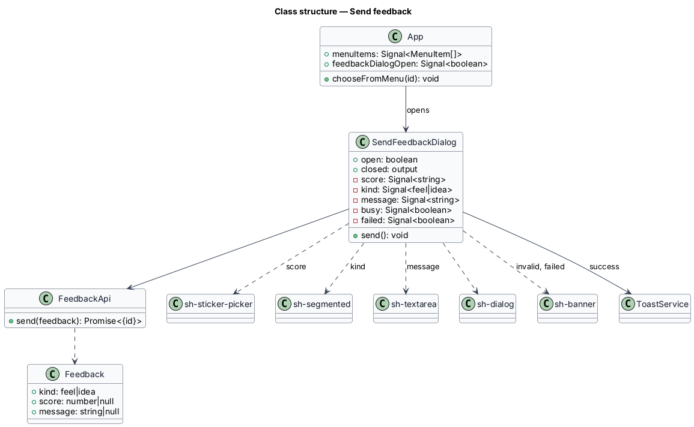
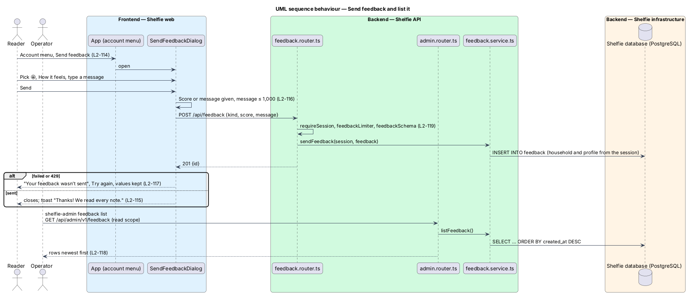

# Send feedback

## Overview

Shelfie is a web application that helps one child read books by logging each chapter she reads and answering short questions about it, while a parent in the same household reviews her answers and gives rewards. A **household** is the unit of tenancy: its parents and readers share one bookshelf.

This feature lets anyone signed in, a reader or a parent, tell us what they think without leaving Shelfie. "Send feedback" in the account menu opens a short dialog: a **score** from 1 to 5 as five faces, a **kind** ("How it feels" or "An idea") and an optional **message** of up to 1,000 characters. A score or a message is needed. Sent feedback is saved against the sender's household and profile, and a toast thanks them.

The operator reads feedback through the admin API and `shelfie-admin feedback list`, newest first. There is no screen inside Shelfie for reading it (ADR-0014).

The feature sits in the `shell` subsystem because it starts from the account menu, beside navigate-shell and notify. It touches the `shelfie` application (the menu item), the `settings` library (the dialog), the API and the admin CLI. No new component is added to `components`.

## Description

### Data

- **Migration `009-feedback.sql`** creates `feedback`: `id TEXT PRIMARY KEY`, `household_id TEXT NOT NULL REFERENCES household(id) ON DELETE CASCADE`, `profile_id TEXT NOT NULL REFERENCES profile(id) ON DELETE CASCADE`, `kind TEXT NOT NULL CHECK (kind IN ('feel', 'idea'))`, `score INTEGER CHECK (score BETWEEN 1 AND 5)`, `message TEXT CHECK (char_length(message) <= 1000)`, `created_at TEXT NOT NULL`, and `CHECK (score IS NOT NULL OR message IS NOT NULL)`. Timestamps are ISO-8601 like the rest of the schema. The household's erasure statement in `docs/runbook.md` removes it through the cascade (`L2-119`).

### API

- **`feedback.service.ts`** — `sendFeedback(db, session, { kind, score, message })` inserts one row with a random id, the session's `householdId` and `profileId`, and `created_at` now; `listFeedback(db)` returns every row newest first as `{ id, createdAt, householdId, role, kind, score, message }`, joining `profile` for the role only.
- **`feedback.router.ts`** — mounted at `/api/feedback` after `csrfGuard`; applies `requireSession` and then `feedbackLimiter`.
  - `POST /` validates `feedbackSchema` (`kind: z.enum(['feel', 'idea'])`, `score: z.number().int().min(1).max(5).nullable().optional()`, `message: z.string().trim().max(1000).optional()`, an empty message becoming none, and a refinement that a score or a message is given) and answers 201 `{ id }`. Any other field, such as `householdId`, is ignored.
  - A body that fails answers 400 `validation` through `validationProblem`; no session 401; no CSRF header 403.
- **`rate-limit.ts`** — `feedbackLimiter(db)`: at most 10 per profile in ten minutes, keyed `feedback:<profileId>`, through the same `rateLimiter` and table as the other limits; 429 `too-many-attempts` with `Retry-After`.
- **`admin.router.ts`** — `GET /feedback` behind `guard('read')`, answering `listFeedback(db)`, audited by `adminAudit` like every admin call. `apps/api/admin-api.yaml` documents it.
- **Logging** — `requestLogging` writes method, route pattern, status and duration only, so no message reaches the log.

### Frontend

- **`App`** (shelfie) — `menuItems` gains `{ id: 'feedback', label: 'Send feedback' }` before Sign out for both roles; choosing it sets `feedbackDialogOpen`, which renders `<sh-send-feedback-dialog>` beside the photo dialog.
- **`SendFeedbackDialog`** (settings) — `sh-dialog` "Send feedback" with an intro line; `sh-sticker-picker` for the score (five faces, values `"1"` to `"5"`, label "How does Shelfie feel?" for a reader and "How is Shelfie to use?" for a parent); `sh-segmented` for the kind (How it feels, chosen at first; An idea); `sh-textarea` for the message (label "Tell us more" or "Your message", "What would make Shelfie better?" for An idea; help "Up to 1,000 characters · N left"). The fields sit in a `fieldset` disabled while sending. Send checks first: no score and no message gives "Pick a face or write a message."; over 1,000 characters gives "Keep it to 1,000 characters (N too many)."; either shows an `sh-banner` `danger` "Fix N things" and sends nothing. While sending, Send is busy and Cancel is disabled; Escape does nothing. A network, server or 429 answer shows "Your feedback wasn’t sent" with Try again and keeps everything. On success it toasts `success` "Thanks! We read every note." and emits `closed`. Each opening starts empty.
- **`FeedbackApi`** (settings) — `send({ kind, score, message })` over `ApiClient`.
- **Page objects** — `e2e/pages/shell.page.ts` gains `openSendFeedback()`; `e2e/pages/send-feedback-dialog.page.ts` owns the dialog's fields, buttons, errors and banner.

### CLI

- **`QueryCommands.Feedback()`** — `shelfie-admin feedback list` prints `GET feedback` as a table with columns `DATE`, `HOUSEHOLD`, `ROLE`, `KIND`, `SCORE` and `MESSAGE`, or the API JSON with `--json`. It needs a token with the `read` scope.

### Error mapping

| Situation | API | Dialog |
|---|---|---|
| Neither score nor message | 400 `validation` | Field error and "Fix 1 thing"; nothing is sent |
| Message over 1,000 characters | 400 `validation` | Field error and "Fix 1 thing"; nothing is sent |
| Score not 1 to 5, kind unknown | 400 `validation` | Not reachable from the dialog |
| No session | 401 `no-session` | Global session handling (L2-003) |
| No CSRF header | 403 | Not reachable from the dialog |
| More than 10 in ten minutes | 429 `too-many-attempts` | "Your feedback wasn’t sent" with Try again; values kept |
| Network or server failure | status 0 or 5xx | "Your feedback wasn’t sent" with Try again; values kept |

## Requirements

The feature realizes the following level-2 (L2) requirements. Each refines a level-1 (L1) requirement, cited by identifier.

| L2 ID | Refines (L1) | Requirement |
|-------|--------------|-------------|
| `L2-114` | `L1-026` | Send feedback shall open from the account menu for both roles and close without saving. |
| `L2-115` | `L1-026` | A score of 1 to 5, a kind and a message shall be sent and saved, with a thank-you toast. |
| `L2-116` | `L1-026` | Feedback shall be validated in the dialog and by the API. |
| `L2-117` | `L1-026` | Sending shall be busy, and a failure shall keep everything and offer Try again. |
| `L2-118` | `L1-016`, `L1-026` | The operator shall list feedback newest first through the admin API and the CLI. |
| `L2-119` | `L1-026` | Feedback shall need a session and CSRF, be saved against the session's household, be rate limited, never be shown to a household and be erased with it. |

`L2-003`, `L2-023`, `L2-025`, `L2-026`, `L2-027` to `L2-029` and `L2-049` to `L2-055` are used unchanged.

## Decisions

- **Stored per household, read only by the operator.** Recorded in [ADR-0014](../../../adr/0014-feedback-is-read-only-by-the-operator.md).
- **The dialog lives in the `settings` library.** The application holds only the shell and composition, and `core` holds no dialogs. `settings` already owns the other dialog the account menu opens ("Your photo"), so the feedback dialog sits beside it rather than in a new library for one dialog.
- **The score is `sh-sticker-picker`, not a new `sh-score`.** The sticker picker is already a big, tappable radio group of emoji, each named for screen readers, with arrow-key movement and a field error; five faces with values `"1"` to `"5"` are just its options. `sh-segmented` was tried first, but its chips are small, text-only toggle buttons, not a radio group.
- **A score or a message is required; the kind always has a value.** "How it feels" is chosen at first, so the kind never blocks a young reader. One tap on a face is enough to send.
- **The message has no `maxlength`.** The count of characters left shows instead, so a pasted long message is kept and the invalid state can explain it, rather than being cut silently.
- **Ten per person in ten minutes.** Enough for anyone, and the same limiter and table as the other limits; keyed by profile because the sender is always signed in.

## Diagrams

### System context

Readers and parents send feedback; the operator reads it with the CLI.

### Containers

The Angular application posts to the API, which stores the feedback; the admin CLI reads it through the admin API.

### Components

`feedback.router.ts` checks the session, CSRF and rate limit and calls `feedback.service.ts`; `admin.router.ts` lists through the same service.

### Class structure

The application opens `SendFeedbackDialog`, which composes library components and sends through `FeedbackApi`.

### Behaviour — send feedback and list it

A reader sends feedback from the account menu; the operator lists it (`L2-114` to `L2-118`).

## Open questions

- **No close icon (resolved).** `sh-dialog` has no × button in any dialog, so this one closes with Escape and Cancel like the others; adding one to the library would change every dialog and is left out.
- **Deferred.** A screen inside Shelfie for reading, replying to, tagging or voting on feedback; e-mail or any notification when feedback arrives; screenshots or attachments; automatic prompts asking for a score; score charts or averages.
