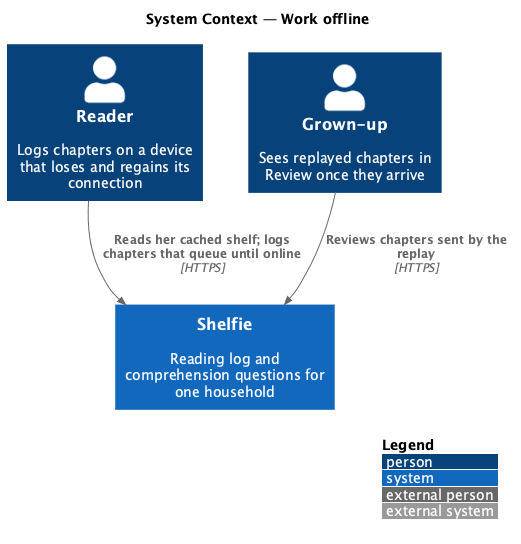
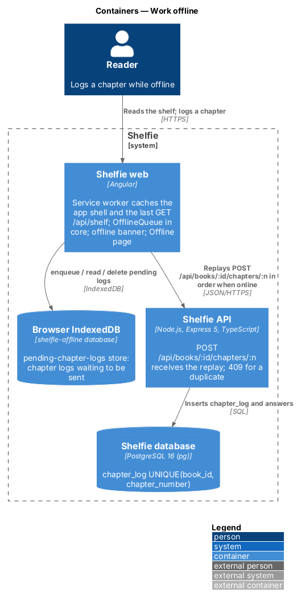
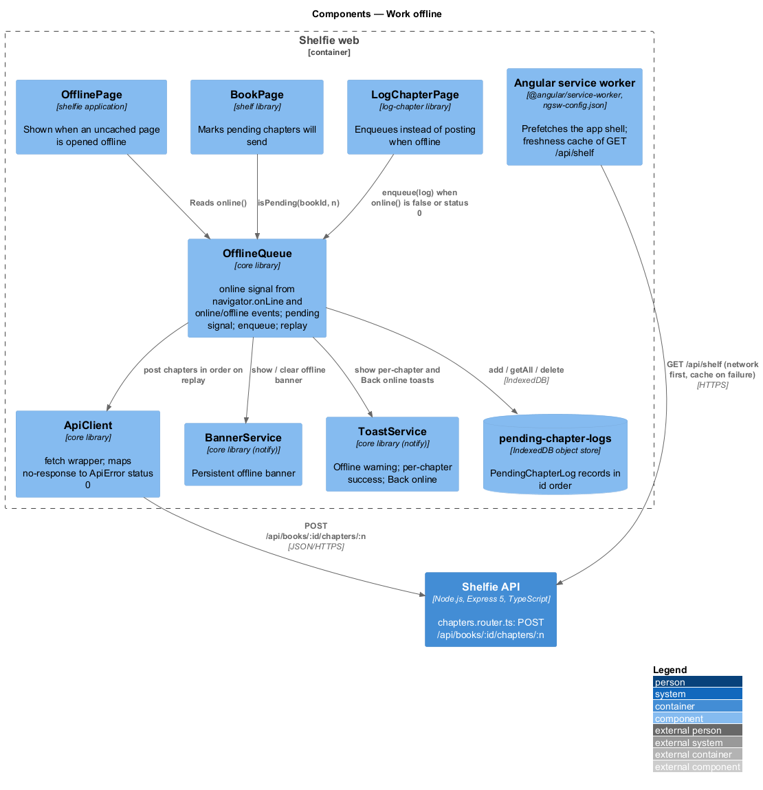
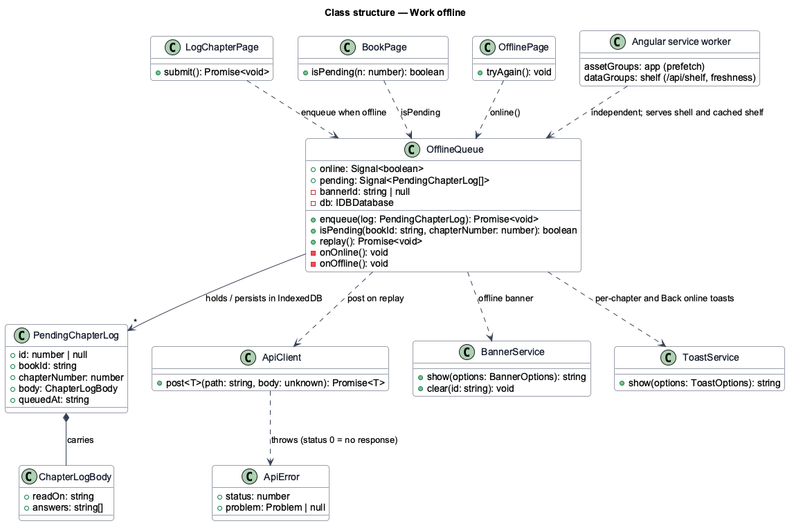
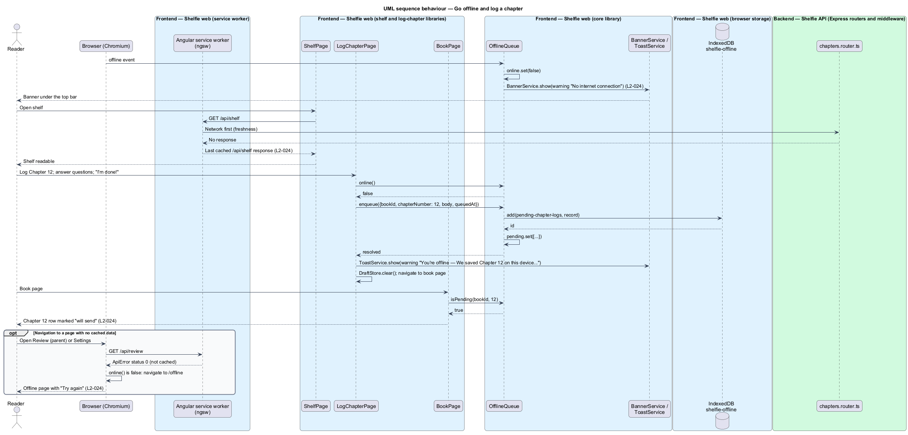
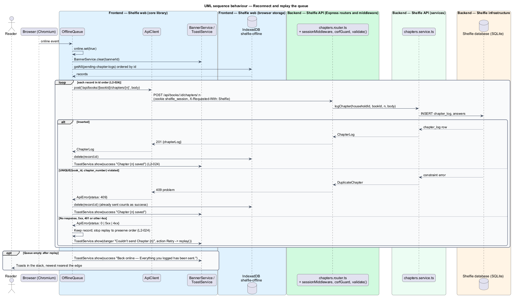

# Work offline

## Overview

Shelfie is a web application that helps one child read books by logging each chapter she reads and answering short questions about it, while a grown-up in the same household reviews her answers and gives rewards. The reader often reads where the connection is poor: a car, a bedroom at the edge of the Wi-Fi, a tablet with no SIM. Losing a chapter log because the network dropped would turn the one thing she is asked to do into a chore.

This feature keeps the application usable without a connection. **Offline** means the browser reports no network (`navigator.onLine` is false) or a request fails before a response arrives. While offline, three things hold. The **app shell** (the HTML, JavaScript, CSS and fonts of the Angular application) still loads, because a **service worker**, a script the browser runs beside the page, has cached it. The reader's shelf still shows, because the service worker also keeps the last successful shelf response. A chapter she logs is not lost: it is written to an **offline queue**, a store in the browser's IndexedDB, marked "will send" on the book page, and sent in order when the connection returns.

A persistent **banner** under the top bar tells her she is offline and that what she logs will be sent later. When the connection returns the banner clears, the queue replays, each sent chapter gets a toast, and a final toast says "Back online". A chapter the server refuses as a duplicate counts as sent, because it means an earlier attempt reached the server. A send that fails for any other reason stays in the queue for the next attempt. Opening a page whose data was never cached shows the **Offline page** instead of a broken screen.

The feature sits in the `shell` subsystem beside shell navigation (`navigate-shell`) and notifications (`notify`), whose banner and toast services it uses. Logging a chapter itself is owned by the `reading-log` subsystem's `log-chapter` feature; this feature adds the offline branch to that flow and the replay that completes it.

## Description

The slice is frontend-heavy: the service worker and the queue live in the browser, and the only backend call is the existing chapter endpoint replayed from the queue.

- **Angular service worker** — `@angular/service-worker` registered in the `shelfie` application (`provideServiceWorker('ngsw-worker.js', { enabled: !isDevMode(), registrationStrategy: 'registerWhenStable:30000' })`). `ngsw-config.json` declares one asset group, `app`, with `installMode: prefetch` for `index.html`, the build's JavaScript and CSS, the manifest and the fonts and icons under `assets/`, and one data group, `shelf`, matching `/api/shelf` with `strategy: 'freshness'`, `maxSize: 1`, `timeout: '3s'` and a `maxAge` of 7 days. Freshness means the worker tries the network first and falls back to the cached response when the request fails or times out, so `GET /api/shelf` answers from cache while offline (`L2-024`). No other API response is cached.
- **`OfflineQueue`** — service in the `core` library. It holds `online: Signal<boolean>`, seeded from `navigator.onLine` and updated by the `window` `online` and `offline` events, and `pending: Signal<PendingChapterLog[]>`, a mirror of the IndexedDB store. Methods: `enqueue(log: PendingChapterLog): Promise<void>` writes a record and updates `pending`; `isPending(bookId, chapterNumber): boolean`; `replay(): Promise<void>` sends the records in insertion order (described below). The service opens the IndexedDB database `shelfie-offline`, version 1, with one object store `pending-chapter-logs` keyed by an auto-increment `id` and an index on `[bookId, chapterNumber]`. The design uses the raw IndexedDB API wrapped in promises; no `idb` package is added.
- **`PendingChapterLog`** — type `{ id?: number; bookId: string; chapterNumber: number; body: ChapterLogBody; queuedAt: string }`. `ChapterLogBody` is the request body of `POST /api/books/:id/chapters/:n` as defined by `log-chapter` (`readOn`, `answers[]`).
- **Offline banner** — on construction and on every `offline` event, `OfflineQueue` calls `BannerService.show({ severity: 'warning', title: 'No internet connection', message: 'Showing what we saved earlier. Anything you log is sent when you're back.', dismissible: false })` and keeps the `id`; on `online` it calls `BannerService.clear(id)`. The banner is the `warning` variant of the banner mocks and appears on every page while offline.
- **Logging while offline** — `LogChapterPage` (in the `log-chapter` library) submits through `ChaptersApi.logChapter()`. When `OfflineQueue.online()` is false, or the call throws `ApiError` with `status: 0` (the `ApiClient` mapping for a `fetch` that produced no response), the page calls `OfflineQueue.enqueue({ bookId, chapterNumber, body, queuedAt })` instead of showing the failure, shows the warning toast "You're offline — We saved Chapter N on this device and will send it when you're back online." through `ToastService`, clears the `DraftStore` draft and navigates to the book page. The chapter row for a pending log is rendered by `BookPage` (in the `shelf` library) with the "will send" state (`sh-chapter-row` input `pending: true`) when `OfflineQueue.isPending(bookId, n)` is true. Undo is not offered for a queued log; the record can be removed only by a successful send.
- **Replay** — on each `online` event and once at start-up when `online()` is true and `pending()` is not empty, `OfflineQueue.replay()` takes the records in `id` order and for each calls `ApiClient.post('/api/books/${bookId}/chapters/${chapterNumber}', body)`. A 2xx response, or a 409 problem (the chapter was already logged by an earlier attempt that reached the server), deletes the record and shows a success toast "Chapter N saved". Any other outcome (`ApiError` with status 0, 5xx, or a 4xx other than 409) leaves the record in place, stops the replay so order is kept, and waits for the next `online` event or start-up; the toast for that case is a `danger` "Couldn't send Chapter N" with action Retry that calls `replay()` again. When the queue empties the service shows the success toast "Back online — Everything you logged has been sent." A record the server rejects with a 400 on three attempts is dropped from the queue; its answers stay in `DraftStore` and a danger toast says so.
- **Backend** — no change. `POST /api/books/:id/chapters/:n` in `chapters.router.ts` is owned by `log-chapter`; its `UNIQUE(book_id, chapter_number)` constraint is what makes the 409 a safe success signal. The request carries the session cookie and the `X-Requested-With: Shelfie` header through `ApiClient`, so an expired session during replay yields a 401, which is treated as a non-409 failure and keeps the record for after sign-in.
- **`OfflinePage`** — page component in the `shelfie` application at route `/offline`, matching `docs/mocks/pages/offline/default.html`: the offline banner, a 📡 glyph, the heading "You're offline", the text "Shelfie will reconnect by itself. Anything you log while offline is kept on this device and sent when you're back.", and a "Try again" `sh-button` that navigates back to the page that redirected. A page whose load request fails with `ApiError{status: 0}` while `OfflineQueue.online()` is false navigates to `/offline` with the attempted URL in navigation state; the shelf never does, because its data answers from the service-worker cache.
- **Acceptance tests** — Playwright, Chromium only, through `e2e/pages/BookPage`, `e2e/pages/LogChapterPage` and `e2e/pages/OfflinePage`, using `context.setOffline(true)` and `page.route()` to simulate the drop and the 409. Tests cover: offline banner appears and the cached shelf renders; a chapter logged offline shows "will send"; reconnecting replays in order with one toast per chapter and the "Back online" toast; a failed send stays queued; a 409 is treated as sent; navigation to an uncached page shows the Offline page.

The mocks' banner note says the offline banner "becomes the 'Back online' toast" when the connection returns; the design clears the banner on `online` and shows that toast when the replay has emptied the queue, so a reader with no queued chapters sees it at once.

## Requirements

The feature realizes the following level-2 (L2) requirement. It refines a level-1 (L1) requirement, cited by identifier.

| L2 ID | Refines (L1) | Requirement |
|-------|--------------|-------------|
| `L2-024` | `L1-010` | Offline behaviour. When the device goes offline, an offline banner shall be shown and the previously loaded shelf shall remain readable; a chapter logged offline shall be stored on the device and marked "will send"; when connectivity returns, queued chapters shall be sent in order and a toast shall confirm each, and a failed send shall remain queued; an offline navigation to an unloaded page shall show the Offline page. |

## Diagrams

### System context

The reader logs chapters on a device that loses and regains its connection; the grown-up sees the replayed chapters in Review once they arrive.

### Containers

The Angular application and its service worker keep the shell and the last shelf response; the browser's IndexedDB holds the queue; the API receives the replay.

### Components

`OfflineQueue` in `core` watches connectivity, owns the IndexedDB store and the replay, and drives the banner and toasts; `LogChapterPage` and `BookPage` branch on it; the service worker serves the shell and the cached shelf.

### Class structure

`OfflineQueue` holds `PendingChapterLog` records and depends on `ApiClient`, `BannerService` and `ToastService`; `LogChapterPage`, `BookPage` and `OfflinePage` read it.

### Behaviour — go offline and log a chapter

The connection drops, the banner appears, the shelf answers from the service-worker cache, and a chapter log is queued and shown as "will send" (`L2-024`).

### Behaviour — reconnect and replay the queue

The `online` event clears the banner and replays the queue in order; a 2xx or 409 removes the record and shows a toast, a failure keeps it queued and stops the replay (`L2-024`).

